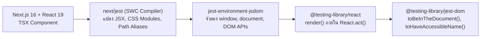

## 1. แนวคิด (Concept)
ปรัชญาแกนหลักของ **React Testing Library (RTL)** ที่สร้างโดย Kent C. Dodds คือประโยคอมตะที่ว่า:

> **"The more your tests resemble the way your software is used, the more confidence they can give you."**  
> *(ยิ่งชุดทดสอบของคุณใกล้เคียงกับวิธีที่ผู้ใช้งานจริงใช้ซอฟต์แวร์มากเท่าไหร่ มันก็ยิ่งมอบความมั่นใจให้คุณได้มากเท่านั้น)*

ในอดีต เครื่องมือยุคเก่าอย่าง Enzyme ส่งเสริมให้เราทดสอบ **Implementation Details** เช่น การตรวจว่า `component.state('isAgingModalOpen')` เป็น `true` หรือไม่ ส่งผลให้เมื่อนักพัฒนาเพียงแค่เปลี่ยนชื่อตัวแปร `useState` หรือย้ายสถานะไปไว้ใน Context เทสต์ก็พังทันทีทั้งที่หน้าจอและฟังก์ชันทุกอย่างยังทำงานเหมือนเดิม

React Testing Library แก้ปัญหานี้โดยบังคับให้เราปฏิสัมพันธ์กับ Component ผ่าน **Rendered DOM Nodes** เท่านั้น ผู้ใช้จริงไม่รู้จัก `useState` หรือ `props` แต่ผู้ใช้มองเห็นปุ่มที่มีข้อความว่า *"เพิ่ม Miyazaki A5 ลงตะกร้า"* และเห็นยอดเงินรวมที่เปลี่ยนไปบนหน้าจอ

## 2. หลักการเบื้องหลัง (Under the Hood)
ในการรันชุดทดสอบของ [Next.js 16](/docs/nextjs) และ [React 19](/docs/react) บน Node.js ซึ่งไม่มีเบราว์เซอร์จริง ระบบจะทำงานผ่านสถาปัตยกรรมดังนี้:



1. **`next/jest` (SWC Transformation):** แพ็กเกจ `next/jest` จะโหลดการตั้งค่าจาก `next.config.ts` และใช้ Rust-based SWC Compiler แปลงไฟล์ `.tsx` ด้วยความเร็วสูง พร้อมจัดการ Mock ไฟล์รูปภาพ (`next/image`), ฟอนต์ (`next/font`), CSS Modules และอ่าน Path Aliases (`@/*`) จาก `tsconfig.json` ให้อัตโนมัติ
2. **`jest-environment-jsdom`:** จำลอง Web Standards API (เช่น `document.createElement`, `window.location`, Event Bubbling) บนหน่วยความจำของ Node.js
3. **React 19 `act()` Wrapper:** เมื่อเรียก `render(<Component />)` ตัว `@testing-library/react` (เวอร์ชัน 16+ ที่รองรับ React 19) จะห่อหุ้มการเรนเดอร์และการอัปเดต State ไว้ใน `React.act()` เพื่อให้มั่นใจว่า Effects และ DOM Mutations ทั้งหมดถูกประมวลผลเสร็จสิ้นก่อนส่งต่อไปยังบรรทัด Assertion

## 3. ตัวอย่างโค้ด (Smart Butcher Marketplace)

### ตัวอย่างที่ 1 (พื้นฐาน): การตั้งค่า `jest.config.ts` และ `jest.setup.ts` สำหรับ Next.js 16 + React 19
การตั้งค่ามาตรฐานระดับ Production ที่รวมการจำลอง `next/navigation` และ `@testing-library/jest-dom`:

```typescript filename="jest.config.ts"
import type { Config } from 'jest';
import nextJest from 'next/jest.js';

const createJestConfig = nextJest({
  // ชี้ไปยังโฟลเดอร์หลักของโปรเจกต์ Next.js 16 เพื่อโหลด next.config.ts และ .env
  dir: './',
});

const config: Config = {
  coverageProvider: 'v8',
  testEnvironment: 'jsdom',
  setupFilesAfterEnv: ['<rootDir>/jest.setup.ts'],
  moduleNameMapper: {
    '^@/(.*)$': '<rootDir>/src/$1',
  },
  clearMocks: true,
};

export default createJestConfig(config);
```

```typescript filename="jest.setup.ts"
import '@testing-library/jest-dom';

// จำลอง next/navigation พื้นฐานสำหรับ App Router ใน Next.js 16
jest.mock('next/navigation', () => ({
  useRouter: () => ({
    push: jest.fn(),
    replace: jest.fn(),
    prefetch: jest.fn(),
    back: jest.fn(),
  }),
  usePathname: () => '/catalog/wagyu',
  useSearchParams: () => new URLSearchParams(),
}));
```

### ตัวอย่างที่ 2 (ขั้นสูง): การสร้าง Custom Render Utility พร้อม Providers และการทดสอบ `WagyuCutCard`
ในระบบจริง Component มักต้องการ Context Providers (เช่น Theme, Currency หรือ Butcher Cart Context) เราจึงสร้าง `renderWithButcherProviders` และนำไปทดสอบการ์ดแสดงสินค้าเนื้อวากิว:

```tsx filename="src/components/catalog/WagyuCutCard.spec.tsx"
import React, { createContext, useContext, ReactNode } from 'react';
import { render, screen, RenderOptions } from '@testing-library/react';

export interface Product {
  id: string;
  sku: string;
  name: string;
  categoryName: string;
  pricePerKg: number;
  stockKg: number;
  bmsScore: number;
}

interface CurrencyContextValue {
  currencySymbol: string;
  vatRate: number;
}

const CurrencyContext = createContext<CurrencyContextValue>({
  currencySymbol: '฿',
  vatRate: 0.07,
});

export function WagyuCutCard({ product }: { product: Product }) {
  const { currencySymbol, vatRate } = useContext(CurrencyContext);
  const grossPricePerKg = Math.round(product.pricePerKg * (1 + vatRate));
  const isOutOfStock = product.stockKg <= 0;

  return (
    <article aria-label={`Product card for ${product.name}`}>
      <h3>{product.name}</h3>
      <p>Category: {product.categoryName}</p>
      <p>Marbling Grade: BMS {product.bmsScore}</p>
      <p data-testid="gross-price">
        {currencySymbol}
        {grossPricePerKg.toLocaleString()} / kg (incl. VAT)
      </p>
      <button type="button" disabled={isOutOfStock}>
        {isOutOfStock ? 'Sold Out in Aging Vault' : 'Select Cut Weight'}
      </button>
    </article>
  );
}

// Custom Render ที่ห่อหุ้ม Providers ของระบบ Smart Butcher
function renderWithButcherProviders(
  ui: React.ReactElement,
  options?: Omit<RenderOptions, 'wrapper'>,
) {
  function AllProviders({ children }: { children: ReactNode }) {
    return (
      <CurrencyContext.Provider value={{ currencySymbol: '฿', vatRate: 0.07 }}>
        {children}
      </CurrencyContext.Provider>
    );
  }
  return render(ui, { wrapper: AllProviders, ...options });
}

describe('WagyuCutCard Component', () => {
  const sampleMiyazakiProduct: Product = {
    id: 'prod-miyazaki-01',
    sku: 'WAGYU-MIYAZAKI-A5',
    name: 'Miyazaki A5 Striploin',
    categoryName: 'Japanese Wagyu',
    pricePerKg: 5000,
    stockKg: 4.5,
    bmsScore: 11,
  };

  it('should render wagyu product details and VAT-inclusive price per kg', () => {
    renderWithButcherProviders(<WagyuCutCard product={sampleMiyazakiProduct} />);

    expect(
      screen.getByRole('heading', { name: 'Miyazaki A5 Striploin' }),
    ).toBeInTheDocument();
    expect(screen.getByText('Marbling Grade: BMS 11')).toBeInTheDocument();
    // 5000 * 1.07 = 5,350
    expect(screen.getByTestId('gross-price')).toHaveTextContent('฿5,350 / kg (incl. VAT)');
    expect(
      screen.getByRole('button', { name: 'Select Cut Weight' }),
    ).toBeEnabled();
  });

  it('should disable action button and display Sold Out text when stockKg is zero', () => {
    renderWithButcherProviders(
      <WagyuCutCard product={{ ...sampleMiyazakiProduct, stockKg: 0 }} />,
    );

    const button = screen.getByRole('button', { name: 'Sold Out in Aging Vault' });
    expect(button).toBeDisabled();
  });
});
```

## 4. ผิด vs ถูก (Anti-pattern vs Best Practice)

| มิติการเปรียบเทียบ | ❌ ผิด (Anti-pattern) | ✅ ถูก (Best Practice) |
| :--- | :--- | :--- |
| **การตรวจสอบ DOM** | ใช้ `const { container } = render(...); expect(container.querySelector('.btn-primary')).toBeTruthy()` ซึ่งผูกติดกับ CSS Class | ใช้ `screen.getByRole('button', { name: '...' })` และ Matchers จาก `@testing-library/jest-dom` เช่น `toBeInTheDocument()` |
| **การตั้งค่า Babel ซ้อนใน Next.js** | ติดตั้ง `.babelrc` เองโดยไม่จำเป็น ทำให้ไปปิดการทำงานของ Rust SWC Compiler ใน `next/jest` จนรันเทสต์ช้า | ใช้ `next/jest` เพียงอย่างเดียวเพื่อให้ SWC จัดการการแปลงโค้ด TypeScript และ JSX ด้วยความเร็วสูงสุด |

## 5. ควรใช้เมื่อไหร่ และ ไม่ควรใช้เมื่อไหร่
- **ควรใช้เมื่อ:** ทดสอบ Interactive Client Components, การแสดงผลตามเงื่อนไข (Conditional Rendering), ฟอร์มรับข้อมูล และความถูกต้องด้าน Accessibility ของ UI
- **ไม่ควรใช้เมื่อ:** ต้องการตรวจสอบความสวยงามทางสายตาของ CSS Layout, Animation หรือ Responsive Breakpoints (เนื่องจาก JSDOM ไม่มี Layout Engine และไม่คำนวณ Pixel จริง ต้องใช้ Playwright Visual Regression แทน)

## 6. คำถามสัมภาษณ์ (Interview Q&A)
- **Q1: เหตุใดสภาพแวดล้อม `jsdom` ใน Jest จึงไม่สามารถทดสอบ `window.matchMedia` หรือ `IntersectionObserver` ได้ทันทีหากไม่เขียน Mock เพิ่ม?**
  - *แนวคำตอบ:* เพราะ `jsdom` เป็นเพียงการจำลองโครงสร้าง DOM Tree และ HTML Spec บน Node.js แต่ไม่มีเครื่องยนต์เรนเดอร์ภาพ (Layout & Rendering Engine) เหมือน Blink หรือ WebKit ทำให้ไม่มีแนวคิดเรื่องขนาดหน้าจอจริง (Viewport Dimension) หรือตำแหน่งการเลื่อนหน้าจอ (Scroll Intersection) ดังนั้น API ที่พึ่งพามิติทางกายภาพของหน้าจอจึงไม่ได้ถูกสร้างไว้ใน `jsdom` และต้องกำหนด Mock Implementation ในไฟล์ `jest.setup.ts`
- **Q2: ทำไม React Testing Library จึงแนะนำให้ใช้ `screen.getByRole(...)` แทนการ Destructure `const { getByRole } = render(<Comp />)`?**
  - *แนวคำตอบ:* การใช้ `screen` ช่วยให้เราไม่ต้องคอยแก้รายการ Destructure ทุกครั้งที่เพิ่มหรือเปลี่ยนชนิด Query ในเทสต์ และ `screen` จะชี้ไปยัง `document.body` ปัจจุบันเสมอ รวมถึงมีเมธอดช่วยเหลือในการดีบักอย่าง `screen.debug()` และ `screen.logTestingPlaygroundURL()` ที่เรียกใช้ได้ทันที

---
