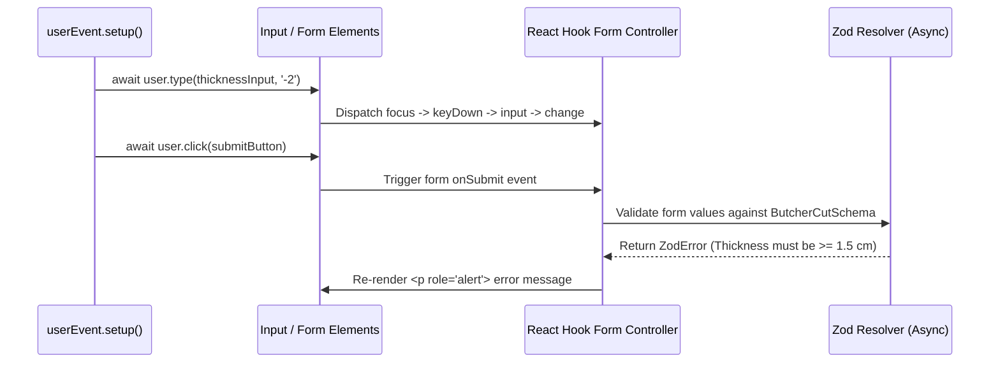

## 1. แนวคิด (Concept)
ในการจำลองเหตุการณ์ของผู้ใช้ นักพัฒนาจำนวนมากมักสับสนระหว่าง `fireEvent` (ที่ติดมากับ `@testing-library/react`) กับไลบรารี **`@testing-library/user-event` (v14+)**
- **`fireEvent.click(input)`:** เป็นเพียงการสร้าง DOM Event สังเคราะห์ (`new MouseEvent('click')`) แล้วยิงตรงไปยัง Element นั้นตัวเดียวโดยไม่สนใจว่าผู้ใช้จริงทำแบบนั้นได้หรือไม่ (เช่น ยิง `fireEvent.change` ใส่ `<input disabled />` ก็ยังทำงานได้)
- **`await user.click(input)` (`user-event`):** จำลองลำดับพฤติกรรมทั้งหมดที่เกิดขึ้นในเบราว์เซอร์จริง เช่น เมื่อสั่ง `await user.type(input, '3.5')` มันจะทำการเลื่อนเมาส์ (`pointerOver`, `pointerMove`), คลิกเพื่อโฟกัส (`pointerDown`, `focus`, `pointerUp`, `click`), และกดคีย์บอร์ดทีละตัวอักษร (`keyDown`, `keyPress`, `input`, `keyUp`) พร้อมตรวจสอบว่าช่องกรอกนั้นไม่ได้ถูก `disabled` หรือซ่อนอยู่

คุณสมบัตินี้สำคัญอย่างยิ่งในการทดสอบฟอร์มที่ใช้ **[React Hook Form + Zod](/docs/react-hook-form-zod)** เพราะ React Hook Form พึ่งพาเหตุการณ์ `focus`, `blur`, `input` และ `submit` แบบ Asynchronous ในการประมวลผล Zod Schema Validation

## 2. หลักการเบื้องหลัง (Under the Hood)


ใน `@testing-library/user-event` เวอร์ชัน 14 ทุกเมธอดทำงานแบบ Asynchronous (`Promise`) ดังนั้นเราจึงต้องสร้างอินสแตนซ์ด้วย **`const user = userEvent.setup()`** ก่อนการเรียก `render()` และต้องใส่ **`await`** หน้าทุกคำสั่ง (`await user.type()`, `await user.click()`, `await user.selectOptions()`) เสมอ

## 3. ตัวอย่างโค้ด (Smart Butcher Marketplace)

### ตัวอย่างที่ 1 (พื้นฐาน): การใช้ `userEvent.setup()` ทดสอบตัวเลือกความหนาสเต็กและระดับความสุก
ตัวอย่างการทดสอบ Interactive Component ด้วย `user.selectOptions` และ `user.click` เพื่อตรวจสอบการคำนวณน้ำหนักเนื้อตามความหนาที่ลูกค้าเลือก:

```tsx filename="src/components/butcher/SteakCutSelector.spec.tsx"
import React, { useState } from 'react';
import { render, screen } from '@testing-library/react';
import userEvent from '@testing-library/user-event';

export type CutStyle = 'RIBEYE' | 'T_BONE';

export function SteakCutSelector({
  onConfirmCut,
}: {
  onConfirmCut: (payload: { cutStyle: CutStyle; vacuumSealed: boolean }) => void;
}) {
  const [cutStyle, setCutStyle] = useState<CutStyle>('RIBEYE');
  const [vacuumSealed, setVacuumSealed] = useState<boolean>(false);

  return (
    <div>
      <label htmlFor="cut-style-select">Select Butcher Cut Style</label>
      <select
        id="cut-style-select"
        value={cutStyle}
        onChange={(e) => setCutStyle(e.target.value as CutStyle)}
      >
        <option value="RIBEYE">Ribeye Boneless (350g)</option>
        <option value="T_BONE">Dry-Aged T-Bone (650g)</option>
      </select>

      <label>
        <input
          type="checkbox"
          checked={vacuumSealed}
          onChange={(e) => setVacuumSealed(e.target.checked)}
        />
        Add Medical-Grade Vacuum Sealing
      </label>

      <button
        type="button"
        onClick={() => onConfirmCut({ cutStyle, vacuumSealed })}
      >
        Confirm Butcher Specification
      </button>
    </div>
  );
}

describe('SteakCutSelector User Interaction with user-event', () => {
  it('should allow customer to change cut style, toggle vacuum sealing checkbox, and submit selection', async () => {
    const user = userEvent.setup();
    const handleConfirm = jest.fn();

    render(<SteakCutSelector onConfirmCut={handleConfirm} />);

    const selectElement = screen.getByLabelText('Select Butcher Cut Style');
    const checkboxElement = screen.getByRole('checkbox', {
      name: 'Add Medical-Grade Vacuum Sealing',
    });
    const confirmButton = screen.getByRole('button', {
      name: 'Confirm Butcher Specification',
    });

    // เปลี่ยนตัวเลือกเป็น T_BONE และติ๊กถูกที่ช่อง Vacuum Sealing
    await user.selectOptions(selectElement, 'T_BONE');
    await user.click(checkboxElement);
    await user.click(confirmButton);

    expect(checkboxElement).toBeChecked();
    expect(handleConfirm).toHaveBeenCalledTimes(1);
    expect(handleConfirm).toHaveBeenCalledWith({
      cutStyle: 'T_BONE',
      vacuumSealed: true,
    });
  });
});
```

### ตัวอย่างที่ 2 (ขั้นสูง): การทดสอบฟอร์มสั่งแล่เนื้อพิเศษที่ใช้ React Hook Form + Zod Schema
ตัวอย่างการทดสอบฟอร์มที่มีกฎตรวจสอบความหนาของสเต็ก (1.5 - 6.0 ซม.) และน้ำหนักสั่งซื้อขั้นต่ำ พร้อมทดสอบทั้งกรณีกรอกข้อมูลผิดพลาด (แสดงข้อความแจ้งเตือนจาก Zod) และกรณีกรอกข้อมูลถูกต้อง:

```tsx filename="src/components/forms/CustomButcherOrderForm.spec.tsx"
import React from 'react';
import { render, screen } from '@testing-library/react';
import userEvent from '@testing-library/user-event';
import { useForm } from 'react-hook-form';
import { z } from 'zod';
import { zodResolver } from '@hookform/resolvers/zod';

export const customButcherOrderSchema = z.object({
  customerName: z.string().min(3, 'Customer name must be at least 3 characters'),
  thicknessCm: z
    .number({ invalid_type_error: 'Thickness is required' })
    .min(1.5, 'Steak thickness must be at least 1.5 cm for proper searing')
    .max(6.0, 'Steak thickness cannot exceed 6.0 cm'),
  weightKg: z
    .number({ invalid_type_error: 'Weight is required' })
    .min(0.3, 'Minimum order weight for A5 Wagyu is 0.3 kg'),
  butcherNotes: z.string().optional(),
});

export type CustomButcherOrderFormValues = z.infer<typeof customButcherOrderSchema>;

export function CustomButcherOrderForm({
  onSubmitOrder,
}: {
  onSubmitOrder: (values: CustomButcherOrderFormValues) => Promise<void> | void;
}) {
  const {
    register,
    handleSubmit,
    formState: { errors, isSubmitting },
  } = useForm<CustomButcherOrderFormValues>({
    resolver: zodResolver(customButcherOrderSchema),
    defaultValues: {
      customerName: '',
      thicknessCm: 2.5,
      weightKg: 0.5,
      butcherNotes: '',
    },
  });

  return (
    <form onSubmit={handleSubmit((data) => onSubmitOrder(data))} noValidate>
      <div>
        <label htmlFor="customerName">Recipient Full Name</label>
        <input id="customerName" type="text" {...register('customerName')} />
        {errors.customerName && <p role="alert">{errors.customerName.message}</p>}
      </div>

      <div>
        <label htmlFor="thicknessCm">Cut Thickness (cm)</label>
        <input
          id="thicknessCm"
          type="number"
          step="0.5"
          {...register('thicknessCm', { valueAsNumber: true })}
        />
        {errors.thicknessCm && <p role="alert">{errors.thicknessCm.message}</p>}
      </div>

      <div>
        <label htmlFor="weightKg">Target Weight (kg)</label>
        <input
          id="weightKg"
          type="number"
          step="0.1"
          {...register('weightKg', { valueAsNumber: true })}
        />
        {errors.weightKg && <p role="alert">{errors.weightKg.message}</p>}
      </div>

      <button type="submit" disabled={isSubmitting}>
        Submit Custom Cut Order
      </button>
    </form>
  );
}

describe('CustomButcherOrderForm (React Hook Form + Zod)', () => {
  it('should display Zod validation alerts and block submission when thickness is below 1.5 cm', async () => {
    const user = userEvent.setup();
    const mockSubmit = jest.fn();

    render(<CustomButcherOrderForm onSubmitOrder={mockSubmit} />);

    const nameInput = screen.getByLabelText('Recipient Full Name');
    const thicknessInput = screen.getByLabelText('Cut Thickness (cm)');
    const submitButton = screen.getByRole('button', { name: 'Submit Custom Cut Order' });

    await user.type(nameInput, 'Al'); // สั้นเกินไป (น้อยกว่า 3 ตัวอักษร)
    await user.clear(thicknessInput);
    await user.type(thicknessInput, '0.8'); // บางเกินไป (ต่ำกว่า 1.5 ซม.)
    await user.click(submitButton);

    // ต้องรอด้วย findAllByRole เนื่องจาก React Hook Form ตรวจสอบ Zod แบบ Asynchronous
    const alerts = await screen.findAllByRole('alert');
    expect(alerts).toHaveLength(2);
    expect(
      screen.getByText('Customer name must be at least 3 characters'),
    ).toBeInTheDocument();
    expect(
      screen.getByText('Steak thickness must be at least 1.5 cm for proper searing'),
    ).toBeInTheDocument();
    expect(mockSubmit).not.toHaveBeenCalled();
  });

  it('should call onSubmitOrder with parsed numeric values when all fields satisfy Zod schema', async () => {
    const user = userEvent.setup();
    const mockSubmit = jest.fn();

    render(<CustomButcherOrderForm onSubmitOrder={mockSubmit} />);

    const nameInput = screen.getByLabelText('Recipient Full Name');
    const thicknessInput = screen.getByLabelText('Cut Thickness (cm)');
    const weightInput = screen.getByLabelText('Target Weight (kg)');
    const submitButton = screen.getByRole('button', { name: 'Submit Custom Cut Order' });

    await user.type(nameInput, 'Chef Somchai');
    await user.clear(thicknessInput);
    await user.type(thicknessInput, '3.5');
    await user.clear(weightInput);
    await user.type(weightInput, '1.2');
    await user.click(submitButton);

    // รอให้การส่งฟอร์มเสร็จสมบูรณ์และตรวจสอบข้อมูลที่ได้จากการแปลงชนิดตัวเลขของ Zod
    expect(mockSubmit).toHaveBeenCalledTimes(1);
    expect(mockSubmit).toHaveBeenCalledWith({
      customerName: 'Chef Somchai',
      thicknessCm: 3.5,
      weightKg: 1.2,
      butcherNotes: '',
    });
  });
});
```

## 4. ผิด vs ถูก (Anti-pattern vs Best Practice)

| มิติการเปรียบเทียบ | ❌ ผิด (Anti-pattern) | ✅ ถูก (Best Practice) |
| :--- | :--- | :--- |
| **การจำลองการพิมพ์ข้อความ** | ใช้ `fireEvent.change(input, { target: { value: '3.5' } })` ซึ่งข้ามการเกิด `focus`, `keyDown` และไม่ตรวจว่าช่องถูก `disabled` อยู่หรือไม่ | ใช้ `const user = userEvent.setup()` ร่วมกับ `await user.clear(input)` และ `await user.type(input, '3.5')` |
| **การตรวจผลลัพธ์ของ React Hook Form** | ใช้ `screen.getByRole('alert')` ทันทีหลังคลิกปุ่ม Submit จนเทสต์พังเพราะ Zod Resolver ยังทำงานไม่เสร็จ | ใช้ `await screen.findByRole('alert')` หรือ `await waitFor(...)` เพื่อรอให้ Async Form Validation ของ RHF อัปเดต State เสร็จสิ้น |

## 5. ควรใช้เมื่อไหร่ และ ไม่ควรใช้เมื่อไหร่
- **ควรใช้ `userEvent` เมื่อ:** ทดสอบทุกการกระทำของผู้ใช้บนหน้าเว็บ เช่น การคลิกปุ่ม การพิมพ์ข้อความ การกดปุ่ม `Tab` เปลี่ยนโฟกัส หรือการกด `Enter` ส่งฟอร์ม
- **ไม่ควรใช้ `userEvent` เมื่อ:** ต้องการจำลองเหตุการณ์ระดับ Browser/Window พิเศษที่ `user-event` ไม่ได้รองรับโดยตรง เช่น `fireEvent.scroll(window)` หรือ Custom Touch/Drag Events เฉพาะทาง ซึ่งกรณีนั้นสามารถใช้ `fireEvent` เสริมได้

## 6. คำถามสัมภาษณ์ (Interview Q&A)
- **Q1: ในการทดสอบ React Hook Form ทำไมในฟังก์ชัน `<form onSubmit={handleSubmit((data) => onSubmitOrder(data))}>` เราจึงไม่ควรเขียนย่อเป็น `handleSubmit(onSubmitOrder)` เวลาตรวจ `expect(onSubmitOrder).toHaveBeenCalledWith(expectedData)`?**
  - *แนวคำตอบ:* เพราะ `handleSubmit` ของ React Hook Form จะส่งอาร์กิวเมนต์ 2 ตัวให้กับ Callback คือ `(data, event)` (ข้อมูลที่ผ่านการ Validate แล้ว และ SyntheticBaseEvent ของฟอร์ม) หากเราส่ง `mockSubmit` เข้าไปตรงๆ เวลาเขียน `expect(mockSubmit).toHaveBeenCalledWith(expectedData)` เทสต์จะล้มเหลวเพราะอาร์กิวเมนต์ตัวที่สองเป็น Event Object การห่อด้วย `(data) => onSubmitOrder(data)` หรือตรวจด้วย `expect(mockSubmit).toHaveBeenCalledWith(expectedData, expect.anything())` จึงเป็นแนวทางที่แม่นยำกว่า
- **Q2: ทำไมการเปลี่ยนค่าใน `<input type="number" defaultValue={2.5} />` ด้วย `await user.type(input, '3.5')` โดยไม่เรียก `await user.clear(input)` ก่อนจึงทำให้ได้ค่าผิดพลาด?**
  - *แนวคำตอบ:* เพราะ `user.type()` จำลองพฤติกรรมของผู้ใช้จริงที่คลิกวางเคอร์เซอร์ต่อท้ายข้อความเดิมแล้วพิมพ์ต่อ ดังนั้นหากมีค่าเริ่มต้น `2.5` อยู่แล้วและพิมพ์ `3.5` ต่อท้าย ค่าในช่องจะกลายเป็น `'2.53.5'` หรือ `'2.535'` จึงต้องสั่ง `await user.clear(input)` เพื่อลบค่าเริ่มต้นออกก่อนพิมพ์ค่าใหม่เสมอ

---
