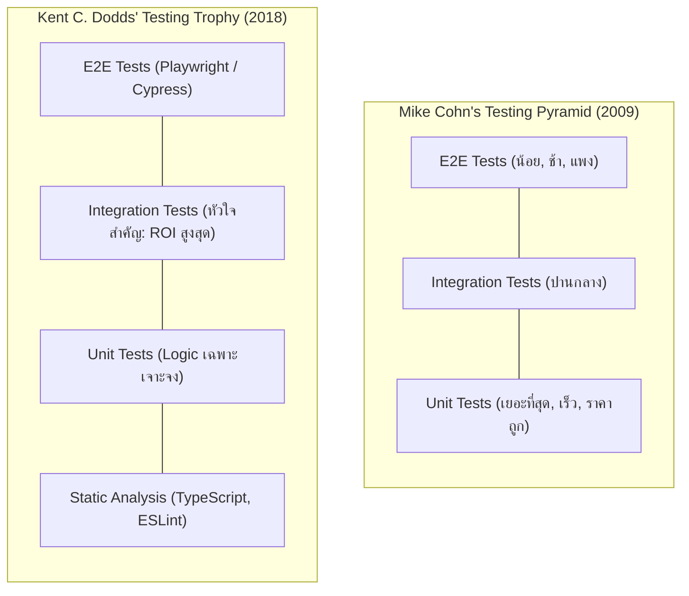
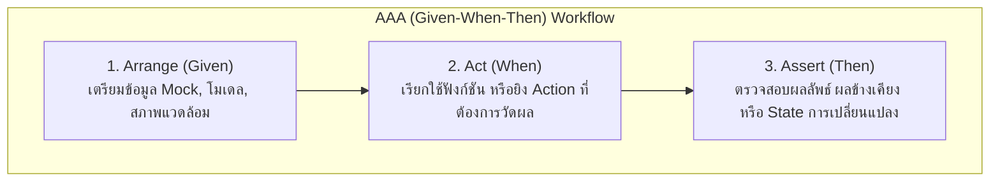
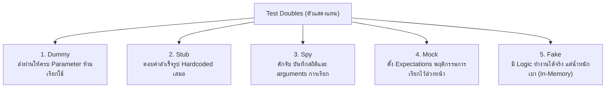
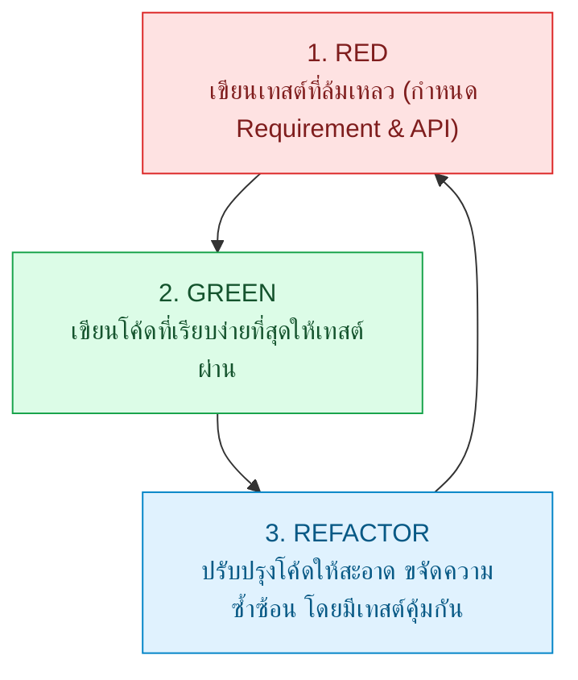
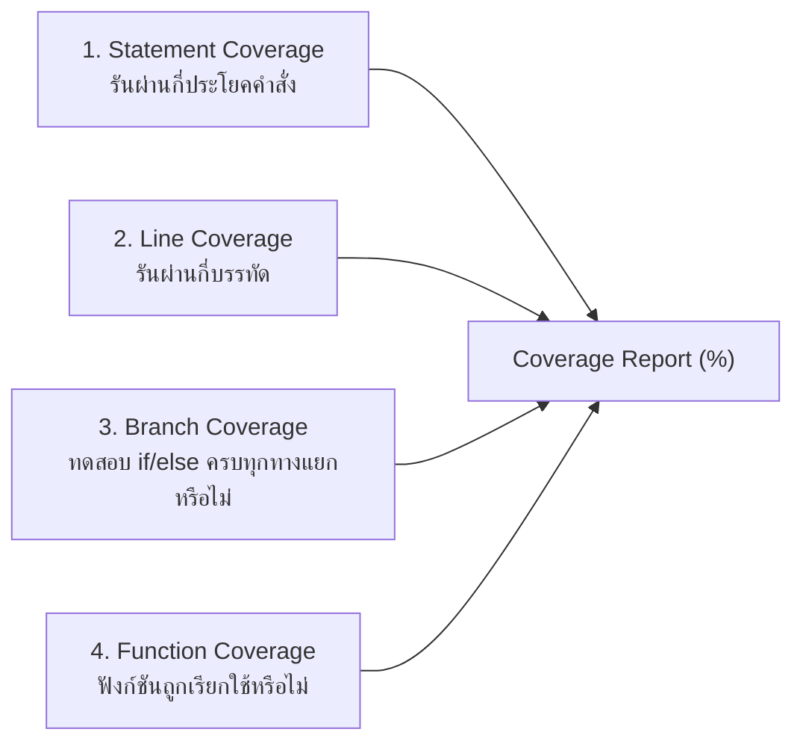
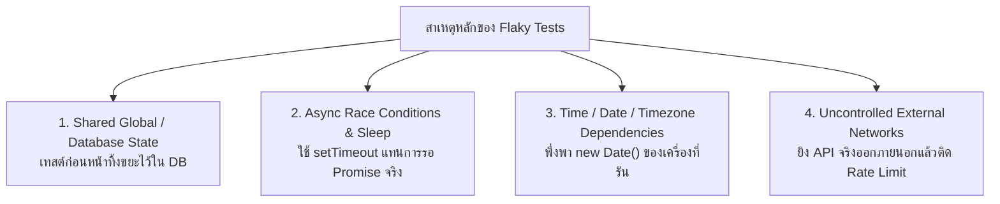

# Testing Fundamentals

(สำหรับเครื่องมือทดสอบเฉพาะทาง สามารถดูเพิ่มเติมได้ที่ [Jest](/docs/testing/jest), [Backend Testing](/docs/testing/backend-testing), [Frontend Testing](/docs/testing/frontend-testing), และ [E2E Testing](/docs/testing/e2e-playwright) โดยเอกสารนี้จะปูพื้นฐานแนวคิด หลักการสากล และกลยุทธ์การทดสอบซอฟต์แวร์ระดับองค์กร)

| หัวข้อในบทเรียนนี้ | ขอบเขตเนื้อหาสำคัญ | ลิงก์ข้ามไปยังหัวข้อ |
| :--- | :--- | :--- |
| **1. Cost of Bugs** | ทำไมต้องเขียนเทสต์ และต้นทุนของ Bug ที่หลุดไปถึง Production | [อ่านหัวข้อที่ 1](#1-ทำไมต้องเขียนเทสต์และต้นทุนของ-bug-the-cost-of-software-defects) |
| **2. Pyramid & Trophy** | เปรียบเทียบ Testing Pyramid และ Testing Trophy (Unit / Integration / E2E) | [อ่านหัวข้อที่ 2](#2-testing-pyramid-และ-testing-trophy) |
| **3. AAA & Behavior** | โครงสร้าง Arrange-Act-Assert และการเทสต์พฤติกรรมแทนรายละเอียดภายใน | [อ่านหัวข้อที่ 3](#3-หลักการเขียนเทสต์ที่ดี-aaa-pattern-และ-behavior-driven) |
| **4. Test Doubles** | ความต่างของ Dummy, Stub, Spy, Mock และ Fake พร้อมตัวอย่างจริง | [อ่านหัวข้อที่ 4](#4-test-doubles-mock-stub-spy-fake-dummy-ต่างกันอย่างไร) |
| **5. TDD Workflow** | วงจร Red-Green-Refactor และการประยุกต์ใช้ในงานจริง | [อ่านหัวข้อที่ 5](#5-test-driven-development-tdd-แบบเข้าใจง่าย) |
| **6. Code Coverage** | Line vs Branch Coverage และทำไม 100% Coverage จึงไม่ใช่เป้าหมายสูงสุด | [อ่านหัวข้อที่ 6](#6-code-coverage-และทำไม-100-จึงไม่ใช่เป้าหมายสูงสุด) |
| **7. What to Test** | เกณฑ์ตัดสินใจเลือกสิ่งที่ควรเทสต์เน้นๆ และสิ่งที่ไม่ควรเสียเวลาเทสต์ | [อ่านหัวข้อที่ 7](#7-สิ่งที่ควรเทสต์และสิ่งที่ไม่ควรเทสต์-what-to-test-vs-what-not-to-test) |
| **8. Flaky Tests** | สาเหตุของเทสต์ที่เดี๋ยวผ่านเดี๋ยวพัง และวิธีป้องกันอย่างถาวร | [อ่านหัวข้อที่ 8](#8-flaky-test-คืออะไรและวิธีรับมือ) |

---

## 1. ทำไมต้องเขียนเทสต์และต้นทุนของ Bug (The Cost of Software Defects)

### แนวคิด
การเขียนชุดทดสอบอัตโนมัติ (Automated Testing) ไม่ใช่ "ภาระงานที่เพิ่มขึ้นหลังเขียนฟีเจอร์เสร็จ" แต่คือ **เครื่องมือกำกับและรับประกันคุณภาพการลงทุนทางวิศวกรรม (Engineering Investment Protection)**

ในระบบระดับองค์กรอย่าง **Smart Butcher Marketplace** (แพลตฟอร์มจำหน่ายเนื้อพรีเมียมและเนื้อดรายเอจออนไลน์) บั๊กไม่ใช่แค่ความผิดพลาดบนหน้าจอ แต่สร้างความสูญเสียทางการเงินโดยตรง เช่น:
- ระบบตัดสต็อกเนื้อดรายเอจ A5 Wagyu ผิดพลาด ทำให้รับออร์เดอร์เกินสต็อกที่มีบ่มไว้จริง 45 วัน (เนื้อมีสต็อกจำกัด ไม่สามารถผลิตเพิ่มได้ทันที)
- ฟังก์ชันคำนวณราคาปัดเศษสตางค์ผิดเมื่อตัดแต่งความหนาพิเศษ (Custom Cut Thickness) ส่งผลให้ขาดทุนสะสมในทุกๆ คำสั่งซื้อ

```mermaid filename="docs/testing/fundamentals-diagram.mmd"
flowchart LR
    Coding["1. ขณะเขียนโค้ด (IDE)<br/>ต้นทุน: 1x ($)"] --> PR["2. Pull Request (CI)<br/>ต้นทุน: 5x ($$)"]
    PR --> Staging["3. Staging / QA<br/>ต้นทุน: 15x ($$$)"]
    Staging --> Prod["4. Production Failure<br/>ต้นทุน: 100x ($$$$$)"]

    style Coding fill:#dcfce7,stroke:#16a34a,color:#14532d
    style PR fill:#fef9c3,stroke:#ca8a04,color:#713f12
    style Staging fill:#ffedd5,stroke:#ea580c,color:#7c2d12
    style Prod fill:#fee2e2,stroke:#dc2626,color:#7f1d1d
```

### หลักการเบื้องหลัง: เส้นโค้งต้นทุนของโบห์ม (Boehm's Cost of Change Curve)
Barry Boehm (ผู้เชี่ยวชาญด้านวิศวกรรมซอฟต์แวร์ระดับตำนาน) ได้นิยาม **Relative Cost of Fixing Defects**:
1. **Coding Phase (1x)**: นักพัฒนาพิมพ์โค้ดแล้ว Unit Test ในเครื่องแจ้งเตือนทันที ใช้เวลาแก้ไม่ถึง 30 วินาที
2. **Pull Request / Review Phase (5x)**: เกิด Context Switching ต้องรอ CI รัน แจ้งเตือนเพื่อนร่วมทีม รีวิวซ้ำ และ Re-deploy
3. **Staging / QA Phase (15x)**: ทีม QA พบข้อผิดพลาด ต้องเปิด Ticket บันทึกขั้นตอน Reproduce, นักพัฒนาต้องดึงงานปัจจุบันลงเพื่อสลับกลับมาแก้
4. **Production Crash (30x - 100x+)**: เกิด Data Corruption ในฐานข้อมูล, ต้อง Rollback เวอร์ชันฉุกเฉิน, กระทบความเชื่อมั่นของลูกค้า, เกิดค่าปรับทางกฎหมายหรือชดเชยสินค้า

การมีชุดทดสอบที่รวดเร็วและครอบคลุมเป็นหัวใจของ **Continuous Delivery (CD)** ทำให้ทีมสามารถ Refactor โค้ดเก่า, อัปเกรดเวอร์ชันไลบรารี, หรือปรับแต่งสถาปัตยกรรมระบบได้ด้วยความมั่นใจ 100% ว่าฟังก์ชันเดิมจะไม่พัง (No Regression)

---

### ตัวอย่างโค้ด: การตรวจจับข้อผิดพลาดในระดับ Unit Test

#### โดเมนโมเดลร่วม: Smart Butcher Marketplace Core Interfaces
```typescript filename="domain/models.ts"
// domain/models.ts
export type UserRole = 'CUSTOMER' | 'BUTCHER' | 'ADMIN';

export interface User {
  id: string;
  email: string;
  fullName: string;
  role: UserRole;
  isVip: boolean;
}

export type CutType = 'RIBEYE' | 'TENDERLOIN' | 'STRIPLOIN';

export interface Product {
  id: string;
  name: string;
  sku: string;
  pricePerKg: number;
  stockQty: number; // ปริมาณเนื้อคงเหลือในสต็อก (กิโลกรัม)
  dryAgedDays: number;
  isActive: boolean;
}

export interface OrderItem {
  id: string;
  productId: string;
  cutType: CutType;
  thicknessCm: number;
  unitPrice: number;
  quantity: number; // จำนวนชิ้น
  subtotal: number;
}
```

#### ตัวอย่างที่ 1 (ระดับพื้นฐาน): ตรวจสอบเงื่อนไขการตัดแต่งเนื้อสเต็กดรายเอจ
```typescript filename="services/butcher-validator.ts"
// services/butcher-validator.ts
export class InvalidCutSpecificationError extends Error {
  constructor(message: string) {
    super(message);
    this.name = 'InvalidCutSpecificationError';
  }
}

export function validateSteakCutThickness(cutType: CutType, thicknessCm: number): boolean {
  // กฎทางธุรกิจ: ชิ้นเนื้อสเต็กต้องมีความหนาระหว่าง 2.0 ซม. ถึง 6.0 ซม. เพื่อคงความชุ่มฉ่ำขณะย่าง
  if (thicknessCm < 2.0) {
    throw new InvalidCutSpecificationError(
      `ความหนา ${thicknessCm} ซม. บางเกินไปสำหรับสเต็กพรีเมียม (ขั้นต่ำ 2.0 ซม.)`
    );
  }
  if (thicknessCm > 6.0) {
    throw new InvalidCutSpecificationError(
      `ความหนา ${thicknessCm} ซม. หนาเกินไปสำหรับมาตรฐานกระทะครัวเรือน (สูงสุด 6.0 ซม.)`
    );
  }
  return true;
}
```

```typescript filename="tests/unit/butcher-validator.spec.ts"
// tests/unit/butcher-validator.spec.ts
import { validateSteakCutThickness, InvalidCutSpecificationError } from '../../services/butcher-validator';

describe('validateSteakCutThickness', () => {
  it('should accept valid standard steak thickness of 3.5 cm', () => {
    // Act & Assert
    expect(validateSteakCutThickness('RIBEYE', 3.5)).toBe(true);
  });

  it('should throw InvalidCutSpecificationError when thickness is below 2.0 cm threshold', () => {
    // Act & Assert
    expect(() => validateSteakCutThickness('STRIPLOIN', 1.5)).toThrow(
      InvalidCutSpecificationError
    );
    expect(() => validateSteakCutThickness('STRIPLOIN', 1.5)).toThrow(
      'ความหนา 1.5 ซม. บางเกินไปสำหรับสเต็กพรีเมียม (ขั้นต่ำ 2.0 ซม.)'
    );
  });

  it('should throw InvalidCutSpecificationError when thickness exceeds 6.0 cm threshold', () => {
    // Act & Assert
    expect(() => validateSteakCutThickness('TENDERLOIN', 7.0)).toThrow(
      InvalidCutSpecificationError
    );
  });
});
```

#### ตัวอย่างที่ 2 (ระดับธุรกิจขั้นสูง): คำนวณส่วนลด VIP และค่าบริการดรายเอจพิเศษ ป้องกันความเสียหายทางการเงิน
```typescript filename="services/pricing-engine.ts"
// services/pricing-engine.ts
export interface PricingCalculationResult {
  baseAmount: number;
  agingSurcharge: number;
  vipDiscountAmount: number;
  finalTotal: number;
}

export function calculateCustomSteakPrice(
  product: Product,
  quantityKg: number,
  buyer: User
): PricingCalculationResult {
  if (quantityKg <= 0) {
    throw new Error('ปริมาณเนื้อต้องมากกว่า 0 กิโลกรัม');
  }
  if (quantityKg > product.stockQty) {
    throw new Error(`สต็อกไม่เพียงพอ: สต็อกเหลือ ${product.stockQty} กก. แต่ร้องขอ ${quantityKg} กก.`);
  }

  const baseAmount = Number((product.pricePerKg * quantityKg).toFixed(2));

  // ค่าบริการบ่มพิเศษ: หากบ่มเกิน 30 วัน มีค่าห้องควบคุมความชื้น 150 บาทต่อกิโลกรัม
  const agingSurcharge = product.dryAgedDays > 30 ? Number((150 * quantityKg).toFixed(2)) : 0;

  // สิทธิพิเศษลูกค้า VIP: รับส่วนลด 10% จากยอดรวมก่อนคิดค่าบริการบ่ม
  const vipDiscountAmount = buyer.isVip ? Number((baseAmount * 0.10).toFixed(2)) : 0;

  const finalTotal = Number((baseAmount + agingSurcharge - vipDiscountAmount).toFixed(2));

  return {
    baseAmount,
    agingSurcharge,
    vipDiscountAmount,
    finalTotal,
  };
}
```

```typescript filename="tests/unit/pricing-engine.spec.ts"
// tests/unit/pricing-engine.spec.ts
import { calculateCustomSteakPrice } from '../../services/pricing-engine';
import { Product, User } from '../../domain/models';

describe('calculateCustomSteakPrice', () => {
  const mockA5Ribeye: Product = {
    id: 'prod-wagyu-a5',
    name: 'Miyazaki Wagyu A5 Ribeye',
    sku: 'WAGYU-A5-RIB',
    pricePerKg: 3500,
    stockQty: 10,
    dryAgedDays: 45, // เกิน 30 วัน -> ต้องคิดค่า surcharge
    isActive: true,
  };

  const vipCustomer: User = {
    id: 'usr-vip-001',
    email: 'executive@meatlover.com',
    fullName: 'Somchai ButcherKing',
    role: 'CUSTOMER',
    isVip: true,
  };

  const standardCustomer: User = {
    id: 'usr-std-002',
    email: 'guest@foodie.com',
    fullName: 'Jane Doe',
    role: 'CUSTOMER',
    isVip: false,
  };

  it('should calculate correct total with aging surcharge and VIP 10% discount', () => {
    // 2 kg * 3,500 = 7,000 base
    // Surcharge: 2 kg * 150 = 300
    // VIP discount: 10% of 7,000 = 700
    // Final: 7,000 + 300 - 700 = 6,600
    const result = calculateCustomSteakPrice(mockA5Ribeye, 2, vipCustomer);

    expect(result).toEqual({
      baseAmount: 7000,
      agingSurcharge: 300,
      vipDiscountAmount: 700,
      finalTotal: 6600,
    });
  });

  it('should not apply VIP discount for non-VIP customer', () => {
    const result = calculateCustomSteakPrice(mockA5Ribeye, 2, standardCustomer);

    expect(result.vipDiscountAmount).toBe(0);
    expect(result.finalTotal).toBe(7300); // 7000 + 300
  });

  it('should prevent placing order when requested quantity exceeds available stock', () => {
    expect(() => calculateCustomSteakPrice(mockA5Ribeye, 12, vipCustomer)).toThrow(
      'สต็อกไม่เพียงพอ: สต็อกเหลือ 10 กก. แต่ร้องขอ 12 กก.'
    );
  });
});
```

---

### ผิด vs ถูก: การทดสอบความถูกต้องของระบบ

```typescript filename="src/fundamentals.spec.ts"
// ❌ ผิด: ทดสอบแบบไร้ทิศทาง ขาด Assertion หรือทดสอบแต่ "Happy path" ลืมเคสขอบเขต (Boundary)
it('should test butcher calculation', () => {
  const result = calculateCustomSteakPrice(mockA5Ribeye, 2, vipCustomer);
  // ไม่ assert ค่าเฉพาะเจาะจง หรือ assert แค่ว่ามีค่ากลับมา
  expect(result).toBeDefined();
  // บั๊กปัดเศษเงินติดลบ หรือคิดสูตรส่วนลดผิดจะไม่ถูกตรวจจับเลย!
});

// ✅ ถูก: ตรวจสอบความถูกต้องของตัวเลขทุกฟิลด์ พร้อม Boundary Conditions (0, ค่าติดลบ, สต็อกหมด)
it('should calculate precision cents accurately and prevent negative quantity', () => {
  expect(() => calculateCustomSteakPrice(mockA5Ribeye, -1, vipCustomer)).toThrow(
    'ปริมาณเนื้อต้องมากกว่า 0 กิโลกรัม'
  );

  const precisionResult = calculateCustomSteakPrice(
    { ...mockA5Ribeye, pricePerKg: 1999.99 },
    1.25,
    vipCustomer
  );
  // 1999.99 * 1.25 = 2499.9875 -> ปัดทศนิยม 2 ตำแหน่งเป็น 2499.99
  expect(precisionResult.baseAmount).toBe(2499.99);
});
```

---

### ควรใช้เมื่อไหร่ / ไม่ควรใช้เมื่อไหร่
- **ควรใช้**: กับทุกโมดูลที่มี Business Logic กฎทางการเงิน, การตัดสต็อก, การให้สิทธิพิเศษ, และ State Machine ในการสั่งซื้อ
- **ไม่ควรใช้**: กับโค้ดทดลองชั่วคราว (Throwaway Spike หรือ Proof of Concept) ที่ยังไม่แน่ชัดเรื่องโครงสร้างและพร้อมทิ้งใน 24 ชั่วโมง

---

### คำถามสัมภาษณ์งานระดับ Senior
**คำถาม**: *"หากผู้บริหารบอกว่า 'เราต้องรีบเปิดตัวฟีเจอร์ Butcher Marketplace ภายใน 2 สัปดาห์ การเขียนเทสต์ทำให้เสียเวลา ให้ตัดงานเทสต์ออกไปก่อน' คุณจะมีวิธีอธิบายและรับมืออย่างไร?"*

**แนวคำตอบระดับ Senior**:
> "การละเว้นเทสต์ไม่ได้ลดเวลาการส่งมอบจริง แต่เป็นการ **กู้ยืมหนี้ทางเทคนิค (Technical Debt)** ด้วยอัตราดอกเบี้ยทบต้นมหาศาล ตาม Boehm's Curve บั๊กที่พบในวัน Launching บน Production มีต้นทุนการแก้สูงกว่าตอนเขียนโค้ดถึง 30-100 เท่า อีกทั้งทำให้ทั้งทีมต้องหยุดพัฒนาฟีเจอร์ใหม่เพื่อมา Firefighting และกู้ข้อมูลสต็อกเนื้อที่เสียหาย
> กลยุทธ์ที่ผมเสนอคือ **Risk-based Testing**: เราจะไม่เขียนเทสต์คลุมทุกอย่าง 100% แต่เราจะปกป้อง **Critical Path** ด้วย Unit Tests ทันทีเฉพาะส่วน Financial Calculation, Stock Reservation, และ Payment State เพื่อให้เรา Release งานได้เร็วโดยไม่มีความเสี่ยงด้านการเงิน"

---

## 2. Testing Pyramid และ Testing Trophy

### แนวคิด
ในการวางกลยุทธ์การทดสอบระดับองค์กร คำถามสำคัญคือ: **"เราควรลงทุนเขียนเทสต์ประเภทไหน ในสัดส่วนเท่าใด เพื่อให้ได้ผลตอบแทน (Return on Investment - ROI) สูงสุด?"**

มีสองโมเดลแนวคิดหลักที่เป็นมาตรฐานสากล:
1. **Testing Pyramid (Mike Cohn, 2009)**: เน้นฐานกว้างด้วย Unit Tests (รันเร็ว ถูก), ตรงกลางคือ Service/Integration Tests, และยอดแหลมคือ UI/E2E Tests
2. **Testing Trophy (Kent C. Dodds, 2018)**: เน้นย้ำว่าในยุค Web Application และ Microservices ปัจจุบัน **Integration Tests ให้สมดุลระหว่างความมั่นใจ (Confidence) และต้นทุนการดูแลรักษา (Maintenance Cost) สูงที่สุด**



### หลักการเบื้องหลัง: การเปรียบเทียบเชิงลึก

| มิติการเปรียบเทียบ | Static Analysis | Unit Test | Integration Test | End-to-End (E2E) |
| :--- | :--- | :--- | :--- | :--- |
| **สิ่งที่ทดสอบ** | Syntax, Data Types, Typo | 1 ฟังก์ชัน หรือ 1 Method โดดๆ | การทำงานร่วมกันหลายโมดูล / DB | ระบบทั้งระบบผ่านเบราว์เซอร์จริง |
| **ความเร็วในการรัน** | เสี้ยววินาที (ms) | หลักมิลลิวินาที (ms) | หลักร้อยมิลลิวินาที (100ms - 2s) | หลักวินาทีถึงนาที (10s - 5m) |
| **ต้นทุนการดูแล (Cost)** | ต่ำมาก (ตั้งค่าครั้งเดียว) | ต่ำ (หักล้างง่าย) | ปานกลาง | สูงมาก (ติด Flaky บ่อยเมื่อ UI เปลี่ยน) |
| **ระดับความมั่นใจ** | จับ Typo ได้ แต่ไม่รู้ว่า logic ถูกไหม | มั่นใจเฉพาะจุดเล็กๆ | **สูงมากต่อราคา (Optimal ROI)** | สูงที่สุดต่อพฤติกรรมจริงของผู้ใช้ |

Kent C. Dodds สรุปปรัชญาไว้ว่า:
> *"Write tests. Not too many. Mostly integration."*
> (เขียนเทสต์ แต่อย่าเขียนมากเกินไป และให้เน้นหนักที่ Integration Tests เป็นหลัก)

---

### ตัวอย่างโค้ด: การแบ่งระดับการทดสอบในระบบ Smart Butcher

#### ตัวอย่างที่ 1: Unit Test (ทดสอบ Pure Logic การแบ่งชิ้นสเต็ก)
```typescript filename="domain/portion-calculator.ts"
// domain/portion-calculator.ts
export interface SteakCutPortion {
  cutsCount: number;
  remainderKg: number;
}

export function calculateSteakPortions(
  slabWeightKg: number,
  thicknessCm: number,
  approxWeightPerCmKg: number = 0.12 // เนื้อ 1 ซม. หนักประมาณ 120 กรัม
): SteakCutPortion {
  if (slabWeightKg <= 0 || thicknessCm <= 0) {
    throw new Error('ค่าน้ำหนักและความหนาต้องมากกว่าศูนย์');
  }

  const weightPerCut = thicknessCm * approxWeightPerCmKg;
  const cutsCount = Math.floor(slabWeightKg / weightPerCut);
  const remainderKg = Number((slabWeightKg - cutsCount * weightPerCut).toFixed(3));

  return { cutsCount, remainderKg };
}
```

```typescript filename="tests/unit/portion-calculator.spec.ts"
// tests/unit/portion-calculator.spec.ts
import { calculateSteakPortions } from '../../domain/portion-calculator';

describe('calculateSteakPortions (Unit Level)', () => {
  it('should calculate exact cuts and remainder for a 3kg Wagyu slab at 2.5cm thickness', () => {
    // 2.5cm * 0.12 = 0.30 kg ต่อชิ้น
    // 3.0 kg / 0.30 kg = 10 ชิ้นพอดี เหลือเศษ 0
    const result = calculateSteakPortions(3.0, 2.5, 0.12);

    expect(result.cutsCount).toBe(10);
    expect(result.remainderKg).toBe(0);
  });
});
```

#### ตัวอย่างที่ 2: Integration Test (ทดสอบ OrderService ทำงานร่วมกับ In-Memory Repository และ Inventory Service)
```typescript filename="services/butcher-order-service.ts"
// services/butcher-order-service.ts
export interface IProductRepository {
  findById(id: string): Promise<Product | null>;
  decrementStock(id: string, qtyKg: number): Promise<void>;
}

export interface IOrderRepository {
  save(order: Order): Promise<Order>;
}

export class ButcherOrderService {
  constructor(
    private readonly productRepo: IProductRepository,
    private readonly orderRepo: IOrderRepository
  ) {}

  async placeSteakOrder(
    userId: string,
    productId: string,
    cutType: CutType,
    thicknessCm: number,
    quantityKg: number
  ): Promise<Order> {
    const product = await this.productRepo.findById(productId);
    if (!product || !product.isActive) {
      throw new Error('ไม่พบสินค้าเนื้อที่ต้องการ หรือสินค้าถูกระงับการขาย');
    }

    if (product.stockQty < quantityKg) {
      throw new Error('เนื้อชิ้นส่วนนี้มีสต็อกไม่เพียงพอสำหรับการตัดแต่ง');
    }

    // 1. ตัดสต็อกจริงในคลังเนื้อ
    await this.productRepo.decrementStock(productId, quantityKg);

    // 2. สร้างออร์เดอร์และคำนวณราคา
    const subtotal = Number((product.pricePerKg * quantityKg).toFixed(2));
    const newOrder: Order = {
      id: `ord-${Date.now()}`,
      orderNo: `SBM-${Math.floor(1000 + Math.random() * 9000)}`,
      userId,
      status: 'PENDING',
      totalAmount: subtotal,
      items: [
        {
          id: `item-${Date.now()}`,
          productId,
          cutType,
          thicknessCm,
          unitPrice: product.pricePerKg,
          quantity: quantityKg,
          subtotal,
        },
      ],
      createdAt: new Date(),
    };

    return await this.orderRepo.save(newOrder);
  }
}
```

```typescript filename="tests/integration/butcher-order-service.spec.ts"
// tests/integration/butcher-order-service.spec.ts
import { ButcherOrderService, IProductRepository, IOrderRepository } from '../../services/butcher-order-service';
import { Product, Order } from '../../domain/models';

// สร้าง In-Memory Fake Repositories สำหรับ Integration Test
class InMemoryProductRepository implements IProductRepository {
  public products = new Map<string, Product>();

  async findById(id: string): Promise<Product | null> {
    return this.products.get(id) || null;
  }

  async decrementStock(id: string, qtyKg: number): Promise<void> {
    const current = this.products.get(id);
    if (current) {
      current.stockQty -= qtyKg;
    }
  }
}

class InMemoryOrderRepository implements IOrderRepository {
  public orders: Order[] = [];

  async save(order: Order): Promise<Order> {
    this.orders.push(order);
    return order;
  }
}

describe('ButcherOrderService (Integration Level)', () => {
  let productRepo: InMemoryProductRepository;
  let orderRepo: InMemoryOrderRepository;
  let service: ButcherOrderService;

  beforeEach(() => {
    productRepo = new InMemoryProductRepository();
    orderRepo = new InMemoryOrderRepository();
    service = new ButcherOrderService(productRepo, orderRepo);

    // Seed ข้อมูลเตรียมทดสอบ
    productRepo.products.set('ribeye-prime', {
      id: 'ribeye-prime',
      name: 'Dry-Aged Black Angus Ribeye 30D',
      sku: 'ANGUS-30D-RIB',
      pricePerKg: 1850,
      stockQty: 5.5,
      dryAgedDays: 30,
      isActive: true,
    });
  });

  it('should deduct inventory stock and persist order in pending state', async () => {
    // Act: สั่งเนื้อ 2 กิโลกรัม หนา 3.5 ซม.
    const order = await service.placeSteakOrder(
      'usr-customer-123',
      'ribeye-prime',
      'RIBEYE',
      3.5,
      2.0
    );

    // Assert: ตรวจสอบความถูกต้องที่เชื่อมโยงระหว่าง 2 ส่วน
    expect(order.status).toBe('PENDING');
    expect(order.totalAmount).toBe(3700); // 1850 * 2
    expect(orderRepo.orders).toHaveLength(1);

    // สต็อกสินค้าต้องถูกตัดจาก 5.5 เหลือ 3.5 กก.
    const updatedProduct = await productRepo.findById('ribeye-prime');
    expect(updatedProduct?.stockQty).toBe(3.5);
  });
});
```

---

### ผิด vs ถูก: การวางสัดส่วนชุดทดสอบ

```typescript filename="src/fundamentals.spec.ts"
// ❌ ผิด: Ice-cream Cone Anti-pattern (เปิด Browser จริงผ่าน Playwright เพื่อทดสอบแค่ if-else ยอดส่วนลด)
// การทำเช่นนี้ทำให้ CI ช้า ใช้ทรัพยากรเซิร์ฟเวอร์มหาศาล และเทสต์ล้มง่ายจาก Network lag
test('e2e: verify 10% discount on web page', async ({ page }) => {
  await page.goto('https://smartbutcher.com/cart');
  await page.fill('#coupon', 'VIP10');
  await page.click('#apply-btn');
  await expect(page.locator('#discount')).toHaveText('-฿350.00');
});

// ✅ ถูก: ทดสอบกฎส่วนลดที่ Unit/Integration level (รันเสร็จใน 2ms)
// และใช้ E2E เพียงแค่ 1-2 สคริปต์เพื่อตรวจสอบว่าปุ่มกดคลิกได้และส่งคำขอไปยัง Backend สำเร็จ
it('should calculate 10% discount for VIP coupon at logic level', () => {
  const result = applyCouponCode({ total: 3500 }, 'VIP10');
  expect(result.discount).toBe(350);
});
```

---

### ควรใช้เมื่อไหร่ / ไม่ควรใช้เมื่อไหร่
- **เน้น Testing Pyramid**: เหมาะกับโปรเจกต์ที่เป็น Core Engine / Library บริสุทธิ์ เช่น การทำ Math/Cryptographic module หรือ SDK ที่ไม่มี UI
- **เน้น Testing Trophy**: เหมาะสมที่สุดสำหรับ Enterprise Web Application, Full-Stack Next.js, Microservices ที่ต้องการความมั่นใจในการเชื่อมต่อ API, Database และ Client Components

---

### คำถามสัมภาษณ์งานระดับ Senior
**คำถาม**: *"ทำไม Kent C. Dodds จึงเสนอว่า Integration Tests ให้ ROI สูงกว่า Unit Tests และคำว่า Integration Test ในบริบทของ Web Application ยุคใหม่มีความหมายครอบคลุมแค่ไหน?"*

**แนวคำตอบระดับ Senior**:
> "Unit Test มักจะบังคับให้เราแยกส่วนประกอบย่อยและทำ Mocking สูงมาก ผลลัพธ์คือแต่ละฟังก์ชันผ่านเทสต์ของตัวเอง 100% แต่เมื่อนำมาประกอบกันกลับทำงานไม่ได้จริง (เช่น Unit A ส่งค่าที่ Unit B ไม่คาดหวัง)
> ในขณะที่ **Integration Test** ทดสอบโมดูลหลายตัวที่ทำงานร่วมกันจริง เช่น Service ทำงานกับ Database Repository หรือ React Component ทำงานร่วมกับ Hook และ State Store โดยไม่ Mock ส่วนประกอบภายใน ทำให้ได้ความมั่นใจใกล้เคียงกับ User จริงมากที่สุด แต่รันเร็วกว่า E2E หลายเท่าตัวโดยไม่ต้องเปิดเบราว์เซอร์"

---

## 3. หลักการเขียนเทสต์ที่ดี (AAA Pattern และ Behavior-Driven)

### แนวคิด
เทสต์ที่ดีจะต้องทำหน้าที่เป็น **Living Documentation** (เอกสารที่มีชีวิต) ที่อธิบายความต้องการของระบบอย่างตรงไปตรงมา ไม่กำกวม และไม่พังอย่างไร้เหตุผลเมื่อโครงสร้างโค้ดภายในถูกปรับปรุง

มี 2 เสาหลักสำคัญ:
1. **AAA Pattern (Arrange - Act - Assert)**: การแบ่งโครงสร้างของบล็อกทดสอบออกเป็น 3 ขั้นตอนชัดเจน ช่วยให้อ่านและดีบักได้ง่ายดาย (เทียบเท่ากับ **Given - When - Then** ใน BDD)
2. **Behavior-Driven Testing**: ทดสอบ "พฤติกรรมภายนอกและผลลัพธ์ที่สังเกตได้" (Observable Behavior) ไม่ทดสอบ "รายละเอียดการทำงานภายใน" (Implementation Details)



### หลักการเบื้องหลัง: หลีกเลี่ยง Implementation Details และหลักการ FIRST

#### ทำไมไม่ควรทดสอบ Implementation Details?
หากเราเขียนเทสต์ตรวจสอบว่า:
- คลาสนี้มีตัวแปร `private _tempSteakBuffer: string[]` บันทึกค่าอะไรอยู่
- ฟังก์ชันนี้ใช้ `for loop` หรือ `.reduce()` ในการคำนวณ

เมื่อไหร่ก็ตามที่เรา Refactor โค้ดเพื่อปรับปรุง Performance (เช่น เปลี่ยนจาก Loop เป็น Map/Reduce) **เทสต์จะพังทันทีทั้งที่ระบบยังทำงานถูกต้อง 100%** สิ่งนี้เรียกว่า **False Negative** หรือ **Brittle Test (เทสต์เปราะบาง)** ทำให้ทีมสูญเสียความเชื่อมั่นและมองว่าเทสต์เป็นตัวถ่วง

#### หลักการ FIRST
- **F (Fast)**: รันได้อย่างรวดเร็วในระดับเสี้ยววินาทีต่อเคส
- **I (Isolated / Hermetic)**: แต่ละเทสต์ต้องเป็นอิสระต่อกัน ไม่ส่งผลข้างเคียง (State Mutation) ข้ามเทสต์
- **R (Repeatable)**: รันกี่ครั้ง บนเครื่องใคร หรือรันบน CI เวลาไหน ผลลัพธ์ต้องเหมือนเดิมเสมอ (Deterministic)
- **S (Self-validating)**: ผลลัพธ์ต้องสรุปชัดเจนว่าเป็น Pass หรือ Fail โดยไม่ต้องอาศัยคนเปิด Log ดู
- **T (Timely)**: เขียนเทสต์อย่างทันท่วงทีควบคู่กับการเขียน Production Code

---

### ตัวอย่างโค้ด: AAA Pattern & Behavior-Driven ใน Smart Butcher

#### ตัวอย่างที่ 1: การเขียน AAA ชัดเจนในระบบประเมินเกรดเนื้อ Dry-Aged
```typescript filename="domain/dry-age-grader.ts"
// domain/dry-age-grader.ts
export type BeefGrade = 'STANDARD' | 'PREMIUM_AGED' | 'MASTER_RESERVE';

export interface AgingEvaluation {
  grade: BeefGrade;
  flavorProfile: string;
  tendernessScore: number; // 1 - 100
}

export function evaluateDryAgedBeef(dryAgedDays: number): AgingEvaluation {
  if (dryAgedDays < 0) {
    throw new Error('จำนวนวันบ่มเนื้อต้องไม่ติดลบ');
  }

  if (dryAgedDays < 21) {
    return {
      grade: 'STANDARD',
      flavorProfile: 'Mild buttery beef flavor',
      tendernessScore: 70,
    };
  } else if (dryAgedDays <= 45) {
    return {
      grade: 'PREMIUM_AGED',
      flavorProfile: 'Rich nutty, earthy with intense umami',
      tendernessScore: 90,
    };
  } else {
    return {
      grade: 'MASTER_RESERVE',
      flavorProfile: 'Deep blue-cheese, funky umami, extreme tenderness',
      tendernessScore: 98,
    };
  }
}
```

```typescript filename="tests/unit/dry-age-grader.spec.ts"
// tests/unit/dry-age-grader.spec.ts
import { evaluateDryAgedBeef } from '../../domain/dry-age-grader';

describe('evaluateDryAgedBeef', () => {
  it('should categorize beef as MASTER_RESERVE when dry-aged for 60 days', () => {
    // 1. Arrange (Given): จัดเตรียมเงื่อนไขเริ่มต้น
    const dryAgedDays = 60;

    // 2. Act (When): รันฟังก์ชันที่ต้องการทดสอบ
    const evaluation = evaluateDryAgedBeef(dryAgedDays);

    // 3. Assert (Then): ตรวจสอบผลลัพธ์เชิงพฤติกรรม
    expect(evaluation.grade).toBe('MASTER_RESERVE');
    expect(evaluation.tendernessScore).toBeGreaterThanOrEqual(95);
    expect(evaluation.flavorProfile).toContain('funky umami');
  });
});
```

#### ตัวอย่างที่ 2: State Transition ของ Order Lifecycle (Behavioral Testing)
```typescript filename="domain/order-state-machine.ts"
// domain/order-state-machine.ts
import { Order, OrderStatus } from './models';

export class InvalidOrderStateTransitionError extends Error {
  constructor(from: OrderStatus, to: OrderStatus) {
    super(`ไม่สามารถเปลี่ยนสถานะคำสั่งซื้อจาก ${from} ไปเป็น ${to} ได้`);
    this.name = 'InvalidOrderStateTransitionError';
  }
}

export function transitionOrderStatus(order: Order, nextStatus: OrderStatus): Order {
  const allowedTransitions: Record<OrderStatus, OrderStatus[]> = {
    PENDING: ['PAID', 'CANCELLED'],
    PAID: ['CUTTING', 'CANCELLED'],
    CUTTING: ['DELIVERED'],
    DELIVERED: [],
    CANCELLED: [],
  };

  const validNextStates = allowedTransitions[order.status];
  if (!validNextStates.includes(nextStatus)) {
    throw new InvalidOrderStateTransitionError(order.status, nextStatus);
  }

  return {
    ...order,
    status: nextStatus,
  };
}
```

```typescript filename="tests/unit/order-state-machine.spec.ts"
// tests/unit/order-state-machine.spec.ts
import { transitionOrderStatus, InvalidOrderStateTransitionError } from '../../domain/order-state-machine';
import { Order } from '../../domain/models';

describe('transitionOrderStatus (Behavioral State Transition)', () => {
  const createMockOrder = (status: Order['status']): Order => ({
    id: 'ord-test-01',
    orderNo: 'SBM-9999',
    userId: 'usr-customer-01',
    status,
    totalAmount: 2500,
    items: [],
    createdAt: new Date(),
  });

  it('should allow transitioning from PAID to CUTTING when butcher starts working', () => {
    // Arrange
    const paidOrder = createMockOrder('PAID');

    // Act
    const cuttingOrder = transitionOrderStatus(paidOrder, 'CUTTING');

    // Assert
    expect(cuttingOrder.status).toBe('CUTTING');
  });

  it('should reject invalid transition directly from PENDING to CUTTING before payment', () => {
    // Arrange: คำสั่งซื้อที่ยังไม่ได้จ่ายเงิน
    const pendingOrder = createMockOrder('PENDING');

    // Act & Assert: ต้องปฏิเสธไม่ให้ช่างเนื้อนำไปแล่เด็ดขาด
    expect(() => transitionOrderStatus(pendingOrder, 'CUTTING')).toThrow(
      InvalidOrderStateTransitionError
    );
    expect(() => transitionOrderStatus(pendingOrder, 'CUTTING')).toThrow(
      'ไม่สามารถเปลี่ยนสถานะคำสั่งซื้อจาก PENDING ไปเป็น CUTTING ได้'
    );
  });
});
```

---

### ผิด vs ถูก: การทดสอบพฤติกรรมเทียบกับการทดสอบ Implementation Details

```typescript filename="src/fundamentals.spec.ts"
// ❌ ผิด: ทดสอบ Implementation Detail และ Private State
it('should verify internal private variable of ButcherOrderProcessor', () => {
  const processor = new ButcherOrderProcessor();
  processor.processItem({ id: 'item-1', price: 100 });

  // แอบเข้าถึง private property เพื่อดูว่าเก็บ array แบบไหน
  // หากวันข้างหน้าเปลี่ยนมาใช้ Set หรือ Map เทสต์นี้จะพังทันที!
  expect((processor as any)._internalItemCache.length).toBe(1);
});

// ✅ ถูก: ทดสอบผลลัพธ์ผ่าน Public API ที่ผู้ใช้เรียกใช้งานจริง
it('should calculate aggregated total correctly when multiple items are added', () => {
  const processor = new ButcherOrderProcessor();
  processor.addItem({ id: 'item-1', price: 100 });
  processor.addItem({ id: 'item-2', price: 200 });

  // Assert observable behavior
  expect(processor.getGrandTotal()).toBe(300);
});
```

---

### ควรใช้เมื่อไหร่ / ไม่ควรใช้เมื่อไหร่
- **ควรใช้**: ทุก Test Case ควรร้อยเรียงด้วย AAA Pattern เสมอ เพื่อให้อ่านเข้าใจได้ทันทีว่า Setup ข้อมูลอะไร รันอะไร และคาดหวังอะไร
- **ไม่ควรใช้**: การรวมหลายๆ Act และหลายๆ Assert สลับไปมาหลายรอบใน 1 `it()` บล็อก เพราะเมื่อเกิดข้อผิดพลาด จะระบุสาเหตุที่แท้จริงได้ยาก

---

### คำถามสัมภาษณ์งานระดับ Senior
**คำถาม**: *"ทำไมการตั้งชื่อ Test Case จึงควรใช้ Behavioral Language (เช่น 'should apply VIP discount when buyer is VIP') แทนการตั้งชื่อตามชื่อเมธอด (เช่น 'test_calculateTotal_1')?"*

**แนวคำตอบระดับ Senior**:
> "เพราะชุดทดสอบคือ **Executable Specification** ของระบบ หากตั้งชื่อว่า `test_calculateTotal_1` แล้วเทสต์ล้มเหลวใน CI ทีมจะไม่รู้เลยว่า Requirement ข้อไหนที่พัง แต่ถ้าตั้งชื่อเป็นภาษาพฤติกรรม เช่น `should reject steak cutting when order is unpaid` เมื่อเทสต์ล้มเหลว Product Owner หรือ Developer ทุกคนจะเข้าใจทันทีว่ากฎทางธุรกิจข้อใดถูกละเมิด ทำให้สื่อสารและแก้ไขได้ตรงจุดทันที"

---

## 4. Test Doubles (Mock, Stub, Spy, Fake, Dummy) ต่างกันอย่างไร

### แนวคิด
ในการทดสอบซอฟต์แวร์ เรามักไม่สามารถใช้คอมโพเนนต์จริงได้ทุกชิ้น (เช่น การยิงตัดเงินผ่านบัตรเครดิตจริง, การส่ง SMS จริง, หรือการต่อ Database Production) 

เราจึงต้องใช้ **Test Doubles** (แนวคิดเปรียบเสมือน "สตันท์แมน" หรือตัวแสดงแทนในวงการภาพยนตร์) ตามการจัดหมวดหมู่คลาสสิกของ Gerard Meszaros และ Martin Fowler ซึ่งแบ่งออกเป็น 5 ประเภทหลัก:



### หลักการเบื้องหลัง: คำจำกัดความและการเปรียบเทียบ

1. **Dummy**: อ็อบเจกต์ที่ส่งเข้าไปให้ครบตาม Type Signature ของฟังก์ชันเท่านั้น โค้ดจะไม่เข้าไปยุ่งหรือเรียกเมธอดใดๆ ของมัน
2. **Stub**: อ็อบเจกต์ที่คืนค่าสำเร็จรูปตามที่กำหนดไว้ล่วงหน้า (Hardcoded Responses) เพื่อให้โค้ดส่วนอื่นทำงานต่อไปได้ โดยไม่สนใจว่าใครจะเรียกอย่างไร
3. **Spy**: ห่อหุ้มฟังก์ชันหรืออ็อบเจกต์จริงไว้ เพื่อแอบบันทึกข้อมูล (จำนวนครั้งที่ถูกเรียก, พารามิเตอร์ที่ส่งเข้ามา) เพื่อนำมา Assert ในภายหลัง
4. **Mock**: อ็อบเจกต์ที่ตั้งค่าความคาดหวัง (Expectations) ไว้ล่วงหน้า ว่าจะต้องถูกเรียกด้วยพารามิเตอร์ใด กี่ครั้ง และถ้าไม่เป็นไปตามนั้น เทสต์จะล้มเหลวทันที
5. **Fake**: คลาสที่มี Business Logic ที่ทำงานได้จริง แต่ใช้การเก็บข้อมูลหรือโครงสร้างที่เรียบง่ายกว่าของจริง เช่น ใช้ In-Memory Hash Map แทน PostgreSQL

---

### ตัวอย่างโค้ด: การเปรียบเทียบ Test Doubles ใน Smart Butcher Marketplace

#### โค้ดระบบหลัก: บริการแจ้งเตือนช่างแล่เนื้อและตัดเงิน
```typescript filename="services/butcher-notification.ts"
// services/butcher-notification.ts
export interface IEmailClient {
  send(to: string, subject: string, body: string): Promise<boolean>;
}

export interface IPaymentGateway {
  charge(orderId: string, amount: number): Promise<{ success: boolean; transactionId: string }>;
}

export class ButcherOrderFulfillmentService {
  constructor(
    private readonly paymentGateway: IPaymentGateway,
    private readonly emailClient: IEmailClient
  ) {}

  async completeOrder(order: Order, customerEmail: string): Promise<boolean> {
    // 1. เรียกตัดเงิน
    const chargeResult = await this.paymentGateway.charge(order.id, order.totalAmount);
    if (!chargeResult.success) {
      throw new Error(`การชำระเงินล้มเหลวสำหรับคำสั่งซื้อ ${order.orderNo}`);
    }

    // 2. ส่งอีเมลแจ้งเตือนลูกค้า
    await this.emailClient.send(
      customerEmail,
      `คำสั่งซื้อ ${order.orderNo} กำลังเข้าสู่ขั้นตอนการตัดแต่งเนื้อ`,
      `เนื้อของคุณกำลังถูกตัดแต่งโดยช่างฝีมือด้วยความหนาที่ระบุ`
    );

    return true;
  }
}
```

#### ตัวอย่างที่ 1: การใช้ Dummy, Stub, และ Spy
```typescript filename="tests/unit/test-doubles-demo.spec.ts"
// tests/unit/test-doubles-demo.spec.ts
import {
  ButcherOrderFulfillmentService,
  IEmailClient,
  IPaymentGateway,
} from '../../services/butcher-notification';
import { Order } from '../../domain/models';

describe('Test Doubles Demonstration (Dummy, Stub, Spy)', () => {
  const sampleOrder: Order = {
    id: 'ord-101',
    orderNo: 'SBM-101',
    userId: 'usr-1',
    status: 'PENDING',
    totalAmount: 1850,
    items: [],
    createdAt: new Date(),
  };

  it('1. Stub: ให้คำตอบตายตัวว่าตัดเงินสำเร็จเสมอ', async () => {
    // Stub: Hardcoded คืนค่า success เสมอ ไม่ว่า amount จะเป็นเท่าไหร่
    const paymentStub: IPaymentGateway = {
      charge: async () => ({ success: true, transactionId: 'txn-stub-999' }),
    };

    // Dummy Email Client: ทำตาม interface แต่ไม่คาดหวังผลลัพธ์
    const emailDummy: IEmailClient = {
      send: async () => true,
    };

    const service = new ButcherOrderFulfillmentService(paymentStub, emailDummy);
    const result = await service.completeOrder(sampleOrder, 'customer@meat.com');

    expect(result).toBe(true);
  });

  it('2. Spy: บันทึกการส่งอีเมลเพื่อตรวจสอบ Argument และจำนวนครั้งที่ถูกเรียก', async () => {
    const paymentStub: IPaymentGateway = {
      charge: async () => ({ success: true, transactionId: 'txn-123' }),
    };

    // Spy: บันทึกประวัติการเรียกใช้งานฟังก์ชัน send
    const sentEmailsHistory: Array<{ to: string; subject: string }> = [];
    const emailSpy: IEmailClient = {
      send: async (to, subject) => {
        sentEmailsHistory.push({ to, subject });
        return true;
      },
    };

    const service = new ButcherOrderFulfillmentService(paymentStub, emailSpy);
    await service.completeOrder(sampleOrder, 'vip@butcher.com');

    // Assert ผ่านข้อมูลที่ Spy จดบันทึกไว้
    expect(sentEmailsHistory).toHaveLength(1);
    expect(sentEmailsHistory[0].to).toBe('vip@butcher.com');
    expect(sentEmailsHistory[0].subject).toContain('SBM-101');
  });
});
```

#### ตัวอย่างที่ 2: การใช้ Mock เทียบกับ Fake
```typescript filename="tests/unit/mock-vs-fake.spec.ts"
// tests/unit/mock-vs-fake.spec.ts
import {
  ButcherOrderFulfillmentService,
  IPaymentGateway,
  IEmailClient,
} from '../../services/butcher-notification';
import { Order } from '../../domain/models';

describe('Mock vs Fake Demonstration', () => {
  const sampleOrder: Order = {
    id: 'ord-555',
    orderNo: 'SBM-555',
    userId: 'usr-vip',
    status: 'PENDING',
    totalAmount: 4200,
    items: [],
    createdAt: new Date(),
  };

  it('3. Mock: ตั้ง Expectation ชัดเจนว่าจะต้องถูกเรียกด้วย amount ที่ถูกต้องเป๊ะๆ', async () => {
    // สร้าง Mock โดยใช้ Vitest/Jest mock function
    const mockCharge = vi.fn().mockResolvedValue({ success: true, transactionId: 'txn-mock-1' });
    const paymentMock: IPaymentGateway = { charge: mockCharge };

    const mockSend = vi.fn().mockResolvedValue(true);
    const emailMock: IEmailClient = { send: mockSend };

    const service = new ButcherOrderFulfillmentService(paymentMock, emailMock);
    await service.completeOrder(sampleOrder, 'buyer@butcher.com');

    // ตรวจสอบพฤติกรรม (Behavior Verification): ต้องเรียก charge ด้วย order id และ amount 4200
    expect(mockCharge).toHaveBeenCalledTimes(1);
    expect(mockCharge).toHaveBeenCalledWith('ord-555', 4200);

    expect(mockSend).toHaveBeenCalledWith(
      'buyer@butcher.com',
      expect.stringContaining('SBM-555'),
      expect.any(String)
    );
  });

  it('4. Fake: คลาสจำลอง Payment Gateway ที่มี Logic การตรวจสอบวงเงินจริงในหน่วยความจำ', async () => {
    // Fake: มีสถานะและ Logic เสมือนจริง (เช่น บัตรที่มีวงเงินจำกัด)
    class FakeWalletPaymentGateway implements IPaymentGateway {
      private balance = 5000;

      async charge(orderId: string, amount: number) {
        if (this.balance < amount) {
          return { success: false, transactionId: '' };
        }
        this.balance -= amount;
        return { success: true, transactionId: `fake-txn-${Date.now()}` };
      }

      getBalance() {
        return this.balance;
      }
    }

    const fakeGateway = new FakeWalletPaymentGateway();
    const emailDummy: IEmailClient = { send: async () => true };
    const service = new ButcherOrderFulfillmentService(fakeGateway, emailDummy);

    // ครั้งที่ 1: ตัด 4,200 จาก 5,000 -> สำเร็จ (เหลือ 800)
    await service.completeOrder(sampleOrder, 'buyer@butcher.com');
    expect(fakeGateway.getBalance()).toBe(800);

    // ครั้งที่ 2: พยายามตัดอีก 4,200 -> ยอดไม่พอ ต้องเกิด Exception ตาม Logic ของ Fake
    await expect(service.completeOrder(sampleOrder, 'buyer@butcher.com')).rejects.toThrow(
      'การชำระเงินล้มเหลวสำหรับคำสั่งซื้อ SBM-555'
    );
  });
});
```

---

### ผิด vs ถูก: การใช้งาน Test Doubles

```typescript filename="src/fundamentals.spec.ts"
// ❌ ผิด: Over-Mocking! Mock ทุกสิ่งทุกอย่างจนไม่ได้ทดสอบอะไรที่มีความหมายเลย
it('should place order (Over-mocked anti-pattern)', async () => {
  const mockRepo = { findById: vi.fn(), save: vi.fn() };
  mockRepo.findById.mockResolvedValue({ id: '1', price: 100 });
  mockRepo.save.mockResolvedValue({ id: 'ord-1' });

  // Mock แม้กระทั่ง internal helper function จนเสมือนเทสต์กำลัง assert สิ่งที่ตัวเอง mock ไว้
  expect(await mockRepo.findById('1')).toEqual({ id: '1', price: 100 });
});

// ✅ ถูก: ใช้ Fake สำหรับ Repository และใช้ Mock เฉพาะขอบเขต External API ข้ามเครือข่าย
it('should place order and persist state using Fake Repository', async () => {
  const fakeRepo = new InMemoryProductRepository(); // มี logic ค้นหาและลดสต็อกจริง
  fakeRepo.seed([sampleProduct]);

  const service = new ButcherOrderService(fakeRepo, fakeOrderRepo);
  await service.placeSteakOrder('usr-1', sampleProduct.id, 'RIBEYE', 3.0, 1.5);

  expect(fakeRepo.getRemainingStock(sampleProduct.id)).toBe(3.5);
});
```

---

### ควรใช้เมื่อไหร่ / ไม่ควรใช้เมื่อไหร่
- **ควรใช้ Stub/Fake**: เมื่อต้องการทดสอบ Business Logic ในระบบ โดยไม่ต้องเชื่อมต่อโครงสร้างพื้นฐานภายนอก (Database, S3, Redis)
- **ควรใช้ Mock/Spy**: เฉพาะกับ Side Effects ที่ส่งผลออกภายนอกระบบจริง (External Boundaries) เช่น การส่ง SMS, ยิง Webhook, หรือตัดเงินผ่าน Payment Provider
- **ไม่ควรใช้**: อย่า Mock โดเมนอ็อบเจกต์หรือ Pure Function ภายในโมดูลเดียวกัน

---

### คำถามสัมภาษณ์งานระดับ Senior
**คำถาม**: *"State Verification ต่างจาก Behavior Verification อย่างไร และทำไมการใช้ Mock มากเกินไป (Over-mocking) จึงทำให้เกิดปัญหาในการบำรุงรักษาซอฟต์แวร์?"*

**แนวคำตอบระดับ Senior**:
> "**State Verification** คือการตรวจสอบผลลัพธ์สุดท้ายหรือ State ของระบบหลังทำงาน (เช่น ข้อมูลในฐานข้อมูลเปลี่ยนไปตามที่ควรหรือไม่) มักทำร่วมกับ Stub หรือ Fake
> ส่วน **Behavior Verification** คือการตรวจสอบว่ามีฟังก์ชันใดถูกเรียก ด้วยพารามิเตอร์ใด กี่ครั้ง ผ่าน Mock
> ปัญหาของ **Over-mocking** คือมันผูกชุดทดสอบเข้ากับ Implementation Details อย่างเหนียวแน่น หากเราเปลี่ยนลำดับการเรียกเมธอดภายใน แม้ผลลัพธ์สุดท้ายจะถูกต้องสมบูรณ์ แต่ Mock Verification จะล้มเหลวทันที ทำให้เทสต์กลายเป็นภาระในการดูแลรักษาแทนที่จะช่วยตรวจจับบั๊กจริง"

---

## 5. Test-Driven Development (TDD) แบบเข้าใจง่าย

### แนวคิด
**Test-Driven Development (TDD)** ไม่ใช่เทคนิคการทดสอบโค้ด แต่เป็น **เทคนิคการออกแบบซอฟต์แวร์ (Design Technique)** ผ่านวงจรความคิดแบบวนซ้ำสั้นๆ (Micro-feedback Loops)

ปรัชญาหัวใจของ TDD คือ **"ห้ามเขียน Production Code แม้แต่บรรทัดเดียว หากยังไม่มี Automated Test ที่ล้มเหลวมารองรับ"**



### หลักการเบื้องหลัง: วงจร Red-Green-Refactor
1. **RED (เขียนเทสต์ก่อน)**:
   - บังคับให้นักพัฒนาคิดจากมุมมองของ **Consumer (ผู้เรียกใช้งาน API)** ว่าต้องการฟังก์ชันชื่ออะไร รับพารามิเตอร์อะไร คืนค่าแบบไหน
   - รันเทสต์แล้วต้องเห็นผลเป็นสีแดง (Fail) เพื่อพิสูจน์ว่าเทสต์ไม่ได้ผ่านโดยบังเอิญ
2. **GREEN (ทำให้ผ่านอย่างรวดเร็ว)**:
   - เขียนโค้ดที่ตรงไปตรงมาที่สุดเพื่อแก้ปัญหาเฉพาะหน้า แม้กระทั่งการ Hardcode ค่ากลับไปชั่วคราว เพื่อยืนยันว่าการเชื่อมต่อถูกต้อง
3. **REFACTOR (จัดระเบียบโครงสร้าง)**:
   - ปรับปรุง Clean Code, ลดความซ้ำซ้อน (DRY), แยก Method, ปรับอัลกอริทึม
   - ทุกครั้งที่แก้ไขโค้ด สามารถกดรันเทสต์ซ้ำได้ทันที หากยังคงเป็นสีเขียว (Green) แสดงว่าพฤติกรรมเดิมไม่เสียหาย

---

### ตัวอย่างโค้ด: การพัฒนาฟังก์ชันคำนวณค่าธรรมเนียมตัดแต่งเนื้อพิเศษด้วย TDD

#### ขั้นที่ 1: RED - เขียนเทสต์กำหนดสเปกของ Custom Cut Fee
```typescript filename="tests/unit/butcher-cut-fee.spec.ts"
// tests/unit/butcher-cut-fee.spec.ts
import { calculateCustomCutFee } from '../../services/butcher-cut-fee';

describe('calculateCustomCutFee (TDD Cycle)', () => {
  it('should charge 0 THB for standard thickness (between 2.5cm and 4.0cm)', () => {
    // Standard cut ไม่คิดค่าบริการเพิ่ม
    const fee = calculateCustomCutFee('RIBEYE', 3.0);
    expect(fee).toBe(0);
  });

  it('should charge 50 THB fee for extra-thick cuts (> 4.0cm) due to special bone sawing', () => {
    // หนาพิเศษ ต้องใช้เลื่อยกระดูกพิเศษ คิด 50 บาท
    const fee = calculateCustomCutFee('RIBEYE', 5.0);
    expect(fee).toBe(50);
  });

  it('should charge 80 THB fee for ultra-thin carpaccio cuts (< 2.0cm) requiring precision slicer', () => {
    // บางเฉียบระดับ Carpaccio ใช้ฝีมือสูง คิด 80 บาท
    const fee = calculateCustomCutFee('TENDERLOIN', 1.0);
    expect(fee).toBe(80);
  });
});
```
*(เมื่อรันครั้งแรกจะเกิด Compilation Error เพราะยังไม่มีฟังก์ชัน `calculateCustomCutFee` อยู่จริง -> RED)*

#### ขั้นที่ 2: GREEN - เขียนโค้ดอย่างง่ายที่สุดให้เทสต์ทั้งหมดผ่าน
```typescript filename="services/butcher-cut-fee.ts"
// services/butcher-cut-fee.ts
import { CutType } from '../domain/models';

export function calculateCustomCutFee(cutType: CutType, thicknessCm: number): number {
  if (thicknessCm > 4.0) {
    return 50;
  }
  if (thicknessCm < 2.0) {
    return 80;
  }
  return 0;
}
```
*(รันเทสต์ -> ผ่านเป็นสีเขียวทันที -> GREEN)*

#### ขั้นที่ 3: REFACTOR - สเปกเริ่มขยาย จึงปรับปรุงให้อ่านง่ายและรองรับ Extension
```typescript filename="services/butcher-cut-fee.ts"
// services/butcher-cut-fee.ts (Refactored Version)
import { CutType } from '../domain/models';

export interface CutFeePolicy {
  minThickness: number;
  maxThickness: number;
  fee: number;
}

const CUT_FEE_POLICIES: Record<string, CutFeePolicy> = {
  PRECISION_THIN: { minThickness: 0, maxThickness: 1.99, fee: 80 },
  STANDARD_THICKNESS: { minThickness: 2.0, maxThickness: 4.0, fee: 0 },
  HEAVY_DUTY_THICK: { minThickness: 4.01, maxThickness: 10.0, fee: 50 },
};

export function calculateCustomCutFee(cutType: CutType, thicknessCm: number): number {
  if (thicknessCm <= 0) {
    throw new Error('ความหนาต้องมากกว่าศูนย์');
  }

  for (const policy of Object.values(CUT_FEE_POLICIES)) {
    if (thicknessCm >= policy.minThickness && thicknessCm <= policy.maxThickness) {
      return policy.fee;
    }
  }

  return 0;
}
```
*(รันเทสต์ซ้ำ โค้ดยังคงผ่านสีเขียวทุกกรณี แต่โครงสร้างรองรับการเพิ่มเงื่อนไขของเนื้อประเภทอื่นได้สะดวก)*

---

### ผิด vs ถูก: แนวทางปฏิบัติในการทำ TDD

```typescript filename="src/fundamentals.spec.ts"
// ❌ ผิด: Test-After Anti-pattern (เขียนโค้ดธุรกิจซับซ้อน 800 บรรทัดเสร็จแล้ว ค่อยมาพยายามเขียนเทสต์คลุม)
// ผลลัพธ์: โค้ดจะถูกผูกมัดแน่น (Tightly Coupled) ยากต่อการ Mock และมักจบลงด้วยการเขียนเทสต์ส่งเดชเพื่อจบงาน

// ✅ ถูก: Baby Steps TDD (เริ่มจากเคสง่ายที่สุด แล้วค่อยๆ เพิ่มความซับซ้อนทีละสเต็ป)
// Step 1: เทสต์กรณีซื้อเนื้อน้ำหนักปกติ
// Step 2: เทสต์กรณีน้ำหนักเป็น 0 หรือค่าติดลบ
// Step 3: เทสต์กรณีลูกค้าเป็น VIP
// Step 4: เทสต์กรณีสต็อกไม่พอ
```

---

### ควรใช้เมื่อไหร่ / ไม่ควรใช้เมื่อไหร่
- **ควรใช้ TDD อย่างยิ่ง**:
  - โดเมนที่มี Business Logic และเงื่อนไขการคำนวณที่ซับซ้อน (Core Domain Logic)
  - โมดูลที่มีการเปลี่ยนแปลงอัลกอริทึมบ่อยๆ เช่น Pricing, Discount Rule, Stock Allocation
  - เมื่อต้องแก้บั๊ก (เขียนเทสต์จับบั๊กให้เป็นสีแดงก่อน แล้วแก้โค้ดให้เขียว เพื่อป้องกัน Regression ถาวร)
- **ไม่ควรใช้ TDD**:
  - งานสำรวจและทดลองเทคโนโลยีใหม่ (Spike Solutions / Prototypes)
  - หน้า UI Layout และ CSS Styling ที่ดีไซเนอร์ยังปรับแก้ตำแหน่งรายชั่วโมง

---

### คำถามสัมภาษณ์งานระดับ Senior
**คำถาม**: *"ทำไมโปรแกรมเมอร์หลายคนจึงบอกว่า TDD ใช้ไม่ได้จริงในชีวิตประจำวัน และในฐานะ Lead Developer คุณจะประยุกต์ใช้ TDD อย่างไรให้ทีมส่งมอบงานได้ตรงเวลา?"*

**แนวคำตอบระดับ Senior**:
> "สาเหตุที่คนส่วนใหญ่ล้มเหลวกับ TDD เกิดจากการพยายามทำ TDD กับทุกส่วนโดยไม่แยกแยะ เช่น การพยายามเขียนเทสต์ล่วงหน้ากับ UI Component หรือ Glue Code ที่เปลี่ยนตลอดเวลา ซึ่งทำให้เกิดต้นทุนสูงเกินจำเป็น
> แนวทางของผมคือการใช้ **Pragmatic TDD**: เราจะบังคับใช้วงจร Red-Green-Refactor 100% กับ **Core Domain Engine, Financial Calculations, และ Bug Fixes** ซึ่งเป็นจุดที่ TDD ให้คุณค่าสูงสุดในการกำหนดสเปกและป้องกันข้อผิดพลาด ส่วนงาน UI หรือ Integration Glue Code เราจะเน้นเขียน Component/Integration Test ควบคู่หรือตามหลัง (Test-Along) เพื่อรักษา Velocity ของทีม"

---

## 6. Code Coverage และทำไม 100% จึงไม่ใช่เป้าหมายสูงสุด

### แนวคิด
**Code Coverage** คือตัวชี้วัดเชิงปริมาณ (Quantitative Metric) ที่แสดงว่าโค้ด Production ถูกเรียกใช้ (Execute) โดยชุดทดสอบไปมากน้อยเพียงใด โดยทั่วไปรายงานผ่าน 4 มิติ:



แม้ตัวเลข Coverage จะมีประโยชน์ในการตรวจหา **Dead Code** หรือ **Unchecked Path** แต่ **การตั้งเป้าหมาย 100% Coverage กลับเป็นกับดักที่อันตรายที่สุดอย่างหนึ่งในวิศวกรรมซอฟต์แวร์**

### หลักการเบื้องหลัง: ภาพลวงตาของ 100% Coverage (Goodhart's Law)

> *"When a measure becomes a target, it ceases to be a good measure."*
> — Marilyn Strathern (Goodhart's Law)

หากฝ่ายบริหารกำหนด KPI ว่า *"ทุกโปรเจกต์ต้องมี Code Coverage 100%"* สิ่งที่จะเกิดขึ้นในทางปฏิบัติคือ:
1. **The Assertion-Free Test**: นักพัฒนาเขียนเทสต์ที่เรียกใช้ฟังก์ชันเพื่อให้โค้ดรันผ่านทุกบรรทัด แต่ไม่มีคำสั่ง `expect()` เลยแม้แต่ข้อเดียว เทสต์จะเขียว 100% Coverage ทันทีทั้งที่จับบั๊กอะไรไม่ได้เลย
2. **ละเลย Edge Cases**: 100% Line Coverage ไม่ได้รับประกันว่าระบบจะรองรับค่า `null`, `undefined`, Negative Numbers, หรือ Network Timeout
3. **ต้นทุนบำรุงรักษาสูงเกินผลตอบแทน (Diminishing Returns)**: การดันตัวเลขจาก 85% ไปเป็น 100% ต้องใช้เวลาเขียนเทสต์เพื่อคลุม Boilerplate, Getters, Setters, และ Config Files ซึ่งแทบไม่มีคุณค่าทางธุรกิจ

**ตัวเลขเป้าหมายระดับสากลในระดับองค์กร**:
- **75% - 85%** สำหรับ Core Business Logic และ Domain Layer (จุดที่ให้ผลตอบแทนคุ้มค่าที่สุด)
- **ไม่บังคับ Coverage สูง** กับ UI Markup, Configuration Files, และ Third-party Library Wrappers

---

### ตัวอย่างโค้ด: การเปรียบเทียบ 100% Line Coverage ที่มีบั๊ก กับ Test ที่มีคุณภาพ

#### โค้ดคำนวณส่วนลดเนื้อตามอายุการบ่ม
```typescript filename="services/aging-discount-calculator.ts"
// services/aging-discount-calculator.ts
export function calculateAgingDiscount(dryAgedDays: number, basePrice: number): number {
  let discountPercentage = 0;

  // กฎ: ถ้าเนื้อบ่มนานเกิน 40 วัน ลด 5%, เกิน 60 วัน ลด 10%
  if (dryAgedDays > 60) {
    discountPercentage = 0.10;
  } else if (dryAgedDays > 40) {
    discountPercentage = 0.05;
  }

  return basePrice * discountPercentage;
}
```

#### ตัวอย่างที่ 1: ภาพลวงตาของ 100% Coverage (เทสต์ผ่านครบทุกบรรทัด แต่ไร้ประโยชน์)
```typescript filename="tests/unit/aging-discount-bad-coverage.spec.ts"
// tests/unit/aging-discount-bad-coverage.spec.ts
import { calculateAgingDiscount } from '../../services/aging-discount-calculator';

describe('calculateAgingDiscount (Illusion of 100% Coverage)', () => {
  it('should execute all lines to achieve 100% coverage', () => {
    // รันเคสที่ 1: เข้า if แรก (dryAgedDays = 70)
    calculateAgingDiscount(70, 2000);

    // รันเคสที่ 2: เข้า else if (dryAgedDays = 50)
    calculateAgingDiscount(50, 2000);

    // รันเคสที่ 3: ไม่เข้าเงื่อนไขใดๆ (dryAgedDays = 30)
    calculateAgingDiscount(30, 2000);

    // ❌ ผลลัพธ์: Istanbul/Jest จะรายงานว่าไฟล์นี้มี 100% Line และ Branch Coverage!
    // แต่ไม่มีการใส่ expect() ตรวจสอบผลลัพธ์เลย หากสูตรคิดเลขผิด ระบบก็ไม่เตือน
  });
});
```

#### ตัวอย่างที่ 2: การทดสอบคุณภาพสูงที่มุ่งเน้น Boundary Value Analysis
```typescript filename="tests/unit/aging-discount-quality.spec.ts"
// tests/unit/aging-discount-quality.spec.ts
import { calculateAgingDiscount } from '../../services/aging-discount-calculator';

describe('calculateAgingDiscount (Quality & Boundary Coverage)', () => {
  it('should return exactly 0 discount for boundary day 40', () => {
    // ทดสอบจุดขอบเขต (Boundary Value)
    expect(calculateAgingDiscount(40, 1000)).toBe(0);
  });

  it('should return 5% discount immediately at day 41', () => {
    expect(calculateAgingDiscount(41, 1000)).toBe(50);
  });

  it('should return exactly 5% discount for boundary day 60', () => {
    expect(calculateAgingDiscount(60, 1000)).toBe(50);
  });

  it('should return 10% discount immediately at day 61', () => {
    expect(calculateAgingDiscount(61, 1000)).toBe(100);
  });

  it('should handle zero price gracefully', () => {
    expect(calculateAgingDiscount(50, 0)).toBe(0);
  });
});
```

---

### ผิด vs ถูก: นโยบายและแนวทางการจัดการ Code Coverage

```typescript filename="src/fundamentals.spec.ts"
// ❌ ผิด: ตั้งค่า CI บังคับ Fail หาก Global Coverage ไม่ถึง 100%
// ผลลัพธ์: ทีมเริ่มเขียน mock dummy เพื่อเลี่ยงการเทสต์จริง และเลิก refactor โค้ดเพราะกลัวตัวเลขตก
// jest.config.js
module.exports = {
  coverageThreshold: {
    global: {
      branches: 100,
      functions: 100,
      lines: 100,
      statements: 100,
    },
  },
};

// ✅ ถูก: ตั้ง Coverage Threshold แยกตามความสำคัญของโฟลเดอร์ (Layered Thresholds)
// jest.config.js
module.exports = {
  coverageThreshold: {
    // บังคับเข้มงวดเฉพาะ Core Domain & Calculation Logic
    './src/domain/**/*.ts': {
      branches: 85,
      functions: 90,
      lines: 85,
    },
    // ผ่อนปรนในส่วน UI Controllers หรือ Framework Setup
    './src/controllers/**/*.ts': {
      lines: 70,
    },
  },
};
```

---

### ควรใช้เมื่อไหร่ / ไม่ควรใช้เมื่อไหร่
- **ควรใช้ Coverage Tool**: เป็นเครื่องมือนำทาง (Diagnostic Tool) สำหรับนักพัฒนาเพื่อดูว่ามี Branch เคสไหนที่เราอาจหลงลืมคิดถึง
- **ไม่ควรใช้ Coverage Tool**: เป็นเกณฑ์เดี่ยวในการวัดความสำเร็จของทีม หรือใช้เป็นเครื่องตัดสินโบนัสของวิศวกร

---

### คำถามสัมภาษณ์งานระดับ Senior
**คำถาม**: *"หากระบบของคุณมี Branch Coverage สูงถึง 95% แต่อัตราการหลุดของบั๊กสู่ Production ไม่ได้ลดลงเลย คุณคิดว่าปัญหาน่าจะเกิดจากอะไร และจะปรับปรุงอย่างไร?"*

**แนวคำตอบระดับ Senior**:
> "สาเหตุหลักมักเกิดจาก **Assertion Blindness** (เทสต์รันผ่านโค้ดแต่ไม่ได้ Assert ความถูกต้องของ Business Invariant) และการขาด **Edge Case & Integration Testing** (เทสต์เฉพาะค่าปกติ แต่ไม่เทสต์จังหวะที่ระบบเชื่อมต่อกัน เช่น Database Timeout, Race Condition, หรือ Data Serialization)
> แนวทางแก้ปัญหาคือ:
> 1. นำเทคนิค **Mutation Testing** (เช่น Stryker) มาตรวจวัดว่า Assertion ของเรามีประสิทธิภาพจริงหรือไม่
> 2. เปลี่ยน Focus จากการปั๊ม Line Coverage ไปสู่การทำ **Boundary Value Analysis** และ **Integration Flow Testing**"

---

## 7. สิ่งที่ควรเทสต์และสิ่งที่ไม่ควรเทสต์ (What to Test vs What NOT to Test)

### แนวคิด
หัวใจของการสร้างระบบทดสอบที่ยั่งยืนคือ **Return on Investment (ROI)** ของโค้ดเทสต์แต่ละบรรทัด ทุกเทสต์ที่เราเขียนขึ้นมามีต้นทุนในการดูแลรักษา (Maintenance Cost) เสมอ

หากเราทดสอบสิ่งที่ไม่ควรทดสอบ เราจะได้ชุดทดสอบที่เปราะบาง ช้า และต้องคอยแก้เทสต์ตลอดเวลาที่ระบบขยับเพียงเล็กน้อย

```mermaid filename="docs/testing/fundamentals-diagram.mmd"
flowchart TD
    subgraph MUST_TEST ["สิ่งที่ควรเทสต์ (High Value / High ROI)"]
        direction TB
        M1["Domain Business Rules & Formulas"]
        M2["Order State Machine Transitions"]
        M3["Boundary Values & Edge Cases"]
        M4["Error Handling & Custom Exceptions"]
        M5["Security & Authorization Guards"]
    end

    subgraph AVOID_TEST ["สิ่งที่ไม่ควรเทสต์ (Low Value / High Maintenance)"]
        direction TB
        A1["Third-party Library Internals (Prisma, Zod)"]
        A2["Trivial Getters / Setters / Plain Models"]
        A3["Pixel-perfect CSS & UI Styling"]
        A4["Framework Boilerplate (Next.js Router)"]
    end
```



### หลักการเบื้องหลัง: เมทริกซ์การตัดสินใจ

| หมวดหมู่ | ตัวอย่างใน Smart Butcher | ควรเทสต์หรือไม่? | เหตุผลทางวิศวกรรม |
| :--- | :--- | :---: | :--- |
| **Domain Logic** | การคำนวณอายุบ่มเนื้อ, สิทธิพิเศษ VIP, ค่าตัดแต่ง | **ต้องเทสต์ 100%** | เป็น Core Value ของธุรกิจ พลาดแล้วสูญเสียรายได้ทันที |
| **State Transitions** | เปลี่ยน Order จาก PENDING -> PAID -> CUTTING | **ต้องเทสต์** | ป้องกันช่างเนื้อนำเนื้อไปตัดทั้งที่ลูกค้ารายการยังไม่จ่ายเงิน |
| **Security / Auth** | เฉพาะ BUTCHER role เท่านั้นที่เห็นคิวตัดเนื้อ | **ต้องเทสต์** | ป้องกันช่องโหว่การเข้าถึงข้อมูลลูกค้าข้ามสิทธิ์ |
| **Third-Party Libs** | ตรวจสอบว่า Prisma `findUnique` ดึงข้อมูลได้จริง | **ไม่ควรเทสต์ตรงๆ** | เป็นหน้าที่ของ Prisma ทีมงานเค้าเทสต์มาแล้ว ให้เทสต์พฤติกรรม Service เราแทน |
| **Getters / Setters** | `get email() { return this._email; }` | **ไม่ควรเทสต์** | โค้ดไม่มี logic ซับซ้อน เขียนเทสต์ไปก็เปลืองเวลาดูแล |
| **UI Styling** | ปุ่ม 'สั่งซื้อ' มีสีเขียว `#16a34a` หรือไม่ | **ไม่ควรเขียน Unit Test** | เปลี่ยนดีไซน์บ่อยมาก หากจำเป็นให้ใช้ Visual Regression Test แทน |

---

### ตัวอย่างโค้ด: สิ่งที่ควรเทสต์ vs สิ่งที่ไม่ควรเทสต์

#### ตัวอย่างที่ 1: สิ่งที่ต้องเทสต์อย่างเข้มงวด (Auth Guard & State Protection)
```typescript filename="guards/butcher-auth-guard.ts"
// guards/butcher-auth-guard.ts
import { User, Order } from '../domain/models';

export class UnauthorizedButcherActionError extends Error {
  constructor(message: string) {
    super(message);
    this.name = 'UnauthorizedButcherActionError';
  }
}

export function assertCanAccessCuttingQueue(actor: User): void {
  // กฎความปลอดภัย: เฉพาะผู้มี Role 'BUTCHER' หรือ 'ADMIN' เท่านั้นที่เปิดดูคิวตัดเนื้อได้
  if (actor.role !== 'BUTCHER' && actor.role !== 'ADMIN') {
    throw new UnauthorizedButcherActionError(
      `ผู้ใช้ ${actor.fullName} (Role: ${actor.role}) ไม่มีสิทธิ์เข้าถึงห้องตัดแต่งเนื้อ`
    );
  }
}

export function assertOrderReadyForCutting(order: Order): void {
  // กฎความปลอดภัยของร้าน: ห้ามลงมือตัดเนื้อหากสถานะไม่ใช่ PAID
  if (order.status !== 'PAID') {
    throw new Error(`คำสั่งซื้อ ${order.orderNo} ยังไม่ได้รับการชำระเงิน (สถานะปัจจุบัน: ${order.status})`);
  }
}
```

```typescript filename="tests/unit/butcher-auth-guard.spec.ts"
// tests/unit/butcher-auth-guard.spec.ts
import { assertCanAccessCuttingQueue, assertOrderReadyForCutting } from '../../guards/butcher-auth-guard';
import { User, Order } from '../../domain/models';

describe('Security & Business Guards (Critical to Test)', () => {
  const customerUser: User = {
    id: 'u-1',
    email: 'hacker@meat.com',
    fullName: 'Bob Malicious',
    role: 'CUSTOMER',
    isVip: false,
  };

  const butcherUser: User = {
    id: 'u-2',
    email: 'master@butcher.com',
    fullName: 'Chef Marco',
    role: 'BUTCHER',
    isVip: false,
  };

  it('should deny customer from accessing cutting queue', () => {
    expect(() => assertCanAccessCuttingQueue(customerUser)).toThrow(
      'ไม่มีสิทธิ์เข้าถึงห้องตัดแต่งเนื้อ'
    );
  });

  it('should allow certified butcher to access cutting queue', () => {
    expect(() => assertCanAccessCuttingQueue(butcherUser)).not.toThrow();
  });

  it('should reject cutting if order status is still PENDING', () => {
    const unpaidOrder: Order = {
      id: 'ord-unpaid',
      orderNo: 'SBM-0001',
      userId: 'u-1',
      status: 'PENDING',
      totalAmount: 1500,
      items: [],
      createdAt: new Date(),
    };

    expect(() => assertOrderReadyForCutting(unpaidOrder)).toThrow(
      'ยังไม่ได้รับการชำระเงิน'
    );
  });
});
```

#### ตัวอย่างที่ 2: สิ่งที่ไม่ควรเทสต์ (Anti-patterns of Testing)
```typescript filename="src/fundamentals.spec.ts"
// ❌ ผิด: ทดสอบ Getter/Setter ธรรมดา และทดสอบไลบรารีภายนอก
class ProductDto {
  constructor(public id: string, public name: string) {}
}

describe('Useless Tests (Do NOT write these)', () => {
  it('should test plain property assignment (Wasting time!)', () => {
    const dto = new ProductDto('p1', 'T-Bone');
    // ทดสอบว่า JavaScript กำหนดค่าตัวแปรได้หรือไม่ ซึ่งไม่มี Business Logic อะไรเลย
    expect(dto.id).toBe('p1');
    expect(dto.name).toBe('T-Bone');
  });

  it('should test if Array.push works (Testing language features!)', () => {
    const list: string[] = [];
    list.push('Ribeye');
    // ทดสอบว่า V8 engine ทำงานถูกต้องหรือไม่ ซึ่งไม่ใช่หน้าที่ของเรา
    expect(list.length).toBe(1);
  });
});
```

---

### ผิด vs ถูก: จุดโฟกัสของการเขียนชุดทดสอบ

```tsx filename="src/fundamentals.spec.tsx"
// ❌ ผิด: เขียน Unit Test ทดสอบว่า CSS Class ของปุ่มมีคลาส Tailwind ถูกต้องหรือไม่
it('should render checkout button with green color class', () => {
  render(<CheckoutButton />);
  const button = screen.getByRole('button');
  // เปราะบางมาก วันใดที่เปลี่ยนเป็น bg-emerald-600 เทสต์จะพังทันทีทั้งที่ปุ่มยังทำงานได้
  expect(button.className).toContain('bg-green-600');
});

// ✅ ถูก: ทดสอบว่าเมื่อกดปุ่มแล้ว มีการเรียก Action ส่งคำสั่งซื้อหรือไม่
it('should dispatch submitOrder action when checkout button is clicked', async () => {
  const mockSubmit = vi.fn();
  render(<CheckoutButton onSubmit={mockSubmit} disabled={false} />);

  await userEvent.click(screen.getByRole('button', { name: /ชำระเงิน/i }));
  expect(mockSubmit).toHaveBeenCalledTimes(1);
});
```

---

### ควรใช้เมื่อไหร่ / ไม่ควรใช้เมื่อไหร่
- **ควรทดสอบ**: เมื่อโค้ดชิ้นนั้นมี **เงื่อนไข (if/else)**, มี **การคำนวณ**, มี **การเปลี่ยน State**, หรือมี **ความเสี่ยงด้านความปลอดภัย**
- **ไม่ควรทดสอบ**: เมื่อโค้ดเป็นเพียง **Declarative Configuration**, **Type Definitions**, หรือ **Pass-through Wrapper**

---

### คำถามสัมภาษณ์งานระดับ Senior
**คำถาม**: *"หากคุณได้รับมอบหมายให้เข้ามารับช่วงต่อโปรเจกต์ Legacy ที่ไม่มี Automated Test เลยแม้แต่ตัวเดียว และทีมมีเวลาจำกัด คุณจะเลือกเริ่มเขียนเทสต์ที่จุดใดก่อน และละเว้นจุดใด?"*

**แนวคำตอบระดับ Senior**:
> "ผมจะใช้หลักการ **Risk & Value Matrix**:
> 1. **เริ่มเขียนทันทีที่ Money Path & Core Invariants**: จุดคำนวณเงิน, การตัดสต็อกเนื้อ, และการเปลี่ยนสถานะการจ่ายเงิน เพราะเป็นจุดที่หากเกิดข้อผิดพลาดจะสร้างความเสียหายต่อธุรกิจร้ายแรงที่สุด
> 2. **สร้าง Characterization / Golden Master Tests**: เขียน Integration Test ครอบ Flow ใหญ่ๆ เพื่อเก็บรักษาพฤติกรรมปัจจุบันของระบบไว้ก่อนเริ่มแตะโค้ด Refactor
> 3. **ละเว้นการทดสอบ**: หน้า UI, Form Labels, CSS Styling, และ Helper/Utility เล็กๆ ที่ไม่มีผลกระทบต่อแกนหลักทางธุรกิจ เพื่อใช้ทรัพยากรของทีมให้เกิด ROI สูงสุด"

---

## 8. Flaky Test คืออะไรและวิธีรับมือ

### แนวคิด
**Flaky Test (เทสต์ไม่เสถียร)** คือการทดสอบที่รันด้วยซอร์สโค้ดชุดเดิมทุกประการ แต่ **บางครั้งก็ผ่าน (Pass) บางครั้งก็ล้มเหลว (Fail)** โดยไม่มีการเปลี่ยนแปลงโค้ดใดๆ เลย

Flaky Test คือ **ยาพิษที่อันตรายที่สุดต่อวัฒนธรรมวิศวกรรม**:
- ทำลายความเชื่อมั่นในระบบ CI/CD (เมื่อเทสต์แดง นักพัฒนาจะพูดว่า *"อ๋อ มัน flaky น่ะ ช่างมัน กด Re-run อีกรอบเดี๋ยวก็เขียว"*)
- เมื่อเกิดบั๊กจริงหลุดเข้ามา ทุกคนจะมองข้ามเพราะคิดว่าเป็นแค่ Flaky Test
- ทำให้ Build Pipeline ล่าช้า เสียเวลาของทั้งทีมในการรอ Re-run ซ้ำๆ



### หลักการเบื้องหลัง: 4 ต้นตอหลักและกลยุทธ์การแก้ไขอย่างถาวร

1. **Shared State ระหว่างเคสทดสอบ**:
   - *ปัญหา*: เทสต์เคส A สร้างเนื้อ 'Wagyu A5' ไว้ในฐานข้อมูล แล้วเทสต์เคส B ที่รันคู่ขนานกันดันนับจำนวนสินค้าทั้งหมด ทำให้ผลลัพธ์เพี้ยน
   - *วิธีแก้*: ทำ **Database Cleaner / Transaction Rollback** ใน `beforeEach` หรือใช้ Unique Dynamic ID (UUID) แยกข้อมูลของแต่ละเทสต์อย่างเด็ดขาด
2. **Race Conditions & Arbitrary Delays**:
   - *ปัญหา*: ใช้คำสั่งรอแบบคาดเดา เช่น `await sleep(1000)` เพื่อรอให้สถานะเปลี่ยน แต่บนเซิร์ฟเวอร์ CI เครื่องอาจจะช้ากว่าเครื่อง Local จน 1 วินาทีไม่เพียงพอ
   - *วิธีแก้*: ใช้ Polling Assertion หรือ Event-driven Wait (เช่น `waitFor(() => expect(...))`)
3. **Time / Timezone / Locale Dependency**:
   - *ปัญหา*: โค้ดคำนวณโปรโมชั่น Happy Hour โดยใช้ `new Date()` รันตอนบ่าย 2 ผ่าน แต่เมื่อ CI รันตอน 5 ทุ่มกลับพัง
   - *วิธีแก้*: ใช้ **Fake Timers** (`vi.useFakeTimers()`) หรือทำ Clock Injection
4. **Network Dependencies**:
   - *ปัญหา*: เทสต์ยิงไปหา Currency Exchange API หรือ SMS Gateway จริง
   - *วิธีแก้*: ห้ามยิง Network จริงในระดับ Unit/Integration เด็ดขาด ให้ใช้ Mock Service Worker (MSW) หรือ In-Memory Doubles

---

### ตัวอย่างโค้ด: การจัดการ Flaky Test ในระบบเวลาและสต็อก

#### ตัวอย่างที่ 1: การแก้ปัญหา Time-dependent Flaky Test (โปรโมชั่น Butcher Weekend)
```typescript filename="services/weekend-promotion.ts"
// services/weekend-promotion.ts
export function isWeekendButcherSpecialAvailable(currentDate: Date = new Date()): boolean {
  // กฎ: โปรโมชั่นลดราคาพิเศษมีเฉพาะวันเสาร์ (6) และวันอาทิตย์ (0) เท่านั้น
  const dayOfWeek = currentDate.getDay();
  return dayOfWeek === 0 || dayOfWeek === 6;
}
```

```typescript filename="tests/unit/weekend-promotion.spec.ts"
// tests/unit/weekend-promotion.spec.ts
import { isWeekendButcherSpecialAvailable } from '../../services/weekend-promotion';

describe('isWeekendButcherSpecialAvailable (Deterministic Testing)', () => {
  // ❌ ตัวอย่าง Flaky Test: ถ้าใครมารันเทสต์นี้ในวันจันทร์-ศุกร์ เทสต์จะพังทันที!
  /*
  it('should verify weekend special (FLAKY ANTI-PATTERN)', () => {
    // พึ่งพา new Date() ของเวลาจริงในขณะนั้น
    const isAvailable = isWeekendButcherSpecialAvailable();
    expect(isAvailable).toBe(true); // พังแน่นอนถ้าไม่ใช่วันเสาร์/อาทิตย์
  });
  */

  // ✅ การเขียนที่ถูกต้อง: ควบคุมเวลาอย่างแน่นอน (Deterministic)
  it('should return true when date is Saturday', () => {
    // Arrange: จำลองวันเสาร์ที่ 17 ตุลาคม 2026
    const fixedSaturday = new Date('2026-10-17T10:00:00.000Z');

    // Act
    const result = isWeekendButcherSpecialAvailable(fixedSaturday);

    // Assert
    expect(result).toBe(true);
  });

  it('should return false when date is Wednesday', () => {
    // Arrange: จำลองวันพุธที่ 14 ตุลาคม 2026
    const fixedWednesday = new Date('2026-10-14T10:00:00.000Z');

    // Act
    const result = isWeekendButcherSpecialAvailable(fixedWednesday);

    // Assert
    expect(result).toBe(false);
  });
});
```

#### ตัวอย่างที่ 2: การแก้ปัญหา Async Timing & Race Condition Flaky Test
```typescript filename="services/butcher-async-order.ts"
// services/butcher-async-order.ts
export class AsyncOrderProcessor {
  private processingOrders = new Set<string>();

  async processOrderAsync(orderId: string, durationMs: number = 50): Promise<string> {
    this.processingOrders.add(orderId);

    return new Promise((resolve) => {
      setTimeout(() => {
        this.processingOrders.delete(orderId);
        resolve(`Order ${orderId} cutting completed`);
      }, durationMs);
    });
  }

  isProcessing(orderId: string): boolean {
    return this.processingOrders.has(orderId);
  }
}
```

```typescript filename="tests/unit/async-order-processor.spec.ts"
// tests/unit/async-order-processor.spec.ts
import { AsyncOrderProcessor } from '../../services/butcher-async-order';

describe('AsyncOrderProcessor (Handling Async Deterministically)', () => {
  beforeEach(() => {
    vi.useFakeTimers(); // สั่งให้ Vitest / Jest ควบคุมเวลาจำลอง
  });

  afterEach(() => {
    vi.useRealTimers(); // คืนค่าเวลาจริงเมื่อเทสต์เสร็จ
  });

  it('should track processing state and complete deterministically without real delay', async () => {
    // Arrange
    const processor = new AsyncOrderProcessor();
    const orderId = 'ord-dry-aged-99';

    // Act: เริ่มต้นทำงาน async
    const processPromise = processor.processOrderAsync(orderId, 5000); // จำลองว่าใช้เวลา 5 วินาที

    // ณ วินาทีนี้ สถานะต้องกำลังทำงานอยู่
    expect(processor.isProcessing(orderId)).toBe(true);

    // สั่งเร่งเวลาเดินหน้าไป 5 วินาทีในทันทีโดยไม่ต้องรอจริง!
    vi.advanceTimersByTime(5000);

    const result = await processPromise;

    // Assert
    expect(result).toBe('Order ord-dry-aged-99 cutting completed');
    expect(processor.isProcessing(orderId)).toBe(false);
  });
});
```

---

### ผิด vs ถูก: การรับมือกับ Flaky Tests

```typescript filename="src/fundamentals.spec.ts"
// ❌ ผิด: ซุกขยะไว้ใต้พรมด้วยการสั่ง Retry ซ้ำๆ หรือใส่ sleep ยาวๆ
// การทำเช่นนี้ไม่ได้แก้ปัญหา แต่ทำให้ทั้งทีมชินชากับความไม่เสถียร
test('flaky test workaround anti-pattern', async () => {
  // รอนานถึง 5 วินาทีเพื่อหวังว่า async task จะเสร็จทัน
  await new Promise((resolve) => setTimeout(resolve, 5000));
  expect(checkStatus()).toBe('READY');
});

// ✅ ถูก: ใช้ Polling assertion ที่ตรวจสอบเงื่อนไขทันทีที่พร้อม และมี timeout ที่ชัดเจน
test('deterministic assertion with retry-until-ready', async () => {
  await vi.waitFor(
    () => {
      expect(checkStatus()).toBe('READY');
    },
    { timeout: 2000, interval: 50 }
  );
});
```

---

### ควรใช้เมื่อไหร่ / ไม่ควรใช้เมื่อไหร่
- เมื่อพบ Flaky Test ในระบบ: **ต้องนำออกจาก Main Build ทันที (Quarantine)** โดยแยกไปใส่ใน Quarantine Suite เพื่อไม่ให้บล็อกทีม แล้วเปิด Ticket แก้ไขต้นตอของ State/Timing ให้เรียบร้อยก่อนนำกลับเข้ามา
- **ห้ามใช้ `retryTimes(3)`** เป็นทางแก้ถาวรเด็ดขาด อนุญาตให้ใช้เฉพาะชั่วคราวขณะสืบสวนหา Root Cause เท่านั้น

---

### คำถามสัมภาษณ์งานระดับ Senior
**คำถาม**: *"หากใน CI Pipeline ของคุณมีเทสต์ตัวหนึ่งที่ล้มเหลวแบบสุ่มประมาณ 5% ของรอบการรัน โดยเกิดขึ้นเฉพาะบน CI แต่รันในเครื่อง Local ไม่เคยพังเลย คุณมีขั้นตอนในการสืบสวน (Root Cause Analysis) และแก้ไขปัญหานี้อย่างไร?"*

**แนวคำตอบระดับ Senior**:
> "ขั้นตอนการวิเคราะห์เชิงระบบมีดังนี้:
> 1. **ตรวจเช็ค Timezone และ Locale Difference**: CI ส่วนใหญ่รันบน Linux และตั้งค่าเป็น UTC ในขณะที่เครื่อง Local อาจเป็น GMT+7 (Bangkok) หากโค้ดแปลง Date หรือ Format เงินด้วยสกุลเงินท้องถิ่น จะพังบน CI ทันที
> 2. **ตรวจเช็ค Concurrency & Resource Contention**: บน CI มักรันแบบ Parallel (`--maxWorkers`) ซึ่งอาจเกิด Race Condition ในการแย่งพอร์ตหรือฐานข้อมูล ในขณะที่เครื่อง Local รันแบบ Single Worker
> 3. **ตรวจเช็ค Shared Database State**: มีเทสต์อื่นที่รันก่อนหน้าแล้วไม่ได้ Clean ข้อมูลในตารางหรือไม่
> 4. **ขั้นตอนแก้ปัญหา**: ทำ Quarantine เทสต์นั้นออกทันทีเพื่อไม่ให้รบกวนทีม, ใช้ Docker Container จำลองสภาพแวดล้อมเดียวกับ CI ในเครื่อง Local, ฉีด Deterministic Data และ Clock เข้าไปแทนการพึ่งพาเวลาจริงของเครื่อง"

---

## ข้อผิดพลาดที่พบบ่อย (Anti-patterns)

ในการตรวจสอบ Code Review ระดับองค์กร มักพบ Anti-patterns สำคัญเหล่านี้ที่ควรหลีกเลี่ยง:

### 1. The Liar (เทสต์จอมปลอมที่ผ่านเสมอ)
เทสต์ที่รันผ่านตลอดเวลาเพราะลืมใส่ `await` ในคำสั่ง Async, ลืมใส่ `expect()`, หรือใส่ Assertion ที่ไม่มีวันล้มเหลว เช่น `expect(true).toBe(true)` ทำให้เกิดความมั่นใจแบบผิดๆ

### 2. The Slow Poke (เทสต์เต่าคลาน)
Unit Test ที่แอบต่อ Database จริง หรือเปิดอ่านไฟล์ขนาดใหญ่จากดิสก์ทุกครั้ง ทำให้ชุดเทสต์ใช้เวลารันเป็นสิบนาที จนวิศวกรเลิกรันเทสต์ในเครื่องตัวเองก่อน Push งาน

### 3. The Tight Coupler (เทสต์ผูกติดกระดูก)
เทสต์ที่ผูกกับโครงสร้างภายในของคลาส (Private Properties, Private Methods) จนไม่สามารถ Refactor โค้ดเพื่อปรับปรุง Performance ได้เลย

### 4. The Giant Setup (การจัดเตรียมข้อมูลมหึมา)
เขียนส่วน `Arrange` ยาวเหยียด 200 บรรทัดเพื่อเตรียมข้อมูลสำหรับเทสต์ฟังก์ชันที่มีเงื่อนไข `if` เพียงบรรทัดเดียว ทางแก้คือการใช้ **Object Mother** หรือ **Test Data Builder Pattern**

### 5. The Multiple Personalities (หลายพฤติกรรมในเคสเดียว)
การใส่ `it()` เดียวแล้วทดสอบตั้งแต่สมัครสมาชิก, เลือกเนื้อ, คำนวณเงิน, จ่ายเงิน, ไปจนถึงส่งอีเมล หากล้มเหลวที่จุดแรก จุดที่เหลือจะไม่ถูกรันเลย ทำให้ไม่รู้ขอบเขตความเสียหายที่แท้จริง

### 6. The Mock Free-for-all (Mock จนไม่เหลือความจริง)
Mock ทุกโมดูลจนโค้ดเทสต์ทดสอบเพียงแค่ว่า Mock ฟังก์ชันถูกเรียกตามที่คาด แต่เมื่อนำไปต่อกับของจริงบน Production โค้ดกลับพังพินาศทันทีเพราะ Data Contract ไม่ตรงกัน

---

## Checklist สรุป

ก่อนเปิด Pull Request หรือตรวจรับโค้ดในส่วน Testing ให้ตรวจสอบเช็กลิสต์ความพร้อมเหล่านี้:

- [ ] **Fast Execution**: ชุด Unit Test ทั้งหมดในโปรเจกต์ต้องรันเสร็จสิ้นภายในเวลาไม่กี่วินาที
- [ ] **No Flakiness**: รันเทสต์ซ้ำ 10 รอบติดต่อกัน ผลลัพธ์ต้องเป็นสีเขียวเหมือนเดิมทุกรอบ 100%
- [ ] **Behavior-Focused**: ทดสอบที่ Observable Behavior ไม่แตะต้อง Private Variables หรือ Implementation Details
- [ ] **AAA Structure**: ทุกเทสต์เคสมีการแบ่งสัดส่วน Arrange, Act, Assert อย่างชัดเจน
- [ ] **Edge Cases Covered**: ครอบคลุมค่าขอบเขต (0, ค่าติดลบ, สต็อกไม่พอ, สตริงว่าง, วันที่ข้ามเดือน)
- [ ] **Deterministic Time**: ฟังก์ชันที่เกี่ยวข้องกับเวลาต้องใช้ Fake Timers หรือ Time Injection ห้ามพึ่งพา `new Date()` ของระบบจริง
- [ ] **Isolated & Clean**: แต่ละเทสต์ไม่มีการแชร์ State ร่วมกัน มีการเคลียร์ข้อมูลก่อนและหลังรันเสมอ
- [ ] **Meaningful Names**: ชื่อเทสต์อธิบายพฤติกรรมและความต้องการทางธุรกิจอย่างชัดเจนในรูปแบบภาษาอังกฤษเชิงพฤติกรรม

---

## ลำดับการเรียนที่แนะนำ และ ดูเพิ่มเติมที่

เพื่อต่อยอดองค์ความรู้จากพื้นฐานทางทฤษฎีและกลยุทธ์สู่การลงมือปฏิบัติจริงกับสแต็กเทคโนโลยีชั้นนำ แนะนำให้ศึกษาตามลำดับขั้นตอนดังนี้:

1. **[Jest](/docs/testing/jest)**: เรียนรู้เครื่องมือทดสอบยอดนิยมสูงสุดของ JavaScript/TypeScript, การตั้งค่า Config สำหรับ Enterprise, Matchers เชิงลึก, และการทำ Snapshot Testing
2. **[Backend Testing](/docs/testing/backend-testing)**: การทำ Integration Testing สำหรับ REST API, การ Mock Dependency Injection, Database Test Containers, และ Authentication Testing
3. **[Frontend Testing](/docs/testing/frontend-testing)**: การทดสอบ React Components จากมุมมองของผู้ใช้งาน (User-Centric), การจัดการ User Events, Async UI, และ State Management
4. **[E2E Testing](/docs/testing/e2e-playwright)**: การทำ End-to-End Automation ครอบคลุม Cross-browser, การดักจับ Network, Visual Regression Testing, และ CI Pipeline Integration
