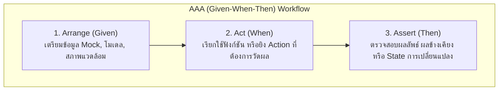

## 1. แนวคิด
เทสต์ที่ดีจะต้องทำหน้าที่เป็น **Living Documentation** (เอกสารที่มีชีวิต) ที่อธิบายความต้องการของระบบอย่างตรงไปตรงมา ไม่กำกวม และไม่พังอย่างไร้เหตุผลเมื่อโครงสร้างโค้ดภายในถูกปรับปรุง

มี 2 เสาหลักสำคัญ:
1. **AAA Pattern (Arrange - Act - Assert)**: การแบ่งโครงสร้างของบล็อกทดสอบออกเป็น 3 ขั้นตอนชัดเจน ช่วยให้อ่านและดีบักได้ง่ายดาย (เทียบเท่ากับ **Given - When - Then** ใน BDD)
2. **Behavior-Driven Testing**: ทดสอบ "พฤติกรรมภายนอกและผลลัพธ์ที่สังเกตได้" (Observable Behavior) ไม่ทดสอบ "รายละเอียดการทำงานภายใน" (Implementation Details)



## 2. หลักการเบื้องหลัง: หลีกเลี่ยง Implementation Details และหลักการ FIRST

### ทำไมไม่ควรทดสอบ Implementation Details?
หากเราเขียนเทสต์ตรวจสอบว่า:
- คลาสนี้มีตัวแปร `private _tempSteakBuffer: string[]` บันทึกค่าอะไรอยู่
- ฟังก์ชันนี้ใช้ `for loop` หรือ `.reduce()` ในการคำนวณ

เมื่อไหร่ก็ตามที่เรา Refactor โค้ดเพื่อปรับปรุง Performance (เช่น เปลี่ยนจาก Loop เป็น Map/Reduce) **เทสต์จะพังทันทีทั้งที่ระบบยังทำงานถูกต้อง 100%** สิ่งนี้เรียกว่า **False Negative** หรือ **Brittle Test (เทสต์เปราะบาง)** ทำให้ทีมสูญเสียความเชื่อมั่นและมองว่าเทสต์เป็นตัวถ่วง

### หลักการ FIRST
- **F (Fast)**: รันได้อย่างรวดเร็วในระดับเสี้ยววินาทีต่อเคส
- **I (Isolated / Hermetic)**: แต่ละเทสต์ต้องเป็นอิสระต่อกัน ไม่ส่งผลข้างเคียง (State Mutation) ข้ามเทสต์
- **R (Repeatable)**: รันกี่ครั้ง บนเครื่องใคร หรือรันบน CI เวลาไหน ผลลัพธ์ต้องเหมือนเดิมเสมอ (Deterministic)
- **S (Self-validating)**: ผลลัพธ์ต้องสรุปชัดเจนว่าเป็น Pass หรือ Fail โดยไม่ต้องอาศัยคนเปิด Log ดู
- **T (Timely)**: เขียนเทสต์อย่างทันท่วงทีควบคู่กับการเขียน Production Code

---

## 3. ตัวอย่างโค้ด: AAA Pattern & Behavior-Driven ใน Smart Butcher

### ตัวอย่างที่ 1: การเขียน AAA ชัดเจนในระบบประเมินเกรดเนื้อ Dry-Aged
```typescript filename="domain/dry-age-grader.ts"
// domain/dry-age-grader.ts
export type BeefGrade = 'STANDARD' | 'PREMIUM_AGED' | 'MASTER_RESERVE';

export interface AgingEvaluation {
  grade: BeefGrade;
  flavorProfile: string;
  tendernessScore: number; // 1 - 100
}

export function evaluateDryAgedBeef(dryAgedDays: number): AgingEvaluation {
  if (dryAgedDays < 0) {
    throw new Error('จำนวนวันบ่มเนื้อต้องไม่ติดลบ');
  }

  if (dryAgedDays < 21) {
    return {
      grade: 'STANDARD',
      flavorProfile: 'Mild buttery beef flavor',
      tendernessScore: 70,
    };
  } else if (dryAgedDays <= 45) {
    return {
      grade: 'PREMIUM_AGED',
      flavorProfile: 'Rich nutty, earthy with intense umami',
      tendernessScore: 90,
    };
  } else {
    return {
      grade: 'MASTER_RESERVE',
      flavorProfile: 'Deep blue-cheese, funky umami, extreme tenderness',
      tendernessScore: 98,
    };
  }
}
```

```typescript filename="tests/unit/dry-age-grader.spec.ts"
// tests/unit/dry-age-grader.spec.ts
import { evaluateDryAgedBeef } from '../../domain/dry-age-grader';

describe('evaluateDryAgedBeef', () => {
  it('should categorize beef as MASTER_RESERVE when dry-aged for 60 days', () => {
    // 1. Arrange (Given): จัดเตรียมเงื่อนไขเริ่มต้น
    const dryAgedDays = 60;

    // 2. Act (When): รันฟังก์ชันที่ต้องการทดสอบ
    const evaluation = evaluateDryAgedBeef(dryAgedDays);

    // 3. Assert (Then): ตรวจสอบผลลัพธ์เชิงพฤติกรรม
    expect(evaluation.grade).toBe('MASTER_RESERVE');
    expect(evaluation.tendernessScore).toBeGreaterThanOrEqual(95);
    expect(evaluation.flavorProfile).toContain('funky umami');
  });
});
```

### ตัวอย่างที่ 2: State Transition ของ Order Lifecycle (Behavioral Testing)
```typescript filename="domain/order-state-machine.ts"
// domain/order-state-machine.ts
import { Order, OrderStatus } from './models';

export class InvalidOrderStateTransitionError extends Error {
  constructor(from: OrderStatus, to: OrderStatus) {
    super(`ไม่สามารถเปลี่ยนสถานะคำสั่งซื้อจาก ${from} ไปเป็น ${to} ได้`);
    this.name = 'InvalidOrderStateTransitionError';
  }
}

export function transitionOrderStatus(order: Order, nextStatus: OrderStatus): Order {
  const allowedTransitions: Record<OrderStatus, OrderStatus[]> = {
    PENDING: ['PAID', 'CANCELLED'],
    PAID: ['CUTTING', 'CANCELLED'],
    CUTTING: ['DELIVERED'],
    DELIVERED: [],
    CANCELLED: [],
  };

  const validNextStates = allowedTransitions[order.status];
  if (!validNextStates.includes(nextStatus)) {
    throw new InvalidOrderStateTransitionError(order.status, nextStatus);
  }

  return {
    ...order,
    status: nextStatus,
  };
}
```

```typescript filename="tests/unit/order-state-machine.spec.ts"
// tests/unit/order-state-machine.spec.ts
import { transitionOrderStatus, InvalidOrderStateTransitionError } from '../../domain/order-state-machine';
import { Order } from '../../domain/models';

describe('transitionOrderStatus (Behavioral State Transition)', () => {
  const createMockOrder = (status: Order['status']): Order => ({
    id: 'ord-test-01',
    orderNo: 'SBM-9999',
    userId: 'usr-customer-01',
    status,
    totalAmount: 2500,
    items: [],
    createdAt: new Date(),
  });

  it('should allow transitioning from PAID to CUTTING when butcher starts working', () => {
    // Arrange
    const paidOrder = createMockOrder('PAID');

    // Act
    const cuttingOrder = transitionOrderStatus(paidOrder, 'CUTTING');

    // Assert
    expect(cuttingOrder.status).toBe('CUTTING');
  });

  it('should reject invalid transition directly from PENDING to CUTTING before payment', () => {
    // Arrange: คำสั่งซื้อที่ยังไม่ได้จ่ายเงิน
    const pendingOrder = createMockOrder('PENDING');

    // Act & Assert: ต้องปฏิเสธไม่ให้ช่างเนื้อนำไปแล่เด็ดขาด
    expect(() => transitionOrderStatus(pendingOrder, 'CUTTING')).toThrow(
      InvalidOrderStateTransitionError
    );
    expect(() => transitionOrderStatus(pendingOrder, 'CUTTING')).toThrow(
      'ไม่สามารถเปลี่ยนสถานะคำสั่งซื้อจาก PENDING ไปเป็น CUTTING ได้'
    );
  });
});
```

---

## 4. ผิด vs ถูก: การทดสอบพฤติกรรมเทียบกับการทดสอบ Implementation Details

```typescript filename="src/fundamentals.spec.ts"
// ❌ ผิด: ทดสอบ Implementation Detail และ Private State
it('should verify internal private variable of ButcherOrderProcessor', () => {
  const processor = new ButcherOrderProcessor();
  processor.processItem({ id: 'item-1', price: 100 });

  // แอบเข้าถึง private property เพื่อดูว่าเก็บ array แบบไหน
  // หากวันข้างหน้าเปลี่ยนมาใช้ Set หรือ Map เทสต์นี้จะพังทันที!
  expect((processor as any)._internalItemCache.length).toBe(1);
});

// ✅ ถูก: ทดสอบผลลัพธ์ผ่าน Public API ที่ผู้ใช้เรียกใช้งานจริง
it('should calculate aggregated total correctly when multiple items are added', () => {
  const processor = new ButcherOrderProcessor();
  processor.addItem({ id: 'item-1', price: 100 });
  processor.addItem({ id: 'item-2', price: 200 });

  // Assert observable behavior
  expect(processor.getGrandTotal()).toBe(300);
});
```

---

## 5. ควรใช้เมื่อไหร่ / ไม่ควรใช้เมื่อไหร่
- **ควรใช้**: ทุก Test Case ควรร้อยเรียงด้วย AAA Pattern เสมอ เพื่อให้อ่านเข้าใจได้ทันทีว่า Setup ข้อมูลอะไร รันอะไร และคาดหวังอะไร
- **ไม่ควรใช้**: การรวมหลายๆ Act และหลายๆ Assert สลับไปมาหลายรอบใน 1 `it()` บล็อก เพราะเมื่อเกิดข้อผิดพลาด จะระบุสาเหตุที่แท้จริงได้ยาก

---

## 6. คำถามสัมภาษณ์งานระดับ Senior
**คำถาม**: *"ทำไมการตั้งชื่อ Test Case จึงควรใช้ Behavioral Language (เช่น 'should apply VIP discount when buyer is VIP') แทนการตั้งชื่อตามชื่อเมธอด (เช่น 'test_calculateTotal_1')?"*

**แนวคำตอบระดับ Senior**:
> "เพราะชุดทดสอบคือ **Executable Specification** ของระบบ หากตั้งชื่อว่า `test_calculateTotal_1` แล้วเทสต์ล้มเหลวใน CI ทีมจะไม่รู้เลยว่า Requirement ข้อไหนที่พัง แต่ถ้าตั้งชื่อเป็นภาษาพฤติกรรม เช่น `should reject steak cutting when order is unpaid` เมื่อเทสต์ล้มเหลว Product Owner หรือ Developer ทุกคนจะเข้าใจทันทีว่ากฎทางธุรกิจข้อใดถูกละเมิด ทำให้สื่อสารและแก้ไขได้ตรงจุดทันที"

---
