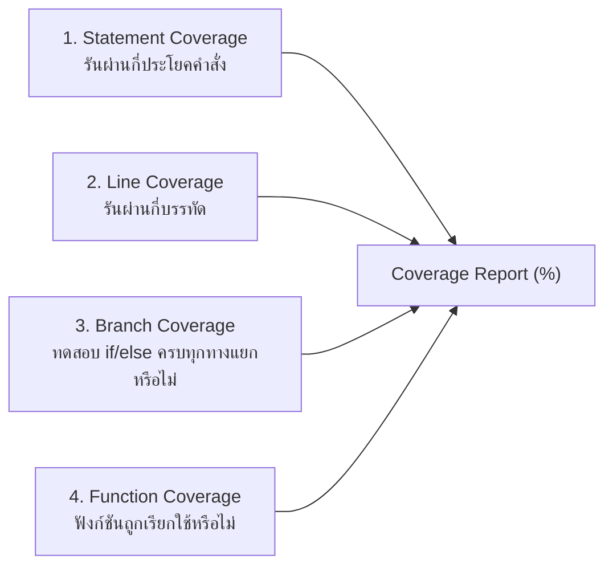

## 1. แนวคิด
**Code Coverage** คือตัวชี้วัดเชิงปริมาณ (Quantitative Metric) ที่แสดงว่าโค้ด Production ถูกเรียกใช้ (Execute) โดยชุดทดสอบไปมากน้อยเพียงใด โดยทั่วไปรายงานผ่าน 4 มิติ:



แม้ตัวเลข Coverage จะมีประโยชน์ในการตรวจหา **Dead Code** หรือ **Unchecked Path** แต่ **การตั้งเป้าหมาย 100% Coverage กลับเป็นกับดักที่อันตรายที่สุดอย่างหนึ่งในวิศวกรรมซอฟต์แวร์**

## 2. หลักการเบื้องหลัง: ภาพลวงตาของ 100% Coverage (Goodhart's Law)

> *"When a measure becomes a target, it ceases to be a good measure."*
> — Marilyn Strathern (Goodhart's Law)

หากฝ่ายบริหารกำหนด KPI ว่า *"ทุกโปรเจกต์ต้องมี Code Coverage 100%"* สิ่งที่จะเกิดขึ้นในทางปฏิบัติคือ:
1. **The Assertion-Free Test**: นักพัฒนาเขียนเทสต์ที่เรียกใช้ฟังก์ชันเพื่อให้โค้ดรันผ่านทุกบรรทัด แต่ไม่มีคำสั่ง `expect()` เลยแม้แต่ข้อเดียว เทสต์จะเขียว 100% Coverage ทันทีทั้งที่จับบั๊กอะไรไม่ได้เลย
2. **ละเลย Edge Cases**: 100% Line Coverage ไม่ได้รับประกันว่าระบบจะรองรับค่า `null`, `undefined`, Negative Numbers, หรือ Network Timeout
3. **ต้นทุนบำรุงรักษาสูงเกินผลตอบแทน (Diminishing Returns)**: การดันตัวเลขจาก 85% ไปเป็น 100% ต้องใช้เวลาเขียนเทสต์เพื่อคลุม Boilerplate, Getters, Setters, และ Config Files ซึ่งแทบไม่มีคุณค่าทางธุรกิจ

**ตัวเลขเป้าหมายระดับสากลในระดับองค์กร**:
- **75% - 85%** สำหรับ Core Business Logic และ Domain Layer (จุดที่ให้ผลตอบแทนคุ้มค่าที่สุด)
- **ไม่บังคับ Coverage สูง** กับ UI Markup, Configuration Files, และ Third-party Library Wrappers

---

## 3. ตัวอย่างโค้ด: การเปรียบเทียบ 100% Line Coverage ที่มีบั๊ก กับ Test ที่มีคุณภาพ

### โค้ดคำนวณส่วนลดเนื้อตามอายุการบ่ม
```typescript filename="services/aging-discount-calculator.ts"
// services/aging-discount-calculator.ts
export function calculateAgingDiscount(dryAgedDays: number, basePrice: number): number {
  let discountPercentage = 0;

  // กฎ: ถ้าเนื้อบ่มนานเกิน 40 วัน ลด 5%, เกิน 60 วัน ลด 10%
  if (dryAgedDays > 60) {
    discountPercentage = 0.10;
  } else if (dryAgedDays > 40) {
    discountPercentage = 0.05;
  }

  return basePrice * discountPercentage;
}
```

### ตัวอย่างที่ 1: ภาพลวงตาของ 100% Coverage (เทสต์ผ่านครบทุกบรรทัด แต่ไร้ประโยชน์)
```typescript filename="tests/unit/aging-discount-bad-coverage.spec.ts"
// tests/unit/aging-discount-bad-coverage.spec.ts
import { calculateAgingDiscount } from '../../services/aging-discount-calculator';

describe('calculateAgingDiscount (Illusion of 100% Coverage)', () => {
  it('should execute all lines to achieve 100% coverage', () => {
    // รันเคสที่ 1: เข้า if แรก (dryAgedDays = 70)
    calculateAgingDiscount(70, 2000);

    // รันเคสที่ 2: เข้า else if (dryAgedDays = 50)
    calculateAgingDiscount(50, 2000);

    // รันเคสที่ 3: ไม่เข้าเงื่อนไขใดๆ (dryAgedDays = 30)
    calculateAgingDiscount(30, 2000);

    // ❌ ผลลัพธ์: Istanbul/Jest จะรายงานว่าไฟล์นี้มี 100% Line และ Branch Coverage!
    // แต่ไม่มีการใส่ expect() ตรวจสอบผลลัพธ์เลย หากสูตรคิดเลขผิด ระบบก็ไม่เตือน
  });
});
```

### ตัวอย่างที่ 2: การทดสอบคุณภาพสูงที่มุ่งเน้น Boundary Value Analysis
```typescript filename="tests/unit/aging-discount-quality.spec.ts"
// tests/unit/aging-discount-quality.spec.ts
import { calculateAgingDiscount } from '../../services/aging-discount-calculator';

describe('calculateAgingDiscount (Quality & Boundary Coverage)', () => {
  it('should return exactly 0 discount for boundary day 40', () => {
    // ทดสอบจุดขอบเขต (Boundary Value)
    expect(calculateAgingDiscount(40, 1000)).toBe(0);
  });

  it('should return 5% discount immediately at day 41', () => {
    expect(calculateAgingDiscount(41, 1000)).toBe(50);
  });

  it('should return exactly 5% discount for boundary day 60', () => {
    expect(calculateAgingDiscount(60, 1000)).toBe(50);
  });

  it('should return 10% discount immediately at day 61', () => {
    expect(calculateAgingDiscount(61, 1000)).toBe(100);
  });

  it('should handle zero price gracefully', () => {
    expect(calculateAgingDiscount(50, 0)).toBe(0);
  });
});
```

---

## 4. ผิด vs ถูก: นโยบายและแนวทางการจัดการ Code Coverage

```typescript filename="src/fundamentals.spec.ts"
// ❌ ผิด: ตั้งค่า CI บังคับ Fail หาก Global Coverage ไม่ถึง 100%
// ผลลัพธ์: ทีมเริ่มเขียน mock dummy เพื่อเลี่ยงการเทสต์จริง และเลิก refactor โค้ดเพราะกลัวตัวเลขตก
// jest.config.js
module.exports = {
  coverageThreshold: {
    global: {
      branches: 100,
      functions: 100,
      lines: 100,
      statements: 100,
    },
  },
};

// ✅ ถูก: ตั้ง Coverage Threshold แยกตามความสำคัญของโฟลเดอร์ (Layered Thresholds)
// jest.config.js
module.exports = {
  coverageThreshold: {
    // บังคับเข้มงวดเฉพาะ Core Domain & Calculation Logic
    './src/domain/**/*.ts': {
      branches: 85,
      functions: 90,
      lines: 85,
    },
    // ผ่อนปรนในส่วน UI Controllers หรือ Framework Setup
    './src/controllers/**/*.ts': {
      lines: 70,
    },
  },
};
```

---

## 5. ควรใช้เมื่อไหร่ / ไม่ควรใช้เมื่อไหร่
- **ควรใช้ Coverage Tool**: เป็นเครื่องมือนำทาง (Diagnostic Tool) สำหรับนักพัฒนาเพื่อดูว่ามี Branch เคสไหนที่เราอาจหลงลืมคิดถึง
- **ไม่ควรใช้ Coverage Tool**: เป็นเกณฑ์เดี่ยวในการวัดความสำเร็จของทีม หรือใช้เป็นเครื่องตัดสินโบนัสของวิศวกร

---

## 6. คำถามสัมภาษณ์งานระดับ Senior
**คำถาม**: *"หากระบบของคุณมี Branch Coverage สูงถึง 95% แต่อัตราการหลุดของบั๊กสู่ Production ไม่ได้ลดลงเลย คุณคิดว่าปัญหาน่าจะเกิดจากอะไร และจะปรับปรุงอย่างไร?"*

**แนวคำตอบระดับ Senior**:
> "สาเหตุหลักมักเกิดจาก **Assertion Blindness** (เทสต์รันผ่านโค้ดแต่ไม่ได้ Assert ความถูกต้องของ Business Invariant) และการขาด **Edge Case & Integration Testing** (เทสต์เฉพาะค่าปกติ แต่ไม่เทสต์จังหวะที่ระบบเชื่อมต่อกัน เช่น Database Timeout, Race Condition, หรือ Data Serialization)
> แนวทางแก้ปัญหาคือ:
> 1. นำเทคนิค **Mutation Testing** (เช่น Stryker) มาตรวจวัดว่า Assertion ของเรามีประสิทธิภาพจริงหรือไม่
> 2. เปลี่ยน Focus จากการปั๊ม Line Coverage ไปสู่การทำ **Boundary Value Analysis** และ **Integration Flow Testing**"

---
