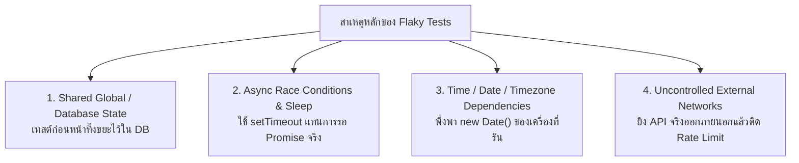

## 1. แนวคิด
**Flaky Test (เทสต์ไม่เสถียร)** คือการทดสอบที่รันด้วยซอร์สโค้ดชุดเดิมทุกประการ แต่ **บางครั้งก็ผ่าน (Pass) บางครั้งก็ล้มเหลว (Fail)** โดยไม่มีการเปลี่ยนแปลงโค้ดใดๆ เลย

Flaky Test คือ **ยาพิษที่อันตรายที่สุดต่อวัฒนธรรมวิศวกรรม**:
- ทำลายความเชื่อมั่นในระบบ CI/CD (เมื่อเทสต์แดง นักพัฒนาจะพูดว่า *"อ๋อ มัน flaky น่ะ ช่างมัน กด Re-run อีกรอบเดี๋ยวก็เขียว"*)
- เมื่อเกิดบั๊กจริงหลุดเข้ามา ทุกคนจะมองข้ามเพราะคิดว่าเป็นแค่ Flaky Test
- ทำให้ Build Pipeline ล่าช้า เสียเวลาของทั้งทีมในการรอ Re-run ซ้ำๆ



## 2. หลักการเบื้องหลัง: 4 ต้นตอหลักและกลยุทธ์การแก้ไขอย่างถาวร

1. **Shared State ระหว่างเคสทดสอบ**:
   - *ปัญหา*: เทสต์เคส A สร้างเนื้อ 'Wagyu A5' ไว้ในฐานข้อมูล แล้วเทสต์เคส B ที่รันคู่ขนานกันดันนับจำนวนสินค้าทั้งหมด ทำให้ผลลัพธ์เพี้ยน
   - *วิธีแก้*: ทำ **Database Cleaner / Transaction Rollback** ใน `beforeEach` หรือใช้ Unique Dynamic ID (UUID) แยกข้อมูลของแต่ละเทสต์อย่างเด็ดขาด
2. **Race Conditions & Arbitrary Delays**:
   - *ปัญหา*: ใช้คำสั่งรอแบบคาดเดา เช่น `await sleep(1000)` เพื่อรอให้สถานะเปลี่ยน แต่บนเซิร์ฟเวอร์ CI เครื่องอาจจะช้ากว่าเครื่อง Local จน 1 วินาทีไม่เพียงพอ
   - *วิธีแก้*: ใช้ Polling Assertion หรือ Event-driven Wait (เช่น `waitFor(() => expect(...))`)
3. **Time / Timezone / Locale Dependency**:
   - *ปัญหา*: โค้ดคำนวณโปรโมชั่น Happy Hour โดยใช้ `new Date()` รันตอนบ่าย 2 ผ่าน แต่เมื่อ CI รันตอน 5 ทุ่มกลับพัง
   - *วิธีแก้*: ใช้ **Fake Timers** (`vi.useFakeTimers()`) หรือทำ Clock Injection
4. **Network Dependencies**:
   - *ปัญหา*: เทสต์ยิงไปหา Currency Exchange API หรือ SMS Gateway จริง
   - *วิธีแก้*: ห้ามยิง Network จริงในระดับ Unit/Integration เด็ดขาด ให้ใช้ Mock Service Worker (MSW) หรือ In-Memory Doubles

---

## 3. ตัวอย่างโค้ด: การจัดการ Flaky Test ในระบบเวลาและสต็อก

### ตัวอย่างที่ 1: การแก้ปัญหา Time-dependent Flaky Test (โปรโมชั่น Butcher Weekend)
```typescript filename="services/weekend-promotion.ts"
// services/weekend-promotion.ts
export function isWeekendButcherSpecialAvailable(currentDate: Date = new Date()): boolean {
  // กฎ: โปรโมชั่นลดราคาพิเศษมีเฉพาะวันเสาร์ (6) และวันอาทิตย์ (0) เท่านั้น
  const dayOfWeek = currentDate.getDay();
  return dayOfWeek === 0 || dayOfWeek === 6;
}
```

```typescript filename="tests/unit/weekend-promotion.spec.ts"
// tests/unit/weekend-promotion.spec.ts
import { isWeekendButcherSpecialAvailable } from '../../services/weekend-promotion';

describe('isWeekendButcherSpecialAvailable (Deterministic Testing)', () => {
  // ❌ ตัวอย่าง Flaky Test: ถ้าใครมารันเทสต์นี้ในวันจันทร์-ศุกร์ เทสต์จะพังทันที!
  /*
  it('should verify weekend special (FLAKY ANTI-PATTERN)', () => {
    // พึ่งพา new Date() ของเวลาจริงในขณะนั้น
    const isAvailable = isWeekendButcherSpecialAvailable();
    expect(isAvailable).toBe(true); // พังแน่นอนถ้าไม่ใช่วันเสาร์/อาทิตย์
  });
  */

  // ✅ การเขียนที่ถูกต้อง: ควบคุมเวลาอย่างแน่นอน (Deterministic)
  it('should return true when date is Saturday', () => {
    // Arrange: จำลองวันเสาร์ที่ 17 ตุลาคม 2026
    const fixedSaturday = new Date('2026-10-17T10:00:00.000Z');

    // Act
    const result = isWeekendButcherSpecialAvailable(fixedSaturday);

    // Assert
    expect(result).toBe(true);
  });

  it('should return false when date is Wednesday', () => {
    // Arrange: จำลองวันพุธที่ 14 ตุลาคม 2026
    const fixedWednesday = new Date('2026-10-14T10:00:00.000Z');

    // Act
    const result = isWeekendButcherSpecialAvailable(fixedWednesday);

    // Assert
    expect(result).toBe(false);
  });
});
```

### ตัวอย่างที่ 2: การแก้ปัญหา Async Timing & Race Condition Flaky Test
```typescript filename="services/butcher-async-order.ts"
// services/butcher-async-order.ts
export class AsyncOrderProcessor {
  private processingOrders = new Set<string>();

  async processOrderAsync(orderId: string, durationMs: number = 50): Promise<string> {
    this.processingOrders.add(orderId);

    return new Promise((resolve) => {
      setTimeout(() => {
        this.processingOrders.delete(orderId);
        resolve(`Order ${orderId} cutting completed`);
      }, durationMs);
    });
  }

  isProcessing(orderId: string): boolean {
    return this.processingOrders.has(orderId);
  }
}
```

```typescript filename="tests/unit/async-order-processor.spec.ts"
// tests/unit/async-order-processor.spec.ts
import { AsyncOrderProcessor } from '../../services/butcher-async-order';

describe('AsyncOrderProcessor (Handling Async Deterministically)', () => {
  beforeEach(() => {
    vi.useFakeTimers(); // สั่งให้ Vitest / Jest ควบคุมเวลาจำลอง
  });

  afterEach(() => {
    vi.useRealTimers(); // คืนค่าเวลาจริงเมื่อเทสต์เสร็จ
  });

  it('should track processing state and complete deterministically without real delay', async () => {
    // Arrange
    const processor = new AsyncOrderProcessor();
    const orderId = 'ord-dry-aged-99';

    // Act: เริ่มต้นทำงาน async
    const processPromise = processor.processOrderAsync(orderId, 5000); // จำลองว่าใช้เวลา 5 วินาที

    // ณ วินาทีนี้ สถานะต้องกำลังทำงานอยู่
    expect(processor.isProcessing(orderId)).toBe(true);

    // สั่งเร่งเวลาเดินหน้าไป 5 วินาทีในทันทีโดยไม่ต้องรอจริง!
    vi.advanceTimersByTime(5000);

    const result = await processPromise;

    // Assert
    expect(result).toBe('Order ord-dry-aged-99 cutting completed');
    expect(processor.isProcessing(orderId)).toBe(false);
  });
});
```

---

## 4. ผิด vs ถูก: การรับมือกับ Flaky Tests

```typescript filename="src/fundamentals.spec.ts"
// ❌ ผิด: ซุกขยะไว้ใต้พรมด้วยการสั่ง Retry ซ้ำๆ หรือใส่ sleep ยาวๆ
// การทำเช่นนี้ไม่ได้แก้ปัญหา แต่ทำให้ทั้งทีมชินชากับความไม่เสถียร
test('flaky test workaround anti-pattern', async () => {
  // รอนานถึง 5 วินาทีเพื่อหวังว่า async task จะเสร็จทัน
  await new Promise((resolve) => setTimeout(resolve, 5000));
  expect(checkStatus()).toBe('READY');
});

// ✅ ถูก: ใช้ Polling assertion ที่ตรวจสอบเงื่อนไขทันทีที่พร้อม และมี timeout ที่ชัดเจน
test('deterministic assertion with retry-until-ready', async () => {
  await vi.waitFor(
    () => {
      expect(checkStatus()).toBe('READY');
    },
    { timeout: 2000, interval: 50 }
  );
});
```

---

## 5. ควรใช้เมื่อไหร่ / ไม่ควรใช้เมื่อไหร่
- เมื่อพบ Flaky Test ในระบบ: **ต้องนำออกจาก Main Build ทันที (Quarantine)** โดยแยกไปใส่ใน Quarantine Suite เพื่อไม่ให้บล็อกทีม แล้วเปิด Ticket แก้ไขต้นตอของ State/Timing ให้เรียบร้อยก่อนนำกลับเข้ามา
- **ห้ามใช้ `retryTimes(3)`** เป็นทางแก้ถาวรเด็ดขาด อนุญาตให้ใช้เฉพาะชั่วคราวขณะสืบสวนหา Root Cause เท่านั้น

---

## 6. คำถามสัมภาษณ์งานระดับ Senior
**คำถาม**: *"หากใน CI Pipeline ของคุณมีเทสต์ตัวหนึ่งที่ล้มเหลวแบบสุ่มประมาณ 5% ของรอบการรัน โดยเกิดขึ้นเฉพาะบน CI แต่รันในเครื่อง Local ไม่เคยพังเลย คุณมีขั้นตอนในการสืบสวน (Root Cause Analysis) และแก้ไขปัญหานี้อย่างไร?"*

**แนวคำตอบระดับ Senior**:
> "ขั้นตอนการวิเคราะห์เชิงระบบมีดังนี้:
> 1. **ตรวจเช็ค Timezone และ Locale Difference**: CI ส่วนใหญ่รันบน Linux และตั้งค่าเป็น UTC ในขณะที่เครื่อง Local อาจเป็น GMT+7 (Bangkok) หากโค้ดแปลง Date หรือ Format เงินด้วยสกุลเงินท้องถิ่น จะพังบน CI ทันที
> 2. **ตรวจเช็ค Concurrency & Resource Contention**: บน CI มักรันแบบ Parallel (`--maxWorkers`) ซึ่งอาจเกิด Race Condition ในการแย่งพอร์ตหรือฐานข้อมูล ในขณะที่เครื่อง Local รันแบบ Single Worker
> 3. **ตรวจเช็ค Shared Database State**: มีเทสต์อื่นที่รันก่อนหน้าแล้วไม่ได้ Clean ข้อมูลในตารางหรือไม่
> 4. **ขั้นตอนแก้ปัญหา**: ทำ Quarantine เทสต์นั้นออกทันทีเพื่อไม่ให้รบกวนทีม, ใช้ Docker Container จำลองสภาพแวดล้อมเดียวกับ CI ในเครื่อง Local, ฉีด Deterministic Data และ Clock เข้าไปแทนการพึ่งพาเวลาจริงของเครื่อง"

---
