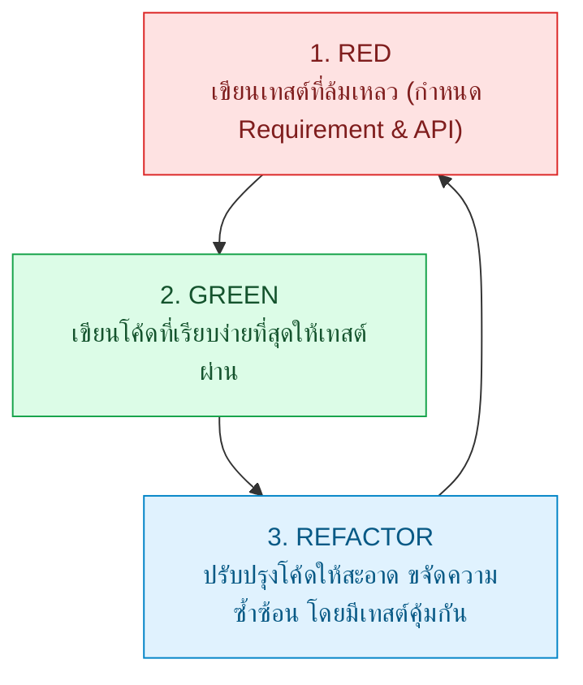

## 1. แนวคิด
**Test-Driven Development (TDD)** ไม่ใช่เทคนิคการทดสอบโค้ด แต่เป็น **เทคนิคการออกแบบซอฟต์แวร์ (Design Technique)** ผ่านวงจรความคิดแบบวนซ้ำสั้นๆ (Micro-feedback Loops)

ปรัชญาหัวใจของ TDD คือ **"ห้ามเขียน Production Code แม้แต่บรรทัดเดียว หากยังไม่มี Automated Test ที่ล้มเหลวมารองรับ"**



## 2. หลักการเบื้องหลัง: วงจร Red-Green-Refactor
1. **RED (เขียนเทสต์ก่อน)**:
   - บังคับให้นักพัฒนาคิดจากมุมมองของ **Consumer (ผู้เรียกใช้งาน API)** ว่าต้องการฟังก์ชันชื่ออะไร รับพารามิเตอร์อะไร คืนค่าแบบไหน
   - รันเทสต์แล้วต้องเห็นผลเป็นสีแดง (Fail) เพื่อพิสูจน์ว่าเทสต์ไม่ได้ผ่านโดยบังเอิญ
2. **GREEN (ทำให้ผ่านอย่างรวดเร็ว)**:
   - เขียนโค้ดที่ตรงไปตรงมาที่สุดเพื่อแก้ปัญหาเฉพาะหน้า แม้กระทั่งการ Hardcode ค่ากลับไปชั่วคราว เพื่อยืนยันว่าการเชื่อมต่อถูกต้อง
3. **REFACTOR (จัดระเบียบโครงสร้าง)**:
   - ปรับปรุง Clean Code, ลดความซ้ำซ้อน (DRY), แยก Method, ปรับอัลกอริทึม
   - ทุกครั้งที่แก้ไขโค้ด สามารถกดรันเทสต์ซ้ำได้ทันที หากยังคงเป็นสีเขียว (Green) แสดงว่าพฤติกรรมเดิมไม่เสียหาย

---

## 3. ตัวอย่างโค้ด: การพัฒนาฟังก์ชันคำนวณค่าธรรมเนียมตัดแต่งเนื้อพิเศษด้วย TDD

### ขั้นที่ 1: RED - เขียนเทสต์กำหนดสเปกของ Custom Cut Fee
```typescript filename="tests/unit/butcher-cut-fee.spec.ts"
// tests/unit/butcher-cut-fee.spec.ts
import { calculateCustomCutFee } from '../../services/butcher-cut-fee';

describe('calculateCustomCutFee (TDD Cycle)', () => {
  it('should charge 0 THB for standard thickness (between 2.5cm and 4.0cm)', () => {
    // Standard cut ไม่คิดค่าบริการเพิ่ม
    const fee = calculateCustomCutFee('RIBEYE', 3.0);
    expect(fee).toBe(0);
  });

  it('should charge 50 THB fee for extra-thick cuts (> 4.0cm) due to special bone sawing', () => {
    // หนาพิเศษ ต้องใช้เลื่อยกระดูกพิเศษ คิด 50 บาท
    const fee = calculateCustomCutFee('RIBEYE', 5.0);
    expect(fee).toBe(50);
  });

  it('should charge 80 THB fee for ultra-thin carpaccio cuts (< 2.0cm) requiring precision slicer', () => {
    // บางเฉียบระดับ Carpaccio ใช้ฝีมือสูง คิด 80 บาท
    const fee = calculateCustomCutFee('TENDERLOIN', 1.0);
    expect(fee).toBe(80);
  });
});
```
*(เมื่อรันครั้งแรกจะเกิด Compilation Error เพราะยังไม่มีฟังก์ชัน `calculateCustomCutFee` อยู่จริง -> RED)*

### ขั้นที่ 2: GREEN - เขียนโค้ดอย่างง่ายที่สุดให้เทสต์ทั้งหมดผ่าน
```typescript filename="services/butcher-cut-fee.ts"
// services/butcher-cut-fee.ts
import { CutType } from '../domain/models';

export function calculateCustomCutFee(cutType: CutType, thicknessCm: number): number {
  if (thicknessCm > 4.0) {
    return 50;
  }
  if (thicknessCm < 2.0) {
    return 80;
  }
  return 0;
}
```
*(รันเทสต์ -> ผ่านเป็นสีเขียวทันที -> GREEN)*

### ขั้นที่ 3: REFACTOR - สเปกเริ่มขยาย จึงปรับปรุงให้อ่านง่ายและรองรับ Extension
```typescript filename="services/butcher-cut-fee.ts"
// services/butcher-cut-fee.ts (Refactored Version)
import { CutType } from '../domain/models';

export interface CutFeePolicy {
  minThickness: number;
  maxThickness: number;
  fee: number;
}

const CUT_FEE_POLICIES: Record<string, CutFeePolicy> = {
  PRECISION_THIN: { minThickness: 0, maxThickness: 1.99, fee: 80 },
  STANDARD_THICKNESS: { minThickness: 2.0, maxThickness: 4.0, fee: 0 },
  HEAVY_DUTY_THICK: { minThickness: 4.01, maxThickness: 10.0, fee: 50 },
};

export function calculateCustomCutFee(cutType: CutType, thicknessCm: number): number {
  if (thicknessCm <= 0) {
    throw new Error('ความหนาต้องมากกว่าศูนย์');
  }

  for (const policy of Object.values(CUT_FEE_POLICIES)) {
    if (thicknessCm >= policy.minThickness && thicknessCm <= policy.maxThickness) {
      return policy.fee;
    }
  }

  return 0;
}
```
*(รันเทสต์ซ้ำ โค้ดยังคงผ่านสีเขียวทุกกรณี แต่โครงสร้างรองรับการเพิ่มเงื่อนไขของเนื้อประเภทอื่นได้สะดวก)*

---

## 4. ผิด vs ถูก: แนวทางปฏิบัติในการทำ TDD

```typescript filename="src/fundamentals.spec.ts"
// ❌ ผิด: Test-After Anti-pattern (เขียนโค้ดธุรกิจซับซ้อน 800 บรรทัดเสร็จแล้ว ค่อยมาพยายามเขียนเทสต์คลุม)
// ผลลัพธ์: โค้ดจะถูกผูกมัดแน่น (Tightly Coupled) ยากต่อการ Mock และมักจบลงด้วยการเขียนเทสต์ส่งเดชเพื่อจบงาน

// ✅ ถูก: Baby Steps TDD (เริ่มจากเคสง่ายที่สุด แล้วค่อยๆ เพิ่มความซับซ้อนทีละสเต็ป)
// Step 1: เทสต์กรณีซื้อเนื้อน้ำหนักปกติ
// Step 2: เทสต์กรณีน้ำหนักเป็น 0 หรือค่าติดลบ
// Step 3: เทสต์กรณีลูกค้าเป็น VIP
// Step 4: เทสต์กรณีสต็อกไม่พอ
```

---

## 5. ควรใช้เมื่อไหร่ / ไม่ควรใช้เมื่อไหร่
- **ควรใช้ TDD อย่างยิ่ง**:
  - โดเมนที่มี Business Logic และเงื่อนไขการคำนวณที่ซับซ้อน (Core Domain Logic)
  - โมดูลที่มีการเปลี่ยนแปลงอัลกอริทึมบ่อยๆ เช่น Pricing, Discount Rule, Stock Allocation
  - เมื่อต้องแก้บั๊ก (เขียนเทสต์จับบั๊กให้เป็นสีแดงก่อน แล้วแก้โค้ดให้เขียว เพื่อป้องกัน Regression ถาวร)
- **ไม่ควรใช้ TDD**:
  - งานสำรวจและทดลองเทคโนโลยีใหม่ (Spike Solutions / Prototypes)
  - หน้า UI Layout และ CSS Styling ที่ดีไซเนอร์ยังปรับแก้ตำแหน่งรายชั่วโมง

---

## 6. คำถามสัมภาษณ์งานระดับ Senior
**คำถาม**: *"ทำไมโปรแกรมเมอร์หลายคนจึงบอกว่า TDD ใช้ไม่ได้จริงในชีวิตประจำวัน และในฐานะ Lead Developer คุณจะประยุกต์ใช้ TDD อย่างไรให้ทีมส่งมอบงานได้ตรงเวลา?"*

**แนวคำตอบระดับ Senior**:
> "สาเหตุที่คนส่วนใหญ่ล้มเหลวกับ TDD เกิดจากการพยายามทำ TDD กับทุกส่วนโดยไม่แยกแยะ เช่น การพยายามเขียนเทสต์ล่วงหน้ากับ UI Component หรือ Glue Code ที่เปลี่ยนตลอดเวลา ซึ่งทำให้เกิดต้นทุนสูงเกินจำเป็น
> แนวทางของผมคือการใช้ **Pragmatic TDD**: เราจะบังคับใช้วงจร Red-Green-Refactor 100% กับ **Core Domain Engine, Financial Calculations, และ Bug Fixes** ซึ่งเป็นจุดที่ TDD ให้คุณค่าสูงสุดในการกำหนดสเปกและป้องกันข้อผิดพลาด ส่วนงาน UI หรือ Integration Glue Code เราจะเน้นเขียน Component/Integration Test ควบคู่หรือตามหลัง (Test-Along) เพื่อรักษา Velocity ของทีม"

---
