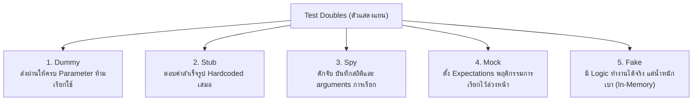

## 1. แนวคิด
ในการทดสอบซอฟต์แวร์ เรามักไม่สามารถใช้คอมโพเนนต์จริงได้ทุกชิ้น (เช่น การยิงตัดเงินผ่านบัตรเครดิตจริง, การส่ง SMS จริง, หรือการต่อ Database Production) 

เราจึงต้องใช้ **Test Doubles** (แนวคิดเปรียบเสมือน "สตันท์แมน" หรือตัวแสดงแทนในวงการภาพยนตร์) ตามการจัดหมวดหมู่คลาสสิกของ Gerard Meszaros และ Martin Fowler ซึ่งแบ่งออกเป็น 5 ประเภทหลัก:



## 2. หลักการเบื้องหลัง: คำจำกัดความและการเปรียบเทียบ

1. **Dummy**: อ็อบเจกต์ที่ส่งเข้าไปให้ครบตาม Type Signature ของฟังก์ชันเท่านั้น โค้ดจะไม่เข้าไปยุ่งหรือเรียกเมธอดใดๆ ของมัน
2. **Stub**: อ็อบเจกต์ที่คืนค่าสำเร็จรูปตามที่กำหนดไว้ล่วงหน้า (Hardcoded Responses) เพื่อให้โค้ดส่วนอื่นทำงานต่อไปได้ โดยไม่สนใจว่าใครจะเรียกอย่างไร
3. **Spy**: ห่อหุ้มฟังก์ชันหรืออ็อบเจกต์จริงไว้ เพื่อแอบบันทึกข้อมูล (จำนวนครั้งที่ถูกเรียก, พารามิเตอร์ที่ส่งเข้ามา) เพื่อนำมา Assert ในภายหลัง
4. **Mock**: อ็อบเจกต์ที่ตั้งค่าความคาดหวัง (Expectations) ไว้ล่วงหน้า ว่าจะต้องถูกเรียกด้วยพารามิเตอร์ใด กี่ครั้ง และถ้าไม่เป็นไปตามนั้น เทสต์จะล้มเหลวทันที
5. **Fake**: คลาสที่มี Business Logic ที่ทำงานได้จริง แต่ใช้การเก็บข้อมูลหรือโครงสร้างที่เรียบง่ายกว่าของจริง เช่น ใช้ In-Memory Hash Map แทน PostgreSQL

---

## 3. ตัวอย่างโค้ด: การเปรียบเทียบ Test Doubles ใน Smart Butcher Marketplace

### โค้ดระบบหลัก: บริการแจ้งเตือนช่างแล่เนื้อและตัดเงิน
```typescript filename="services/butcher-notification.ts"
// services/butcher-notification.ts
export interface IEmailClient {
  send(to: string, subject: string, body: string): Promise<boolean>;
}

export interface IPaymentGateway {
  charge(orderId: string, amount: number): Promise<{ success: boolean; transactionId: string }>;
}

export class ButcherOrderFulfillmentService {
  constructor(
    private readonly paymentGateway: IPaymentGateway,
    private readonly emailClient: IEmailClient
  ) {}

  async completeOrder(order: Order, customerEmail: string): Promise<boolean> {
    // 1. เรียกตัดเงิน
    const chargeResult = await this.paymentGateway.charge(order.id, order.totalAmount);
    if (!chargeResult.success) {
      throw new Error(`การชำระเงินล้มเหลวสำหรับคำสั่งซื้อ ${order.orderNo}`);
    }

    // 2. ส่งอีเมลแจ้งเตือนลูกค้า
    await this.emailClient.send(
      customerEmail,
      `คำสั่งซื้อ ${order.orderNo} กำลังเข้าสู่ขั้นตอนการตัดแต่งเนื้อ`,
      `เนื้อของคุณกำลังถูกตัดแต่งโดยช่างฝีมือด้วยความหนาที่ระบุ`
    );

    return true;
  }
}
```

### ตัวอย่างที่ 1: การใช้ Dummy, Stub, และ Spy
```typescript filename="tests/unit/test-doubles-demo.spec.ts"
// tests/unit/test-doubles-demo.spec.ts
import {
  ButcherOrderFulfillmentService,
  IEmailClient,
  IPaymentGateway,
} from '../../services/butcher-notification';
import { Order } from '../../domain/models';

describe('Test Doubles Demonstration (Dummy, Stub, Spy)', () => {
  const sampleOrder: Order = {
    id: 'ord-101',
    orderNo: 'SBM-101',
    userId: 'usr-1',
    status: 'PENDING',
    totalAmount: 1850,
    items: [],
    createdAt: new Date(),
  };

  it('1. Stub: ให้คำตอบตายตัวว่าตัดเงินสำเร็จเสมอ', async () => {
    // Stub: Hardcoded คืนค่า success เสมอ ไม่ว่า amount จะเป็นเท่าไหร่
    const paymentStub: IPaymentGateway = {
      charge: async () => ({ success: true, transactionId: 'txn-stub-999' }),
    };

    // Dummy Email Client: ทำตาม interface แต่ไม่คาดหวังผลลัพธ์
    const emailDummy: IEmailClient = {
      send: async () => true,
    };

    const service = new ButcherOrderFulfillmentService(paymentStub, emailDummy);
    const result = await service.completeOrder(sampleOrder, 'customer@meat.com');

    expect(result).toBe(true);
  });

  it('2. Spy: บันทึกการส่งอีเมลเพื่อตรวจสอบ Argument และจำนวนครั้งที่ถูกเรียก', async () => {
    const paymentStub: IPaymentGateway = {
      charge: async () => ({ success: true, transactionId: 'txn-123' }),
    };

    // Spy: บันทึกประวัติการเรียกใช้งานฟังก์ชัน send
    const sentEmailsHistory: Array<{ to: string; subject: string }> = [];
    const emailSpy: IEmailClient = {
      send: async (to, subject) => {
        sentEmailsHistory.push({ to, subject });
        return true;
      },
    };

    const service = new ButcherOrderFulfillmentService(paymentStub, emailSpy);
    await service.completeOrder(sampleOrder, 'vip@butcher.com');

    // Assert ผ่านข้อมูลที่ Spy จดบันทึกไว้
    expect(sentEmailsHistory).toHaveLength(1);
    expect(sentEmailsHistory[0].to).toBe('vip@butcher.com');
    expect(sentEmailsHistory[0].subject).toContain('SBM-101');
  });
});
```

### ตัวอย่างที่ 2: การใช้ Mock เทียบกับ Fake
```typescript filename="tests/unit/mock-vs-fake.spec.ts"
// tests/unit/mock-vs-fake.spec.ts
import {
  ButcherOrderFulfillmentService,
  IPaymentGateway,
  IEmailClient,
} from '../../services/butcher-notification';
import { Order } from '../../domain/models';

describe('Mock vs Fake Demonstration', () => {
  const sampleOrder: Order = {
    id: 'ord-555',
    orderNo: 'SBM-555',
    userId: 'usr-vip',
    status: 'PENDING',
    totalAmount: 4200,
    items: [],
    createdAt: new Date(),
  };

  it('3. Mock: ตั้ง Expectation ชัดเจนว่าจะต้องถูกเรียกด้วย amount ที่ถูกต้องเป๊ะๆ', async () => {
    // สร้าง Mock โดยใช้ Vitest/Jest mock function
    const mockCharge = vi.fn().mockResolvedValue({ success: true, transactionId: 'txn-mock-1' });
    const paymentMock: IPaymentGateway = { charge: mockCharge };

    const mockSend = vi.fn().mockResolvedValue(true);
    const emailMock: IEmailClient = { send: mockSend };

    const service = new ButcherOrderFulfillmentService(paymentMock, emailMock);
    await service.completeOrder(sampleOrder, 'buyer@butcher.com');

    // ตรวจสอบพฤติกรรม (Behavior Verification): ต้องเรียก charge ด้วย order id และ amount 4200
    expect(mockCharge).toHaveBeenCalledTimes(1);
    expect(mockCharge).toHaveBeenCalledWith('ord-555', 4200);

    expect(mockSend).toHaveBeenCalledWith(
      'buyer@butcher.com',
      expect.stringContaining('SBM-555'),
      expect.any(String)
    );
  });

  it('4. Fake: คลาสจำลอง Payment Gateway ที่มี Logic การตรวจสอบวงเงินจริงในหน่วยความจำ', async () => {
    // Fake: มีสถานะและ Logic เสมือนจริง (เช่น บัตรที่มีวงเงินจำกัด)
    class FakeWalletPaymentGateway implements IPaymentGateway {
      private balance = 5000;

      async charge(orderId: string, amount: number) {
        if (this.balance < amount) {
          return { success: false, transactionId: '' };
        }
        this.balance -= amount;
        return { success: true, transactionId: `fake-txn-${Date.now()}` };
      }

      getBalance() {
        return this.balance;
      }
    }

    const fakeGateway = new FakeWalletPaymentGateway();
    const emailDummy: IEmailClient = { send: async () => true };
    const service = new ButcherOrderFulfillmentService(fakeGateway, emailDummy);

    // ครั้งที่ 1: ตัด 4,200 จาก 5,000 -> สำเร็จ (เหลือ 800)
    await service.completeOrder(sampleOrder, 'buyer@butcher.com');
    expect(fakeGateway.getBalance()).toBe(800);

    // ครั้งที่ 2: พยายามตัดอีก 4,200 -> ยอดไม่พอ ต้องเกิด Exception ตาม Logic ของ Fake
    await expect(service.completeOrder(sampleOrder, 'buyer@butcher.com')).rejects.toThrow(
      'การชำระเงินล้มเหลวสำหรับคำสั่งซื้อ SBM-555'
    );
  });
});
```

---

## 4. ผิด vs ถูก: การใช้งาน Test Doubles

```typescript filename="src/fundamentals.spec.ts"
// ❌ ผิด: Over-Mocking! Mock ทุกสิ่งทุกอย่างจนไม่ได้ทดสอบอะไรที่มีความหมายเลย
it('should place order (Over-mocked anti-pattern)', async () => {
  const mockRepo = { findById: vi.fn(), save: vi.fn() };
  mockRepo.findById.mockResolvedValue({ id: '1', price: 100 });
  mockRepo.save.mockResolvedValue({ id: 'ord-1' });

  // Mock แม้กระทั่ง internal helper function จนเสมือนเทสต์กำลัง assert สิ่งที่ตัวเอง mock ไว้
  expect(await mockRepo.findById('1')).toEqual({ id: '1', price: 100 });
});

// ✅ ถูก: ใช้ Fake สำหรับ Repository และใช้ Mock เฉพาะขอบเขต External API ข้ามเครือข่าย
it('should place order and persist state using Fake Repository', async () => {
  const fakeRepo = new InMemoryProductRepository(); // มี logic ค้นหาและลดสต็อกจริง
  fakeRepo.seed([sampleProduct]);

  const service = new ButcherOrderService(fakeRepo, fakeOrderRepo);
  await service.placeSteakOrder('usr-1', sampleProduct.id, 'RIBEYE', 3.0, 1.5);

  expect(fakeRepo.getRemainingStock(sampleProduct.id)).toBe(3.5);
});
```

---

## 5. ควรใช้เมื่อไหร่ / ไม่ควรใช้เมื่อไหร่
- **ควรใช้ Stub/Fake**: เมื่อต้องการทดสอบ Business Logic ในระบบ โดยไม่ต้องเชื่อมต่อโครงสร้างพื้นฐานภายนอก (Database, S3, Redis)
- **ควรใช้ Mock/Spy**: เฉพาะกับ Side Effects ที่ส่งผลออกภายนอกระบบจริง (External Boundaries) เช่น การส่ง SMS, ยิง Webhook, หรือตัดเงินผ่าน Payment Provider
- **ไม่ควรใช้**: อย่า Mock โดเมนอ็อบเจกต์หรือ Pure Function ภายในโมดูลเดียวกัน

---

## 6. คำถามสัมภาษณ์งานระดับ Senior
**คำถาม**: *"State Verification ต่างจาก Behavior Verification อย่างไร และทำไมการใช้ Mock มากเกินไป (Over-mocking) จึงทำให้เกิดปัญหาในการบำรุงรักษาซอฟต์แวร์?"*

**แนวคำตอบระดับ Senior**:
> "**State Verification** คือการตรวจสอบผลลัพธ์สุดท้ายหรือ State ของระบบหลังทำงาน (เช่น ข้อมูลในฐานข้อมูลเปลี่ยนไปตามที่ควรหรือไม่) มักทำร่วมกับ Stub หรือ Fake
> ส่วน **Behavior Verification** คือการตรวจสอบว่ามีฟังก์ชันใดถูกเรียก ด้วยพารามิเตอร์ใด กี่ครั้ง ผ่าน Mock
> ปัญหาของ **Over-mocking** คือมันผูกชุดทดสอบเข้ากับ Implementation Details อย่างเหนียวแน่น หากเราเปลี่ยนลำดับการเรียกเมธอดภายใน แม้ผลลัพธ์สุดท้ายจะถูกต้องสมบูรณ์ แต่ Mock Verification จะล้มเหลวทันที ทำให้เทสต์กลายเป็นภาระในการดูแลรักษาแทนที่จะช่วยตรวจจับบั๊กจริง"

---
