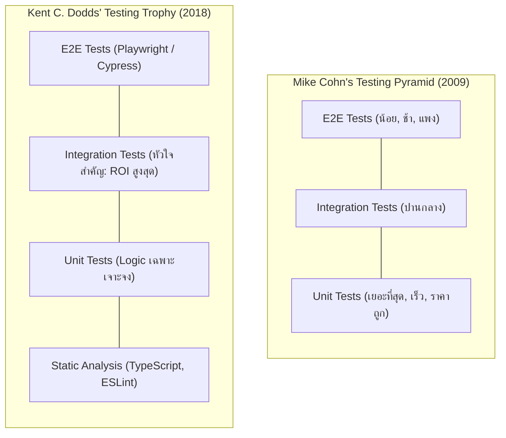

## 1. แนวคิด
ในการวางกลยุทธ์การทดสอบระดับองค์กร คำถามสำคัญคือ: **"เราควรลงทุนเขียนเทสต์ประเภทไหน ในสัดส่วนเท่าใด เพื่อให้ได้ผลตอบแทน (Return on Investment - ROI) สูงสุด?"**

มีสองโมเดลแนวคิดหลักที่เป็นมาตรฐานสากล:
1. **Testing Pyramid (Mike Cohn, 2009)**: เน้นฐานกว้างด้วย Unit Tests (รันเร็ว ถูก), ตรงกลางคือ Service/Integration Tests, และยอดแหลมคือ UI/E2E Tests
2. **Testing Trophy (Kent C. Dodds, 2018)**: เน้นย้ำว่าในยุค Web Application และ Microservices ปัจจุบัน **Integration Tests ให้สมดุลระหว่างความมั่นใจ (Confidence) และต้นทุนการดูแลรักษา (Maintenance Cost) สูงที่สุด**



## 2. หลักการเบื้องหลัง: การเปรียบเทียบเชิงลึก

| มิติการเปรียบเทียบ | Static Analysis | Unit Test | Integration Test | End-to-End (E2E) |
| :--- | :--- | :--- | :--- | :--- |
| **สิ่งที่ทดสอบ** | Syntax, Data Types, Typo | 1 ฟังก์ชัน หรือ 1 Method โดดๆ | การทำงานร่วมกันหลายโมดูล / DB | ระบบทั้งระบบผ่านเบราว์เซอร์จริง |
| **ความเร็วในการรัน** | เสี้ยววินาที (ms) | หลักมิลลิวินาที (ms) | หลักร้อยมิลลิวินาที (100ms - 2s) | หลักวินาทีถึงนาที (10s - 5m) |
| **ต้นทุนการดูแล (Cost)** | ต่ำมาก (ตั้งค่าครั้งเดียว) | ต่ำ (หักล้างง่าย) | ปานกลาง | สูงมาก (ติด Flaky บ่อยเมื่อ UI เปลี่ยน) |
| **ระดับความมั่นใจ** | จับ Typo ได้ แต่ไม่รู้ว่า logic ถูกไหม | มั่นใจเฉพาะจุดเล็กๆ | **สูงมากต่อราคา (Optimal ROI)** | สูงที่สุดต่อพฤติกรรมจริงของผู้ใช้ |

Kent C. Dodds สรุปปรัชญาไว้ว่า:
> *"Write tests. Not too many. Mostly integration."*
> (เขียนเทสต์ แต่อย่าเขียนมากเกินไป และให้เน้นหนักที่ Integration Tests เป็นหลัก)

---

## 3. ตัวอย่างโค้ด: การแบ่งระดับการทดสอบในระบบ Smart Butcher

### ตัวอย่างที่ 1: Unit Test (ทดสอบ Pure Logic การแบ่งชิ้นสเต็ก)
```typescript filename="domain/portion-calculator.ts"
// domain/portion-calculator.ts
export interface SteakCutPortion {
  cutsCount: number;
  remainderKg: number;
}

export function calculateSteakPortions(
  slabWeightKg: number,
  thicknessCm: number,
  approxWeightPerCmKg: number = 0.12 // เนื้อ 1 ซม. หนักประมาณ 120 กรัม
): SteakCutPortion {
  if (slabWeightKg <= 0 || thicknessCm <= 0) {
    throw new Error('ค่าน้ำหนักและความหนาต้องมากกว่าศูนย์');
  }

  const weightPerCut = thicknessCm * approxWeightPerCmKg;
  const cutsCount = Math.floor(slabWeightKg / weightPerCut);
  const remainderKg = Number((slabWeightKg - cutsCount * weightPerCut).toFixed(3));

  return { cutsCount, remainderKg };
}
```

```typescript filename="tests/unit/portion-calculator.spec.ts"
// tests/unit/portion-calculator.spec.ts
import { calculateSteakPortions } from '../../domain/portion-calculator';

describe('calculateSteakPortions (Unit Level)', () => {
  it('should calculate exact cuts and remainder for a 3kg Wagyu slab at 2.5cm thickness', () => {
    // 2.5cm * 0.12 = 0.30 kg ต่อชิ้น
    // 3.0 kg / 0.30 kg = 10 ชิ้นพอดี เหลือเศษ 0
    const result = calculateSteakPortions(3.0, 2.5, 0.12);

    expect(result.cutsCount).toBe(10);
    expect(result.remainderKg).toBe(0);
  });
});
```

### ตัวอย่างที่ 2: Integration Test (ทดสอบ OrderService ทำงานร่วมกับ In-Memory Repository และ Inventory Service)
```typescript filename="services/butcher-order-service.ts"
// services/butcher-order-service.ts
export interface IProductRepository {
  findById(id: string): Promise<Product | null>;
  decrementStock(id: string, qtyKg: number): Promise<void>;
}

export interface IOrderRepository {
  save(order: Order): Promise<Order>;
}

export class ButcherOrderService {
  constructor(
    private readonly productRepo: IProductRepository,
    private readonly orderRepo: IOrderRepository
  ) {}

  async placeSteakOrder(
    userId: string,
    productId: string,
    cutType: CutType,
    thicknessCm: number,
    quantityKg: number
  ): Promise<Order> {
    const product = await this.productRepo.findById(productId);
    if (!product || !product.isActive) {
      throw new Error('ไม่พบสินค้าเนื้อที่ต้องการ หรือสินค้าถูกระงับการขาย');
    }

    if (product.stockQty < quantityKg) {
      throw new Error('เนื้อชิ้นส่วนนี้มีสต็อกไม่เพียงพอสำหรับการตัดแต่ง');
    }

    // 1. ตัดสต็อกจริงในคลังเนื้อ
    await this.productRepo.decrementStock(productId, quantityKg);

    // 2. สร้างออร์เดอร์และคำนวณราคา
    const subtotal = Number((product.pricePerKg * quantityKg).toFixed(2));
    const newOrder: Order = {
      id: `ord-${Date.now()}`,
      orderNo: `SBM-${Math.floor(1000 + Math.random() * 9000)}`,
      userId,
      status: 'PENDING',
      totalAmount: subtotal,
      items: [
        {
          id: `item-${Date.now()}`,
          productId,
          cutType,
          thicknessCm,
          unitPrice: product.pricePerKg,
          quantity: quantityKg,
          subtotal,
        },
      ],
      createdAt: new Date(),
    };

    return await this.orderRepo.save(newOrder);
  }
}
```

```typescript filename="tests/integration/butcher-order-service.spec.ts"
// tests/integration/butcher-order-service.spec.ts
import { ButcherOrderService, IProductRepository, IOrderRepository } from '../../services/butcher-order-service';
import { Product, Order } from '../../domain/models';

// สร้าง In-Memory Fake Repositories สำหรับ Integration Test
class InMemoryProductRepository implements IProductRepository {
  public products = new Map<string, Product>();

  async findById(id: string): Promise<Product | null> {
    return this.products.get(id) || null;
  }

  async decrementStock(id: string, qtyKg: number): Promise<void> {
    const current = this.products.get(id);
    if (current) {
      current.stockQty -= qtyKg;
    }
  }
}

class InMemoryOrderRepository implements IOrderRepository {
  public orders: Order[] = [];

  async save(order: Order): Promise<Order> {
    this.orders.push(order);
    return order;
  }
}

describe('ButcherOrderService (Integration Level)', () => {
  let productRepo: InMemoryProductRepository;
  let orderRepo: InMemoryOrderRepository;
  let service: ButcherOrderService;

  beforeEach(() => {
    productRepo = new InMemoryProductRepository();
    orderRepo = new InMemoryOrderRepository();
    service = new ButcherOrderService(productRepo, orderRepo);

    // Seed ข้อมูลเตรียมทดสอบ
    productRepo.products.set('ribeye-prime', {
      id: 'ribeye-prime',
      name: 'Dry-Aged Black Angus Ribeye 30D',
      sku: 'ANGUS-30D-RIB',
      pricePerKg: 1850,
      stockQty: 5.5,
      dryAgedDays: 30,
      isActive: true,
    });
  });

  it('should deduct inventory stock and persist order in pending state', async () => {
    // Act: สั่งเนื้อ 2 กิโลกรัม หนา 3.5 ซม.
    const order = await service.placeSteakOrder(
      'usr-customer-123',
      'ribeye-prime',
      'RIBEYE',
      3.5,
      2.0
    );

    // Assert: ตรวจสอบความถูกต้องที่เชื่อมโยงระหว่าง 2 ส่วน
    expect(order.status).toBe('PENDING');
    expect(order.totalAmount).toBe(3700); // 1850 * 2
    expect(orderRepo.orders).toHaveLength(1);

    // สต็อกสินค้าต้องถูกตัดจาก 5.5 เหลือ 3.5 กก.
    const updatedProduct = await productRepo.findById('ribeye-prime');
    expect(updatedProduct?.stockQty).toBe(3.5);
  });
});
```

---

## 4. ผิด vs ถูก: การวางสัดส่วนชุดทดสอบ

```typescript filename="src/fundamentals.spec.ts"
// ❌ ผิด: Ice-cream Cone Anti-pattern (เปิด Browser จริงผ่าน Playwright เพื่อทดสอบแค่ if-else ยอดส่วนลด)
// การทำเช่นนี้ทำให้ CI ช้า ใช้ทรัพยากรเซิร์ฟเวอร์มหาศาล และเทสต์ล้มง่ายจาก Network lag
test('e2e: verify 10% discount on web page', async ({ page }) => {
  await page.goto('https://smartbutcher.com/cart');
  await page.fill('#coupon', 'VIP10');
  await page.click('#apply-btn');
  await expect(page.locator('#discount')).toHaveText('-฿350.00');
});

// ✅ ถูก: ทดสอบกฎส่วนลดที่ Unit/Integration level (รันเสร็จใน 2ms)
// และใช้ E2E เพียงแค่ 1-2 สคริปต์เพื่อตรวจสอบว่าปุ่มกดคลิกได้และส่งคำขอไปยัง Backend สำเร็จ
it('should calculate 10% discount for VIP coupon at logic level', () => {
  const result = applyCouponCode({ total: 3500 }, 'VIP10');
  expect(result.discount).toBe(350);
});
```

---

## 5. ควรใช้เมื่อไหร่ / ไม่ควรใช้เมื่อไหร่
- **เน้น Testing Pyramid**: เหมาะกับโปรเจกต์ที่เป็น Core Engine / Library บริสุทธิ์ เช่น การทำ Math/Cryptographic module หรือ SDK ที่ไม่มี UI
- **เน้น Testing Trophy**: เหมาะสมที่สุดสำหรับ Enterprise Web Application, Full-Stack Next.js, Microservices ที่ต้องการความมั่นใจในการเชื่อมต่อ API, Database และ Client Components

---

## 6. คำถามสัมภาษณ์งานระดับ Senior
**คำถาม**: *"ทำไม Kent C. Dodds จึงเสนอว่า Integration Tests ให้ ROI สูงกว่า Unit Tests และคำว่า Integration Test ในบริบทของ Web Application ยุคใหม่มีความหมายครอบคลุมแค่ไหน?"*

**แนวคำตอบระดับ Senior**:
> "Unit Test มักจะบังคับให้เราแยกส่วนประกอบย่อยและทำ Mocking สูงมาก ผลลัพธ์คือแต่ละฟังก์ชันผ่านเทสต์ของตัวเอง 100% แต่เมื่อนำมาประกอบกันกลับทำงานไม่ได้จริง (เช่น Unit A ส่งค่าที่ Unit B ไม่คาดหวัง)
> ในขณะที่ **Integration Test** ทดสอบโมดูลหลายตัวที่ทำงานร่วมกันจริง เช่น Service ทำงานกับ Database Repository หรือ React Component ทำงานร่วมกับ Hook และ State Store โดยไม่ Mock ส่วนประกอบภายใน ทำให้ได้ความมั่นใจใกล้เคียงกับ User จริงมากที่สุด แต่รันเร็วกว่า E2E หลายเท่าตัวโดยไม่ต้องเปิดเบราว์เซอร์"

---
