## 1. แนวคิด
หัวใจของการสร้างระบบทดสอบที่ยั่งยืนคือ **Return on Investment (ROI)** ของโค้ดเทสต์แต่ละบรรทัด ทุกเทสต์ที่เราเขียนขึ้นมามีต้นทุนในการดูแลรักษา (Maintenance Cost) เสมอ

หากเราทดสอบสิ่งที่ไม่ควรทดสอบ เราจะได้ชุดทดสอบที่เปราะบาง ช้า และต้องคอยแก้เทสต์ตลอดเวลาที่ระบบขยับเพียงเล็กน้อย

```mermaid filename="docs/testing/fundamentals-diagram.mmd"
flowchart TD
    subgraph MUST_TEST ["สิ่งที่ควรเทสต์ (High Value / High ROI)"]
        direction TB
        M1["Domain Business Rules & Formulas"]
        M2["Order State Machine Transitions"]
        M3["Boundary Values & Edge Cases"]
        M4["Error Handling & Custom Exceptions"]
        M5["Security & Authorization Guards"]
    end

    subgraph AVOID_TEST ["สิ่งที่ไม่ควรเทสต์ (Low Value / High Maintenance)"]
        direction TB
        A1["Third-party Library Internals (Prisma, Zod)"]
        A2["Trivial Getters / Setters / Plain Models"]
        A3["Pixel-perfect CSS & UI Styling"]
        A4["Framework Boilerplate (Next.js Router)"]
    end
```



## 2. หลักการเบื้องหลัง: เมทริกซ์การตัดสินใจ

| หมวดหมู่ | ตัวอย่างใน Smart Butcher | ควรเทสต์หรือไม่? | เหตุผลทางวิศวกรรม |
| :--- | :--- | :---: | :--- |
| **Domain Logic** | การคำนวณอายุบ่มเนื้อ, สิทธิพิเศษ VIP, ค่าตัดแต่ง | **ต้องเทสต์ 100%** | เป็น Core Value ของธุรกิจ พลาดแล้วสูญเสียรายได้ทันที |
| **State Transitions** | เปลี่ยน Order จาก PENDING -> PAID -> CUTTING | **ต้องเทสต์** | ป้องกันช่างเนื้อนำเนื้อไปตัดทั้งที่ลูกค้ารายการยังไม่จ่ายเงิน |
| **Security / Auth** | เฉพาะ BUTCHER role เท่านั้นที่เห็นคิวตัดเนื้อ | **ต้องเทสต์** | ป้องกันช่องโหว่การเข้าถึงข้อมูลลูกค้าข้ามสิทธิ์ |
| **Third-Party Libs** | ตรวจสอบว่า Prisma `findUnique` ดึงข้อมูลได้จริง | **ไม่ควรเทสต์ตรงๆ** | เป็นหน้าที่ของ Prisma ทีมงานเค้าเทสต์มาแล้ว ให้เทสต์พฤติกรรม Service เราแทน |
| **Getters / Setters** | `get email() { return this._email; }` | **ไม่ควรเทสต์** | โค้ดไม่มี logic ซับซ้อน เขียนเทสต์ไปก็เปลืองเวลาดูแล |
| **UI Styling** | ปุ่ม 'สั่งซื้อ' มีสีเขียว `#16a34a` หรือไม่ | **ไม่ควรเขียน Unit Test** | เปลี่ยนดีไซน์บ่อยมาก หากจำเป็นให้ใช้ Visual Regression Test แทน |

---

## 3. ตัวอย่างโค้ด: สิ่งที่ควรเทสต์ vs สิ่งที่ไม่ควรเทสต์

### ตัวอย่างที่ 1: สิ่งที่ต้องเทสต์อย่างเข้มงวด (Auth Guard & State Protection)
```typescript filename="guards/butcher-auth-guard.ts"
// guards/butcher-auth-guard.ts
import { User, Order } from '../domain/models';

export class UnauthorizedButcherActionError extends Error {
  constructor(message: string) {
    super(message);
    this.name = 'UnauthorizedButcherActionError';
  }
}

export function assertCanAccessCuttingQueue(actor: User): void {
  // กฎความปลอดภัย: เฉพาะผู้มี Role 'BUTCHER' หรือ 'ADMIN' เท่านั้นที่เปิดดูคิวตัดเนื้อได้
  if (actor.role !== 'BUTCHER' && actor.role !== 'ADMIN') {
    throw new UnauthorizedButcherActionError(
      `ผู้ใช้ ${actor.fullName} (Role: ${actor.role}) ไม่มีสิทธิ์เข้าถึงห้องตัดแต่งเนื้อ`
    );
  }
}

export function assertOrderReadyForCutting(order: Order): void {
  // กฎความปลอดภัยของร้าน: ห้ามลงมือตัดเนื้อหากสถานะไม่ใช่ PAID
  if (order.status !== 'PAID') {
    throw new Error(`คำสั่งซื้อ ${order.orderNo} ยังไม่ได้รับการชำระเงิน (สถานะปัจจุบัน: ${order.status})`);
  }
}
```

```typescript filename="tests/unit/butcher-auth-guard.spec.ts"
// tests/unit/butcher-auth-guard.spec.ts
import { assertCanAccessCuttingQueue, assertOrderReadyForCutting } from '../../guards/butcher-auth-guard';
import { User, Order } from '../../domain/models';

describe('Security & Business Guards (Critical to Test)', () => {
  const customerUser: User = {
    id: 'u-1',
    email: 'hacker@meat.com',
    fullName: 'Bob Malicious',
    role: 'CUSTOMER',
    isVip: false,
  };

  const butcherUser: User = {
    id: 'u-2',
    email: 'master@butcher.com',
    fullName: 'Chef Marco',
    role: 'BUTCHER',
    isVip: false,
  };

  it('should deny customer from accessing cutting queue', () => {
    expect(() => assertCanAccessCuttingQueue(customerUser)).toThrow(
      'ไม่มีสิทธิ์เข้าถึงห้องตัดแต่งเนื้อ'
    );
  });

  it('should allow certified butcher to access cutting queue', () => {
    expect(() => assertCanAccessCuttingQueue(butcherUser)).not.toThrow();
  });

  it('should reject cutting if order status is still PENDING', () => {
    const unpaidOrder: Order = {
      id: 'ord-unpaid',
      orderNo: 'SBM-0001',
      userId: 'u-1',
      status: 'PENDING',
      totalAmount: 1500,
      items: [],
      createdAt: new Date(),
    };

    expect(() => assertOrderReadyForCutting(unpaidOrder)).toThrow(
      'ยังไม่ได้รับการชำระเงิน'
    );
  });
});
```

### ตัวอย่างที่ 2: สิ่งที่ไม่ควรเทสต์ (Anti-patterns of Testing)
```typescript filename="src/fundamentals.spec.ts"
// ❌ ผิด: ทดสอบ Getter/Setter ธรรมดา และทดสอบไลบรารีภายนอก
class ProductDto {
  constructor(public id: string, public name: string) {}
}

describe('Useless Tests (Do NOT write these)', () => {
  it('should test plain property assignment (Wasting time!)', () => {
    const dto = new ProductDto('p1', 'T-Bone');
    // ทดสอบว่า JavaScript กำหนดค่าตัวแปรได้หรือไม่ ซึ่งไม่มี Business Logic อะไรเลย
    expect(dto.id).toBe('p1');
    expect(dto.name).toBe('T-Bone');
  });

  it('should test if Array.push works (Testing language features!)', () => {
    const list: string[] = [];
    list.push('Ribeye');
    // ทดสอบว่า V8 engine ทำงานถูกต้องหรือไม่ ซึ่งไม่ใช่หน้าที่ของเรา
    expect(list.length).toBe(1);
  });
});
```

---

## 4. ผิด vs ถูก: จุดโฟกัสของการเขียนชุดทดสอบ

```tsx filename="src/fundamentals.spec.tsx"
// ❌ ผิด: เขียน Unit Test ทดสอบว่า CSS Class ของปุ่มมีคลาส Tailwind ถูกต้องหรือไม่
it('should render checkout button with green color class', () => {
  render(<CheckoutButton />);
  const button = screen.getByRole('button');
  // เปราะบางมาก วันใดที่เปลี่ยนเป็น bg-emerald-600 เทสต์จะพังทันทีทั้งที่ปุ่มยังทำงานได้
  expect(button.className).toContain('bg-green-600');
});

// ✅ ถูก: ทดสอบว่าเมื่อกดปุ่มแล้ว มีการเรียก Action ส่งคำสั่งซื้อหรือไม่
it('should dispatch submitOrder action when checkout button is clicked', async () => {
  const mockSubmit = vi.fn();
  render(<CheckoutButton onSubmit={mockSubmit} disabled={false} />);

  await userEvent.click(screen.getByRole('button', { name: /ชำระเงิน/i }));
  expect(mockSubmit).toHaveBeenCalledTimes(1);
});
```

---

## 5. ควรใช้เมื่อไหร่ / ไม่ควรใช้เมื่อไหร่
- **ควรทดสอบ**: เมื่อโค้ดชิ้นนั้นมี **เงื่อนไข (if/else)**, มี **การคำนวณ**, มี **การเปลี่ยน State**, หรือมี **ความเสี่ยงด้านความปลอดภัย**
- **ไม่ควรทดสอบ**: เมื่อโค้ดเป็นเพียง **Declarative Configuration**, **Type Definitions**, หรือ **Pass-through Wrapper**

---

## 6. คำถามสัมภาษณ์งานระดับ Senior
**คำถาม**: *"หากคุณได้รับมอบหมายให้เข้ามารับช่วงต่อโปรเจกต์ Legacy ที่ไม่มี Automated Test เลยแม้แต่ตัวเดียว และทีมมีเวลาจำกัด คุณจะเลือกเริ่มเขียนเทสต์ที่จุดใดก่อน และละเว้นจุดใด?"*

**แนวคำตอบระดับ Senior**:
> "ผมจะใช้หลักการ **Risk & Value Matrix**:
> 1. **เริ่มเขียนทันทีที่ Money Path & Core Invariants**: จุดคำนวณเงิน, การตัดสต็อกเนื้อ, และการเปลี่ยนสถานะการจ่ายเงิน เพราะเป็นจุดที่หากเกิดข้อผิดพลาดจะสร้างความเสียหายต่อธุรกิจร้ายแรงที่สุด
> 2. **สร้าง Characterization / Golden Master Tests**: เขียน Integration Test ครอบ Flow ใหญ่ๆ เพื่อเก็บรักษาพฤติกรรมปัจจุบันของระบบไว้ก่อนเริ่มแตะโค้ด Refactor
> 3. **ละเว้นการทดสอบ**: หน้า UI, Form Labels, CSS Styling, และ Helper/Utility เล็กๆ ที่ไม่มีผลกระทบต่อแกนหลักทางธุรกิจ เพื่อใช้ทรัพยากรของทีมให้เกิด ROI สูงสุด"

---
