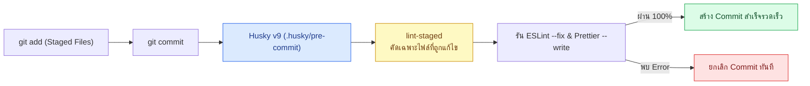

## 1. แนวคิด (Concept)

การรอให้ตรวจพบข้อผิดพลาดด้าน Linting หรือ Formatting บน GitHub Actions CI ใช้เวลานานเกินไป (ต้องรอ Push โค้ด, รอจองเครื่อง Runner, รอติดตั้งแพ็กเกจ รวมเวลา 2–5 นาที) เราจึงนำหลักการ **Shift-Left Testing** มาใช้ด้วยการตั้งด่านสกัดตั้งแต่จังหวะที่นักพัฒนาพิมพ์คำสั่ง `git commit` ในเครื่องตัวเอง

แต่หากเราสั่งรัน `eslint .` และ `prettier --write .` ทั้งโปรเจกต์ทุกครั้งที่กด Commit ในโปรเจกต์ที่มีไฟล์มากกว่า 2,000 ไฟล์ นักพัฒนาจะต้องรอนาน 30–60 วินาทีต่อหนึ่ง Commit จนสุดท้ายทุกคนแอบใส่ `--no-verify` เพื่อข้ามการตรวจ ดังนั้นเราจึงต้องใช้คู่หูสำคัญ:
- **Husky v9**: เครื่องมือจัดการ Git Hooks สมัยใหม่ที่ผูกสคริปต์ในโฟลเดอร์ `.husky/` เข้ากับเหตุการณ์ของ Git (เช่น `pre-commit`, `commit-msg`) โดยอัตโนมัติเมื่อรัน `npm install`
- **lint-staged**: เครื่องมือกรองเฉพาะไฟล์ที่อยู่ในสถานะ **Git Staged (`git add`)** เท่านั้นมาส่งต่อให้ ESLint และ Prettier ประมวลผล ทำให้การตรวจก่อน Commit ใช้เวลาเพียง 1–2 วินาที!



## 2. หลักการเบื้องหลัง (Under the Hood)

1. **กลไกของ Husky v9**: เมื่อสคริปต์ `"prepare": "husky"` ใน `package.json` ทำงาน Husky จะสั่ง `git config core.hooksPath .husky/_` เพื่อเปลี่ยนเส้นทางการค้นหา Git Hooks ของโปรเจกต์จาก `.git/hooks` (ซึ่งไม่สามารถแชร์ขึ้น Git ได้) มายังโฟลเดอร์ `.husky` ที่อยู่ใน Repository แทน
2. **กลไก Stashing ของ lint-staged**: หากนักพัฒนาแก้ไขไฟล์ `order.service.ts` ไป 20 บรรทัด แต่เลือก `git add -p` เฉพาะ 10 บรรทัดแรก (มีบางส่วนเป็น Unstaged changes) `lint-staged` จะทำการสำรองส่วนที่ยังไม่ได้ Stage เก็บไว้ใน Git Stash ชั่วคราว แล้วรัน ESLint/Prettier เฉพาะกับโค้ดที่กำลังจะ Commit จริงๆ เท่านั้น เมื่อเสร็จแล้วจึงนำโค้ดที่เหลือคืนกลับมาอย่างปลอดภัย

<Callout type="tip" title="ทำไมไม่ควรรัน tsc --noEmit ผ่าน lint-staged โดยตรงแบบรายไฟล์?">
lint-staged จะส่งรายชื่อไฟล์ที่ถูกแก้ไขต่อท้ายคำสั่ง เช่น tsc --noEmit src/order.ts ซึ่งพฤติกรรมของคอมไพเลอร์ tsc เมื่อได้รับชื่อไฟล์ระบุตรงๆ คือมันจะเพิกเฉยต่อไฟล์ tsconfig.json ทันที! ส่งผลให้การตั้งค่า strict mode และ path aliases หายหมด หากต้องการเช็ค Type ก่อน Commit ต้องเขียนเป็นฟังก์ชันใน lint-staged.config.mjs ที่เรียก tsc --noEmit โดยไม่ส่งชื่อไฟล์ต่อท้าย
</Callout>

## 3. ตัวอย่างโค้ด (Smart Butcher Marketplace)

### ตัวอย่างที่ 1 (ระดับพื้นฐาน): การตั้งค่า Husky v9, `package.json` และ `lint-staged.config.mjs`
การตั้งค่าด่านตรวจ `pre-commit` ที่รันทั้ง ESLint, Prettier และการตรวจสอบ TypeScript ทั้งโปรเจกต์อย่างถูกต้องโดยไม่ทำลาย `tsconfig.json`

```javascript filename="lint-staged.config.mjs"
// @ts-check

/** @type {import('lint-staged').Configuration} */
export default {
  // 1. ไฟล์ TypeScript และ React: รัน ESLint แก้อัตโนมัติ, จัดหน้าด้วย Prettier และตรวจ Type ทั้งโปรเจกต์
  '*.{ts,tsx}': [
    'eslint --fix --max-warnings 0',
    'prettier --write',
    () => 'tsc --noEmit',
  ],

  // 2. ไฟล์ตั้งค่าและเอกสาร: จัดรูปแบบด้วย Prettier อย่างเดียว
  '*.{json,md,yml,yaml,mjs}': ['prettier --write'],
};
```

### ตัวอย่างที่ 2 (ระดับ Production): โมดูลตรวจสอบคำสั่งซื้อเนื้อพรีเมียมพร้อม Unit Test ที่ถูกรันตรวจสอบในจังหวะ Pre-commit
โค้ดบริการตรวจสอบความถูกต้องของคำสั่งซื้อ (`Order`, `OrderItem`, `Product`, `User`) ที่ผ่านด่าน `lint-staged` และ `vitest related` ก่อนอนุญาตให้สร้าง Commit

```typescript filename="src/domain/butcher-order-guard.ts"
export interface User {
  id: string;
  email: string;
  role: 'CUSTOMER' | 'BUTCHER' | 'ADMIN';
  isVip: boolean;
}

export interface Category {
  id: string;
  name: string;
  requiresColdTruck: boolean;
}

export interface Product {
  id: string;
  categoryId: string;
  name: string;
  sku: string;
  pricePerKg: number;
  stockKg: number;
  dryAgedDays: number;
}

export interface OrderItem {
  id: string;
  productId: string;
  weightKg: number;
  unitPricePerKg: number;
  subtotal: number;
}

export interface Order {
  id: string;
  userId: string;
  items: OrderItem[];
  totalAmount: number;
  deliveryProvince: string;
}

export interface Payment {
  id: string;
  orderId: string;
  amount: number;
  status: 'PENDING' | 'PAID' | 'REFUNDED';
}

export function validatePreCommitOrderIntegrity(
  order: Order,
  productsById: ReadonlyMap<string, Product>,
  payment: Payment,
): { valid: boolean; reason?: string } {
  if (order.items.length === 0) {
    return { valid: false, reason: 'คำสั่งซื้อต้องมีรายการเนื้ออย่างน้อย 1 รายการ' };
  }

  let expectedTotal = 0;

  for (const item of order.items) {
    const product = productsById.get(item.productId);
    if (!product) {
      return { valid: false, reason: `ไม่พบเนื้อรหัส ${item.productId} ในระบบ` };
    }

    if (item.weightKg <= 0 || item.weightKg > product.stockKg) {
      return {
        valid: false,
        reason: `น้ำหนักสั่งซื้อของ ${product.name} (${String(item.weightKg)} กก.) เกินสต็อกคงเหลือ`,
      };
    }

    const expectedItemSubtotal = Math.round(item.weightKg * product.pricePerKg);
    if (item.subtotal !== expectedItemSubtotal) {
      return {
        valid: false,
        reason: `ยอดรวมย่อยของ ${product.name} ไม่ตรงกับราคาต่อกิโลกรัม`,
      };
    }

    expectedTotal += expectedItemSubtotal;
  }

  if (order.totalAmount !== expectedTotal || payment.amount !== expectedTotal) {
    return {
      valid: false,
      reason: 'ยอดชำระเงินรวมไม่ตรงกับผลรวมของรายการสินค้าเนื้อทั้งหมด',
    };
  }

  return { valid: true };
}
```

## 4. ผิด vs ถูก (Anti-pattern vs Best Practice)

```javascript filename="lint-staged.compare.mjs"
// ❌ ผิด (Anti-pattern): ส่งชื่อไฟล์ต่อท้าย tsc --noEmit โดยตรง ทำให้ tsconfig.json ถูกเพิกเฉย!
export const badLintStaged = {
  '*.{ts,tsx}': [
    'tsc --noEmit', // กลายเป็น tsc --noEmit file1.ts file2.ts (ไม่อ่าน tsconfig.json!)
    'eslint',
  ],
};

// ✅ ถูก (Best Practice): ใช้ Arrow Function คืนค่าคำสั่ง tsc --noEmit เพื่อบังคับให้อ่าน tsconfig.json เสมอ
export const goodLintStaged = {
  '*.{ts,tsx}': [
    'eslint --fix --max-warnings 0',
    'prettier --write',
    () => 'tsc --noEmit',
  ],
};
```

## 5. ควรใช้เมื่อไหร่ และ ไม่ควรใช้เมื่อไหร่

- **ควรใช้ใน `pre-commit` เสมอ**: การจัดรูปแบบโค้ด (`prettier --write`), การตรวจจับ Linting เฉพาะไฟล์ที่แก้ (`eslint --fix`) และการรัน Unit Test เฉพาะไฟล์ที่เกี่ยวข้อง (`jest --bail --findRelatedTests`)
- **ไม่ควรใช้ใน `pre-commit`**: ห้ามรัน E2E Testing (Playwright) หรือสั่ง Build โปรเจกต์ทั้งหมด (`next build`) ใน `pre-commit` Hook เด็ดขาด เพราะใช้เวลานานหลายนาทีและจะทำลายสมาธิของนักพัฒนา ให้แยกงานหนักไปไว้บน GitHub Actions CI แทน

## 6. คำถามสัมภาษณ์ (Interview Q&A)

**Q1: หากนักพัฒนาในทีมบ่นว่าการมี Husky `pre-commit` ทำให้การ Commit ช้าลงมาก คุณจะปรับปรุงโครงสร้างนี้อย่างไรโดยไม่ลดทอนคุณภาพโค้ด?**
- **แนวคำตอบ**: ตรวจสอบก่อนว่าใน `.husky/pre-commit` ได้รันคำสั่งทั้งโปรเจกต์หรือใช้ `lint-staged` หากยังไม่ได้ใช้ต้องเปลี่ยนมาใช้ `lint-staged` เพื่อตรวจเฉพาะไฟล์ที่ถูกแก้ไขพร้อมเปิด `--cache` ให้กับ ESLint ส่วนงานที่ใช้เวลานานอย่างการรัน Test Suite ทั้งหมดหรือการ Build ให้ย้ายไปทำงานบน GitHub Actions ตอนเปิด Pull Request แทน เพื่อให้ `pre-commit` จบภายในไม่เกิน 3 วินาที

**Q2: ถ้ามีคนใช้ `git commit --no-verify` เพื่อข้าม Husky Hook ในเครื่องตัวเอง ระบบของเรายังปลอดภัยอยู่หรือไม่?**
- **แนวคำตอบ**: Git Hooks ในเครื่อง Local มีไว้เพื่อเพิ่มความเร็วในการรับ Feedback (Developer Experience) เท่านั้น ไม่ใช่มาตรการรักษาความปลอดภัยขั้นสุดท้าย เพราะนักพัฒนาสามารถใส่ `--no-verify` ข้ามได้เสมอ ดังนั้นจึงต้องมี **GitHub Actions CI Pipeline** คู่กับ **Branch Protection Rules** บนเซิร์ฟเวอร์เป็นปราการด่านสุดท้ายที่ไม่มีใครข้ามได้

---
