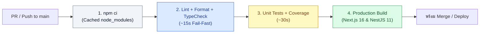

## 1. แนวคิด (Concept)

แม้เราจะมี Husky คอยตรวจในเครื่องนักพัฒนาแล้ว แต่เครื่องแต่ละคนอาจมีสภาพแวดล้อมที่แตกต่างกัน (เช่น เวอร์ชันของ Node.js หรือตัวแปรในเครื่อง) ดังนั้น **GitHub Actions CI Pipeline** จึงทำหน้าที่เป็น **"ห้องปฏิบัติการกลางที่สะอาดบริสุทธิ์ (Clean-room Verification)"** ซึ่งจะรันตรวจสอบโค้ดทุกครั้งที่มีการเปิด Pull Request หรือ Push เข้าสู่สาขา `main`

ลำดับขั้นตอนใน Pipeline ต้องเรียงตามหลัก **Fail-Fast (อะไรที่รันเร็วและใช้ทรัพยากรน้อยให้ตรวจก่อน)**:
1. **Deterministic Install (`npm ci`)**: ติดตั้งแพ็กเกจตรงตาม `package-lock.json` ทุกตัวอักษรพร้อมใช้ระบบ Cache
2. **Static Analysis (`lint` & `format:check` & `typecheck`)**: ใช้เวลาเพียง 10–20 วินาที หากโค้ดพิมพ์ผิดหรือ Type ไม่ตรงจะได้รู้ผลทันที
3. **Unit Tests (`test:unit`)**: ทดสอบ Business Logic ของ `Product`, `Order`, `Payment` ในหน่วยความจำ
4. **Production Build (`build`)**: ทดลองคอมไพล์ทั้ง Next.js 16 และ NestJS 11 เพื่อให้มั่นใจว่าโค้ดสามารถนำไปสร้าง Docker Image หรือ Deploy ขึ้นจริงได้ไม่พัง



## 2. หลักการเบื้องหลัง (Under the Hood)

1. **`npm ci` (Clean Install) vs `npm install`**: คำสั่ง `npm ci` จะลบโฟลเดอร์ `node_modules` เดิมทิ้งทั้งหมด แล้วอ่านเวอร์ชันของทุกแพ็กเกจจาก `package-lock.json` โดยตรงโดยไม่ทำการคำนวณ Dependency Tree ใหม่ และหากพบว่า `package.json` กับ `package-lock.json` ไม่ตรงกัน `npm ci` จะโยน Error และหยุดทำงานทันที ช่วยป้องกันปัญหาแพ็กเกจย่อยแอบอัปเดตเวอร์ชันเองบน CI
2. **Concurrency Group**: เมื่อนักพัฒนา Push โค้ดแก้ไขตามคอมเมนต์ติดๆ กัน 3 ครั้งภายใน 1 นาที หากไม่ตั้งค่า `concurrency` บน GitHub Actions ระบบจะรัน CI ทั้ง 3 รอบพร้อมกันจนเปลืองโควตา การกำหนด `cancel-in-progress: true` จะสั่งยกเลิกรอบเก่าที่ยังรันไม่เสร็จแล้วรันเฉพาะ Commit ล่าสุดทันที

<Callout type="warning" title="ห้ามใช้ npm install ในไฟล์ GitHub Actions เด็ดขาด">
การใช้ npm install บน CI อาจทำให้ GitHub Actions ดึงแพ็กเกจเวอร์ชันย่อยใหม่กว่าที่นักพัฒนาทดสอบในเครื่องตัวเองมาติดตั้ง ส่งผลให้เกิดบั๊กที่เกิดขึ้นเฉพาะบน CI เท่านั้น จงใช้ npm ci (หรือ pnpm install --frozen-lockfile) เสมอเพื่อรับประกันความเหมือนเดิม 100%
</Callout>

## 3. ตัวอย่างโค้ด (Smart Butcher Marketplace)

### ตัวอย่างที่ 1 (ระดับพื้นฐาน): ไฟล์ `.github/workflows/ci-quality.yml` ที่ออกแบบตามหลัก Fail-Fast และ Concurrency
ไฟล์ Workflow มาตรฐานสำหรับตรวจสอบคุณภาพโค้ด TypeScript, ESLint, Prettier, Unit Test และการ Build โปรเจกต์

```yaml filename=".github/workflows/ci-quality.yml"
name: Smart Butcher - Quality & Unit CI

on:
  push:
    branches: [main]
  pull_request:
    branches: [main]

# ยกเลิก Job เก่าของ PR เดียวกันทันทีเมื่อมีการ Push โค้ดใหม่เข้ามา
concurrency:
  group: ${{ github.workflow }}-${{ github.ref }}
  cancel-in-progress: true

jobs:
  quality-and-build:
    name: Lint, Type-Check, Unit Test & Build
    runs-on: ubuntu-latest
    timeout-minutes: 10

    steps:
      - name: 1. Checkout Repository
        uses: actions/checkout@v4

      - name: 2. Setup Node.js 22 LTS with npm Cache
        uses: actions/setup-node@v4
        with:
          node-version: '22'
          cache: 'npm'

      - name: 3. Clean Install Dependencies
        run: npm ci

      - name: 4. Verify Code Formatting (Prettier)
        run: npm run format:check

      - name: 5. Run Static Code Analysis (ESLint v9)
        run: npm run lint

      - name: 6. Run TypeScript Strict Type-Checking
        run: npm run typecheck

      - name: 7. Execute Unit Tests with Coverage
        run: npm run test:unit -- --coverage

      - name: 8. Verify Production Build (Next.js 16 & NestJS 11)
        env:
          NODE_ENV: production
        run: npm run build
```

### ตัวอย่างที่ 2 (ระดับ Production): ชุดทดสอบ Unit Test ของระบบคำนวณส่วนลดและจัดสรรเนื้อดรายเอจที่รันในขั้นตอนที่ 7 ของ CI
โค้ดบริการและชุดทดสอบ Jest/Vitest ที่ตรวจสอบความถูกต้องของการคำนวณราคา `Order`, `OrderItem`, `Category` และ `Payment` อย่างแม่นยำบน CI

```typescript filename="src/services/butcher-pricing-engine.spec.ts"
import type { Category, Product, User } from '../domain/butcher-order-guard';

export interface PricedOrderSummary {
  orderItems: {
    productId: string;
    weightKg: number;
    subtotal: number;
  }[];
  coldChainSurcharge: number;
  vipDiscount: number;
  netPayableAmount: number;
}

export function calculateSmartButcherOrder(
  user: User,
  categoriesById: ReadonlyMap<string, Category>,
  selections: readonly { product: Product; weightKg: number }[],
): PricedOrderSummary {
  let rawItemsTotal = 0;
  let requiresColdTruck = false;

  const orderItems = selections.map(({ product, weightKg }) => {
    const category = categoriesById.get(product.categoryId);
    if (category?.requiresColdTruck) {
      requiresColdTruck = true;
    }

    const subtotal = Math.round(product.pricePerKg * weightKg);
    rawItemsTotal += subtotal;

    return {
      productId: product.id,
      weightKg,
      subtotal,
    };
  });

  const vipDiscount = user.isVip ? Math.round(rawItemsTotal * 0.1) : 0;
  const coldChainSurcharge = requiresColdTruck && rawItemsTotal < 5000 ? 250 : 0;
  const netPayableAmount = rawItemsTotal - vipDiscount + coldChainSurcharge;

  return {
    orderItems,
    coldChainSurcharge,
    vipDiscount,
    netPayableAmount,
  };
}

// ตัวอย่างชุดทดสอบที่ถูกเรียกโดย npm run test:unit บน GitHub Actions
describe('calculateSmartButcherOrder (CI Unit Gate)', () => {
  const wagyuCategory: Category = {
    id: 'cat-wagyu',
    name: 'Japanese A5 Wagyu',
    requiresColdTruck: true,
  };

  const ribeyeProduct: Product = {
    id: 'prod-ribeye-a5',
    categoryId: 'cat-wagyu',
    name: 'Miyazaki A5 Ribeye 45-Day Dry-Aged',
    sku: 'WGY-RIB-45D',
    pricePerKg: 4800,
    stockKg: 12.5,
    dryAgedDays: 45,
  };

  const categories = new Map<string, Category>([[wagyuCategory.id, wagyuCategory]]);

  it(' waives cold-truck surcharge when raw total reaches 5,000 THB and applies 10% VIP discount', () => {
    const vipCustomer: User = {
      id: 'usr-vip-01',
      email: 'chef@butcher.co.th',
      role: 'CUSTOMER',
      isVip: true,
    };

    const summary = calculateSmartButcherOrder(vipCustomer, categories, [
      { product: ribeyeProduct, weightKg: 1.5 }, // 4,800 * 1.5 = 7,200 บาท
    ]);

    expect(summary.coldChainSurcharge).toBe(0);
    expect(summary.vipDiscount).toBe(720);
    expect(summary.netPayableAmount).toBe(6480);
  });
});
```

## 4. ผิด vs ถูก (Anti-pattern vs Best Practice)

```yaml filename=".github/workflows/ci.compare.yml"
# ❌ ผิด (Anti-pattern): ไม่ตั้ง timeout-minutes, ใช้ npm install และไม่แคช node_modules
jobs:
  bad-ci:
    runs-on: ubuntu-latest
    steps:
      - uses: actions/checkout@v4
      - run: npm install # เสี่ยงได้เวอร์ชันแพ็กเกจไม่ตรงกับเครื่องนักพัฒนา
      - run: npm test

# ✅ ถูก (Best Practice): กำหนด timeout-minutes ป้องกันค้างกินโควตา และใช้ npm ci คู่กับ cache
jobs:
  good-ci:
    runs-on: ubuntu-latest
    timeout-minutes: 10
    steps:
      - uses: actions/checkout@v4
      - uses: actions/setup-node@v4
        with:
          node-version: '22'
          cache: 'npm'
      - run: npm ci
      - run: npm run validate
```

## 5. ควรใช้เมื่อไหร่ และ ไม่ควรใช้เมื่อไหร่

- **ควรกำหนด `timeout-minutes` ในทุก Job เสมอ**: เพราะค่าเริ่มต้นของ GitHub Actions คือปล่อยให้รันได้นานถึง **360 นาที (6 ชั่วโมง)** หากมีเทสต์ตัวใดตัวหนึ่งเกิด Deadlock หรือรอ Database ค้าง โควตานาทีฟรีของทั้งองค์กรจะถูกเผาผลาญหมดภายในครั้งเดียว
- **ไม่ควรใช้**: ไม่ควรรัน `build` ก่อนรัน `lint` และ `typecheck` เพราะขั้นตอน `build` ใช้เวลานานกว่ามาก หากโค้ดมี Syntax Error ควรให้พังตั้งแต่ด่าน `lint` ใน 15 วินาทีแรก

## 6. คำถามสัมภาษณ์ (Interview Q&A)

**Q1: ทำไมการแยกขั้นตอน `lint`, `typecheck`, `test` และ `build` ออกจากกันจึงสำคัญ และในโปรเจกต์ขนาดใหญ่เราจะลดเวลารวมของ CI ได้อย่างไร?**
- **แนวคำตอบ**: การแยกขั้นตอนทำให้เมื่อ CI พัง นักพัฒนาสามารถคลิกดูที่ชื่อ Step บนหน้า GitHub PR แล้วรู้ได้ทันทีว่าพังเพราะ Type Error, Lint Error หรือ Unit Test โดยไม่ต้องไล่อ่าน Log ยาวหลายพันบรรทัด สำหรับโปรเจกต์ขนาดใหญ่สามารถลดเวลาได้ด้วยการแยก `lint`, `typecheck` และ `unit-test` ออกเป็น Parallel Jobs ที่รันพร้อมกันบนคนละเครื่อง Runner หรือใช้เครื่องมือจัดการ Monorepo Cache อย่าง Turborepo

---
