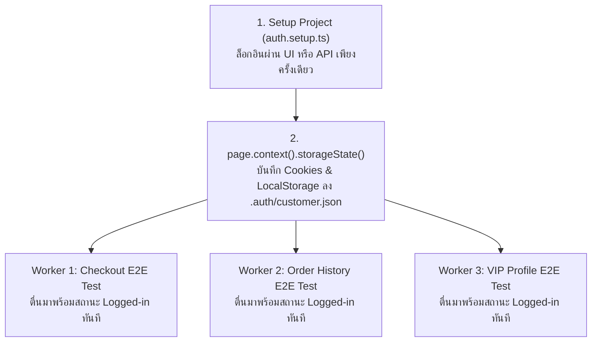

## 1. แนวคิด (Concept)
ในระบบร้านค้าอย่าง Smart Butcher Marketplace เส้นทางที่สำคัญที่สุดต่อธุรกิจ (Critical User Journey) คือ:
**ลูกค้าเข้าสู่ระบบ -> ค้นหาเนื้อวากิว -> กำหนดความหนาและน้ำหนัก -> เพิ่มลงตะกร้า -> กรอกที่อยู่จัดส่งรถห้องเย็น -> ชำระเงิน -> ตรวจสอบหน้ายืนยันคำสั่งซื้อ (`Order` & `Payment`)**

หากเรามีเทสต์ 50 ข้อที่ต้องเริ่มต้นจากการกรอกฟอร์ม Login ผ่านหน้า UI ทุกข้อ เราจะต้องเสียเวลาไปกับการรอหน้า Login ซ้ำๆ ถึง 50 รอบ Playwright จึงมอบฟีเจอร์ **`storageState`** ที่ช่วยให้เราสร้าง **Setup Project** เพื่อทำการล็อกอินเพียง **1 ครั้ง** แล้วบันทึก Cookies และ LocalStorage ลงในไฟล์ (เช่น `playwright/.auth/customer.json`) จากนั้นให้เทสต์อีก 50 ข้อโหลดสถานะการล็อกอินนี้เข้าไปใน `BrowserContext` ทันทีตั้งแต่วินาทีแรกที่เปิดหน้าเว็บ!

## 2. หลักการเบื้องหลัง (Under the Hood)


ในไฟล์ `playwright.config.ts` เราจะกำหนด Project ชื่อ `setup` และกำหนดให้ Project หลัก (`chromium`) มี `dependencies: ['setup']` พร้อมระบุ `use: { storageState: 'playwright/.auth/customer.json' }` ทั้งนี้ต้องเพิ่มโฟลเดอร์ `playwright/.auth/` ลงใน `.gitignore` เสมอเพื่อไม่ให้เผลอ Commit Session Token ขึ้น Git

## 3. ตัวอย่างโค้ด (Smart Butcher Marketplace)

### ตัวอย่างที่ 1 (พื้นฐาน): การเขียน `auth.setup.ts` เพื่อสร้างไฟล์ `storageState` สำหรับลูกค้า VIP
ตัวอย่างการล็อกอินและบันทึกสถานะ Authentication ของลูกค้าเก็บไว้ใช้ซ้ำในเทสต์ทุกไฟล์:

```typescript filename="e2e/auth.setup.ts"
import { test as setup, expect } from '@playwright/test';
import path from 'path';

const customerAuthFile = path.join(__dirname, '../playwright/.auth/customer.json');

setup('should authenticate as VIP customer and persist storageState', async ({ page }) => {
  await page.goto('/login');

  await page.getByLabel('Email Address').fill('vip.chef@smartbutcher.com');
  await page.getByLabel('Password').fill('WagyuMaster#2026');
  await page.getByRole('button', { name: 'Sign In to Butcher Club' }).click();

  // รอจนกว่าจะเปลี่ยนหน้าไปที่หน้าหลักและเห็นชื่อผู้ใช้บนแถบเมนูยืนยันว่าคุกกี้ถูกตั้งค่าเสร็จแล้ว
  await expect(page).toHaveURL('/catalog/wagyu');
  await expect(
    page.getByRole('navigation').getByText('Chef Somchai (VIP)'),
  ).toBeVisible();

  // บันทึก Cookies และ LocalStorage ทั้งหมดลงไฟล์ JSON
  await page.context().storageState({ path: customerAuthFile });
});
```

### ตัวอย่างที่ 2 (ขั้นสูง): การทดสอบ Critical User Journey สั่งซื้อเนื้อดรายเอจและชำระเงินจนได้รับหมายเลขคำสั่งซื้อ
เมื่อมี `storageState` แล้ว เทสต์นี้จะเริ่มต้นในฐานะลูกค้า VIP ที่ล็อกอินอยู่แล้วทันที และทำการทดสอบตั้งแต่เลือกเนื้อ ปรับความหนา ไปจนถึงการชำระเงินสำเร็จ:

```typescript filename="e2e/critical-checkout-journey.spec.ts"
import { test as describeTest, expect } from '@playwright/test';

const describe = describeTest.describe;
const it = describeTest;

describe('Critical User Journey - End-to-End Wagyu Checkout Flow', () => {
  it('should complete full purchase flow from cut selection to confirmed order receipt', async ({
    page,
  }) => {
    // 1. เปิดหน้าสินค้าโดยตรง (ล็อกอินอยู่แล้วจาก storageState)
    await page.goto('/products/miyazaki-a5-ribeye-45d');

    // 2. กำหนดรูปแบบการตัดแต่งเนื้อ (Custom Butcher Specification)
    await page.getByLabel('Steak Thickness').selectOption('3.5cm');
    await page.getByLabel('Cut Weight (kg)').fill('1.0');
    await page
      .getByRole('checkbox', { name: 'Include Dry-Age Trim Fat for Searing' })
      .check();

    await page.getByRole('button', { name: 'Add to Chilled Cart' }).click();

    // 3. เปิด Drawer ตะกร้าสินค้าและไปที่หน้าชำระเงิน
    const cartDialog = page.getByRole('dialog', { name: 'Your Chilled Butcher Cart' });
    await expect(cartDialog).toBeVisible();
    await expect(cartDialog).toContainText('Miyazaki A5 Ribeye (45-Day Dry-Aged)');
    await cartDialog.getByRole('link', { name: 'Proceed to Cold-Chain Checkout' }).click();

    // 4. กรอกข้อมูลการจัดส่งควบคุมอุณหภูมิและเลือกวิธีชำระเงิน
    await expect(page).toHaveURL('/checkout');
    await page.getByLabel('Delivery Address').fill('88 Sukhumvit Soi 55, Thonglor, Bangkok');
    await page.getByLabel('Delivery Time Slot').selectOption('MORNING_CHILLED_09_12');
    await page.getByRole('radio', { name: 'PromptPay Instant QR' }).check();

    // 5. ยืนยันคำสั่งซื้อและตรวจสอบหน้าใบเสร็จ
    await page.getByRole('button', { name: 'Place Order & Confirm Payment' }).click();

    await expect(page).toHaveURL(/\/orders\/ORD-[A-Z0-9-]+$/);
    await expect(
      page.getByRole('heading', { name: /Order Confirmed & Sent to Master Butcher/i }),
    ).toBeVisible();
    await expect(page.getByTestId('order-payment-status')).toHaveText('PAID');
  });
});
```

## 4. ผิด vs ถูก (Anti-pattern vs Best Practice)

| มิติการเปรียบเทียบ | ❌ ผิด (Anti-pattern) | ✅ ถูก (Best Practice) |
| :--- | :--- | :--- |
| **การล็อกอินซ้ำทุก Test Case** | สั่งกรอกฟอร์ม `/login` ใน `beforeEach` ของทุกไฟล์ ทำให้เสียเวลารอการเข้ารหัสผ่าน (`bcrypt`/`argon2`) ซ้ำๆ นับร้อยครั้ง | ใช้ `auth.setup.ts` สร้าง `storageState` แยกตาม Role (`customer.json`, `butcher.json`, `admin.json`) แล้วโหลดใช้งานทันที |
| **การบันทึก `storageState` ก่อน Redirect เสร็จ** | เรียก `page.context().storageState()` ทันทีหลังคลิกปุ่ม Login โดยไม่รอให้เซิร์ฟเวอร์ตอบกลับ `Set-Cookie` Header | ใช้ `await expect(page).toHaveURL(...)` หรือรอให้ UI ของสมาชิกแสดงผลก่อนสั่งบันทึก `storageState` เสมอ |

## 5. ควรใช้เมื่อไหร่ และ ไม่ควรใช้เมื่อไหร่
- **ควรใช้ `storageState` เมื่อ:** ทดสอบทุกฟีเจอร์หลังการล็อกอิน เช่น หน้าสั่งซื้อ หน้าประวัติคำสั่งซื้อ หรือหน้าจัดการสต็อกของช่างแล่เนื้อ
- **ไม่ควรใช้ `storageState` เมื่อ:** กำลังทดสอบฟีเจอร์ของหน้า Login, Logout, การรีเซ็ตรหัสผ่าน หรือการบล็อกผู้ใช้ที่ยังไม่ได้ล็อกอิน (ในไฟล์นั้นสามารถล้างสถานะได้ด้วยการระบุ `test.use({ storageState: { cookies: [], origins: [] } })`)

## 6. คำถามสัมภาษณ์ (Interview Q&A)
- **Q1: หากระบบของเราเก็บ Access Token ไว้ใน `httpOnly` Cookie ตัวฟีเจอร์ `storageState` ของ Playwright จะสามารถดึงและนำกลับมาใช้ใหม่ได้หรือไม่?**
  - *แนวคำตอบ:* ได้อย่างสมบูรณ์ เพราะ `page.context().storageState()` ไม่ได้อ่านคุกกี้ผ่าน `document.cookie` ในฝั่ง JavaScript ของหน้าเว็บ แต่ดึงข้อมูลคุกกี้ทั้งหมด (รวมถึง `httpOnly`, `secure`, `sameSite` cookies) ออกมาจากระดับ Browser Engine โดยตรงผ่าน DevTools Protocol ทำให้รองรับระบบ Authentication สมัยใหม่ที่ใช้ `httpOnly` Cookie ได้ 100%
- **Q2: หากเทสต์บางข้อทำการกดปุ่ม "Logout" ซึ่งสั่งให้ฝั่งเซิร์ฟเวอร์ยกเลิก (Invalidate) Session ในฐานข้อมูล จะส่งผลกระทบต่อเทสต์ข้ออื่นที่ใช้ไฟล์ `storageState` เดียวกันอย่างไร?**
  - *แนวคำตอบ:* หากใช้ Session-based Authentication หรือ Refresh Token Rotation บนเซิร์ฟเวอร์ การที่เทสต์ข้อหนึ่งสั่ง Logout และทำลาย Session นั้นในฐานข้อมูล จะทำให้เทสต์ข้ออื่นที่รันขนานกันด้วย Session ID เดียวกันหลุดจากระบบทันที (401 Unauthorized) วิธีป้องกันคือสำหรับเทสต์ที่ทดสอบการ Logout หรือการเปลี่ยนรหัสผ่าน ให้สร้าง User และล็อกอินแยกเฉพาะสำหรับเทสต์ข้อนั้นโดยไม่ใช้ Shared `storageState` ร่วมกับเทสต์ทั่วไป

---
