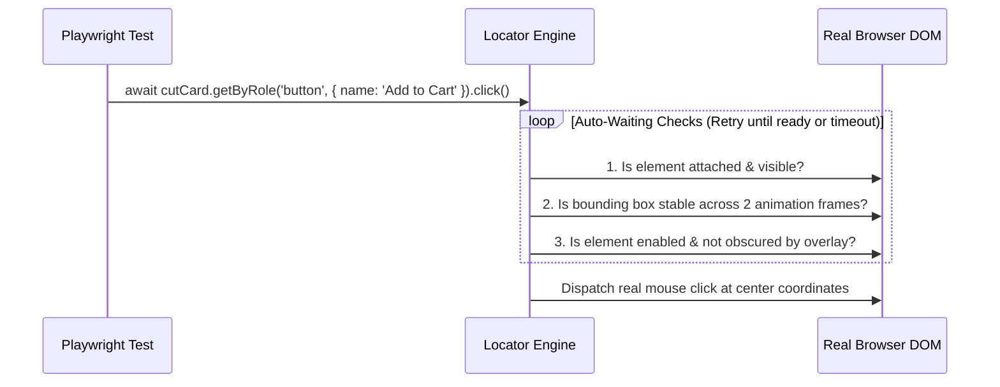

## 1. แนวคิด (Concept)
สาเหตุอันดับหนึ่งที่ทำให้ E2E Test ยุคเก่าเกิดอาการ **Flaky (รันผ่านบ้าง พังบ้างโดยไม่ได้แก้โค้ด)** คือจังหวะเวลาที่หน้าเว็บเรนเดอร์ไม่ทันคำสั่งเทสต์ (เช่น ปุ่มกำลังติด Animation หรือข้อมูล API ยังโหลดไม่เสร็จ)

Playwright แก้ปัญหานี้ที่ระดับแกนกลางด้วย 3 กลไกที่ทำงานประสานกัน:
1. **Resilient Locators:** อ็อบเจกต์ที่เก็บ "วิธีการค้นหา Element บนหน้าจอ" (`page.getByRole`, `page.getByLabel`) โดยยังไม่ดึง DOM จริงจนกว่าจะมีการสั่งกระทำ ทำให้แม้ React 19 จะทำการ Re-render สร้าง DOM Node ใหม่ระหว่างทาง ตัว Locator ก็ยังชี้ไปยัง Element ล่าสุดได้เสมอ (ไม่มีปัญหา `StaleElementReferenceException`)
2. **Actionability Auto-Waiting:** ก่อนที่คำสั่งอย่าง `await locator.click()` จะคลิกจริง Playwright จะตรวจสอบโดยอัตโนมัติว่า Element นั้น **Attached** (อยู่ใน DOM), **Visible** (มองเห็นได้), **Stable** (หยุดขยับจาก Animation แล้ว), **Enabled** (ไม่ได้ถูก `disabled`), และ **Receives Events** (ไม่มี Modal หรือ Overlay อื่นบังอยู่)
3. **Web-First Assertions:** การใช้ `await expect(locator).toBeVisible()` หรือ `toHaveText()` ซึ่งจะทำการ Poll ตรวจสอบเงื่อนไขซ้ำๆ อย่างชาญฉลาดจนกว่าเงื่อนไขจะเป็นจริงหรือครบกำหนด Timeout

## 2. หลักการเบื้องหลัง (Under the Hood)


นอกจากนี้เมื่อต้องการเจาะจงค้นหาปุ่มที่อยู่ในกล่องสินค้าเฉพาะชิ้น เราสามารถนำ Locator มาเชื่อมต่อกัน (**Chaining & Filtering**) ด้วยเมธอด `.filter({ hasText: '...', has: ... })` ได้โดยไม่ต้องเขียน XPath หรือ CSS Selector ที่เปราะบาง

## 3. ตัวอย่างโค้ด (Smart Butcher Marketplace)

### ตัวอย่างที่ 1 (พื้นฐาน): การใช้ `getByRole`, `getByLabel` และ Web-First Assertions แทนการใช้ Manual Assertions
ตัวอย่างการค้นหาช่องกรอกน้ำหนักเนื้อและตรวจสอบการคำนวณราคาแบบเรียลไทม์ด้วย Web-First Assertions:

```typescript filename="e2e/locators-and-assertions.spec.ts"
import { test as describeTest, expect } from '@playwright/test';

const describe = describeTest.describe;
const it = describeTest;

describe('Butcher Price Calculator - Locators & Web-First Assertions', () => {
  it('should automatically wait for dynamic price recalculation when customer adjusts wagyu weight', async ({
    page,
  }) => {
    await page.goto('/products/miyazaki-a5-ribeye');

    const weightInput = page.getByLabel('Desired Cut Weight (kg)');
    const thicknessSelect = page.getByLabel('Steak Thickness');
    const estimatedPriceBanner = page.getByTestId('estimated-cut-price');

    // กรอกน้ำหนัก 1.5 กก. และเลือกความหนา 3.5 ซม.
    await weightInput.fill('1.5');
    await thicknessSelect.selectOption('3.5cm');

    // Web-First Assertion: จะรอจนกว่าข้อความใน DOM จะเปลี่ยนเป็น ฿7,200 โดยไม่ต้องใส่ sleep
    await expect(estimatedPriceBanner).toHaveText('฿7,200');
    await expect(
      page.getByRole('button', { name: 'Reserve This Cut' }),
    ).toBeEnabled();
  });
});
```

### ตัวอย่างที่ 2 (ขั้นสูง): การใช้ `.filter()` เพื่อเลือกกดสั่งซื้อเนื้อชิ้นที่ต้องการจากรายการการ์ดหลายใบ
บนหน้าร้านที่มีการ์ดสินค้าหลายใบและทุกใบมีปุ่มชื่อเดียวกันว่า *"Add to Chilled Cart"* เราใช้ `.filter({ has: ... })` เพื่อเจาะจงเฉพาะการ์ดของ *60-Day Dry-Aged Kobe Striploin* อย่างแม่นยำ:

```typescript filename="e2e/locator-filtering-chaining.spec.ts"
import { test as describeTest, expect } from '@playwright/test';

const describe = describeTest.describe;
const it = describeTest;

describe('Catalog Card Filtering & Chained Locators', () => {
  it('should locate the specific 60-Day Dry-Aged Kobe Striploin card and add it to the chilled cart', async ({
    page,
  }) => {
    await page.goto('/catalog/dry-aged');

    // กรองเฉพาะการ์ด article ที่มีหัวข้อ H3 ชื่อ "60-Day Dry-Aged Kobe Striploin"
    const kobeStriploinCard = page
      .getByRole('article')
      .filter({
        has: page.getByRole('heading', {
          name: '60-Day Dry-Aged Kobe Striploin',
          exact: true,
        }),
      });

    // ตรวจสอบข้อมูลภายในของการ์ดใบนั้นก่อนกดปุ่ม
    await expect(kobeStriploinCard).toContainText('BMS 11');
    await expect(kobeStriploinCard).toContainText('฿6,200 / kg');

    // กดปุ่ม Add to Chilled Cart ที่อยู่ภายในการ์ดใบนี้เท่านั้น
    await kobeStriploinCard
      .getByRole('button', { name: 'Add to Chilled Cart' })
      .click();

    // ยืนยันว่าแถบตะกร้าสินค้าด้านบนอัปเดตจำนวนชิ้นเป็น 1 ชิ้น
    const cartBadge = page.getByRole('status', { name: 'Cart item count' });
    await expect(cartBadge).toHaveText('1 item (฿6,200)');
  });
});
```

## 4. ผิด vs ถูก (Anti-pattern vs Best Practice)

| มิติการเปรียบเทียบ | ❌ ผิด (Anti-pattern) | ✅ ถูก (Best Practice) |
| :--- | :--- | :--- |
| **การตรวจสอบข้อความบนหน้าจอ** | ใช้ `expect(await locator.textContent()).toBe('฿7,200')` ซึ่งดึงค่าครั้งเดียวทันทีโดยไม่รอให้ React อัปเดตเสร็จ | ใช้ Web-First Assertion `await expect(locator).toHaveText('฿7,200')` เพื่อให้ Playwright รอและลองใหม่จนกว่าข้อมูลจะพร้อม |
| **การหน่วงเวลารอ API** | ใส่ `await page.waitForTimeout(3000)` กระจายทั่วไฟล์เทสต์ ทำให้เทสต์ช้าและยังพังเมื่อเซิร์ฟเวอร์ใช้เวลา 3.1 วินาที | อาศัย Auto-Waiting ของ Locator และ Web-First Assertions เช่น `await expect(alert).toBeVisible()` |
| **การอ้างอิง Element ด้วย CSS ลึกๆ** | ใช้ `page.locator('div.grid > div:nth-child(2) > button.bg-red-600')` ซึ่งพังทันทีที่แก้ Tailwind Class | ใช้ `page.getByRole('article').filter({ hasText: '...' }).getByRole('button')` |

## 5. ควรใช้เมื่อไหร่ และ ไม่ควรใช้เมื่อไหร่
- **ควรใช้ `getByRole` + `.filter()` เมื่อ:** ต้องการเข้าถึงปุ่มหรือช่องกรอกข้อมูลที่อยู่ภายในรายการซ้ำๆ เช่น การ์ดสินค้าหรือแถวในตารางคำสั่งซื้อ
- **ไม่ควรใช้ `page.waitForTimeout()` เมื่อ:** เขียนเทสต์บน Production CI ทุกกรณี ยกเว้นใช้ชั่วคราวขณะกำลังดีบักบนเครื่องตัวเองเท่านั้น

## 6. คำถามสัมภาษณ์ (Interview Q&A)
- **Q1: คำสั่ง `expect(await page.getByRole('alert').isVisible()).toBe(true)` แตกต่างจาก `await expect(page.getByRole('alert')).toBeVisible()` อย่างไร?**
  - *แนวคำตอบ:* แบบแรกเรียก `await locator.isVisible()` ซึ่งเป็นเมธอดที่ตรวจสอบสถานะ DOM ณ เสี้ยววินาทีนั้นทันทีและคืนค่า `boolean` ออกมาเลยโดย **ไม่มีการรอ (No Auto-waiting)** หากแบนเนอร์แจ้งเตือนกำลังจะแสดงผลในอีก 100ms ข้างหน้าหลัง API ตอบกลับ เทสต์แบบแรกจะพังทันทีด้วยค่า `false` ส่วนแบบที่สองคือ **Web-First Assertion** ที่จะคอย Poll ตรวจสอบซ้ำๆ จนกว่าแบนเนอร์จะแสดงผลขึ้นมาจริงภายในระยะเวลา Timeout (ค่าเริ่มต้น 5000ms) จึงเสถียรกว่ามาก
- **Q2: Playwright จัดการปัญหา `StaleElementReference` ที่มักเกิดขึ้นเมื่อ React Re-render DOM ใหม่อย่างไร?**
  - *แนวคำตอบ:* เพราะ `Locator` ใน Playwright ไม่ได้เก็บตัวแปรอ้างอิงไปยัง DOM Element Handle ในหน่วยความจำตั้งแต่ตอนประกาศตัวแปร แต่เก็บเป็น "สูตรการค้นหา (Selector Recipe)" ทุกครั้งที่เราสั่งกระทำ เช่น `await buttonLocator.click()` หรือ `await expect(buttonLocator).toBeEnabled()` ตัว Playwright จะนำสูตรนั้นไปค้นหา DOM Element ตัวล่าสุดบนหน้าจอใหม่ทุกครั้ง ทำให้แม้ React จะทำลายและสร้าง DOM ใหม่กี่รอบก็ไม่เกิดข้อผิดพลาด

---
