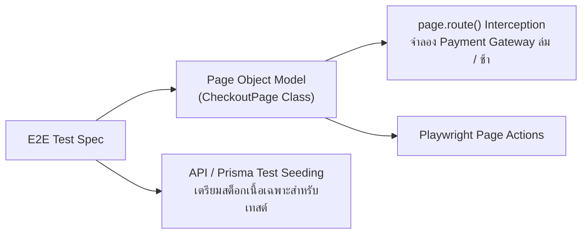

## 1. แนวคิด (Concept)
เมื่อโปรเจกต์เติบโตขึ้นจนมีไฟล์เทสต์ E2E หลายสิบไฟล์ หากเราเขียน Selector อย่าง `page.getByRole('button', { name: 'Add to Chilled Cart' })` ซ้ำๆ กระจายอยู่ใน 30 ไฟล์ วันใดที่ทีม UX เปลี่ยนชื่อปุ่มเป็น *"Reserve Butcher Cut"* เราจะต้องตามไปแก้โค้ดถึง 30 ไฟล์

**Page Object Model (POM)** คือรูปแบบสถาปัตยกรรมที่ห่อหุ้ม Locators และ Actions ของแต่ละหน้าจอไว้ในคลาสเดียว (เช่น `ButcherCatalogPage`, `CheckoutPage`) ทำให้ไฟล์เทสต์อ่านเข้าใจง่ายเหมือนภาษาธุรกิจ และหาก UI เปลี่ยนแปลงก็แก้ไขที่คลาส POM เพียงจุดเดียว

นอกจากนี้ ในระดับ Enterprise เรายังผสาน POM เข้ากับการเตรียมข้อมูลด้วย **Test Database Seeding** และการจำลองสถานการณ์พิเศษด้วย **Network Interception (`page.route()`)**

## 2. หลักการเบื้องหลัง (Under the Hood)


1. **Page Object Encapsulation:** คลาส POM จะรับ `Page` เข้ามาใน Constructor แล้วประกาศ `readonly` properties สำหรับ Locators และเมธอดระดับธุรกิจ เช่น `await catalogPage.selectWagyuCutAndWeight('Miyazaki A5', 1.2)`
2. **Test Database Seeding via API / Prisma:** แทนที่จะเสียเวลาคลิกหน้าเว็บ Admin เพื่อสร้างสินค้าเนื้อวากิวก่อนเริ่มเทสต์ฝั่งลูกค้า เราสามารถใช้ `request` fixture (`APIRequestContext`) ยิงไปยัง Internal Test Seed Endpoint หรือใช้ Prisma สร้างข้อมูลตั้งต้นใน `beforeEach` ได้ภายในไม่กี่มิลลิวินาที
3. **Hybrid Network Interception (`page.route()`):** แม้ใน E2E Test เราจะต่อกับ Backend จริงเป็นหลัก แต่สำหรับสถานการณ์ที่สร้างขึ้นจริงได้ยากมาก เช่น **"ธนาคารปลายทางล่มกะทันหัน (HTTP 503)"** หรือ **"เซนเซอร์ตู้บ่มเนื้อส่งข้อมูลล่าช้า 5 วินาที"** เราสามารถใช้ `await page.route('**/api/v1/payments/**', route => route.fulfill(...))` เพื่อดักจับและจำลองคำตอบเฉพาะเส้นทางนั้นได้อย่างแม่นยำ

## 3. ตัวอย่างโค้ด (Smart Butcher Marketplace)

### ตัวอย่างที่ 1 (พื้นฐาน): การออกแบบคลาส Page Object Model (`WagyuProductPage`) และการนำไปใช้งานในเทสต์
ตัวอย่างการแยก Locators และขั้นตอนการสั่งตัดเนื้อออกเป็นคลาส POM ที่มี Type Safety ชัดเจน:

```typescript filename="e2e/pages/WagyuProductPage.ts"
import { type Page, type Locator, expect } from '@playwright/test';

export class WagyuProductPage {
  readonly page: Page;
  readonly thicknessSelect: Locator;
  readonly weightInput: Locator;
  readonly reserveButton: Locator;
  readonly cartDrawer: Locator;

  constructor(page: Page) {
    this.page = page;
    this.thicknessSelect = page.getByLabel('Steak Thickness');
    this.weightInput = page.getByLabel('Cut Weight (kg)');
    this.reserveButton = page.getByRole('button', { name: 'Add to Chilled Cart' });
    this.cartDrawer = page.getByRole('dialog', { name: 'Your Chilled Butcher Cart' });
  }

  async gotoProduct(slug: string): Promise<void> {
    await this.page.goto(`/products/${slug}`);
  }

  async customizeAndAddToCart(options: {
    thickness: '2.5cm' | '3.5cm' | '5.0cm';
    weightKg: string;
  }): Promise<void> {
    await this.thicknessSelect.selectOption(options.thickness);
    await this.weightInput.fill(options.weightKg);
    await this.reserveButton.click();
  }

  async expectCartDrawerToContainCut(cutName: string, expectedPrice: string): Promise<void> {
    await expect(this.cartDrawer).toBeVisible();
    await expect(this.cartDrawer).toContainText(cutName);
    await expect(this.cartDrawer).toContainText(expectedPrice);
  }
}
```

### ตัวอย่างที่ 2 (ขั้นสูง): การใช้ POM ร่วมกับ API Test Seeding และ `page.route()` เพื่อทดสอบกรณีระบบชำระเงินล่ม
ตัวอย่างการเตรียมข้อมูลเนื้อวากิวผ่าน `request` fixture ก่อนเริ่มเทสต์ และใช้ `page.route()` จำลองเหตุการณ์ระบบชำระเงินขัดข้อง (HTTP 503) เพื่อพิสูจน์ว่าหน้าเว็บแสดงแบนเนอร์ให้ลูกค้าลองใหม่โดยที่ตะกร้าสินค้าไม่หาย:

```typescript filename="e2e/checkout-resilience-pom.spec.ts"
import { test as describeTest, expect } from '@playwright/test';
import { WagyuProductPage } from './pages/WagyuProductPage';

const describe = describeTest.describe;
const it = describeTest;

describe('Checkout Resilience with POM, API Seeding & Network Interception', () => {
  beforeEach(async ({ request }) => {
    // เตรียมข้อมูลสต็อกเนื้อวากิวใน Test Database ผ่าน Internal Testing Endpoint
    const seedRes = await request.post('/api/v1/testing/seed-wagyu', {
      data: {
        slug: 'kobe-a5-chateaubriand',
        name: 'Kobe A5 Chateaubriand Tenderloin',
        pricePerKg: 7500,
        stockKg: 5.0,
      },
    });
    expect(seedRes.ok()).toBeTruthy();
  });

  it('should preserve cart items and display retry alert when payment gateway returns 503', async ({
    page,
  }) => {
    const productPage = new WagyuProductPage(page);

    // ดักจับเฉพาะ API ชำระเงินให้จำลองสถานการณ์ Payment Gateway ล่มชั่วคราว (HTTP 503)
    await page.route('**/api/v1/payments/charge', async (route) => {
      await route.fulfill({
        status: 503,
        contentType: 'application/json',
        body: JSON.stringify({
          errorCode: 'GATEWAY_TIMEOUT',
          message: 'Bank payment network is temporarily unavailable. Your card was not charged.',
        }),
      });
    });

    await productPage.gotoProduct('kobe-a5-chateaubriand');
    await productPage.customizeAndAddToCart({
      thickness: '3.5cm',
      weightKg: '1.0',
    });

    await productPage.expectCartDrawerToContainCut(
      'Kobe A5 Chateaubriand Tenderloin',
      '฿7,500',
    );

    await productPage.cartDrawer
      .getByRole('link', { name: 'Proceed to Cold-Chain Checkout' })
      .click();

    await page.getByRole('button', { name: 'Place Order & Confirm Payment' }).click();

    // ยืนยันว่าหน้าเว็บแสดงข้อความแจ้งเตือนอย่างปลอดภัยและลูกค้ายังอยู่ที่หน้า /checkout
    const errorBanner = page.getByRole('alert');
    await expect(errorBanner).toContainText(
      'Bank payment network is temporarily unavailable. Your card was not charged.',
    );
    await expect(page).toHaveURL('/checkout');
  });
});
```

## 4. ผิด vs ถูก (Anti-pattern vs Best Practice)

| มิติการเปรียบเทียบ | ❌ ผิด (Anti-pattern) | ✅ ถูก (Best Practice) |
| :--- | :--- | :--- |
| **การสร้างข้อมูลตั้งต้นผ่าน UI** | ใช้ Playwright เปิดหน้า Admin คลิกสร้างหมวดหมู่และสร้างสินค้าเนื้อทีละช่องใน `beforeEach` ก่อนจะสลับมาเทสต์หน้าลูกค้า | ใช้ `request.post('/api/v1/testing/seed')` หรือ Prisma Seeding เพื่อเตรียมข้อมูลลงฐานข้อมูลโดยตรงในเวลาหลักมิลลิวินาที |
| **การ Mock ทุก API ใน E2E Test** | ใช้ `page.route()` จำลองทุก API ของระบบตัวเองจนไม่ได้ทดสอบว่า NestJS Backend และฐานข้อมูลทำงานจริงหรือไม่ | ปล่อยให้ API ของระบบตัวเองวิ่งทะลุถึง Backend จริง และใช้ `page.route()` เฉพาะการจำลอง Third-party ล่มหรือ Edge Cases เท่านั้น |

## 5. ควรใช้เมื่อไหร่ และ ไม่ควรใช้เมื่อไหร่
- **ควรใช้ Page Object Model เมื่อ:** หน้าจอนั้นถูกอ้างอิงในไฟล์เทสต์มากกว่า 1 ไฟล์ หรือมีขั้นตอนการโต้ตอบที่ซับซ้อนหลายขั้น (เช่น หน้าตารางเลือกชิ้นส่วนเนื้อวัวและหน้า Checkout)
- **ไม่ควรใช้ `page.route()` เมื่อ:** ทดสอบ Happy Path มาตรฐานที่ต้องการพิสูจน์ว่าข้อมูลถูกบันทึกลงฐานข้อมูล PostgreSQL จริง

## 6. คำถามสัมภาษณ์ (Interview Q&A)
- **Q1: ในการออกแบบคลาส Page Object Model (POM) เราควรใส่ `expect(...)` ไว้ในคลาส POM หรือควรใส่ไว้ในไฟล์เทสต์ (`.spec.ts`)?**
  - *แนวคำตอบ:* แนวทางที่ยืดหยุ่นที่สุดคือให้เมธอด Action หลักใน POM (เช่น `customizeAndAddToCart()`) ทำหน้าที่เฉพาะการโต้ตอบกับหน้าจอโดยไม่ผูกมัดกับ Assertion เพื่อให้สามารถนำเมธอดเดียวกันไปใช้ทดสอบได้ทั้งเคสที่สำเร็จและเคสที่เกิด Error ส่วนการทำ Assertion ให้เขียนในไฟล์ `.spec.ts` หรือสร้างเมธอดช่วยตรวจสอบที่ตั้งชื่อขึ้นต้นด้วย `expect...` อย่างชัดเจน (เช่น `expectCartDrawerToContainCut()`) เพื่อให้ผู้ที่อ่านไฟล์ `.spec.ts` มองเห็นทันทีว่าเทสต์ข้อนี้กำลังพิสูจน์อะไร
- **Q2: ข้อควรระวังในการใช้ `page.route()` กับแอปพลิเคชัน Next.js 16 ที่ใช้ Server Components และ Server Actions คืออะไร?**
  - *แนวคำตอบ:* คำสั่ง `page.route()` ของ Playwright ดักจับเฉพาะ Network Requests ที่วิ่งออกจาก **ตัวเบราว์เซอร์ (Client-side Fetch / XHR / Navigation)** เท่านั้น แต่จะไม่สามารถดักจับ `fetch()` ที่เกิดขึ้นภายใน **Server Component หรือ Server Action** ที่ยิงจากโปรเซสของ Node.js Server ไปยัง Backend API โดยตรงได้ หากต้องการจำลองข้อมูลในระดับ Server-to-Server ต้องตั้งค่า Test Backend / MSW บนฝั่ง Node Server หรือใช้ Test Database Seeding แทน

---
