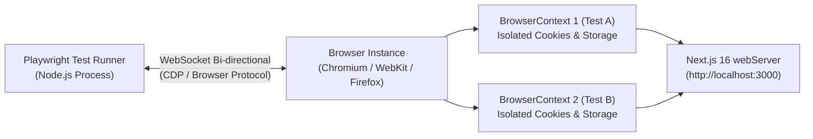

## 1. แนวคิด (Concept)
ในยอดบนสุดของ **Testing Pyramid** คือ **End-to-End (E2E) Testing** ซึ่งทำหน้าที่ตรวจสอบว่าระบบทุกส่วนตั้งแต่ Frontend ([Next.js 16](/docs/nextjs) App Router, `async` Server Components, Server Actions, Middleware), ระบบเครือข่าย, ไปจนถึง Backend ([NestJS 11](/docs/backend/nestjs) และ [Prisma ORM](/docs/backend/prisma-orm)) สามารถทำงานร่วมกันได้จริงบนเอนจินเบราว์เซอร์จริง

สำหรับโปรเจกต์ Next.js 16 ตัว **Playwright** มีบทบาทสำคัญอย่างยิ่ง เพราะเป็นเครื่องมือหลักที่เอกสารทางการของ Next.js แนะนำให้ใช้ทดสอบ `async` Server Components, การเปลี่ยนเส้นทางด้วย `redirect()`, การแคชข้อมูล และการตรวจสอบสิทธิ์ใน `middleware.ts` ที่สภาพแวดล้อม JSDOM ใน Jest ไม่สามารถจำลองได้

## 2. หลักการเบื้องหลัง (Under the Hood)
สถาปัตยกรรมของ Playwright แตกต่างจากเครื่องมือยุคเก่าที่ใช้ HTTP WebDriver หรือรันอยู่ในหน้าต่างเบราว์เซอร์เดียวกัน:



1. **Out-of-Process WebSocket Connection:** Playwright สื่อสารกับเอนจินเบราว์เซอร์โดยตรงผ่าน **Chrome DevTools Protocol (CDP)** บนช่องทาง WebSocket แบบสองทิศทางถาวร (Persistent Bi-directional Pipe) ไม่ต้องเสียเวลาสร้าง HTTP Request ต่อคำสั่งเหมือน Selenium และไม่ถูกจำกัดด้วย Same-Origin Policy ในหน้าต่างเดียวเหมือนรุ่นเก่า
2. **Ultra-fast BrowserContext Isolation:** แทนที่จะเปิดปิดโปรแกรมเบราว์เซอร์ใหม่ทุกครั้งซึ่งกินเวลานานหลายวินาที Playwright จะเปิด Browser Instance เพียงครั้งเดียว แล้วสร้าง **`BrowserContext`** (เทียบเท่าหน้าต่าง Incognito ใหม่เอี่ยมที่แยก Cookies, LocalStorage และ Session ออกจากกัน 100%) สำหรับแต่ละ Test Case โดยใช้เวลาสร้างเพียงไม่กี่มิลลิวินาที
3. **Built-in `webServer` Orchestration:** ในไฟล์ `playwright.config.ts` เราสามารถกำหนดบล็อก `webServer` เพื่อให้ Playwright สั่งบิลด์หรือสตาร์ทเซิร์ฟเวอร์ Next.js 16 (`npm run build && npm run start` หรือ `npm run dev`) และรอจนกว่าพอร์ต `3000` จะพร้อมรับการเชื่อมต่อก่อนเริ่มรันเทสต์ข้อแรกโดยอัตโนมัติ

## 3. ตัวอย่างโค้ด (Smart Butcher Marketplace)

### ตัวอย่างที่ 1 (พื้นฐาน): การกำหนดค่า `playwright.config.ts` สำหรับ Next.js 16 แบบ Production-grade
การตั้งค่าที่รองรับการรันแบบขนาน (`fullyParallel`), การบันทึก Trace เมื่อเทสต์ล้มเหลว และการบูตเซิร์ฟเวอร์ Next.js 16 อัตโนมัติ:

```typescript filename="playwright.config.ts"
import { defineConfig, devices } from '@playwright/test';

const PORT = process.env.PORT ? Number(process.env.PORT) : 3000;
const BASE_URL = process.env.PLAYWRIGHT_TEST_BASE_URL ?? `http://localhost:${PORT}`;

export default defineConfig({
  testDir: './e2e',
  fullyParallel: true,
  forbidOnly: Boolean(process.env.CI),
  retries: process.env.CI ? 2 : 0,
  workers: process.env.CI ? 2 : undefined,
  reporter: [['html', { open: 'never' }], ['list']],

  use: {
    baseURL: BASE_URL,
    trace: 'on-first-retry',
    screenshot: 'only-on-failure',
    video: 'retain-on-failure',
  },

  projects: [
    {
      name: 'chromium',
      use: { ...devices['Desktop Chrome'] },
    },
    {
      name: 'mobile-safari',
      use: { ...devices['iPhone 14 Pro'] },
    },
  ],

  webServer: {
    command: process.env.CI ? 'npm run start' : 'npm run dev',
    url: BASE_URL,
    reuseExistingServer: !process.env.CI,
    timeout: 120 * 1000,
  },
});
```

### ตัวอย่างที่ 2 (ขั้นสูง): การเขียนเทสต์ตรวจสอบหน้าแรกของ Smart Butcher Marketplace และการนำทางไปยังแค็ตตาล็อกเนื้อวากิว
ตัวอย่างการเขียนเทสต์แรกเพื่อตรวจว่า `async` Server Component ของหน้าแรกเรนเดอร์ข้อมูลถูกต้อง และสามารถคลิกลิงก์เปลี่ยนหน้าไปยัง `/catalog/wagyu` ได้อย่างสมบูรณ์:

```typescript filename="e2e/catalog-navigation.spec.ts"
import { test as describeTest, expect } from '@playwright/test';

const describe = describeTest.describe;
const it = describeTest;

describe('Smart Butcher Marketplace - Public Catalog Navigation', () => {
  it('should render hero section and navigate to Japanese Wagyu catalog page', async ({
    page,
  }) => {
    await page.goto('/');

    // ยืนยันว่าหัวข้อหลักบนหน้าแรกแสดงผลถูกต้อง
    await expect(
      page.getByRole('heading', {
        name: /Artisanal Dry-Aged & A5 Wagyu Marketplace/i,
      }),
    ).toBeVisible();

    // คลิกลิงก์ไปยังหมวดหมู่เนื้อวากิวญี่ปุ่น
    await page.getByRole('link', { name: 'Explore Japanese Wagyu' }).click();

    // ยืนยันว่า URL เปลี่ยนไปที่ /catalog/wagyu และแสดงรายการสินค้าจาก Server Component
    await expect(page).toHaveURL(/\/catalog\/wagyu$/);
    await expect(
      page.getByRole('heading', { name: 'Certified A5 Wagyu Selection', level: 1 }),
    ).toBeVisible();
  });

  it('should filter catalog cuts by Dry-Aged category via URL search params', async ({
    page,
  }) => {
    await page.goto('/catalog/wagyu?aging=45-days');

    const productCards = page.getByRole('article');
    await expect(productCards.first()).toContainText('45-Day Dry-Aged');
  });
});
```

## 4. ผิด vs ถูก (Anti-pattern vs Best Practice)

| มิติการเปรียบเทียบ | ❌ ผิด (Anti-pattern) | ✅ ถูก (Best Practice) |
| :--- | :--- | :--- |
| **การระบุ URL ในเทสต์** | ฮาร์ดโค้ด `await page.goto('http://localhost:3000/catalog')` ในทุกไฟล์จนเปลี่ยนพอร์ตบน CI ไม่ได้ | กำหนด `baseURL` ใน `playwright.config.ts` แล้วเรียก `await page.goto('/catalog')` ด้วย Relative Path เสมอ |
| **การแชร์สถานะข้ามเทสต์** | สร้างตัวแปร `let sharedPage: Page` ไว้ระดับไฟล์แล้วใช้ร่วมกันทุก `it()` จนเกิดคุกกี้และสถานะปนเปื้อน | รับ `{ page }` จาก Fixture ของแต่ละ `it()` เสมอ เพื่อให้ Playwright สร้าง `BrowserContext` ใหม่ที่แยกขาดจากกันทุกเคส |

## 5. ควรใช้เมื่อไหร่ และ ไม่ควรใช้เมื่อไหร่
- **ควรใช้เมื่อ:** ทดสอบเส้นทางหลักที่สร้างรายได้ให้ธุรกิจ (Critical User Journeys เช่น สมัครสมาชิก -> เลือกเนื้อ -> ชำระเงิน), ทดสอบ `async` Server Components และทดสอบการทำงานข้ามเบราว์เซอร์ (Desktop Chrome และ Mobile Safari)
- **ไม่ควรใช้เมื่อ:** ทดสอบการตรวจสอบรหัสผ่านผิด 20 รูปแบบ หรือทดสอบฟังก์ชันคำนวณตัวเลขย่อยๆ ซึ่งควรทดสอบในระดับ Unit Test หรือ Component Test ที่รันจบในระดับมิลลิวินาที

## 6. คำถามสัมภาษณ์ (Interview Q&A)
- **Q1: กลไก `BrowserContext` ของ Playwright ช่วยให้การรัน E2E Test เร็วกว่าและเสถียรกว่าการเปิด Browser ใหม่ทุกครั้งอย่างไร?**
  - *แนวคำตอบ:* การบูตโปรเซสของเบราว์เซอร์ (เช่น Chromium) ใหม่ตั้งแต่ต้นต้องใช้เวลาโหลด Binary และจองหน่วยความจำระดับหลายร้อยมิลลิวินาทีถึงหลายวินาที แต่ Playwright บูต Browser Process เพียงครั้งเดียวต่อ Worker แล้วสร้าง `BrowserContext` ซึ่งเป็นโปรไฟล์จำลองระดับหน่วยความจำที่แยก Cookies, IndexedDB, LocalStorage และ Cache ออกจากกันอย่างเด็ดขาดโดยใช้เวลาสร้างเพียงหลักสิบมิลลิวินาที ทำให้เทสต์แต่ละข้อไม่กวนกันเลยและรันจบได้เร็วมาก
- **Q2: ตัวเลือก `forbidOnly: Boolean(process.env.CI)` ใน `playwright.config.ts` มีความสำคัญต่อไปป์ไลน์ CI/CD อย่างไร?**
  - *แนวคำตอบ:* ในระหว่างพัฒนาบนเครื่องตัวเอง นักพัฒนามักใส่ `test.only(...)` เพื่อรันเฉพาะเคสที่กำลังแก้ไข หากเผลอ Commit โค้ดที่มี `test.only` ขึ้นไปยัง Git Repository และไม่มี `forbidOnly: true` บน CI ตัว CI จะรันเทสต์เพียงข้อนั้นข้อเดียวแล้วรายงานว่าสีเขียวผ่านทั้งหมด (ข้ามเทสต์อีก 99% ของระบบไปโดยไม่มีใครรู้) การเปิด `forbidOnly` บน CI จะสั่งให้บิลด์ล้มเหลวทันทีที่ตรวจพบ `.only` ในโค้ด

---
