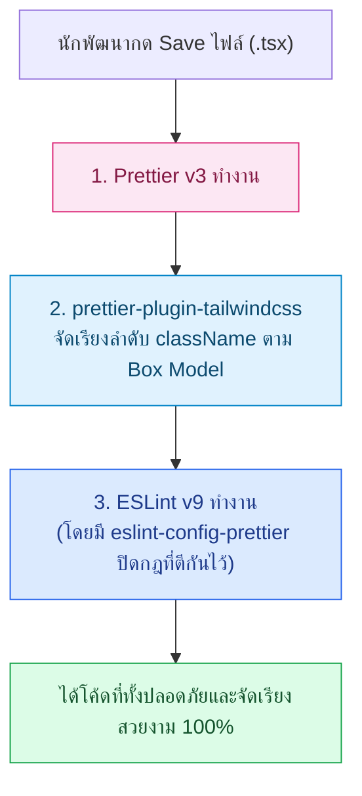

## 1. แนวคิด (Concept)

เพื่อให้การจัดรูปแบบโค้ดทำงานร่วมกับ ESLint และ **Tailwind CSS** ได้อย่างสมบูรณ์แบบโดยไม่มีความขัดแย้ง เราต้องประกอบชิ้นส่วน 3 ชิ้นเข้าด้วยกัน:
1. **`prettier`**: เอนจินหลักสำหรับจัดรูปแบบโค้ดทุกภาษาในโปรเจกต์
2. **`eslint-config-prettier`**: ตัวปิดกฎด้าน Formatting ของ ESLint และ `@typescript-eslint` ทุกข้อที่อาจขัดแย้งกับการจัดวางของ Prettier
3. **`prettier-plugin-tailwindcss`**: ปลั๊กอินอย่างเป็นทางการจากทีม Tailwind CSS ที่ทำหน้าที่จัดเรียงลำดับ Utility Classes ในแอตทริบิวต์ `className` ของ React ตามลำดับ CSS Cascade มาตรฐานโดยอัตโนมัติ



## 2. หลักการเบื้องหลัง (Under the Hood)

วิธีที่ `prettier-plugin-tailwindcss` จัดเรียงคลาสไม่ได้เรียงตามตัวอักษร A-Z แต่เรียงตามลำดับการสร้าง CSS Rule ของ Tailwind Compiler:
1. **Layout & Box Model**: `flex`, `grid`, `block`, `hidden`
2. **Positioning & Sizing**: `relative`, `w-full`, `h-12`
3. **Spacing (Margin / Padding)**: `mx-auto`, `p-6`, `gap-4`
4. **Typography & Visuals**: `bg-white`, `text-slate-900`, `font-bold`, `shadow-sm`
5. **Responsive & State Modifiers**: `hover:...`, `focus:...`, `md:...`, `lg:...` จะถูกดันไปอยู่ท้ายสุดเสมอ

นอกจากนี้ สำหรับโค้ดที่ใช้ฟังก์ชันช่วยรวมคลาสอย่าง `clsx`, `cn` หรือ `cva` เราสามารถตั้งค่า `tailwindFunctions: ['clsx', 'cn', 'cva']` ใน `.prettierrc.json` เพื่อให้ปลั๊กอินเข้าไปจัดเรียงคลาสที่อยู่ภายในอาร์กิวเมนต์ของฟังก์ชันเหล่านั้นได้ด้วย

<Callout type="tip" title="กฎสำคัญของการโหลด prettier-plugin-tailwindcss">
หากโปรเจกต์ของคุณมีการใช้ปลั๊กอินของ Prettier หลายตัวร่วมกัน จะต้องวาง prettier-plugin-tailwindcss ไว้เป็นลำดับสุดท้ายในอาร์เรย์ plugins ของไฟล์ .prettierrc.json เสมอ เพื่อให้มันทำงานหลังจากปลั๊กอินตัวอื่นแปลง AST เสร็จเรียบร้อยแล้ว
</Callout>

## 3. ตัวอย่างโค้ด (Smart Butcher Marketplace)

### ตัวอย่างที่ 1 (ระดับพื้นฐาน): การตั้งค่า `.prettierrc.json` และ `.prettierignore` ระดับ Production
ไฟล์ตั้งค่า Prettier ที่กำหนดมาตรฐานเดียวกันทั้งทีม พร้อมเปิดใช้งานการจัดเรียงคลาส Tailwind CSS ทั้งใน JSX และในฟังก์ชัน `cn()`

```json filename=".prettierrc.json"
{
  "semi": true,
  "singleQuote": true,
  "trailingComma": "all",
  "printWidth": 80,
  "tabWidth": 2,
  "useTabs": false,
  "endOfLine": "lf",
  "arrowParens": "always",
  "plugins": ["prettier-plugin-tailwindcss"],
  "tailwindFunctions": ["clsx", "cn", "cva"]
}
```

### ตัวอย่างที่ 2 (ระดับ Production): การ์ดแสดงสินค้าเนื้อวากิวและสถานะการชำระเงินที่จัดเรียง Tailwind Classes อย่างเป็นระบบ
ตัวอย่าง Component แสดงข้อมูล `Product`, `Category` และสถานะ `Payment` ที่ใช้ฟังก์ชัน `cn` และถูกจัดเรียงลำดับคลาสตามมาตรฐาน Box Model จนอ่านง่ายและบำรุงรักษาสะดวก

```tsx filename="src/components/butcher/WagyuOrderSummaryCard.tsx"
import type { Category, Product } from '../../domain/butcher-pricing';
import type { Order, Payment } from '../../services/order-checkout.service';

export function cn(...classes: readonly (string | false | null | undefined)[]): string {
  return classes.filter(Boolean).join(' ');
}

export interface WagyuOrderSummaryCardProps {
  order: Order;
  product: Product;
  category: Category;
  payment: Payment;
}

export function WagyuOrderSummaryCard({
  order,
  product,
  category,
  payment,
}: WagyuOrderSummaryCardProps) {
  const isPaid = payment.status === 'COMPLETED';

  return (
    <article className="mx-auto flex max-w-lg flex-col gap-4 rounded-2xl border border-slate-200 bg-white p-6 shadow-md transition-shadow hover:shadow-lg">
      <header className="flex items-start justify-between border-b border-slate-100 pb-4">
        <div>
          <span className="inline-block rounded-full bg-amber-100 px-3 py-0.5 text-xs font-semibold tracking-wide text-amber-900 uppercase">
            {category.name} ({category.storageTempCelsius}°C)
          </span>
          <h2 className="mt-2 text-xl font-bold text-slate-900">
            {product.name}
          </h2>
          <p className="text-xs text-slate-500">รหัสคำสั่งซื้อ: {order.id}</p>
        </div>

        <span
          className={cn(
            'rounded-md px-2.5 py-1 text-xs font-bold',
            isPaid
              ? 'bg-emerald-100 text-emerald-800'
              : 'bg-rose-100 text-rose-800',
          )}
        >
          {payment.status}
        </span>
      </header>

      <div className="flex items-center justify-between text-sm text-slate-700">
        <span>จำนวนรายการตัดแต่ง: {order.items.length} ชิ้น</span>
        <span className="text-lg font-extrabold text-slate-900">
          {order.totalAmount.toLocaleString()} บาท
        </span>
      </div>
    </article>
  );
}
```

## 4. ผิด vs ถูก (Anti-pattern vs Best Practice)

```tsx filename="src/components/butcher/TailwindClassOrder.compare.tsx"
// ❌ ผิด (Anti-pattern): คลาส Tailwind เรียงสะเปะสะปะ ผสมปนเประหว่าง hover, padding, layout และสี
export function UnsortedProductBadge({ label }: { label: string }) {
  return (
    <span className="text-white hover:bg-red-800 p-2 flex bg-red-600 items-center rounded-md text-xs font-bold gap-1">
      {label}
    </span>
  );
}

// ✅ ถูก (Best Practice): จัดเรียงด้วย prettier-plugin-tailwindcss (Layout -> Spacing -> Visuals -> States)
export function SortedProductBadge({ label }: { label: string }) {
  return (
    <span className="flex items-center gap-1 rounded-md bg-red-600 p-2 text-xs font-bold text-white hover:bg-red-800">
      {label}
    </span>
  );
}
```

## 5. ควรใช้เมื่อไหร่ และ ไม่ควรใช้เมื่อไหร่

- **ควรใช้ `endOfLine: "lf"` ใน `.prettierrc.json` เสมอเมื่อ**: ทีมพัฒนามีการใช้ระบบปฏิบัติการผสมกันระหว่าง Windows (`CRLF`) และ macOS / Linux (`LF`) เพื่อป้องกันไม่ให้ Git มองว่าไฟล์ถูกแก้ไขทุกบรรทัดเพียงเพราะอักขระขึ้นบรรทัดใหม่ต่างกัน
- **ไม่ควรใช้**: ไม่ควรให้ Prettier เข้าไปจัดรูปแบบไฟล์ที่สร้างขึ้นอัตโนมัติ เช่น `pnpm-lock.yaml`, `package-lock.json`, โฟลเดอร์ `.next`, `dist` หรือไฟล์ Migration ของฐานข้อมูล ให้ใส่รายชื่อเหล่านี้ไว้ใน `.prettierignore` เสมอ

## 6. คำถามสัมภาษณ์ (Interview Q&A)

**Q1: ทำไมการกำหนด `"endOfLine": "lf"` ใน Prettier จึงมีความสำคัญมากเมื่อทีมทำงานร่วมกันระหว่างเครื่อง Windows และ macOS?**
- **แนวคำตอบ**: เพราะ Windows ใช้รหัสขึ้นบรรทัดใหม่เป็น `CRLF` (`\r\n`) ส่วน macOS และ Linux (รวมถึง CI Runner บน GitHub Actions) ใช้ `LF` (`\n`) หากไม่บังคับค่า `"endOfLine": "lf"` ใน Prettier เมื่อนักพัฒนาฝั่ง Windows กด Save หรือรัน `prettier --check` จะเกิด Error แจ้งเตือนทุกบรรทัดในไฟล์ การบังคับ `lf` คู่กับการตั้งค่า `.gitattributes` (`* text=auto eol=lf`) จะช่วยยุติปัญหานี้ได้อย่างถาวร

**Q2: หากเราสร้าง Utility Function ชื่อ `cn()` สำหรับรวมคลาส Tailwind CSS ทำไมตอนแรก `prettier-plugin-tailwindcss` จึงไม่ยอมเรียงคลาสที่อยู่ใน `cn('p-4 flex')` ให้ และต้องแก้ด้วยการตั้งค่าใด?**
- **แนวคำตอบ**: โดยค่าเริ่มต้นปลั๊กอินจะตรวจสอบเฉพาะแอตทริบิวต์ `class` และ `className` ของ JSX เท่านั้น หากต้องการให้มันเข้าไปจัดเรียงสตริงภายในฟังก์ชันเสริม จะต้องเพิ่ม `"tailwindFunctions": ["cn", "clsx", "cva"]` ลงในไฟล์ `.prettierrc.json`

---
