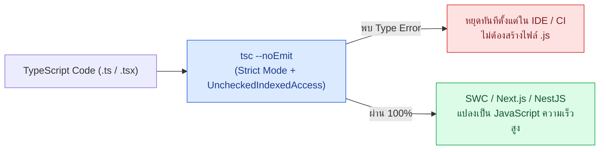

## 1. แนวคิด (Concept)

ก่อนที่เราจะเสียเวลาเขียน Unit Test เพื่อตรวจว่าฟังก์ชันรับค่า `null` หรือ `undefined` แล้วพังหรือไม่ **TypeScript 5.x Strict Mode** สามารถทำหน้าที่เป็น **"ชุดทดสอบอัตโนมัติระดับคอมไพเลอร์ (Compile-time Proof)"** ที่กวาดตรวจทุกบรรทัดของโปรเจกต์ได้ภายในไม่กี่วินาที

ในระบบ **Smart Butcher Marketplace** การเปิดใช้งานเพียง `"strict": true` ใน `tsconfig.json` ยังไม่เพียงพอสำหรับระบบที่มีการคำนวณเงินและสต็อกเนื้อราคาแพง เราควรเปิดแฟล็กเสริมความรัดกุมระดับสูงสุดควบคู่กับคำสั่ง `tsc --noEmit`:
- **`noUncheckedIndexedAccess: true`**: บังคับให้การดึงค่าจาก Array หรือ Record ด้วยดัชนี (เช่น `order.items[0]`) มีชนิดข้อมูลเป็น `OrderItem | undefined` เสมอ ป้องกันบั๊ก `Cannot read properties of undefined` เมื่ออาร์เรย์ว่างเปล่า
- **`exactOptionalPropertyTypes: true`**: แยกแยะชัดเจนระหว่างการไม่ได้ส่งคีย์เข้ามา กับการส่งค่า `undefined` เข้ามาตรงๆ
- **`noImplicitOverride: true`**: บังคับใส่คีย์เวิร์ด `override` เมื่อคลาสลูกเขียนทับเมธอดของคลาสแม่



## 2. หลักการเบื้องหลัง (Under the Hood)

ทำไมเราต้องรัน `tsc --noEmit` แยกต่างหาก ทั้งที่ Next.js (SWC) หรือ Jest (`@swc/jest`) ก็รันโค้ด TypeScript ได้อยู่แล้ว?
1. **SWC และ esbuild ทำเพียง Type Stripping**: เพื่อความเร็วสูงสุดในการรัน Dev Server และ Test Runner เครื่องมืออย่าง SWC จะทำเพียง **"ลอก (Strip) ส่วนที่เป็น Type Annotation ทิ้งไป"** แบบไฟล์ต่อไฟล์โดยไม่ทำการตรวจสอบความถูกต้องของ Type ข้ามไฟล์เลย!
2. **หน้าที่ของ `tsc --noEmit`**: จึงต้องใช้ TypeScript Compiler (`tsc`) ตัวจริงในการสร้าง Type Graph ทั้งโปรเจกต์เพื่อตรวจสอบความสอดคล้องของอินเทอร์เฟซทั้งหมด โดยใส่ออปชัน `--noEmit` เพื่อสั่งให้ตรวจเช็คอย่างเดียวโดยไม่ต้องเขียนไฟล์ `.js` ลงดิสก์

<Callout type="tip" title="เร่งความเร็ว tsc --noEmit ด้วย incremental: true">
การเปิดออปชัน incremental: true ใน tsconfig.json จะทำให้ TypeScript บันทึกข้อมูลโครงสร้าง Type Graph ของรอบก่อนหน้าไว้ในไฟล์ tsconfig.tsbuildinfo เมื่อรัน tsc --noEmit ครั้งถัดไป คอมไพเลอร์จะตรวจเฉพาะไฟล์ที่เปลี่ยนแปลงและไฟล์ที่ได้รับผลกระทบเท่านั้น ช่วยลดเวลาจากหลักสิบวินาทีเหลือเพียง 1-2 วินาที
</Callout>

## 3. ตัวอย่างโค้ด (Smart Butcher Marketplace)

### ตัวอย่างที่ 1 (ระดับพื้นฐาน): การตั้งค่า `tsconfig.json` ระดับ Ultra-Strict สำหรับระบบ E-Commerce
ไฟล์ตั้งค่า TypeScript 5.x ที่อุดช่องโหว่ `undefined` และบังคับการตรวจสอบทุกเงื่อนไขอย่างรัดกุม

```json filename="tsconfig.json"
{
  "compilerOptions": {
    "target": "ES2023",
    "module": "NodeNext",
    "moduleResolution": "NodeNext",
    "lib": ["ES2023", "DOM", "DOM.Iterable"],
    "strict": true,
    "noUncheckedIndexedAccess": true,
    "exactOptionalPropertyTypes": true,
    "noImplicitOverride": true,
    "noFallthroughCasesInSwitch": true,
    "forceConsistentCasingInFileNames": true,
    "isolatedModules": true,
    "incremental": true,
    "noEmit": true,
    "skipLibCheck": true
  },
  "include": ["src/**/*.ts", "src/**/*.tsx", "tests/**/*.ts"],
  "exclude": ["node_modules", "dist", ".next"]
}
```

### ตัวอย่างที่ 2 (ระดับ Production): การใช้ Exhaustive Type Checking (`never`) และป้องกัน `noUncheckedIndexedAccess` ในระบบชำระเงิน
โค้ดประมวลผล `Payment`, `Order`, `OrderItem`, `Product`, `Category` และ `User` ที่ใช้ประโยชน์จาก TypeScript Strict Mode เพื่อรับประกันว่าหากมีการเพิ่มสถานะการชำระเงินใหม่ในอนาคตแล้วลืมเขียนโค้ดรองรับ คอมไพเลอร์จะฟ้อง Error ทันที

```typescript filename="src/domain/strict-payment-Guard.ts"
export interface User {
  id: string;
  email: string;
  role: 'CUSTOMER' | 'BUTCHER' | 'ADMIN';
}

export interface Category {
  id: string;
  name: string;
  minDryAgedDays: number;
}

export interface Product {
  id: string;
  categoryId: string;
  name: string;
  sku: string;
  pricePerKg: number;
  stockKg: number;
}

export interface OrderItem {
  id: string;
  productId: string;
  weightKg: number;
  subtotal: number;
}

export interface Order {
  id: string;
  userId: string;
  items: readonly OrderItem[];
  totalAmount: number;
}

export type PaymentStatus =
  | 'PENDING'
  | 'AUTHORIZED'
  | 'CAPTURED'
  | 'FAILED'
  | 'REFUNDED';

export interface Payment {
  id: string;
  orderId: string;
  amount: number;
  status: PaymentStatus;
}

// ฟังก์ชันช่วยบังคับ Exhaustive Check ใน switch-case
export function assertNever(unexpectedValue: never): never {
  throw new Error(
    `พบสถานะที่ไม่ได้คาดคิดในระบบ: ${JSON.stringify(unexpectedValue)}`,
  );
}

export function describePaymentActionForButcher(
  order: Order,
  payment: Payment,
): string {
  // เนื่องจากเปิด noUncheckedIndexedAccess: true ตัวแปร primaryItem จึงมี Type เป็น OrderItem | undefined
  const primaryItem = order.items[0];
  if (!primaryItem) {
    throw new Error(`คำสั่งซื้อ ${order.id} ไม่มีรายการสินค้าเนื้อ`);
  }

  switch (payment.status) {
    case 'PENDING':
      return `รอการโอนเงินสำหรับรายการแรก (${primaryItem.productId})`;
    case 'AUTHORIZED':
      return `วงเงินอนุมัติแล้ว เตรียมจองเนื้อน้ำหนัก ${String(primaryItem.weightKg)} กก.`;
    case 'CAPTURED':
      return `ตัดเงินสำเร็จ ${String(payment.amount)} บาท เริ่มตัดแต่งเนื้อได้ทันที`;
    case 'FAILED':
      return `การชำระเงินล้มเหลว ยกเลิกการจองเนื้อ`;
    case 'REFUNDED':
      return `คืนเงินให้ลูกค้าเรียบร้อยแล้ว`;
    default:
      // หากใครเพิ่มสถานะใหม่ใน PaymentStatus แล้วลืมใส่ case ด้านบน บรรทัดนี้จะเกิด Compile Error ทันที!
      return assertNever(payment.status);
  }
}
```

## 4. ผิด vs ถูก (Anti-pattern vs Best Practice)

```typescript filename="src/domain/indexed-access.compare.ts"
import type { Order } from './strict-payment-Guard';

// ❌ ผิด (Anti-pattern): ใช้ Non-null assertion (!) บังคับข้ามการตรวจของ TypeScript
export function getFirstItemWeightBad(order: Order): number {
  // ถ้า order.items เป็นอาร์เรย์ว่าง [] จะเกิด Runtime TypeError ทันที!
  return order.items[0]!.weightKg;
}

// ✅ ถูก (Best Practice): ตรวจสอบการมีอยู่ของสมาชิกตัวแรกอย่างชัดเจนตามกฎ noUncheckedIndexedAccess
export function getFirstItemWeightGood(order: Order): number {
  const firstItem = order.items[0];
  if (!firstItem) {
    return 0;
  }
  return firstItem.weightKg;
}
```

## 5. ควรใช้เมื่อไหร่ และ ไม่ควรใช้เมื่อไหร่

- **ควรใช้ `tsc --noEmit` เมื่อ**: รันในขั้นตอน Pre-commit Hook, รันบน GitHub Actions CI และรันก่อนการสั่ง Build ด้วย SWC/Vite ที่ไม่ได้เช็ค Type เอง
- **ไม่ควรใช้**: ห้ามใช้ `@ts-ignore` เพื่อปิดบัง Type Error เด็ดขาด หากจำเป็นต้องทดสอบเคสที่ส่งค่าผิดชนิดในไฟล์เทสต์ ให้ใช้ `@ts-expect-error` พร้อมคำอธิบายแทน เพราะหากวันหนึ่งโค้ดข้างใต้ถูกแก้จนไม่มี Error แล้ว `@ts-expect-error` จะเตือนให้เราลบบรรทัดนั้นออก

## 6. คำถามสัมภาษณ์ (Interview Q&A)

**Q1: ทำไมการเปลี่ยนมาใช้ `@swc/jest` หรือ Vite จึงทำให้ชุดทดสอบรันผ่านแม้เราจะส่งพารามิเตอร์ผิด Type เข้าไปในฟังก์ชัน และต้องแก้ปัญหานี้ใน Pipeline อย่างไร?**
- **แนวคำตอบ**: เพราะ `@swc/jest` และ esbuild เน้นความเร็วในการแปลงโค้ดจึงทำแค่การตัด Type ทิ้ง (Type Stripping) โดยไม่รัน TypeScript Type Checker ดังนั้นใน CI Pipeline และสคริปต์ตรวจสอบก่อนส่งงานจึงต้องมีขั้นตอนการรัน `tsc --noEmit` คู่ขนานกับการรันเทสต์เสมอ

**Q2: ออปชัน `noUncheckedIndexedAccess: true` ใน `tsconfig.json` ช่วยป้องกันบั๊กยอดฮิตใน Production ได้อย่างไร?**
- **แนวคำตอบ**: โดยปกติแม้จะเปิด `strict: true` แล้ว แต่ TypeScript ยังคงอนุมานว่า `items[0]` มีชนิดเป็น `T` เสมอ (ไม่มี `| undefined`) ซึ่งเมื่อเจออาร์เรย์ว่างใน Production จะเกิด `TypeError: Cannot read properties of undefined` ทันที การเปิด `noUncheckedIndexedAccess: true` บังคับให้ทุกการเข้าถึงผ่านดัชนีคืนค่าเป็น `T | undefined` ทำให้นักพัฒนาต้องเขียนเงื่อนไขดักจับก่อนใช้งานเสมอ

---
