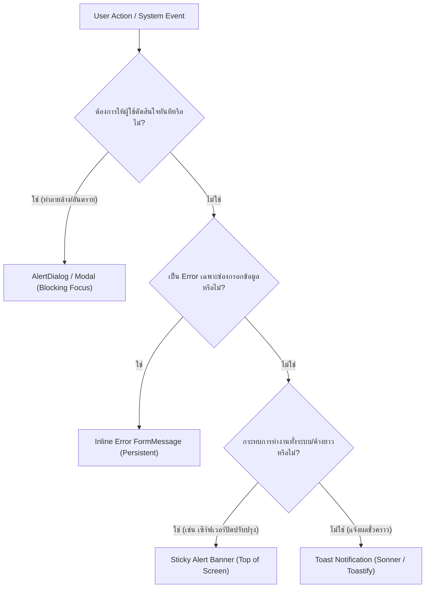

## ภาพรวมระบบแจ้งเตือน Toast Notifications ใน Modern Web Applications

**Toast Notification (หรือ Snackbar)** คือรูปแบบการแจ้งเตือนชั่วคราว (Transient Notification) ที่ปรากฏขึ้นบริเวณขอบจอโดยไม่แย่ง Focus หลักของผู้ใช้ และจะสลายหายไปเองเมื่อหมดเวลาที่กำหนด เพื่อให้ Feedback แก่ผู้ใช้ว่าระบบได้รับคำสั่งหรือประมวลผลเสร็จสิ้นแล้ว (เช่น "บันทึกข้อมูลสำเร็จ", "คัดลอกลิงก์แล้ว")

ทว่าในโลกการทำงานจริง หนึ่งในข้อผิดพลาดระดับสถาปัตยกรรมที่พบบ่อยที่สุดคือ **"การใช้ Toast ผิดบริบท"** เช่น การนำ Toast ไปแจ้งเตือนการกรอกฟอร์มผิด หรือนำไปถามยืนยันการลบข้อมูลสำคัญ ซึ่งทำลาย User Experience และ Accessibility อย่างรุนแรง

---

## เมทริกซ์การตัดสินใจเลือกระบบ Feedback (Notification Decision Matrix)

| รูปแบบ UI | การรบกวน (Disruption) | การคงอยู่ (Persistence) | เหมาะกับสถานการณ์ใด | ห้ามใช้กับสถานการณ์ใด |
| :--- | :--- | :--- | :--- | :--- |
| **Toast** | ต่ำ (Non-blocking) | ชั่วคราว (3–5 วินาที) | แจ้งผลสำเร็จ, Undo การลบ, การแจ้งเตือนเบื้องหลัง | Validation Error ในฟอร์ม, แจ้งเตือนข้อผิดพลาดวิกฤต |
| **AlertDialog** | สูง (Focus trap) | ถาวรจนกว่าจะกดปุ่ม | ยืนยันการลบบัญชี, บัตรเครดิตถูกปฏิเสธ, Session หมดอายุ | แจ้งแค่ว่า "คัดลอกข้อความสำเร็จ", แจ้งเตือนย่อยๆ |
| **Inline Error** | ต่ำ (อยู่ในระนาบฟอร์ม) | ถาวรจนกว่าจะแก้ | อีเมลผิดรูปแบบ, รหัสผ่านไม่ถึง 8 ตัว, ช่องที่จำเป็นต้องกรอก | แจ้งผลบันทึกข้อมูลสำเร็จของทั้งหน้า |
| **Banner / Alert** | ปานกลาง (ด้านบนจอ) | ถาวรจนกว่าจะปิด | ประกาศปิดปรับปรุงระบบ, แจ้งเตือนต่ออายุสมาชิก | แจ้งสถานะของปุ่มที่เพิ่งกดไป |

---

## สารบัญหลักสูตร Toast Notifications (Directory)

บทเรียนชุดนี้เจาะลึกตั้งแต่การเปรียบเทียบไลบรารียอดนิยมอย่าง **Sonner** และ **React Toastify**, การประกอบร่วมกับ shadcn/ui, การดักจับสถานะ TanStack Query และ Server Actions ไปจนถึง Accessibility ตามมาตรฐาน WAI-ARIA:

| หัวข้อ | ลิงก์อ่านเนื้อหา | คำอธิบายสังเขป |
| :--- | :--- | :--- |
| **1. ปรัชญา & UX Matrix** | [Toast Philosophy & UX Matrix](/docs/toast-notify/concept-ux-matrix) | Toast คืออะไร, เมื่อไหร่ควรใช้/ไม่ควรใช้ เทียบกับ Dialog, Inline error และ Banner |
| **2. เปรียบเทียบ Sonner vs Toastify** | [Sonner vs React Toastify](/docs/toast-notify/sonner-vs-toastify) | ตารางเปรียบเทียบขนาด Bundle, API, Stacking Animation, shadcn/ui, และเกณฑ์เลือกใช้ |
| **3. Sonner พื้นฐาน** | [Sonner Setup & Core API](/docs/toast-notify/sonner-basics) | การติดตั้ง, จัดวาง `<Toaster />` ใน Root Layout, `toast.success`, `toast.error`, `position` |
| **4. Sonner ขั้นกลาง** | [Sonner Promises & Actions](/docs/toast-notify/sonner-advanced) | `toast.promise` (Loading -> Success/Error), Action Button, Dismiss, Theme และฟอนต์ไทย |
| **5. Sonner กับ shadcn/ui** | [shadcn/ui Sonner & Theming](/docs/toast-notify/shadcn-sonner) | สถาปัตยกรรม Sonner ใน shadcn, ผูกกับ CSS variables, การเรียกใช้งานข้ามคอมโพเนนต์ |
| **6. React Toastify พื้นฐาน** | [React Toastify Core Setup](/docs/toast-notify/react-toastify-basics) | ติดตั้ง, `ToastContainer`, Import CSS, `autoClose`, `pauseOnHover`, App Router Setup |
| **7. React Toastify ขั้นกลาง** | [React Toastify Advanced](/docs/toast-notify/react-toastify-advanced) | `toast.promise`, `toast.update`, การป้องกัน Toast ซ้ำด้วย `toastId`, Custom Tailwind style |
| **8. การเชื่อมต่อกับ Flow จริง** | [Real-world Fullstack Flows](/docs/toast-notify/real-world-flows) | TanStack Query `useMutation`, Global `QueryCache` error, Form RHF+Zod, Server Actions, 401 Session |
| **9. ศิลปะการเขียนข้อความแจ้งเตือน** | [UX Copywriting & Thai Tone](/docs/toast-notify/ux-copywriting) | หลักการเขียนข้อความสั้นกระชับ, บอกทางแก้, หลีกเลี่ยง Technical jargon, ตัวอย่างภาษาไทย ดี vs แย่ |
| **10. Accessibility & WAI-ARIA** | [Accessibility & WAI-ARIA](/docs/toast-notify/accessibility) | `aria-live="polite"` vs `"assertive"`, `role="status"`/`"alert"`, Keyboard Focus, `prefers-reduced-motion` |
| **11. การย้ายจาก SweetAlert2 สู่ระบบเดี่ยว** | [Migration & Unified Wrapper](/docs/toast-notify/migration-wrapper) | ย้าย SweetAlert2 สู่ Sonner + AlertDialog, การสร้าง `notify` wrapper กลางป้องกัน Vendor lock-in |
| **12. ข้อผิดพลาด & Q&A สัมภาษณ์งาน** | [Pitfalls & Senior Q&A](/docs/toast-notify/pitfalls) | 7 Anti-patterns ยอดฮิต, วาง Toaster ซ้ำ, Toast ทะลักล้นจอ, Checklist & คำถามสัมภาษณ์งานระดับ Senior |
