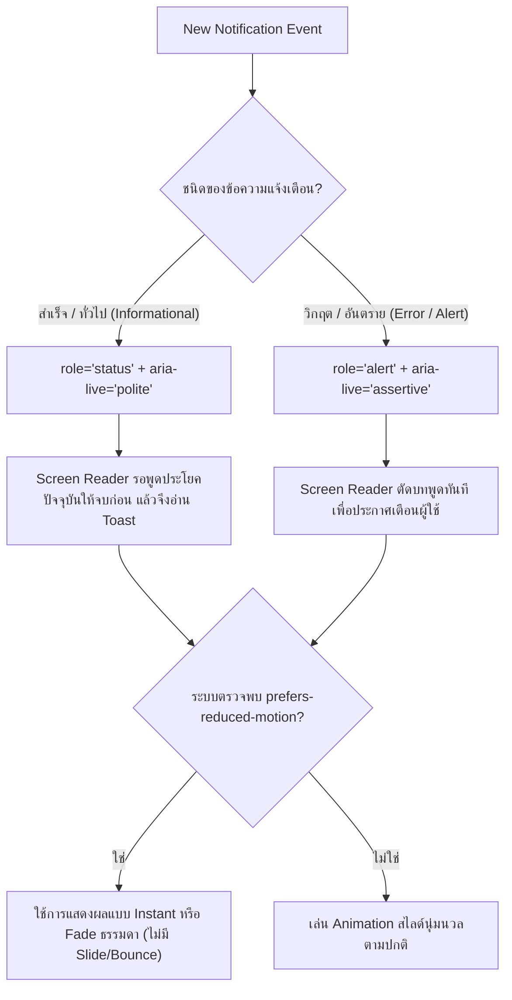

## 1. แนวคิด (Concept)

สำหรับผู้ใช้งานทั่วไป การเห็นกล่องสี่เหลี่ยมสีเขียวเด้งขึ้นมาที่มุมขวาบนพร้อมข้อความว่า "บันทึกข้อมูลสำเร็จ" อาจเป็นเรื่องปกติที่เข้าใจได้ในเสี้ยววินาที แต่สำหรับผู้พิการทางสายตาหรือผู้ใช้เทคโนโลยีช่วยเหลือ (Assistive Technologies) เช่น **โปรแกรมอ่านหน้าจอ (Screen Readers - NVDA, VoiceOver, JAWS)** ข้อมูลเชิงภาพดังกล่าวจะไร้ความหมายโดยสิ้นเชิง หากไม่มีการวางโครงสร้างตามมาตรฐาน **WAI-ARIA (Web Accessibility Initiative - Accessible Rich Internet Applications)**

การสร้างระบบ Toast ที่เข้าถึงได้ (Accessible Toast) ครอบคลุม 4 เสาหลัก:
1. **ARIA Live Regions (`aria-live`)**: การบอกให้ Screen Reader ทราบว่ามีเนื้อหาใหม่แทรกเข้ามาในหน้าจอ
2. **Semantic Roles (`role="status"` vs `role="alert"`)**: การกำหนดระดับความเร่งด่วนของข้อมูล
3. **WCAG 2.2.1 Timing Adjustable**: ระยะเวลาการแสดงผลต้องยาวนานพอ และต้องเปิดโอกาสให้หยุดเวลาชั่วคราวเมื่อ Hover หรือ Focus
4. **Motion Safety (`prefers-reduced-motion`)**: การปิดแอนิเมชันการเลื่อนไถลสำหรับผู้ที่มีภาวะผิดปกติของระบบการทรงตัว (Vestibular Disorders)



---

## 2. หลักการเบื้องหลัง (Under the Hood)

### 2.1 ทำความเข้าใจ `aria-live`: ความต่างระหว่าง `"polite"` กับ `"assertive"`
Live Region คือพื้นที่พิเศษใน DOM ที่เบราว์เซอร์จะส่งสัญญาณไปยัง Accessibility Tree ทันทีที่มีการเปลี่ยนแปลงของ Text Node:
* `aria-live="polite"` (จับคู่กับ `role="status"`):
  - Screen Reader จะ **เข้าคิวรอ (Queue)** จนกว่าจะอ่านสิ่งที่กำลังพูดอยู่ในปัจจุบันจบ
  - เหมาะสำหรับ: "คัดลอกข้อความแล้ว", "บันทึกร่างเรียบร้อย", "สินค้าถูกเพิ่มลงในตะกร้า"
* `aria-live="assertive"` (จับคู่กับ `role="alert"`):
  - Screen Reader จะ **ขัดจังหวะทันที (Interrupt Current Speech)** เพื่อเปล่งเสียงเตือน
  - ควรใช้เฉพาะ: ข้อผิดพลาดร้ายแรง, การตัดการเชื่อมต่อ, หรือความล้มเหลวในการทำธุรกรรมทางการเงิน

> [!CAUTION]
> การใช้ `aria-live="assertive"` มากเกินไปถือเป็น Anti-pattern ร้ายแรง เพราะจะทำลายสมาธิและทำให้ผู้พิการไม่สามารถฟังเนื้อหาหลักในหน้าเว็บได้อย่างต่อเนื่อง

### 2.2 กฎ WCAG 2.2.1 (Timing Adjustable) และการคำนวณระยะเวลา
กฎสากลระบุว่า หากเนื้อหามีการจำกัดเวลา (Time limits) ระบบต้องอนุญาตให้ผู้ใช้:
1. ขยายเวลา (Extend)
2. ปรับความเร็ว (Adjust)
3. หรือหยุดเวลาชั่วคราว (Pause on Mouse Hover & Keyboard Focus)

การคำนวณระยะเวลาแสดงผลขั้นต่ำ:
$$\text{Duration (ms)} = \max\left(4000,\, (\text{จำนวนคำ} \times 350) + 1500\right)$$
หาก Toast มีปุ่ม Action แบบกดได้ (เช่น ปุ่ม "Undo") ควรกำหนดเวลาอย่างน้อย **8,000–10,000 มิลลิวินาที** เสมอ เพื่อให้ผู้ใช้สามารถกดปุ่มลัดแป้นพิมพ์เลื่อน Focus ไปกดได้ทัน

---

## 3. ตัวอย่างโค้ด (TypeScript / TSX)

### ตัวอย่างที่ 1: Accessible Toast Notification Component พร้อม Reduced Motion

คอมโพเนนต์นี้สร้างโครงสร้าง Accessible HTML ครบถ้วนตามมาตรฐาน WAI-ARIA, รองรับ Focus Trapping เมื่อกด Tab, และปรับเปลี่ยนแอนิเมชันตามการตั้งค่าของผู้ใช้

```tsx filename="src/components/ui/accessible-toast.tsx"
'use client';

import * as React from 'react';
import { X, CheckCircle2, AlertOctagon, Info } from 'lucide-react';

export type ToastVariant = 'success' | 'error' | 'info';

export interface AccessibleToastProps {
  id: string;
  variant: ToastVariant;
  title: string;
  description?: string;
  onDismiss: (id: string) => void;
  action?: {
    label: string;
    onClick: () => void;
  };
  durationMs?: number;
}

export function AccessibleToast({
  id,
  variant,
  title,
  description,
  onDismiss,
  action,
  durationMs = 6000,
}: AccessibleToastProps) {
  const [isPaused, setIsPaused] = React.useState<boolean>(false);
  const timerRef = React.useRef<NodeJS.Timeout | null>(null);
  const remainingTimeRef = React.useRef<number>(durationMs);
  const startTimeRef = React.useRef<number>(Date.now());

  // กำหนดบทบาท ARIA ตามประเภทข้อความ
  const isCritical = variant === 'error';
  const role = isCritical ? 'alert' : 'status';
  const ariaLive = isCritical ? 'assertive' : 'polite';

  // จัดการการนับถอยหลังและการหยุดชั่วคราวเมื่อ Hover / Focus
  const startTimer = React.useCallback(() => {
    startTimeRef.current = Date.now();
    timerRef.current = setTimeout(() => {
      onDismiss(id);
    }, remainingTimeRef.current);
  }, [id, onDismiss]);

  const pauseTimer = React.useCallback(() => {
    if (timerRef.current) {
      clearTimeout(timerRef.current);
      timerRef.current = null;
      const elapsed = Date.now() - startTimeRef.current;
      remainingTimeRef.current = Math.max(0, remainingTimeRef.current - elapsed);
    }
  }, []);

  React.useEffect(() => {
    if (!isPaused) {
      startTimer();
    }
    return () => {
      if (timerRef.current) clearTimeout(timerRef.current);
    };
  }, [isPaused, startTimer]);

  return (
    <div
      role={role}
      aria-live={ariaLive}
      aria-atomic="true"
      onMouseEnter={() => {
        setIsPaused(true);
        pauseTimer();
      }}
      onMouseLeave={() => {
        setIsPaused(false);
      }}
      onFocus={() => {
        setIsPaused(true);
        pauseTimer();
      }}
      onBlur={() => {
        setIsPaused(false);
      }}
      className={`
        group relative flex w-full max-w-md items-start gap-3 rounded-xl border border-border bg-card p-4 text-card-foreground shadow-xl
        /* รองรับ Reduced Motion: ไม่ใช้ slide transform หากเปิด reduced motion */
        motion-safe:animate-in motion-safe:fade-in-50 motion-safe:slide-in-from-bottom-5
        motion-reduce:animate-none motion-reduce:transition-none
      `}
    >
      {/* ไอคอนตามประเภท */}
      <div className="shrink-0 mt-0.5">
        {variant === 'success' && <CheckCircle2 className="h-5 w-5 text-emerald-500" aria-hidden="true" />}
        {variant === 'error' && <AlertOctagon className="h-5 w-5 text-destructive" aria-hidden="true" />}
        {variant === 'info' && <Info className="h-5 w-5 text-sky-500" aria-hidden="true" />}
      </div>

      <div className="flex-1 min-w-0">
        <h4 className="text-sm font-semibold text-foreground leading-tight">{title}</h4>
        {description && (
          <p className="mt-1 text-xs text-muted-foreground leading-normal">{description}</p>
        )}

        {action && (
          <div className="mt-3">
            <button
              type="button"
              onClick={() => {
                action.onClick();
                onDismiss(id);
              }}
              className="rounded-md bg-primary px-3 py-1.5 text-xs font-semibold text-primary-foreground shadow-sm hover:bg-primary/90 focus:outline-none focus:ring-2 focus:ring-primary focus:ring-offset-2"
            >
              {action.label}
            </button>
          </div>
        )}
      </div>

      {/* ปุ่มปิดที่เข้าถึงได้ด้วยคีย์บอร์ด */}
      <button
        type="button"
        onClick={() => onDismiss(id)}
        aria-label="ปิดการแจ้งเตือนนี้"
        className="shrink-0 rounded-md p-1 text-muted-foreground hover:bg-muted hover:text-foreground focus:outline-none focus:ring-2 focus:ring-ring"
      >
        <X className="h-4 w-4" aria-hidden="true" />
      </button>
    </div>
  );
}
```

---

### ตัวอย่างที่ 2: Persistent Notification Center (บันทึกประวัติย้อนหลังแก้ปัญหาข้อความหาย)

กฎเหล็กของ Accessibility: **ห้ามนำข้อมูลสำคัญวิกฤตไปไว้ในสิ่งที่สลายหายไปเอง (Ephemeral Toasts) โดยไม่มีที่เก็บบันทึกย้อนหลัง** โค้ดนี้สร้างถาดเก็บประวัติการแจ้งเตือน (Activity History Drawer) ที่ซิงค์กับ Toast ทุกใบในระบบ

```tsx filename="src/components/notifications/notification-center.tsx"
'use client';

import * as React from 'react';
import { Bell, CheckCheck, Trash2, Clock } from 'lucide-react';

export interface NotificationRecord {
  id: string;
  title: string;
  description?: string;
  variant: 'success' | 'error' | 'info';
  timestamp: Date;
  isRead: boolean;
}

// Global Store อย่างง่ายสำหรับประวัติการแจ้งเตือน
export function useNotificationHistory() {
  const [history, setHistory] = React.useState<NotificationRecord[]>([]);

  const addRecord = React.useCallback(
    (item: Omit<NotificationRecord, 'id' | 'timestamp' | 'isRead'>) => {
      const newRecord: NotificationRecord = {
        ...item,
        id: `notif_${Date.now()}_${Math.random().toString(36).substring(2, 7)}`,
        timestamp: new Date(),
        isRead: false,
      };
      setHistory((prev) => [newRecord, ...prev].slice(0, 50)); // รักษาประวัติ 50 รายการล่าสุด
    },
    []
  );

  const markAllAsRead = () => {
    setHistory((prev) => prev.map((item) => ({ ...item, isRead: true })));
  };

  const clearHistory = () => {
    setHistory([]);
  };

  return { history, addRecord, markAllAsRead, clearHistory };
}

export function NotificationDrawer({
  history,
  onClear,
  onMarkRead,
}: {
  history: NotificationRecord[];
  onClear: () => void;
  onMarkRead: () => void;
}) {
  const [isOpen, setIsOpen] = React.useState<boolean>(false);
  const unreadCount = history.filter((i) => !i.isRead).length;

  return (
    <div className="relative">
      {/* ปุ่มเปิดถาดพร้อมตัวเลขกำกับสำหรับ Screen Reader */}
      <button
        type="button"
        onClick={() => setIsOpen(!isOpen)}
        aria-expanded={isOpen}
        aria-controls="notification-history-panel"
        aria-label={`ศูนย์การแจ้งเตือน มีข้อความที่ยังไม่ได้อ่าน ${unreadCount} รายการ`}
        className="relative rounded-full p-2 text-muted-foreground hover:bg-muted focus:outline-none focus:ring-2 focus:ring-primary"
      >
        <Bell className="h-5 w-5" />
        {unreadCount > 0 && (
          <span className="absolute top-1 right-1 flex h-4 w-4 items-center justify-center rounded-full bg-destructive text-[10px] font-bold text-destructive-foreground">
            {unreadCount}
          </span>
        )}
      </button>

      {/* ถาดประวัติการแจ้งเตือน */}
      {isOpen && (
        <div
          id="notification-history-panel"
          role="region"
          aria-label="ประวัติการแจ้งเตือนย้อนหลัง"
          className="absolute right-0 mt-2 w-80 sm:w-96 rounded-2xl border border-border bg-card p-4 shadow-2xl z-50"
        >
          <div className="flex items-center justify-between pb-3 border-b border-border">
            <h3 className="text-sm font-bold text-card-foreground">ประวัติการแจ้งเตือน</h3>
            <div className="flex items-center gap-1">
              <button
                type="button"
                onClick={onMarkRead}
                title="อ่านทั้งหมดแล้ว"
                className="rounded p-1 text-muted-foreground hover:text-foreground"
              >
                <CheckCheck className="h-4 w-4" />
              </button>
              <button
                type="button"
                onClick={onClear}
                title="ล้างประวัติทั้งหมด"
                className="rounded p-1 text-muted-foreground hover:text-destructive"
              >
                <Trash2 className="h-4 w-4" />
              </button>
            </div>
          </div>

          <div className="mt-3 max-h-80 overflow-y-auto space-y-2">
            {history.length === 0 ? (
              <p className="py-6 text-center text-xs text-muted-foreground">ไม่มีรายการแจ้งเตือนย้อนหลัง</p>
            ) : (
              history.map((item) => (
                <div
                  key={item.id}
                  className={`rounded-lg p-2.5 text-xs border ${
                    item.isRead ? 'border-border/40 bg-muted/30' : 'border-primary/20 bg-primary/5'
                  }`}
                >
                  <div className="flex items-center justify-between">
                    <span className="font-semibold text-foreground">{item.title}</span>
                    <span className="flex items-center gap-1 text-[10px] text-muted-foreground">
                      <Clock className="h-3 w-3" />
                      {item.timestamp.toLocaleTimeString('th-TH', { hour: '2-digit', minute: '2-digit' })}
                    </span>
                  </div>
                  {item.description && (
                    <p className="mt-1 text-muted-foreground leading-relaxed">{item.description}</p>
                  )}
                </div>
              ))
            )}
          </div>
        </div>
      )}
    </div>
  );
}
```

---

## 4. เทียบกับวิธีอื่น (Toast vs Alert Banner vs Modal Dialog)

| มิติการเข้าถึง (Accessibility Factors) | Toast Notification | Alert Banner (Static / Sticky) | Modal / AlertDialog |
| :--- | :--- | :--- | :--- |
| **การแย่ง Keyboard Focus** | **ไม่แย่ง** Focus ยังอยู่ที่เดิมบนหน้าเว็บ | **ไม่แย่ง** อยู่บนระนาบตามลำดับ DOM Flow | **แย่งและขัง Focus (Focus Trap)** บังคับให้อยู่ใน Modal |
| **ความเสี่ยงข้อมูลสูญหาย (Data Loss)** | **สูงมาก** หากไม่มีถาดบันทึกประวัติย้อนหลัง | ต่ำ คงอยู่จนกว่าจะปิดหรือเปลี่ยนหน้า | ปลอดภัยที่สุด ข้อมูลไม่หายจนกว่าผู้ใช้จะตัดสินใจ |
| **ผลกระทบต่อ Screen Reader Flow** | ต่ำ (เมื่อใช้ `polite`) อ่านหลังจบประโยค | ปานกลาง อ่านตามลำดับ Tab Navigation | สูง ข้ามไปอ่าน Modal Content ทันที |
| **ความเหมาะสมกับข้อมูลวิกฤต** | **ห้ามใช้เด็ดขาด** ขัดต่อมาตรฐาน WCAG | ปานกลาง เหมาะกับประกาศภาพรวม | **เหมาะสมที่สุด** สำหรับข้อผิดพลาดวิกฤต |

---

## 5. ผิด vs ถูก (Anti-patterns vs Best Practices)

### 1) การใช้ `role="alert"` กับข้อความที่ประสบความสำเร็จ
* ❌ **ผิด**: ใส่ `role="alert"` กับ Toast ที่แจ้งว่า "บันทึกข้อมูลแล้ว" ทำให้ Screen Reader ตะโกนขัดจังหวะผู้ใช้ขณะที่กำลังพิมพ์งานช่องถัดไป
* ✅ **ถูก**: ใช้ `role="status"` คู่กับ `aria-live="polite"` สำหรับ Success/Informational messages เสมอ

### 2) การไม่มีทางเลือกสำหรับผู้ที่ปิด Animation (`prefers-reduced-motion`)
* ❌ **ผิด**: สั่งให้ Toast กระเด้ง สไลด์ หมุนวน อย่างรุนแรง ซึ่งกระตุ้นอาการวิงเวียนศีรษะ (Motion Sickness) ในผู้ป่วยทางสมองหรือหูชั้นใน
* ✅ **ถูก**: ใช้คลาส `motion-safe:` และ `motion-reduce:transition-none motion-reduce:animate-none` เพื่อสลับเป็นการปรากฏตัวแบบนิ่งๆ

### 3) การตั้งเวลา Toast สั้นเกินไป (เช่น 1.5 วินาที)
* ❌ **ผิด**: Toast สลายหายไปอย่างรวดเร็ว ทำให้ผู้มีความบกพร่องทางสติปัญญาหรือผู้สูงอายุอ่านไม่ทัน
* ✅ **ถูก**: ตั้งเวลาขั้นต่ำ 4–6 วินาที พร้อมกลไก Pause เมื่อเมาส์ชี้หรือคีย์บอร์ดโฟกัส

---

## 6. ควรใช้เมื่อไหร่ / ไม่ควรใช้เมื่อไหร่

### ควรใช้ (When to use):
* การแจ้งผลการทำงานที่ผู้ใช้คาดหวังอยู่แล้ว (เช่น คัดลอกข้อความ, บันทึกการเปลี่ยนแปลง)
* เมื่อมีการออกแบบให้มีปุ่มลัดคีย์บอร์ดเข้าถึง Toast ได้ (เช่น Sonner มีปุ่มลัด Alt+T เพื่อ Focus)
* เมื่อระบบมี Notification Center ถาดประวัติสำหรับดูย้อนหลังได้

### ไม่ควรใช้ (When NOT to use):
* แสดงข้อความยืนยันความปลอดภัย เช่น OTP หรือรหัสผ่านใหม่ชั่วคราวที่ไม่มีทางเรียกดูซ้ำ
* แจ้งเตือนสิทธิประโยชน์ทางการเงิน หรือการหักเงินที่ต้องมีเอกสารอ้างอิง
* ฟอร์มที่มีปัญหาหลายจุด โดยไม่แสดงข้อความในฟิลด์

---

## 7. คำถามสัมภาษณ์งาน (Senior Interview Questions & Answers)

### Q1: ตามมาตรฐาน WCAG 2.2 ระดับ AA ทำไม "Toast Notification ที่สลายหายไปเองโดยอัตโนมัติ" จึงสุ่มเสี่ยงต่อการสอบตกเกณฑ์ข้อ 2.2.1 (Timing Adjustable) และคุณมีแนวทางแก้ไขเชิงสถาปัตยกรรมอย่างไร?
**แนวทางตอบแบบ Senior Developer**:
1. **สาเหตุการสอบตกเกณฑ์**: เกณฑ์ข้อ 2.2.1 บังคับว่าหากมีการจำกัดเวลา ผู้ใช้ต้องได้รับสิทธิ์ในการ "ปิดเวลา", "ปรับความเร็วให้ช้าลงอย่างน้อย 10 เท่า", หรือ "มีเวลาเพียงพอในการขยายเวลา" หาก Toast เด้งขึ้นมา 3 วินาทีแล้วหายไป โดยเฉพาะผู้ที่ใช้ Screen Reader ซึ่งต้องรอประโยคเดิมพูดจบก่อน เมื่อ Screen Reader พร้อมจะอ่าน ปรากฏว่า DOM Element นั้นถูกทำลาย (Unmount) ไปแล้ว ทำให้ผู้ใช้พลาดข้อมูลนั้นไปอย่างถาวร
2. **แนวทางแก้ไขเชิงสถาปัตยกรรม**:
   - **Pause Mechanism**: ต้องหยุดเวลาอัตโนมัติเมื่อ Cursor เมาส์ Hover หรือเมื่อได้รับ Keyboard Focus (`onFocus`/`onBlur`)
   - **Notification History Log**: จัดเก็บประวัติ Toast ทุกตัวลงใน Store ส่วนกลาง เพื่อให้ผู้ใช้สามารถกดเปิดถาดประวัติ (Drawer/Dropdown) ดูย้อนหลังได้ตลอดเวลา
   - **ARIA Live Region Persistence**: อย่ารีบถอด DOM Node ทิ้งทันทีเมื่อหมดเวลา ให้ใช้การซ่อนทางสายตา (CSS opacity/translate) แต่คง Accessible Text ไว้ชั่วขณะเพื่อให้ Accessibility Tree บันทึกข้อความเสร็จสมบูรณ์

### Q2: อธิบายความแตกต่างของพฤติกรรมระหว่าง `aria-atomic="true"` และ `aria-atomic="false"` ใน Container ของ Toast
**แนวทางตอบแบบ Senior Developer**:
- **`aria-atomic="true"`**: เมื่อเนื้อหาส่วนใดส่วนหนึ่งใน Container มีการเปลี่ยนแปลง Screen Reader จะอ่านเนื้อหา **"ทั้งหมดทั้งก้อน"** ของภูมิภาคนั้นซ้ำใหม่ ซึ่งจำเป็นอย่างยิ่งสำหรับ Toast เพราะหากเรามี Toast ที่ประกอบด้วย Title และ Description เราต้องการให้อ่านทั้งสองส่วนพร้อมกัน ไม่ใช่เลือกอ่านเฉพาะคำที่เพิ่งเปลี่ยน
- **`aria-atomic="false"`**: Screen Reader จะอ่าน **"เฉพาะ Text Node หรือ Element ที่เพิ่งถูกแทรกเข้าไปใหม่"** เท่านั้น ซึ่งเหมาะกับแอปแช็ตสดหรือ Live Log Streaming แต่ไม่เหมาะกับ Toast เพราะอาจทำให้ข้อความฟังดูขาดตอนและผู้ใช้ไม่เข้าใจบริบท
