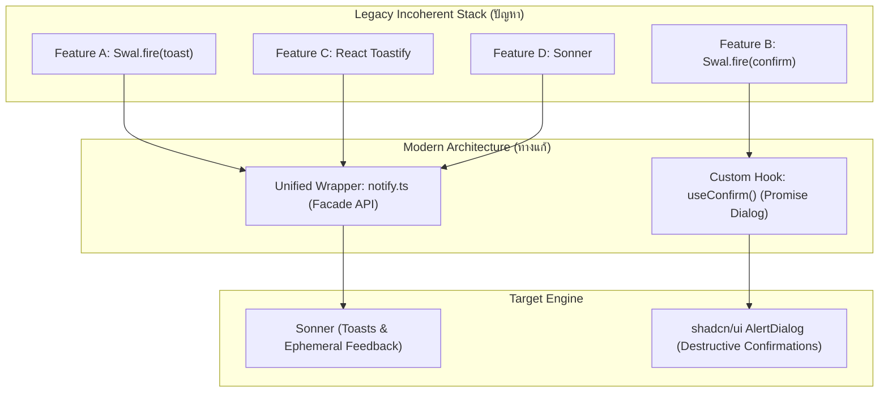

## 1. แนวคิด (Concept)

เมื่อระบบขยายขนาดขึ้น หรือผ่านมือนักพัฒนาหลายรุ่น สิ่งที่มักพบใน Codebase ระดับ Enterprise คือ **"สงครามไลบรารีแจ้งเตือน (Notification Library Incoherence)"**:
* บางหน้าใช้ **SweetAlert2 (`Swal.fire`)** เพราะถนัดมาจากยุค jQuery / Vue 2
* บางหน้าใช้ **React Toastify** เพราะติดตั้งไว้เมื่อหลายปีก่อน
* หน้าระบบใหม่ที่ใช้ **shadcn/ui** ดึง **Sonner** เข้ามาใช้งาน

ผลลัพธ์คือ **Bundle Size บวมขึ้นกว่า 150KB**, เกิด **Z-index Wars** (SweetAlert เด้งทับหลัง Toast หรือบัง Dialog), หน้าตา UI ดูไม่เป็นเอกภาพ, และสอบตกเกณฑ์ Accessibility อย่างสิ้นเชิง

การแก้ปัญหานี้อย่างยั่งยืนประกอบด้วย 2 ขั้นตอน:
1. **การแยกหน้าที่ (Responsibility Decoupling)**:
   - แปลง `Swal.fire` ชนิด Toast $\rightarrow$ ไปใช้ **Sonner**
   - แปลง `Swal.fire` ชนิด Confirm Modal $\rightarrow$ ไปใช้ **shadcn/ui AlertDialog (Radix UI)**
2. **การสร้าง Unified Notification Wrapper (`notify.ts`)**:
   - การประยุกต์ใช้ **Adapter / Facade Pattern** เพื่อสร้าง API กลางชุดเดียวสำหรับทั้งองค์กร ป้องกัน Vendor Lock-in ช่วยให้ในอนาคตหากต้องการเปลี่ยนเอนจินของ Toast จะสามารถแก้ได้ในไฟล์เดียวจบ



---

## 2. หลักการเบื้องหลัง (Under the Hood)

### 2.1 Facade & Adapter Pattern ใน Frontend Architecture
แทนที่จะปล่อยให้คอมโพเนนต์หลายร้อยไฟล์ในโปรเจกต์ทำ Direct Import เช่น `import { toast } from 'sonner'` หรือ `import { toast } from 'react-toastify'`:
* เราสร้างโมดูล `notify.ts` เป็น **Facade** คอยเปิดเผยเมธอดมาตรฐาน:
  - `notify.success(message, options)`
  - `notify.error(error, options)`
  - `notify.promise(promise, messages)`
  - `notify.loading(message)`
* ภายในโมดูลนี้ทำหน้าที่เป็น **Adapter** คอยแปลง Options และ Payload ไปเป็น Signature ของไลบรารีปลายทาง
* หากวันใดต้องการเปลี่ยนไลบรารีจาก Sonner ไปเป็นตัวอื่น หรือต้องการแทรกการส่ง Telemetry Log ไปยัง Datadog/Sentry เราสามารถแทรก Logic ได้ที่ไฟล์ Wrapper นี้เพียงจุดเดียว

### 2.2 การแปลง SweetAlert Confirm สู่ Declarative Promise Dialog
SweetAlert ดั้งเดิมทำงานแบบ Imperative Promise:
```typescript
const { isConfirmed } = await Swal.fire({ title: 'ลบข้อมูลหรือไม่?', showCancelButton: true });
```
ในการแปลงสู่ Modern React เราไม่ควรนำไลบรารีภายนอกมาสร้าง DOM นอก React Root แต่ควรใช้ React State ร่วมกับ Radix UI Primitive ผ่าน Custom Hook เช่น `useConfirm()` ซึ่งคืนค่า Promise ออกมา ทำให้เขียนโค้ดได้ราบรื่นเหมือนเดิม แต่ปลอดภัยและเข้าถึงได้ 100%

---

## 3. ตัวอย่างโค้ด (TypeScript / TSX)

### ตัวอย่างที่ 1: Enterprise Unified Notification Wrapper (`notify.ts`)

ไฟล์นี้ทำหน้าที่เป็นตัวกลางเพียงหนึ่งเดียวสำหรับเรียกใช้ Toast ทั่วทั้งแอปพลิเคชัน มีการแปลง Error อัตโนมัติ และสลับเอนจินได้โดยไม่กระทบโค้ดส่วนอื่น

```tsx filename="src/lib/notify.ts"
'use client';

import { toast as sonnerToast, ExternalToast } from 'sonner';

export interface NotifyAction {
  label: string;
  onClick: () => void;
}

export interface NotifyOptions {
  description?: string;
  duration?: number;
  action?: NotifyAction;
  id?: string | number;
}

export interface PromiseNotificationMessages<T> {
  loading: string;
  success: string | ((data: T) => string);
  error: string | ((err: unknown) => string);
}

/**
 * Unified Notification Adapter
 * ห่อหุ้ม Toast Engine เพื่อป้องกัน Vendor Lock-in และควบคุม Tone of Voice รวมศูนย์
 */
class NotificationService {
  /**
   * แจ้งเตือนสถานะสำเร็จ (Success)
   */
  success(message: string, options?: NotifyOptions): string | number {
    const config: ExternalToast = {
      description: options?.description,
      duration: options?.duration ?? 4000,
      id: options?.id,
      action: options?.action
        ? {
            label: options.action.label,
            onClick: options.action.onClick,
          }
        : undefined,
    };

    return sonnerToast.success(message, config);
  }

  /**
   * แจ้งเตือนข้อผิดพลาด (Error) พร้อมดักจับข้อความอย่างปลอดภัย
   */
  error(errorOrMessage: unknown, options?: NotifyOptions): string | number {
    let message = 'ดำเนินการไม่สำเร็จ';
    let description = options?.description;

    if (typeof errorOrMessage === 'string') {
      message = errorOrMessage;
    } else if (errorOrMessage instanceof Error) {
      // หลีกเลี่ยงการแสดงข้อความทางเทคนิคดิบ
      message = 'เกิดข้อผิดพลาดในการประมวลผล';
      description = errorOrMessage.message;
    }

    const config: ExternalToast = {
      description: description,
      duration: options?.duration ?? 6000,
      id: options?.id,
      action: options?.action
        ? {
            label: options.action.label,
            onClick: options.action.onClick,
          }
        : undefined,
    };

    return sonnerToast.error(message, config);
  }

  /**
   * แจ้งเตือนข้อมูลทั่วไป (Info)
   */
  info(message: string, options?: NotifyOptions): string | number {
    return sonnerToast.info(message, {
      description: options?.description,
      duration: options?.duration ?? 4000,
      id: options?.id,
    });
  }

  /**
   * สำหรับ Asynchronous Promise Workflow
   */
  promise<T>(
    promiseToTrack: Promise<T>,
    messages: PromiseNotificationMessages<T>
  ): Promise<T> {
    sonnerToast.promise(promiseToTrack, {
      loading: messages.loading,
      success: messages.success,
      error: messages.error,
    });

    return promiseToTrack;
  }

  /**
   * ปิดการแจ้งเตือน
   */
  dismiss(toastId?: string | number): void {
    sonnerToast.dismiss(toastId);
  }
}

export const notify = new NotificationService();
```

---

### ตัวอย่างที่ 2: ปลดระวาง SweetAlert Confirm สู่ shadcn/ui `useConfirm` Hook

ตัวอย่างการสร้าง Custom Confirm Dialog ที่ทำงานแบบ Promise เหมือน `Swal.fire` แต่สร้างด้วย Radix UI / shadcn/ui สวยงามและเข้าถึงได้สมบูรณ์

```tsx filename="src/hooks/use-confirm.tsx"
'use client';

import * as React from 'react';
import {
  AlertDialog,
  AlertDialogAction,
  AlertDialogCancel,
  AlertDialogContent,
  AlertDialogDescription,
  AlertDialogFooter,
  AlertDialogHeader,
  AlertDialogTitle,
} from '@/components/ui/alert-dialog';

interface ConfirmOptions {
  title: string;
  description: string;
  confirmText?: string;
  cancelText?: string;
  variant?: 'destructive' | 'default';
}

export function useConfirm() {
  const [promise, setPromise] = React.useState<{
    resolve: (value: boolean) => void;
  } | null>(null);

  const [options, setOptions] = React.useState<ConfirmOptions>({
    title: '',
    description: '',
  });

  const confirm = React.useCallback((opts: ConfirmOptions) => {
    setOptions(opts);
    return new Promise<boolean>((resolve) => {
      setPromise({ resolve });
    });
  }, []);

  const handleClose = () => {
    setPromise(null);
  };

  const handleConfirm = () => {
    promise?.resolve(true);
    handleClose();
  };

  const handleCancel = () => {
    promise?.resolve(false);
    handleClose();
  };

  const ConfirmDialog = () => (
    <AlertDialog open={promise !== null} onOpenChange={(open) => !open && handleCancel()}>
      <AlertDialogContent>
        <AlertDialogHeader>
          <AlertDialogTitle>{options.title}</AlertDialogTitle>
          <AlertDialogDescription>{options.description}</AlertDialogDescription>
        </AlertDialogHeader>
        <AlertDialogFooter>
          <AlertDialogCancel onClick={handleCancel}>
            {options.cancelText || 'ยกเลิก'}
          </AlertDialogCancel>
          <AlertDialogAction
            onClick={handleConfirm}
            className={options.variant === 'destructive' ? 'bg-destructive text-destructive-foreground hover:bg-destructive/90' : ''}
          >
            {options.confirmText || 'ยืนยัน'}
          </AlertDialogAction>
        </AlertDialogFooter>
      </AlertDialogContent>
    </AlertDialog>
  );

  return [ConfirmDialog, confirm] as const;
}
```

```tsx filename="src/features/products/components/product-delete-button.tsx"
'use client';

import * as React from 'react';
import { useConfirm } from '@/hooks/use-confirm';
import { notify } from '@/lib/notify';
import { Trash2 } from 'lucide-react';

export function ProductDeleteButton({ productId, productName }: { productId: string; productName: string }) {
  const [ConfirmDialog, confirm] = useConfirm();
  const [isDeleting, setIsDeleting] = React.useState(false);

  const handleDelete = async () => {
    // 1. แทนที่ Swal.fire({ title: 'แน่ใจหรือไม่?', showCancelButton: true })
    const isConfirmed = await confirm({
      title: `ยืนยันการลบสินค้า "${productName}"?`,
      description: 'เมื่อลบแล้ว ข้อมูลสินค้านี้จะไม่สามารถกู้คืนได้อีกต่อไปในระบบคลัง',
      confirmText: 'ใช่, ต้องการลบ',
      cancelText: 'ยกเลิก',
      variant: 'destructive',
    });

    if (!isConfirmed) return;

    setIsDeleting(true);

    // 2. เรียกใช้งานผ่าน Unified Wrapper (notify.promise)
    notify.promise(
      new Promise((resolve) => setTimeout(resolve, 1500)), // จำลอง API Delete
      {
        loading: 'กำลังลบสินค้าออกจากระบบ...',
        success: 'ลบสินค้าสำเร็จเรียบร้อยแล้ว',
        error: 'ไม่สามารถลบสินค้าได้ กรุณาลองใหม่อีกครั้ง',
      }
    );

    setIsDeleting(false);
  };

  return (
    <>
      <ConfirmDialog />
      <button
        type="button"
        disabled={isDeleting}
        onClick={handleDelete}
        className="inline-flex items-center gap-1.5 rounded-lg border border-destructive/30 px-3 py-1.5 text-xs font-semibold text-destructive hover:bg-destructive/10"
      >
        <Trash2 className="h-4 w-4" />
        ลบสินค้า
      </button>
    </>
  );
}
```

---

## 4. เทียบกับวิธีอื่น (Direct Library Calls vs Unified Wrapper)

| ปัจจัยเปรียบเทียบ | เรียกใช้ไลบรารีตรงๆ (`import { toast } from '...'`) | สร้าง Unified Wrapper (`notify.ts`) |
| :--- | :--- | :--- |
| **ความสะดวกในการเริ่มต้น** | เร็วมากในช่วงแรก เขียนโค้ดสั้น | ต้องใช้เวลาตั้งค่าและสร้าง Architecture ในตอนแรก |
| **การเปลี่ยนไลบรารีในอนาคต (Vendor Lock-in)** | **ฝันร้าย**: ต้องค้นหาและแก้โค้ดหลายร้อยจุดทั่วทั้งแอป | **ง่ายดาย**: เปลี่ยนโค้ดในไฟล์ Wrapper เพียงไฟล์เดียว |
| **การควบคุมความสม่ำเสมอของ UX/Tone** | ควบคุมยาก นักพัฒนาแต่ละคนตั้ง Duration หรือพิมพ์คำไม่เหมือนกัน | ควบคุมได้ 100% ผ่าน Preset Defaults และ Translation Pipeline |
| **การเชื่อมต่อกับ Observability (Logs/Telemetry)** | ต้องไล่ดักทีละจุด หรือพึ่งพา Global Window Object | ดักจับ Error และส่ง Log ไปยัง Datadog/Sentry ได้ทันทีใน Wrapper |

---

## 5. ผิด vs ถูก (Anti-patterns vs Best Practices)

### 1) การใช้ SweetAlert2 ร่วมกับ Sonner และ Toastify ในแพ็กเกจเดียวกัน
* ❌ **ผิด**: มี dependencies ทั้ง `sweetalert2`, `react-toastify`, และ `sonner` อยู่ใน `package.json` หน้าเว็บเดียวกันมีหน้าต่างแจ้งเตือน 3 สไตล์ที่แอนิเมชันขัดกัน
* ✅ **ถูก**: กำหนดทิศทางชัดเจน ลบไลบรารีเก่าออก ปรับโค้ดให้เหลือเพียง Sonner สำหรับ Toast และ Radix UI สำหรับ Dialog

### 2) การเรียก `notify` ที่ฝั่ง Server Component
* ❌ **ผิด**: พยายาม import `notify` ไปเรียกใน `app/page.tsx` ที่เป็น Server Component
* ✅ **ถูก**: วาง Wrapper ไว้เฉพาะในขอบเขต `'use client'` หรือเรียกผ่าน Event Handlers และ Client Transitions

### 3) การปล่อยให้ SweetAlert เข้ามาทำลาย Focus Trap ของหน้าต่างอื่น
* ❌ **ผิด**: เปิด Modal ซ้อน Modal ด้วย SweetAlert จนคีย์บอร์ด Tab ทะลุหลุดออกไปนอกจอ
* ✅ **ถูก**: ใช้ Radix UI Dialog Primitive ซึ่งจัดการ Keyboard Trapping และ WAI-ARIA Focus Restoration ได้อย่างสมบูรณ์แบบ

---

## 6. ควรใช้เมื่อไหร่ / ไม่ควรใช้เมื่อไหร่

### ควรใช้ (When to use):
* โครงการขนาดกลางถึงใหญ่ที่มีทีมนักพัฒนาหลายคน เพื่อบังคับทิศทางและมาตรฐานเดียวกัน
* ระบบที่กำลังรีแฟกเตอร์เพื่อปลดระวางไลบรารียุคเก่าอย่าง SweetAlert2 หรือ Toastify รุ่นดั้งเดิม
* ทีมที่ต้องการเก็บข้อมูล Telemetry เมื่อเกิด Error Toast บ่อยๆ

### ไม่ควรใช้ (When NOT to use):
* มินิโปรเจกต์ขนาดเล็กมาก (1–2 หน้า) ที่ไม่ต้องการการวางสถาปัตยกรรมที่ซับซ้อน
* การสร้าง Modal ยืนยันข้อมูลที่มีฟิลด์กรอกข้อมูลซับซ้อน (ควรสร้างเป็น Form Dialog แยกเฉพาะตัว)

---

## 7. คำถามสัมภาษณ์งาน (Senior Interview Questions & Answers)

### Q1: หากคุณได้รับมอบหมายให้เข้ามารีแฟกเตอร์ระบบขนาดใหญ่ที่มีการเรียกใช้ `Swal.fire` มากกว่า 300 จุดทั่วทั้งแอป คุณจะวางกลยุทธ์การย้ายระบบ (Migration Strategy) อย่างไรเพื่อไม่ให้กระทบธุรกิจ?
**แนวทางตอบแบบ Senior Developer**:
1. **Auditing & Categorization**: ใช้สคริปต์ค้นหา regex ใน Codebase เพื่อจัดกลุ่มการเรียก `Swal.fire` ออกเป็น 2 ประเภทหลัก:
   - ประเภท Informational / Toast (แสดงผลแล้วปิดเอง)
   - ประเภท Confirmation Dialog (มีการรอ `isConfirmed`)
2. **สร้าง Facade Compatibility Layer (Shimming)**: สร้างไฟล์ `swal-shim.ts` ที่มี Interface ตรงกับ `Swal.fire` แต่ภายในแปลงคำสั่งส่งต่อไปยัง `notify` และ `useConfirm` แล้วใช้ Path Aliasing ใน `tsconfig.json` เพื่อชี้ SweetAlert มาที่ Shim นี้ทันที ทำให้โค้ดเดิมทั้งหมดทำงานบนระบบใหม่ได้โดยไม่ต้องแก้ทีละ 300 ไฟล์พร้อมกัน
3. **Automated Codemod Migration**: ใช้เครื่องมือ AST Transformation เช่น `jscodeshift` ในการแปลงโค้ดเดิมทีละโมดูลอย่างเป็นระบบ
4. **Clean up Dependencies**: เมื่อทดสอบระบบจนมั่นใจ จึงถอดแพ็กเกจ `sweetalert2` ออกจาก `package.json` เพื่อลด Bundle Size ทันที

### Q2: ในการออกแบบ Unified Notification Wrapper ทำไม Senior Developer มักนิยมใช้ Adapter Pattern แทนที่จะเขียน Re-export ตรงๆ?
**แนวทางตอบแบบ Senior Developer**:
- การ Re-export ตรงๆ เช่น `export { toast as notify } from 'sonner'` ไม่ได้ช่วยแก้ปัญหา Vendor Lock-in เพราะ Signature และ Options ของฟังก์ชันยังคงผูกติดกับไลบรารีนั้นอยู่ดี
- การใช้ **Adapter Pattern** ช่วยสร้าง **Contract (TypeScript Interface)** ที่เป็นขององค์กรเราเองอย่างแท้จริง ทำให้เราสามารถ:
  - ดักแปลงประเภทข้อมูล (Data Sanitization & Error Parsing)
  - เพิ่มค่าเริ่มต้น (Default Presets) เช่น Duration หรือ Sound Effect
  - ส่ง Telemetry Metrics ได้อย่างเป็นอิสระ โดยไม่ทำให้โค้ดส่วน UI ต้องรับรู้รายละเอียดการทำงานภายในของไลบรารีบุคคลที่สาม
