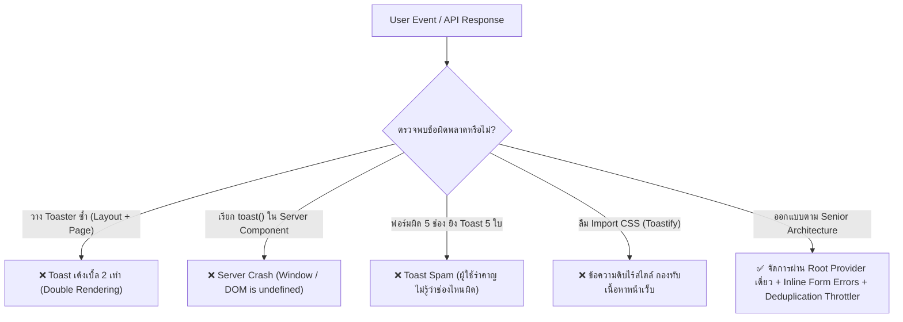

## 1. แนวคิด (Concept)

ระบบการแจ้งเตือนแบบ Toast มักถูกมองว่าเป็นเรื่องเล็กน้อยที่ติดตั้งและเรียกใช้ได้ง่าย แต่ในความเป็นจริง ในแอปพลิเคชันระดับ Production ขนาดใหญ่ Toast เป็นหนึ่งในจุดที่เกิด **Technical Debt** และ **UX Anti-patterns** มากที่สุดจุดหนึ่ง

ปัญหาหลักที่วิศวกรซอฟต์แวร์ระดับ Senior มักพบเจอในการตรวจสอบ Code Review ประกอบด้วย:
1. **สถาปัตยกรรม Portal ซ้ำซ้อน**: การเผลอวางคอมโพเนนต์ Container ไว้ทั้งใน Root Layout และในระดับ Page ย่อย ส่งผลให้เกิด **Toast ซ้อนกัน 2 ชั้น (Double Toasting)**
2. **การปะปนของไลบรารีบุคคลที่สาม**: การใช้ทั้ง SweetAlert2, React Toastify, และ Sonner ปนกันจน Bundle มีขนาดมหึมาและสไตล์ไม่สอดคล้องกัน
3. **การลืมสไตล์ชีต (Missing CSS Syndrome)**: ข้อผิดพลาดคลาสสิกของ React Toastify ที่ลืม Import ไฟล์ `.css` จนข้อความหลุดไปกองอยู่ที่มุมล่างของจอ
4. **การพยายามรันโค้ดฝั่งไคลเอนต์บนเซิร์ฟเวอร์**: เรียก `toast()` ใน Server Components ของ Next.js 16 จนระบบเกิด Server Crash
5. **การใช้ Toast ผิดบริบทอย่างรุนแรง**: นำ Toast ไปแสดง Validation Error ของฟอร์ม แทนที่จะใช้ข้อความ Inline ใต้ช่องกรอก
6. **Toast Spam & Notification Flooding**: ผู้ใช้กดปุ่มรัวๆ หรือการเกิด Network Timeout พร้อมกันจน Toast ทะลักบดบังหน้าจอ

บทความนี้สรุป 6 ข้อผิดพลาดสำคัญ, เช็กลิสต์ความพร้อมก่อนขึ้น Production 8 ประการ, และ 4 คำถามสัมภาษณ์งานระดับ Senior เพื่อสร้างระบบแจ้งเตือนที่มั่นคงและมีประสิทธิภาพสูงสุด



---

## 2. หลักการเบื้องหลัง (Under the Hood)

### 2.1 กลไก React Portal Collision และ Multi-container Lifecycle
เมื่อเราประกาศ `<Toaster />` หรือ `<ToastContainer />`:
* คอมโพเนนต์เหล่านี้จะสร้างหรือแนบตัวเองเข้ากับ DOM Node นอก React Root Tree (ผ่าน `document.body` หรือ `#toast-portal`)
* หากเราใส่ไว้ทั้งใน `app/layout.tsx` และในหน้าย่อย `app/dashboard/page.tsx` ตัว Event Dispatcher ของไลบรารี (ซึ่งเป็น Global Singleton) จะส่งสัญญาณ Broadcast ไปยังทุก Container
* ผลลัพธ์คือ Container ทั้งสองตัวจะประมวลผล Event เดียวกันพร้อมกัน ทำให้มี DOM Element ถูกฉีดเข้าไปในหน้าจอ 2 ชุดซ้อนทับกัน และทำให้แอนิเมชันกระตุกอย่างรุนแรง

### 2.2 Server Component Execution Lifecycle ใน Next.js 16
Next.js 16 App Router รันโค้ดใน Server Components บน Node.js / Edge Runtime:
* ในบริบทนี้จะไม่มีตัวแปรโกลบอล `window`, `document`, หรือ Browser Events
* เมื่อโค้ดใน Server Component พยายามเรียกโมดูลที่ต้องใช้ DOM หรือ Dispatcher ของไลบรารี Toast ตัว Runtime จะโยนข้อผิดพลาด `ReferenceError: document is not defined` ทันที

---

## 3. ตัวอย่างโค้ด (TypeScript / TSX)

### ตัวอย่างที่ 1: ระบบ Anti-Spam / Rate-limiting Toast Throttle Manager

ระบบควบคุมปริมาณการยิง Toast แบบองค์กร ป้องกันผู้ใช้คลิกปุ่มรัวๆ หรือการล้มเหลวของเน็ตเวิร์กพร้อมกัน โดยมีการจัดคิวและบีบอัดข้อความที่ซ้ำกัน (Deduplication)

```tsx filename="src/lib/toast-throttle-manager.ts"
'use client';

import { toast as sonnerToast } from 'sonner';

interface ToastQueueItem {
  message: string;
  type: 'success' | 'error' | 'info';
  timestamp: number;
}

class ToastThrottleManager {
  private recentToasts = new Map<string, ToastQueueItem>();
  private readonly THROTTLE_WINDOW_MS = 2000; // หน้าต่างเวลาป้องกันการส่งซ้ำ 2 วินาที

  /**
   * สร้าง Unique Hash Key สำหรับข้อความและประเภท
   */
  private generateKey(type: string, message: string): string {
    return `${type}:${message.trim().toLowerCase()}`;
  }

  /**
   * ทำความสะอาดข้อความเก่าที่หมดเวลาแล้วเพื่อป้องกันหน่วยความจำรั่วไหล
   */
  private cleanupOldEntries(): void {
    const now = Date.now();
    for (const [key, item] of this.recentToasts.entries()) {
      if (now - item.timestamp > this.THROTTLE_WINDOW_MS) {
        this.recentToasts.delete(key);
      }
    }
  }

  /**
   * ยิง Success Toast พร้อมระบบป้องกันการกดรัว
   */
  success(message: string, description?: string): void {
    this.cleanupOldEntries();
    const key = this.generateKey('success', message);

    if (this.recentToasts.has(key)) {
      // ข้ามการยิง Toast ซ้ำซ้อนภายในช่วงเวลา Window
      return;
    }

    this.recentToasts.set(key, {
      message,
      type: 'success',
      timestamp: Date.now(),
    });

    sonnerToast.success(message, { description });
  }

  /**
   * ยิง Error Toast พร้อมระบบรวบข้อความซ้ำ
   */
  error(message: string, description?: string): void {
    this.cleanupOldEntries();
    const key = this.generateKey('error', message);

    if (this.recentToasts.has(key)) {
      return;
    }

    this.recentToasts.set(key, {
      message,
      type: 'error',
      timestamp: Date.now(),
    });

    sonnerToast.error(message, { description });
  }
}

export const safeToast = new ToastThrottleManager();
```

---

### ตัวอย่างที่ 2: สถาปัตยกรรม Next.js 16 Root Layout และการแยกหน้าที่ที่ถูกต้อง

ตัวอย่างนี้แสดงการจัดวาง `<Toaster />` อย่างถูกต้องใน Root Layout เพียงจุดเดียว พร้อมการแยกการแจ้งเตือนข้อผิดพลาดในแบบฟอร์ม (Inline Validation Errors)

```tsx filename="src/app/layout.tsx"
import type { Metadata } from 'next';
import { Toaster } from '@/components/ui/sonner';
import '@/styles/globals.css';

export const metadata: Metadata = {
  title: 'Enterprise Portal',
  description: 'ระบบจัดการข้อมูลระดับองค์กร',
};

export default function RootLayout({
  children,
}: {
  children: React.ReactNode;
}) {
  return (
    <html lang="th" suppressHydrationWarning>
      <body className="min-h-screen bg-background font-sans antialiased">
        {/* Main Application Tree */}
        <main>{children}</main>

        {/* จุดเดียวสำหรับทั้งแอปพลิเคชัน ห้ามวางในหน้าระดับ Page ย่อยเด็ดขาด */}
        <Toaster
          position="bottom-right"
          richColors
          closeButton
          duration={4000}
        />
      </body>
    </html>
  );
}
```

```tsx filename="src/features/auth/components/sign-in-form.tsx"
'use client';

import * as React from 'react';
import { useForm } from 'react-hook-form';
import { zodResolver } from '@hookform/resolvers/zod';
import { z } from 'zod';
import { safeToast } from '@/lib/toast-throttle-manager';
import { Loader2 } from 'lucide-react';

const signInSchema = z.object({
  email: z.string().email('กรุณาระบุรูปแบบอีเมลให้ถูกต้อง'),
  password: z.string().min(8, 'รหัสผ่านต้องมีความยาวอย่างน้อย 8 ตัวอักษร'),
});

type SignInValues = z.infer<typeof signInSchema>;

export function SignInForm() {
  const [isLoading, setIsLoading] = React.useState(false);

  const {
    register,
    handleSubmit,
    formState: { errors },
  } = useForm<SignInValues>({
    resolver: zodResolver(signInSchema),
  });

  const onSubmit = async (data: SignInValues) => {
    setIsLoading(true);

    try {
      // จำลองการเรียก API
      await new Promise((resolve, reject) => {
        setTimeout(() => {
          if (data.email === 'error@test.com') reject(new Error('อีเมลหรือรหัสผ่านไม่ถูกต้อง'));
          else resolve(true);
        }, 1000);
      });

      safeToast.success('เข้าสู่ระบบสำเร็จ', 'กำลังนำท่านไปยังหน้าหลัก...');
    } catch (err: unknown) {
      // แจ้งผล Error ภาพรวมผ่าน Toast แต่ความผิดพลาดรายฟิลด์จัดการผ่าน Inline Message
      safeToast.error(
        'เข้าสู่ระบบไม่สำเร็จ',
        err instanceof Error ? err.message : 'กรุณาตรวจสอบข้อมูลการเข้าสู่ระบบอีกครั้ง'
      );
    } finally {
      setIsLoading(false);
    }
  };

  return (
    <form onSubmit={handleSubmit(onSubmit)} className="space-y-4 max-w-sm mx-auto p-6 bg-card rounded-xl border border-border">
      <h2 className="text-lg font-bold text-card-foreground">เข้าสู่ระบบ</h2>

      {/* Field 1: Email */}
      <div>
        <label className="block text-xs font-semibold text-foreground mb-1">อีเมลผู้ใช้งาน</label>
        <input
          {...register('email')}
          type="email"
          placeholder="user@example.com"
          className="w-full rounded-md border border-input bg-background px-3 py-2 text-sm"
        />
        {/* Inline Error ที่ถูกต้อง: อยู่ใต้ช่องกรอก ไม่ใช้ Toast */}
        {errors.email && (
          <p className="mt-1 text-xs text-destructive">{errors.email.message}</p>
        )}
      </div>

      {/* Field 2: Password */}
      <div>
        <label className="block text-xs font-semibold text-foreground mb-1">รหัสผ่าน</label>
        <input
          {...register('password')}
          type="password"
          placeholder="••••••••"
          className="w-full rounded-md border border-input bg-background px-3 py-2 text-sm"
        />
        {/* Inline Error ที่ถูกต้อง */}
        {errors.password && (
          <p className="mt-1 text-xs text-destructive">{errors.password.message}</p>
        )}
      </div>

      <button
        type="submit"
        disabled={isLoading}
        className="w-full rounded-md bg-primary py-2 text-sm font-semibold text-primary-foreground shadow hover:bg-primary/90 disabled:opacity-50 flex items-center justify-center gap-2"
      >
        {isLoading && <Loader2 className="h-4 w-4 animate-spin" />}
        เข้าสู่ระบบ
      </button>
    </form>
  );
}
```

---

## 4. เทียบกับวิธีอื่น (Toast vs Inline Error vs Modal Dialog)

| สถานการณ์ | Toast Notification | Inline Field Error | AlertDialog / Modal |
| :--- | :--- | :--- | :--- |
| **Validation ในฟอร์มผิด** | ❌ **ห้ามใช้**: ผู้ใช้ไม่รู้ว่าต้องแก้ช่องไหน และจะหายไปก่อนแก้เสร็จ | ✅ **ถูกต้องที่สุด**: ชี้จุดผิดตรงฟิลด์ พร้อมคำอธิบายถาวร | ❌ **ไม่ควรใช้**: ขัดจังหวะการพิมพ์อย่างรุนแรง |
| **ยืนยันลบบัญชีผู้ใช้** | ❌ **ห้ามใช้**: อันตรายเกินกว่าจะให้กด Undo ใน Toast | ❌ **ไม่เกี่ยวข้องกัน** | ✅ **ถูกต้องที่สุด**: ขัง Focus และบังคับยืนยัน |
| **คัดลอกลิงก์สำเร็จ** | ✅ **ถูกต้องที่สุด**: แจ้งผลสั้นๆ 2-3 วินาที ไม่รบกวนงาน | ❌ **ไม่จำเป็น** | ❌ **ไม่ควรใช้**: สิ้นเปลืองการคลิกปิด |
| **ระบบปิดปรับปรุง** | ❌ **ไม่ควรใช้**: ผู้ใช้อาจมองไม่เห็น | ❌ **ไม่จำเป็น** | ✅ **หรือใช้ Sticky Banner ด้านบนสุด** |

---

## 5. ผิด vs ถูก (6 Anti-patterns ยอดฮิต vs Best Practices)

### 1) วาง `<Toaster />` ซ้ำหลายที่ (ทั้งใน Page และ Layout)
* ❌ **ผิด**: ใส่ `<Toaster />` ใน `app/layout.tsx` แล้วใน `app/orders/page.tsx` ก็ใส่อีกตัว ผลคือเมื่อสั่งยิง Toast จะมีข้อความเด้งซ้อนทับกัน 2 ชั้น
* ✅ **ถูก**: วาง Container ไว้ที่ Root Layout (`app/layout.tsx`) เพียงจุดเดียวสำหรับทั้งแอปพลิเคชัน

### 2) การติดตั้งไลบรารีหลายตัวพร้อมกัน (Sonner + Toastify + SweetAlert2)
* ❌ **ผิด**: ในโปรเจกต์มี Dependencies ทั้ง 3 ตัว ทำให้น้ำหนัก Bundle พุ่งสูง และหน้าตา UI ของการแจ้งเตือนแต่ละหน้าไม่ตรงกัน
* ✅ **ถูก**: ปลดระวางให้เหลือมาตรฐานเดียว (Single Standard): เลือก **Sonner** สำหรับ Toast และ **shadcn AlertDialog** สำหรับ Modal

### 3) ลืม import CSS ของ React Toastify
* ❌ **ผิด**: เรียกใช้ `<ToastContainer />` แต่ลืมเขียน `import 'react-toastify/dist/ReactToastify.css';` ทำให้ Toast กลายเป็นข้อความดิบสีดำลอยอยู่มุมล่างจอ
* ✅ **ถูก**: เพิ่มการ Import CSS ใน Root Layout หรือย้ายไปใช้ **Sonner** ซึ่งเป็นโมเดิร์นไลบรารีที่ไม่ต้องกังวลเรื่องการลืม Import CSS ภายนอก

### 4) พยายามเรียก `toast()` ใน Next.js Server Component
* ❌ **ผิด**:
  ```tsx
  // app/dashboard/page.tsx (Server Component)
  export default async function Page() {
    toast.success("ยินดีต้อนรับ"); // พังทันทีบนเซิร์ฟเวอร์!
    return <div>...</div>;
  }
  ```
* ✅ **ถูก**: เรียก `toast()` เฉพาะใน Client Components (`'use client'`) หรือใน Client Event Handlers เท่านั้น

### 5) ใช้ Toast แทน Inline Error สำหรับ Form Validation
* ❌ **ผิด**: เมื่อผู้ใช้กด Submit แล้วกรอกอีเมลผิด สั่งยิง Toast สีแดงว่า *"อีเมลไม่ถูกต้อง"* แต่บนฟอร์มไม่มีกรอบสีแดงแจ้งเตือน
* ✅ **ถูก**: แสดง Error ไว้ใต้กล่องข้อความ (Inline Form Message) เพื่อให้ผู้ใช้มองเห็นขณะกำลังพิมพ์แก้ไข

### 6) ปล่อยให้เกิด Toast Spam / Flooding
* ❌ **ผิด**: ผู้ใช้คลิกปุ่ม "เพิ่มลงตะกร้า" 10 ครั้งติดกัน Toast เด้งขึ้นมา 10 ใบเรียงกันจนบดบังหน้าจอ
* ✅ **ถูก**: ใช้ระบบ Throttling, ป้องกันปุ่มซ้ำซ้อน (Disable ขณะ Loading), หรือกำหนด `id` เดียวกันเพื่ออัปเดต Toast ตัวเดิมแทน

---

## 6. Production Readiness Checklist (8 ข้อปฏิบัติก่อนขึ้น Production)

ก่อน Deploy ระบบขึ้นสู่สภาพแวดล้อม Production ให้ตรวจสอบความพร้อมตาม 8 เกณฑ์นี้:

- [ ] **1. Single Container Policy**: มี `<Toaster />` หรือ `<ToastContainer />` อยู่ใน Root Layout เพียงจุดเดียวเท่านั้นในทั้งโปรเจกต์
- [ ] **2. Client Boundary Safety**: ปราศจากการเรียกใช้ฟังก์ชัน `toast()` ภายในไฟล์ Server Component หรือไฟล์ Middleware
- [ ] **3. Form Responsibility Cleanliness**: มีการใช้ Inline Message สำหรับ Validation Errors รายช่อง และจำกัดการใช้ Toast สำหรับผลลัพธ์ภาพรวมเท่านั้น
- [ ] **4. Deduplication & Throttling**: มีกลไกป้องกันการกดรัวหรือการล่มของ API Gateway ไม่ให้เกิด Toast พายุทะลักล้นจอ
- [ ] **5. Accessibility Compliance**: ทุก Toast มีการตั้งค่า `aria-live="polite"` สำหรับข้อมูลทั่วไป และ `aria-live="assertive"` สำหรับข้อผิดพลาด พร้อมรองรับ `prefers-reduced-motion`
- [ ] **6. Safe Thai Copywriting**: ไม่มีข้อความ Technical Error จาก Database หรือ Axios หลุดรอดไปยังสายตาผู้ใช้ และมีคำแนะนำทางแก้เสมอ
- [ ] **7. Theme & High-contrast Support**: สไตล์ของ Toast สามารถปรับเปลี่ยนตาม Light / Dark Mode ของ Next.js ได้อย่างกลมกลืนและอ่านง่าย
- [ ] **8. Bundle Optimization**: ไม่มีไลบรารีที่ซ้ำซ้อนกัน เช่น SweetAlert2 หรือ Toastify หลงเหลืออยู่ใน `package.json`

---

## 7. คำถามสัมภาษณ์งาน (Senior Interview Questions & Answers)

### Q1: หากพบว่าในระบบ Production มีผู้ใช้แจ้งว่า "บางครั้ง Toast เด้งเบิ้ล 2 ครั้งพร้อมกัน แต่บางครั้งเด้งครั้งเดียว" คุณจะตั้งสมมติฐานและลำดับขั้นตอนการ Debug อย่างไร?
**แนวทางตอบแบบ Senior Developer**:
1. **สมมติฐานที่ 1: การมี Container ซ้ำใน Component Tree**: ตรวจสอบว่าในหน้าที่เกิดปัญหา มีการเผลอเรนเดอร์ `<Toaster />` ซ้ำในระดับ Page หรือ Layout ของ Route Group หรือไม่ หากมี เมื่อเกิด Event ทั้งสองตัวจะทำงานคู่กัน
2. **สมมติฐานที่ 2: React 18/19 Strict Mode ใน Dev Mode vs Production**: ตรวจสอบว่าอาการเกิดเฉพาะในเครื่อง Development หรือไม่ เพราะ Strict Mode จะ Mount คอมโพเนนต์ 2 ครั้งเพื่อทดสอบ Side Effects
3. **สมมติฐานที่ 3: Double Event Dispatching**: ตรวจสอบ Event Handler หรือ Mutation Callback ว่ามีการผูก Listeners ซ้ำซ้อน หรือมีการยิง Toast ทั้งใน Global QueryCache และใน Local Hook พร้อมกันหรือไม่
4. **การตรวจสอบด้วย Elements Inspector**: ใช้เบราว์เซอร์ตรวจสอบดูจำนวน Container DOM Nodes ที่ถูกฉีดเข้ามาใน `<body>` หากพบมากกว่า 1 โหนด แสดงว่าเป็นปัญหาเรื่องโครงสร้าง Container ซ้ำแน่นอน

### Q2: ทำไมการใช้ Toast แจ้งเตือนข้อผิดพลาดของ Form Validation จึงถือเป็นหนึ่งในข้อผิดพลาดที่ร้ายแรงที่สุดของ Web UX?
**แนวทางตอบแบบ Senior Developer**:
- **การสูญเสียบริบทตำแหน่ง (Spatial Disorientation)**: Toast แสดงผลที่ขอบจอ (เช่น ขวาบนหรือล่างกลาง) แต่สายตาของผู้ใช้อยู่ที่ช่องกรอกข้อมูลตรงกลางหน้าจอ การบังคับให้ผู้ใช้ต้องละสายตาไปมองขอบจอทำให้สูญเสียสมาธิในการกรอกฟอร์ม
- **การสลายหายไปเอง (Transience & Memory Burden)**: หากผู้ใช้กรอกผิด 4 ช่อง และ Toast สลายหายไปใน 4 วินาที ผู้ใช้จะต้องพยายามจำในหัวว่าช่องใดบ้างที่ผิด ซึ่งขัดกับหลักการลดภาระทางปัญญา (Cognitive Load Reduction)
- **การเข้าถึงไม่ได้ (Accessibility Failure)**: ผู้ใช้ที่ขยายหน้าจอใหญ่ (Screen Magnifier) จะมองไม่เห็น Toast ที่อยู่นอกระยะการซูมอย่างสิ้นเชิง

### Q3: ใน Next.js 16 หากเราต้องการให้ Server Action แจ้งเตือน Toast เมื่อเกิด Redirect (เช่น บันทึกข้อมูลสำเร็จแล้วย้ายหน้าไป Dashboard) คุณจะจัดการวงจรชีวิตนี้อย่างไรโดยไม่ให้ Toast หายไประหว่างเปลี่ยนหน้า?
**แนวทางตอบแบบ Senior Developer**:
- เนื่องจาก Server Action มีคำสั่ง `redirect('/dashboard')` ซึ่งจะตัดการทำงานทันที ทำให้ Client ไม่สามารถรันโค้ดต่อจากนั้นได้
- **แนวทางที่ 1 (Cookie / Flash Session Pattern)**: ใน Server Action ให้ตั้งค่า Cookie ชั่วคราว เช่น `cookies().set('flash_toast', JSON.stringify({ message: 'บันทึกสำเร็จ', type: 'success' }))` เมื่อหน้า `/dashboard` เมานต์ ให้ Client Provider อ่าน Flash Cookie นี้ ยิง Toast ออกมา และลบ Cookie นั้นทิ้ง
- **แนวทางที่ 2 (URL Query Parameter Pattern)**: ทำ Redirect ไปที่ `/dashboard?notify=saved` และให้ Client Component ที่ Dashboard ตรวจจับ Search Params ผ่าน `useSearchParams()` เพื่อสั่งยิง Toast และทำ URL Cleaning ในภายหลัง

### Q4: ออกแบบระบบ Toast Queueing และ Rate-limiting สำหรับ Web App ที่มีการเชื่อมต่อ Realtime WebSocket และมีโอกาสได้รับ Events แจ้งเตือนนับร้อยข้อความต่อนาที
**แนวทางตอบแบบ Senior Developer**:
1. **Sliding Window Rate Limiter**: กำหนดขีดจำกัดสูงสุด เช่น ไม่เกิน 3 Toasts ต่อ 5 วินาที
2. **Message Aggregation (การยุบรวม)**: หากได้รับ Event ประเภทเดียวกันถี่ๆ (เช่น *"นาย A กดถูกใจโพสต์ของคุณ"*) แทนที่จะยิงแยกทีละคน ให้รวมเป็น *"นาย A และอีก 12 คน กดถูกใจโพสต์ของคุณ"*
3. **Priority Queue**: แบ่งระดับความสำคัญของ Event:
   - High Priority (แจ้งเตือนความปลอดภัย, เงินเข้า) $\rightarrow$ ยิงทันที ข้ามคิว
   - Normal Priority (การปฏิสัมพันธ์ทั่วไป) $\rightarrow$ ดรอปทิ้งหรือส่งเข้า Notification Center Drawer โดยไม่เด้ง Toast รบกวน
4. **Passive Notification Strategy**: หากความถี่สูงเกินเกณฑ์ ให้ปิดระบบ Pop-up Toast ชั่วคราว และเปลี่ยนมาเป็นการกะพริบจุดสีแดง (Badge Indicator) ที่ไอคอนกระดิ่งแทน
