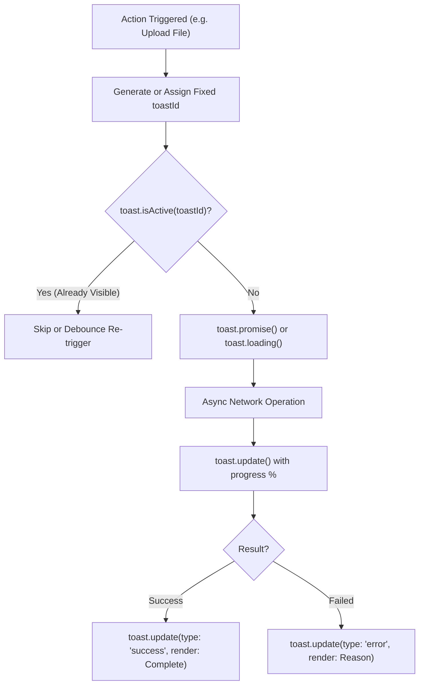

## 1. แนวคิด (Concept)

ในระดับแอปพลิเคชันระดับองค์กร (Enterprise Applications) การใช้งานระบบแจ้งเตือน Toast มักไม่ได้จบลงที่การเรียก `toast.success("บันทึกข้อมูลแล้ว")` เพียงอย่างเดียว แต่ต้องรองรับ **Asynchronous Workflows** ที่มีความซับซ้อน เช่น การอัปโหลดไฟล์ขนาดใหญ่, การประมวลผลข้อมูลแบบแบตช์ (Batch Processing), หรือการรอผลการทำธุรกรรมทางการเงิน

**React Toastify** เป็นหนึ่งในไลบรารีที่ได้รับความนิยมยาวนานที่สุดในระบบนิเวศของ React ด้วยสถาปัตยกรรมแบบ **Imperative Event Bus** ที่ทรงพลัง ซึ่งเปิดโอกาสให้นักพัฒนาสามารถ:
1. **ควบคุมวงจรชีวิต (Lifecycle Management)**: อัปเดตเนื้อหา, เปอร์เซ็นต์ความคืบหน้า (Progress Bar), และชนิดของ Toast ตัวเดิมผ่าน `toast.update()` โดยไม่ต้องทำลายและสร้าง Element ใหม่
2. **ขจัดข้อความซ้ำซ้อน (Deduplication)**: ป้องกัน "Toast Flooding" หรือการที่ผู้ใช้กดย้ำปุ่มรัวๆ ด้วย `toastId` และฟังก์ชันตรวจจับสถานะ `toast.isActive()`
3. **ผสานเข้ากับ Modern Design Systems**: ปรับแต่งผ่าน Tailwind CSS อย่างสมบูรณ์ แทนการพึ่งพา CSS ดั้งเดิมของไลบรารี
4. **จัดการ Theme แบบ Dynamic**: สลับสไตล์ Light / Dark Mode ตาม `next-themes` หรือ System Preference อย่างกลมกลืน



---

## 2. หลักการเบื้องหลัง (Under the Hood)

### 2.1 กลไก Event Emitter และ Queue Manager
หัวใจหลักของ React Toastify คือ **Event Manager Pattern** (หรือ Publish-Subscribe Architecture):
* เมื่อเราเรียก `toast()` ตัวฟังก์ชันไม่ได้แตะต้อง DOM โดยตรง แต่จะส่ง Event พร้อม Metadata (ได้แก่ `content`, `options`, `toastId`) ไปยัง **EventManager Singleton**
* คอมโพเนนต์ `<ToastContainer />` ซึ่งเมานต์อยู่ใน React Tree ทำหน้าที่เป็น Subscriber โดยคอยฟัง Event จาก EventManager
* เมื่อได้รับ Event ตัว Container จะจัดคิวใน Internal Collection (`toastList`) และสั่ง Re-render เฉพาะ Container ผ่าน React State เพื่อแสดงรายการ Toast ใน Portal

### 2.2 การควบคุมผ่าน `toastId` และ `toast.update()`
เมื่อต้องการเปลี่ยนสถานะของ Toast ที่กำลังแสดงอยู่ (เช่น เปลี่ยนจากไอคอนหมุน Loading กลายเป็นไอคอนติ๊กถูก Success):
* React Toastify จะค้นหา Instance ในคอลเลกชันผ่าน Key `toastId`
* เมื่อพบ จะทำการ Merge Configuration ใหม่เข้ากับ Object เดิม และสั่ง Re-render ชิ้นส่วนนั้นโดยตรง ทำให้แอนิเมชันของแถบ Progress Bar ไม่สะดุด และไม่เกิดการกระพริบของ DOM Element

### 2.3 การแทนที่ Default CSS ด้วย Tailwind CSS
โดยปกติ React Toastify จะใช้สไตล์คลาสสิกผ่านไฟล์ `react-toastify/dist/ReactToastify.css` ซึ่งมักมีปัญหากับระบบ Design System ยุคใหม่ เพื่อให้สามารถใช้ Tailwind CSS ได้เต็มประสิทธิภาพ เราสามารถส่งคลาส Tailwind เข้าไปที่ Props `className`, `bodyClassName`, และ `progressClassName` ในระดับ Container หรือกำหนดเฉพาะตัว Toast รายอันได้

---

## 3. ตัวอย่างโค้ด (TypeScript / TSX)

### ตัวอย่างที่ 1: ระบบอัปโหลดและประมวลผลไฟล์ด้วย `toast.promise` และ `toast.update`

ตัวอย่างนี้จำลองกระบวนการอัปโหลดไฟล์วิดีโอไปยัง Cloud Storage ที่มีการอัปเดตความคืบหน้าระหว่างทาง และจัดการผลลัพธ์ทั้งสำเร็จและล้มเหลวอย่างสมบูรณ์

```tsx filename="src/features/uploads/components/video-uploader.tsx"
'use client';

import * as React from 'react';
import { toast, Id, UpdateOptions } from 'react-toastify';
import { UploadCloud, CheckCircle2, AlertTriangle } from 'lucide-react';

interface UploadResponse {
  assetId: string;
  url: string;
  sizeBytes: number;
}

export function VideoUploader() {
  const [isUploading, setIsUploading] = React.useState<boolean>(false);
  const activeToastIdRef = React.useRef<Id | null>(null);

  // จำลองฟังก์ชันอัปโหลดไฟล์จริงพร้อมจำลอง Progress
  const handleUpload = async (file: File) => {
    if (isUploading) return;
    setIsUploading(true);

    const toastId = `upload-${file.name}-${Date.now()}`;
    activeToastIdRef.current = toastId;

    // เริ่มต้น Toast สถานะ Loading
    toast.loading(`กำลังอัปโหลดไฟล์ ${file.name}...`, {
      toastId: toastId,
      position: 'bottom-right',
      closeOnClick: false,
      draggable: false,
    });

    try {
      // จำลองการอัปโหลดแบบสตรีมและอัปเดตความคืบหน้า
      for (let percent = 20; percent <= 80; percent += 20) {
        await new Promise((resolve) => setTimeout(resolve, 600));
        
        // อัปเดตเนื้อหาและสถานะความคืบหน้าของ Toast ตัวเดิม
        const updatePayload: UpdateOptions = {
          render: `กำลังอัปโหลด ${file.name} (${percent}%)`,
          progress: percent / 100,
        };
        toast.update(toastId, updatePayload);
      }

      // จำลองการแปลงรหัสวิดีโอ (Transcoding)
      await new Promise((resolve) => setTimeout(resolve, 800));

      const mockResponse: UploadResponse = {
        assetId: 'vid_9847291',
        url: 'https://cdn.example.com/videos/demo.mp4',
        sizeBytes: file.size,
      };

      // เปลี่ยนสถานะเป็น Success พร้อมตั้งเวลานับถอยหลังปิด 4 วินาที
      toast.update(toastId, {
        render: (
          <div className="flex flex-col gap-1">
            <span className="font-semibold text-emerald-600 dark:text-emerald-400">
              อัปโหลดสำเร็จแล้ว!
            </span>
            <span className="text-xs text-muted-foreground">
              รหัสสื่อ: {mockResponse.assetId} ({Math.round(mockResponse.sizeBytes / 1024)} KB)
            </span>
          </div>
        ),
        type: 'success',
        isLoading: false,
        autoClose: 4000,
        closeButton: true,
        icon: <CheckCircle2 className="h-5 w-5 text-emerald-500" />,
      });
    } catch (err: unknown) {
      const errorMessage = err instanceof Error ? err.message : 'การเชื่อมต่อเครือข่ายขัดข้อง';
      
      // อัปเดตสถานะเป็น Error เพื่อให้ผู้ใช้ทราบปัญหาทันที
      toast.update(toastId, {
        render: `อัปโหลดล้มเหลว: ${errorMessage}`,
        type: 'error',
        isLoading: false,
        autoClose: 6000,
        closeButton: true,
        icon: <AlertTriangle className="h-5 w-5 text-destructive" />,
      });
    } finally {
      setIsUploading(false);
      activeToastIdRef.current = null;
    }
  };

  return (
    <div className="rounded-xl border border-border bg-card p-6 shadow-sm">
      <div className="flex items-center gap-3">
        <div className="rounded-lg bg-primary/10 p-2.5 text-primary">
          <UploadCloud className="h-6 w-6" />
        </div>
        <div>
          <h3 className="text-base font-semibold text-card-foreground">ระบบอัปโหลดไฟล์วิดีโอ</h3>
          <p className="text-xs text-muted-foreground">รองรับไฟล์ MP4, MKV ความละเอียดสูงสุด 4K</p>
        </div>
      </div>

      <div className="mt-5 flex items-center gap-3">
        <button
          type="button"
          disabled={isUploading}
          onClick={() => {
            const dummyFile = new File(['mock content data'], 'project-pitch-2026.mp4', {
              type: 'video/mp4',
            });
            handleUpload(dummyFile);
          }}
          className="inline-flex items-center justify-center rounded-lg bg-primary px-4 py-2 text-sm font-medium text-primary-foreground shadow transition hover:bg-primary/90 disabled:opacity-50"
        >
          {isUploading ? 'กำลังประมวลผล...' : 'เริ่มอัปโหลดไฟล์ตัวอย่าง'}
        </button>

        {isUploading && (
          <button
            type="button"
            onClick={() => {
              if (activeToastIdRef.current) {
                toast.dismiss(activeToastIdRef.current);
                setIsUploading(false);
              }
            }}
            className="rounded-lg border border-input bg-background px-3 py-2 text-xs font-medium text-destructive transition hover:bg-destructive/10"
          >
            ยกเลิกการแสดงผล
          </button>
        )}
      </div>
    </div>
  );
}
```

---

### ตัวอย่างที่ 2: Custom Tailwind Component พร้อมระบบ Deduplication และ Dark Mode Theming

ตัวอย่างนี้แสดงการสร้าง Custom Interactive Toast Component ที่ปิดสไตล์ตั้งต้นของไลบรารี หันมาใช้ Tailwind CSS 100% พร้อมระบบป้องกันการกดซ้ำซ้อน (`toast.isActive`) และปุ่มกดยืนยัน/ย้อนกลับภายใน Toast

```tsx filename="src/components/notifications/tailwind-toast-service.tsx"
'use client';

import * as React from 'react';
import { toast, ToastOptions } from 'react-toastify';
import { useTheme } from 'next-themes';
import { BellRing, ExternalLink, X } from 'lucide-react';

interface OrderAlertProps {
  orderId: string;
  customerName: string;
  amount: number;
  onViewOrder: (id: string) => void;
  closeToast?: () => void;
}

// Custom UI Component ที่เรนเดอร์ใน Toast
export function OrderNotificationCard({
  orderId,
  customerName,
  amount,
  onViewOrder,
  closeToast,
}: OrderAlertProps) {
  return (
    <div className="flex w-full items-start gap-3 rounded-lg bg-card p-3.5 text-card-foreground shadow-lg border border-border">
      <div className="rounded-full bg-primary/10 p-2 text-primary shrink-0">
        <BellRing className="h-5 w-5" />
      </div>

      <div className="flex-1 min-w-0">
        <div className="flex items-center justify-between">
          <p className="text-sm font-semibold text-foreground">คำสั่งซื้อใหม่ #{orderId}</p>
          <span className="text-xs font-bold text-emerald-600 dark:text-emerald-400">
            ฿{amount.toLocaleString()}
          </span>
        </div>
        <p className="text-xs text-muted-foreground mt-0.5 truncate">
          ลูกค้า: {customerName}
        </p>

        <div className="mt-3 flex items-center gap-2">
          <button
            type="button"
            onClick={() => {
              onViewOrder(orderId);
              closeToast?.();
            }}
            className="inline-flex items-center gap-1 rounded-md bg-primary px-2.5 py-1 text-xs font-medium text-primary-foreground hover:bg-primary/90"
          >
            ดูรายละเอียด
            <ExternalLink className="h-3 w-3" />
          </button>

          <button
            type="button"
            onClick={closeToast}
            className="rounded-md border border-input bg-background px-2.5 py-1 text-xs font-medium text-muted-foreground hover:bg-muted"
          >
            ปิด
          </button>
        </div>
      </div>
    </div>
  );
}

// ฟังก์ชันสำหรับเรียก Toast พร้อมระบบ Deduplication
export function triggerOrderNotification(
  order: { id: string; customer: string; total: number },
  routerPush: (path: string) => void
) {
  const uniqueToastId = `order-alert-${order.id}`;

  // 1. ตรวจสอบว่ามี Toast รหัสนี้แสดงอยู่บนหน้าจอหรือไม่ (Deduplication)
  if (toast.isActive(uniqueToastId)) {
    return;
  }

  // 2. เรียก Toast ด้วย Custom Component และปิด Default Styles
  toast(
    ({ closeToast }) => (
      <OrderNotificationCard
        orderId={order.id}
        customerName={order.customer}
        amount={order.total}
        closeToast={closeToast}
        onViewOrder={(id) => routerPush(`/orders/${id}`)}
      />
    ),
    {
      toastId: uniqueToastId,
      position: 'top-right',
      autoClose: 8000,
      hideProgressBar: true,
      closeButton: false, // ปิดปุ่มกากบาทดั้งเดิม ใช้ปุ่มที่เราสร้างเอง
      className: '!p-0 !bg-transparent !shadow-none', // ล้างสไตล์กรอบนอกของ Toastify
    }
  );
}
```

---

## 4. เทียบกับวิธีอื่น (React Toastify Advanced vs Sonner Advanced)

| คุณสมบัติ | React Toastify (Advanced API) | Sonner (Advanced API) |
| :--- | :--- | :--- |
| **การควบคุมแบบ Imperative (`update/dismiss`)** | **ยืดหยุ่นสูงมาก**: `toast.update(id, options)` สามารถเปลี่ยน props เกือบทุกตัวได้อิสระ | เรียบง่าย: `toast.dismiss(id)`, มีระบบ promise อัปเดตในตัว แต่ configuration แยกซับซ้อนน้อยกว่า |
| **ระบบขจัดข้อความซ้ำ (Deduplication)** | **แข็งแกร่ง**: มีฟังก์ชัน `toast.isActive(id)` ในระดับ First-class API ให้เช็กก่อนยิง | ป้องกันผ่าน `id` เดียวกันได้ แต่ไม่มี `toast.isActive` แบบ build-in ชัดเจน |
| **Progress Bar แบบ Manual** | รองรับการควบคุม progress เปอร์เซ็นต์ด้วยตนเอง (`progress: 0.45`) | ส่วนใหญ่ควบคุมผ่านเวลาที่กำหนด (Duration Based) |
| **Custom Component Isolation** | ต้อง Override CSS Wrapper (`!p-0 !bg-transparent`) เพื่อไม่ให้ชนกับ Default CSS | ใช้ headless architecture ผสานร่วมกับ Tailwind / shadcn/ui ได้เนียนตากว่า |
| **Bundle Size Impact** | ~28 KB (Gzipped รวม CSS) | ~5 KB (Gzipped) เบากว่าอย่างเห็นได้ชัด |

---

## 5. ผิด vs ถูก (Anti-patterns vs Best Practices)

### 1) การเรียก `toast()` ซ้ำใน Event Handler โดยไม่กำหนด `toastId`
* ❌ **ผิด**: เมื่อผู้ใช้คลิกปุ่มบันทึก 5 ครั้งติดกัน โค้ดส่ง `toast.info("กำลังประมวลผล...")` 5 รอบ ทำให้ Toast ซ้อนเต็มหน้าจอ
* ✅ **ถูก**: กำหนด `toastId: "save-draft"` และตรวจเช็ก `if (toast.isActive("save-draft")) return;` หรือปล่อยให้ Toastify จัดการ deduplication อัตโนมัติด้วย ID เดิม

### 2) การ Unmount คอมโพเนนต์แล้วลืมทำลาย Toast ที่ค้างอยู่
* ❌ **ผิด**: สั่งเริ่ม `toast.loading()` แล้วผู้ใช้เปลี่ยนหน้า (Route Navigation) ก่อนการโหลดเสร็จ ทำให้ Toast หมุนค้างอยู่ตลอดไป
* ✅ **ถูก**: จัดเก็บ `toastId` ใน `useRef` หรือ Cleanup ด้วย `toast.dismiss(id)` ภายใน `useEffect` cleanup return function

### 3) การ Override สไตล์ Tailwind แต่ชนกับ CSS Specificity ของ Toastify
* ❌ **ผิด**: กำหนด `className="bg-red-500"` ลงใน Toast โดยไม่ตั้งค่า Container ผลลัพธ์คือสีขาวของไลบรารีทับสีของ Tailwind
* ✅ **ถูก**: ใช้ Tailwind Important Modifier (เช่น `!bg-card !text-card-foreground`) หรือปิด Default Styles ด้วย prop ของ Container

---

## 6. ควรใช้เมื่อไหร่ / ไม่ควรใช้เมื่อไหร่

### ควรใช้ (When to use):
* ต้องการการควบคุมสถานะ Asynchronous แบบ Multi-stage ที่ต้องปรับเปลี่ยนทั้งข้อความ, ชนิด, และแถบความคืบหน้าระหว่างทาง
* โปรเจกต์เดิมที่มีการผูกพันกับ React Toastify อยู่แล้ว และต้องการยกระดับให้รองรับ Tailwind CSS และ Next.js 16
* ระบบที่ผู้ใช้มีโอกาสกระตุ้น Event ถี่ๆ และจำเป็นต้องตรวจจับ `toast.isActive(id)` เพื่อป้องกัน UI ทะลัก

### ไม่ควรใช้ (When NOT to use):
* โปรเจกต์ใหม่ที่ใช้ **shadcn/ui** เป็นหลัก (ควรใช้ **Sonner** เพราะมี Native Integration และ Bundle เล็กกว่า 5 เท่า)
* ต้องการแอนิเมชันแบบ Stacked Card ที่ซ้อนเรียงลงมาอย่างนุ่มนวลแบบ Modern iOS Style (Sonner ทำได้เนียนกว่ามาก)
* ฟอร์ม Validation Error เฉพาะจุด (ควรใช้ Inline FormMessage แทน)

---

## 7. คำถามสัมภาษณ์งาน (Senior Interview Questions & Answers)

### Q1: กลไกของ `toast.update()` ใน React Toastify ป้องกัน Memory Leak และ UI Flashing ได้อย่างไร เมื่อเทียบกับการ `dismiss()` ตัวเก่าแล้วสร้างตัวใหม่?
**แนวทางตอบแบบ Senior Developer**:
1. **การรักษา DOM Node และ React Key**: เมื่อเราสั่ง `toast.update(toastId, options)` ตัว Event Manager จะไม่ลบ Element ออกจาก Virtual DOM Tree แต่จะอัปเดต State ภายในของ Toast Item ตัวนั้นโดยตรง ซึ่งช่วยป้องกันการทำ Unmount/Remount Cycle ของ DOM ส่งผลให้เบราว์เซอร์ไม่ต้องคำนวณ Reflow/Repaint ใหม่ทั้งหมด และตัดปัญหาหน้าจอสะดุด (UI Jitter/Flashing)
2. **การจัดการ Progress Animation**: หากเราทำลายแล้วสร้างใหม่ แอนิเมชันของแถบ Progress Bar จะถูกรีเซ็ตกลับไปที่ 0% เสมอ แต่การใช้ `update()` จะทำให้ Animation Frame เดินหน้าต่อเนื่องอย่างราบรื่น
3. **การหลีกเลี่ยง Event Listener Leak**: ใน Custom Component ที่มีการผูก Event Listeners การรักษา Component Instance เดิมไว้จะช่วยลดภาระของ Garbage Collector ในการกำจัด Closure ที่ค้างอยู่ในหน่วยความจำ

### Q2: ในสถาปัตยกรรม Next.js 16 App Router ที่เน้น Server Components เราควรวาง `<ToastContainer />` ไว้ที่ใด และจัดการเรื่อง Hydration Mismatch อย่างไร?
**แนวทางตอบแบบ Senior Developer**:
- **การจัดวางตำแหน่ง**: เราต้องสร้าง Client Wrapper เช่น `<NotificationProvider>` ที่มี directive `'use client'` แล้ววาง `<ToastContainer />` ไว้ใน Root Layout (`app/layout.tsx`) เพียงจุดเดียวเพื่อทำหน้าที่เป็น Global Portal
- **การป้องกัน Hydration Mismatch**: เนื่องจาก React Toastify อาจมีการอ่านค่า Browser Attributes (เช่น Cookies, LocalStorage ของ Theme, หรือ Window Dimensions) หากเซิร์ฟเวอร์เรนเดอร์ HTML ไม่ตรงกับ Client อาจเกิดข้อผิดพลาด Hydration ได้ วิธีแก้คือการใช้ Mount Guard Pattern (`mounted` state ใน `useEffect`) หรือการใช้ Theme Provider ที่ซิงค์ค่าระหว่าง Server กับ Client อย่างถูกต้อง และห้ามเรียก `toast()` ภายในโค้ดฝั่ง Server Component โดยเด็ดขาด
