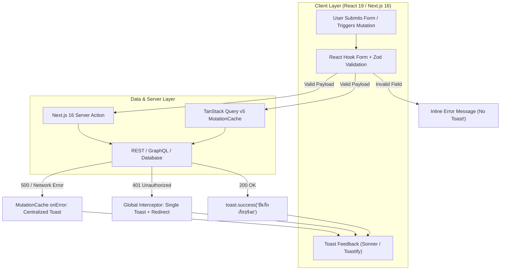

## 1. แนวคิด (Concept)

ในแอปพลิเคชัน Fullstack ยุคใหม่ด้วย Next.js 16 และ React 19 ระบบการแจ้งเตือนแบบ Toast ไม่ได้ทำหน้าที่เพียงแค่แสดงกล่องข้อความเมื่อกดปุ่ม แต่เป็น **Feedback Channel สำคัญที่เชื่อมต่อระหว่างสถานะของเซิร์ฟเวอร์ (Server State) และประสบการณ์ของผู้ใช้ (Client Experience)**

การทำงานจริงต้องจัดการกับ 5 โฟลว์หลักที่พบได้ในทุกระบบระดับ Enterprise:
1. **TanStack Query v5 `useMutation` Feedback**: การแจ้งเตือนแบบ Asynchronous เมื่อมีการส่งข้อมูลไปแก้ไข เช่น การทำ Optimistic Updates พร้อมปุ่ม Undo หรือ Rollback แจ้งเตือนเมื่อเซิร์ฟเวอร์ปฏิเสธคำขอ
2. **Global API Error Interceptor**: การรวมศูนย์ดักจับ Error ที่ระดับ `QueryClient` ผ่าน `QueryCache` และ `MutationCache` เพื่อไม่ให้เกิดโค้ดซ้ำซ้อน และป้องกันอาการ **Error Toast Storm** (เมื่อมีคำขอเครือข่ายล้มเหลวพร้อมกันหลายสิบจุด)
3. **Form Submission ร่วมกับ React Hook Form & Zod**: การแบ่งแยกหน้าที่อย่างชัดเจนระหว่าง "ข้อผิดพลาดระดับฟิลด์ (Inline Field Error)" และ "ข้อผิดพลาด/ความสำเร็จภาพรวม (Form Toast Summary)"
4. **Next.js 16 Server Actions Integration**: การเชื่อมต่อระหว่างผลลัพธ์ของ Server Action กับ Client Components ผ่าน React 19 `useActionState` หรือ `startTransition`
5. **Global 401 Unauthorized / Session Expired Flow**: การดักจับสถานะ Token หมดอายุ เคลียร์แคชระบบ แสดงคำเตือน และนำทางผู้ใช้กลับไปยังหน้าเข้าสู่ระบบอย่างปลอดภัย



---

## 2. หลักการเบื้องหลัง (Under the Hood)

### 2.1 สถาปัตยกรรม Global Cache vs Per-Hook Notification
ใน TanStack Query v5 การประกาศ `onError` ในแต่ละ hook `useQuery` ถูกตัดออกเพื่อลด Side Effects ที่ไม่จำเป็น และสนับสนุนให้จัดการผ่าน **Global Cache Interceptors**:
* `QueryCache({ onError: (error, query) => ... })`
* `MutationCache({ onError: (error, variables, context, mutation) => ... })`

ข้อดีของวิธีนี้คือเราสามารถสร้าง **Rate Limiter / Deduplication Layer** ครอบก่อนการยิง Toast ได้ เช่น หากผู้ใช้เปิดหน้า Dashboard ที่ยิง 10 API แล้วเซิร์ฟเวอร์ล่มพร้อมกัน (HTTP 500) แทนที่หน้าจอจะระเบิดด้วย 10 Toasts ทับกัน Interceptor จะทำการ Deduplicate และยิง Toast เพียงใบเดียวว่า *"ระบบเชื่อมต่อเซิร์ฟเวอร์ขัดข้อง กรุณาลองใหม่อีกครั้งในภายหลัง"*

### 2.2 Client-Server Boundary ใน Next.js 16 Server Actions
Server Actions รันบนสภาพแวดล้อม Node.js ฝั่งเซิร์ฟเวอร์ จึง **ไม่สามารถแตะต้อง DOM หรือเรียกฟังก์ชัน `toast()` ได้โดยตรง** สถาปัตยกรรมที่ถูกต้องคือการส่ง Serialization Response กลับมายัง Client:
```typescript
type ActionResult<T> = 
  | { success: true; data: T; message: string }
  | { success: false; error: string; code?: string };
```
จากนั้น Client Component จะรับค่านั้นผ่าน Hook `useActionState` หรือฟังก์ชัน `startTransition` เพื่อเรียก `toast.success()` หรือ `toast.error()` ตามผลลัพธ์ที่ได้

---

## 3. ตัวอย่างโค้ด (TypeScript / TSX)

### ตัวอย่างที่ 1: Global QueryClient พร้อม MutationCache และระบบ Error Deduplication

ตัวอย่างนี้สร้าง `QueryClient` ระดับ Global ใน Next.js 16 ที่ดักจับ Error ทุกตัวในระบบ แยกประเภท HTTP Status Code และป้องกันการยิง Toast ซ้ำซ้อน

```tsx filename="src/lib/query-client.ts"
'use client';

import { QueryClient, QueryCache, MutationCache } from '@tanstack/react-query';
import { toast } from 'sonner';

// โครงสร้างของ Standard API Error
export interface AppApiError {
  statusCode: number;
  message: string;
  code?: string;
  details?: Record<string, string[]>;
}

// แผนผังจำเวลาป้องกัน Toast พายุ (Throttle / Debounce Map)
const errorToastThrottleMap = new Map<string, number>();
const THROTTLE_WINDOW_MS = 2500;

function shouldShowErrorToast(key: string): boolean {
  const now = Date.now();
  const lastShown = errorToastThrottleMap.get(key) ?? 0;
  if (now - lastShown < THROTTLE_WINDOW_MS) {
    return false;
  }
  errorToastThrottleMap.set(key, now);
  return true;
}

export function createConfiguredQueryClient(onUnauthorizedRedirect: () => void) {
  return new QueryClient({
    queryCache: new QueryCache({
      onError: (error, query) => {
        // หาก Query มีการกำหนด meta.silent: true ให้ข้ามการแจ้งเตือน
        if (query.meta?.silent) return;

        const apiError = error as unknown as AppApiError;
        const statusCode = apiError?.statusCode ?? 500;

        if (statusCode === 401) {
          if (shouldShowErrorToast('auth_401')) {
            toast.error('เซสชันการใช้งานหมดอายุ', {
              description: 'ระบบกำลังนำคุณไปยังหน้าเข้าสู่ระบบ...',
              duration: 4000,
            });
            onUnauthorizedRedirect();
          }
          return;
        }

        // ข้อผิดพลาดระบบทั่วไป (Query ดึงข้อมูลล้มเหลว)
        const throttleKey = `query_err_${statusCode}_${query.queryHash}`;
        if (shouldShowErrorToast(throttleKey)) {
          toast.error('ไม่สามารถโหลดข้อมูลได้', {
            description: apiError?.message || 'เกิดข้อผิดพลาดในการดึงข้อมูลจากเซิร์ฟเวอร์',
          });
        }
      },
    }),

    mutationCache: new MutationCache({
      onError: (error, _variables, _context, mutation) => {
        // หาก Mutation มี meta.suppressGlobalToast ไม่ต้องยิง Toast รวมศูนย์
        if (mutation.meta?.suppressGlobalToast) return;

        const apiError = error as unknown as AppApiError;
        const statusCode = apiError?.statusCode ?? 500;

        if (statusCode === 401) {
          if (shouldShowErrorToast('auth_401')) {
            toast.error('คุณไม่มีสิทธิ์ทำรายการนี้', {
              description: 'กรุณาเข้าสู่ระบบใหม่อีกครั้ง',
            });
            onUnauthorizedRedirect();
          }
          return;
        }

        if (statusCode === 403) {
          toast.error('ปฏิเสธการเข้าถึง', {
            description: 'บัญชีของคุณไม่มีสิทธิ์ในการเปลี่ยนแปลงข้อมูลส่วนนี้',
          });
          return;
        }

        // จัดการ Error อื่นๆ ระดับเซิร์ฟเวอร์
        toast.error('ทำรายการไม่สำเร็จ', {
          description: apiError?.message || 'เซิร์ฟเวอร์ไม่สามารถประมวลผลคำขอได้ในขณะนี้',
        });
      },
    }),

    defaultOptions: {
      queries: {
        staleTime: 1000 * 60 * 2, // 2 นาที
        retry: (failureCount, error) => {
          const apiError = error as unknown as AppApiError;
          // ห้าม Retry หากเป็นข้อผิดพลาดจากฝั่ง Client เช่น 400, 401, 403, 404
          if (apiError?.statusCode && apiError.statusCode < 500) {
            return false;
          }
          return failureCount < 2;
        },
      },
    },
  });
}
```

---

### ตัวอย่างที่ 2: Next.js 16 Server Action ร่วมกับ React Hook Form + Zod และ Sonner Toast

ตัวอย่างนี้แสดงการส่งแบบฟอร์มแก้ไขข้อมูลองค์กร โดยผสานการทำงานระหว่าง Form Validation, Client Transition, Server Action Response, และ Toast Notification อย่างสมบูรณ์

```tsx filename="src/features/organization/components/organization-profile-form.tsx"
'use client';

import * as React from 'react';
import { useForm } from 'react-hook-form';
import { zodResolver } from '@hookform/resolvers/zod';
import { z } from 'zod';
import { toast } from 'sonner';
import { Loader2, Save, Undo2 } from 'lucide-react';
import { updateOrganizationAction } from '../actions/update-organization';

// 1. Zod Schema สำหรับตรวจสอบความถูกต้อง
export const organizationSchema = z.object({
  name: z.string().min(3, 'ชื่อองค์กรต้องมีความยาวอย่างน้อย 3 ตัวอักษร'),
  taxId: z.string().regex(/^\d{13}$/, 'เลขประจำตัวผู้เสียภาษีต้องเป็นตัวเลข 13 หลัก'),
  contactEmail: z.string().email('รูปแบบอีเมลไม่ถูกต้อง'),
});

export type OrganizationFormValues = z.infer<typeof organizationSchema>;

interface Props {
  initialData: OrganizationFormValues;
  organizationId: string;
}

export function OrganizationProfileForm({ initialData, organizationId }: Props) {
  const [isPending, startTransition] = React.useTransition();

  const {
    register,
    handleSubmit,
    reset,
    formState: { errors, isDirty },
  } = useForm<OrganizationFormValues>({
    resolver: zodResolver(organizationSchema),
    defaultValues: initialData,
  });

  // 2. จัดการการ Submit ฟอร์ม
  const onSubmit = (formData: OrganizationFormValues) => {
    startTransition(async () => {
      // แสดง Toast แจ้งเตือนกระบวนการทำงาน
      const toastId = toast.loading('กำลังบันทึกข้อมูลองค์กร...');

      try {
        const response = await updateOrganizationAction(organizationId, formData);

        if (!response.success) {
          toast.error('บันทึกข้อมูลไม่สำเร็จ', {
            id: toastId,
            description: response.error,
          });
          return;
        }

        // บันทึกสำเร็จ: อัปเดต Toast และตั้ง Reset Form State
        reset(formData); // รีเซ็ตสถานะ isDirty
        
        toast.success('บันทึกข้อมูลสำเร็จ', {
          id: toastId,
          description: 'ข้อมูลองค์กรได้รับการอัปเดตเรียบร้อยแล้ว',
          action: {
            label: 'ย้อนกลับ',
            onClick: () => {
              // รองรับ Undo Action
              startTransition(async () => {
                await updateOrganizationAction(organizationId, initialData);
                reset(initialData);
                toast.info('ย้อนข้อมูลกลับเป็นค่าเริ่มต้นแล้ว');
              });
            },
          },
        });
      } catch (err: unknown) {
        toast.error('การเชื่อมต่อขัดข้อง', {
          id: toastId,
          description: err instanceof Error ? err.message : 'กรุณาตรวจสอบอินเทอร์เน็ตของท่าน',
        });
      }
    });
  };

  return (
    <form onSubmit={handleSubmit(onSubmit)} className="space-y-5 rounded-2xl border border-border bg-card p-6 shadow-sm">
      <div>
        <h3 className="text-lg font-bold text-card-foreground">ข้อมูลนิติบุคคล</h3>
        <p className="text-xs text-muted-foreground">แก้ไขข้อมูลเพื่อใช้ออกใบกำกับภาษีอิเล็กทรอนิกส์</p>
      </div>

      <div className="space-y-4">
        {/* Field 1: ชื่อองค์กร */}
        <div>
          <label className="block text-xs font-semibold text-foreground mb-1">
            ชื่อองค์กร / บริษัท
          </label>
          <input
            {...register('name')}
            disabled={isPending}
            className="w-full rounded-lg border border-input bg-background px-3 py-2 text-sm focus:outline-none focus:ring-2 focus:ring-primary"
            placeholder="บริษัท อินโนเวชัน จำกัด"
          />
          {errors.name && (
            <p className="mt-1 text-xs text-destructive">{errors.name.message}</p>
          )}
        </div>

        {/* Field 2: เลขภาษี */}
        <div>
          <label className="block text-xs font-semibold text-foreground mb-1">
            เลขประจำตัวผู้เสียภาษี (13 หลัก)
          </label>
          <input
            {...register('taxId')}
            disabled={isPending}
            maxLength={13}
            className="w-full rounded-lg border border-input bg-background px-3 py-2 text-sm focus:outline-none focus:ring-2 focus:ring-primary"
            placeholder="0105559012345"
          />
          {errors.taxId && (
            <p className="mt-1 text-xs text-destructive">{errors.taxId.message}</p>
          )}
        </div>

        {/* Field 3: อีเมลติดต่อ */}
        <div>
          <label className="block text-xs font-semibold text-foreground mb-1">
            อีเมลสำหรับส่งใบเสร็จ
          </label>
          <input
            {...register('contactEmail')}
            type="email"
            disabled={isPending}
            className="w-full rounded-lg border border-input bg-background px-3 py-2 text-sm focus:outline-none focus:ring-2 focus:ring-primary"
            placeholder="billing@company.co.th"
          />
          {errors.contactEmail && (
            <p className="mt-1 text-xs text-destructive">{errors.contactEmail.message}</p>
          )}
        </div>
      </div>

      <div className="flex items-center justify-end gap-3 pt-3 border-t border-border">
        <button
          type="button"
          disabled={!isDirty || isPending}
          onClick={() => reset()}
          className="inline-flex items-center gap-1.5 rounded-lg border border-input bg-background px-4 py-2 text-xs font-medium text-muted-foreground hover:bg-muted disabled:opacity-50"
        >
          <Undo2 className="h-4 w-4" />
          ล้างการเปลี่ยนแปลง
        </button>

        <button
          type="submit"
          disabled={!isDirty || isPending}
          className="inline-flex items-center gap-1.5 rounded-lg bg-primary px-5 py-2 text-xs font-medium text-primary-foreground shadow hover:bg-primary/90 disabled:opacity-50"
        >
          {isPending ? (
            <>
              <Loader2 className="h-4 w-4 animate-spin" />
              กำลังบันทึก...
            </>
          ) : (
            <>
              <Save className="h-4 w-4" />
              บันทึกการเปลี่ยนแปลง
            </>
          )}
        </button>
      </div>
    </form>
  );
}
```

---

## 4. เทียบกับวิธีอื่น (Toast vs Dialog vs Global Interceptor)

| มิติการพิจารณา | Toast ผ่าน Global Interceptor | Toast เฉพาะ Local Component | Modal / AlertDialog |
| :--- | :--- | :--- | :--- |
| **การจัดการ 401 Session Expired** | **เหมาะสมที่สุด**: ดักจากจุดเดียว ไม่ต้องเขียนโค้ดเช็กซ้ำในทุกหน้า | ผิดหลักการ: ต้องก็อปปี้โค้ดเช็ก 401 ไปใส่ในทุก hook | รองรับได้ดีหากต้องการให้ Re-login ใน Modal กลาง |
| **การจัดการ Form Validation Error** | **ห้ามใช้**: ก่อความรำคาญ และบดบังมุมมอง | ไม่แนะนำ: ทำให้ผู้ใช้จำไม่ได้ว่าช่องใดผิด | ไม่เหมาะสม: ขัดขวาง Flow การพิมพ์มากเกินไป |
| **Network Flapping (เน็ตหลุด)** | **ดีเยี่ยม**: รวมศูนย์แจ้งเตือน "ขาดการเชื่อมต่อ" จุดเดียว | เสี่ยงต่อการเกิด Toast พายุระเบิดเต็มหน้าจอ | ขัดจังหวะการทำงานมากเกินไป |
| **การลบข้อมูลวิกฤต (Destructive)** | ไม่เหมาะสม: Toast สลายหายไปเองได้ | ไม่เหมาะสม: อาจกดพลาดโดยไม่ตั้งใจ | **เหมาะสมที่สุด**: บังคับให้ผู้ใช้มีสมาธิและกดยืนยัน |

---

## 5. ผิด vs ถูก (Anti-patterns vs Best Practices)

### 1) การพยายามเรียก `toast()` ภายใน Server Action File
* ❌ **ผิด**: เขียน `toast.success("บันทึกแล้ว")` ในไฟล์ `actions/user.ts` ที่มี `'use server'` ผลคือเซิร์ฟเวอร์พังเพราะไม่มี Browser Window/DOM API
* ✅ **ถูก**: คืนค่า `{ success: true, message: "บันทึกแล้ว" }` กลับไปยัง Client Component แล้วเรียก `toast.success(res.message)`

### 2) ยิง Toast ซ้ำซ้อนทั้งในระดับ Global Interceptor และ Local Component
* ❌ **ผิด**: ตั้งค่า Global `MutationCache.onError` ให้ยิง Toast แล้ว และในตัว `useMutation({ onError: () => toast.error(...) })` ก็สั่งยิงซ้ำอีก ผลลัพธ์คือมี Toast สีแดงเด้งขึ้นมา 2 ใบพร้อมกัน
* ✅ **ถูก**: ให้ Global จัดการเป็นค่าเริ่มต้น หากคอมโพเนนต์ใดต้องการจัดการเฉพาะทาง ให้ส่ง Flag เช่น `meta: { suppressGlobalToast: true }`

### 3) การใช้ Toast แสดงรายการ Error ของฟอร์มทีละฟิลด์
* ❌ **ผิด**: เมื่อผู้ใช้กด Submit แล้วกรอกผิด 5 ช่อง สั่งยิง Toast 5 ใบ: "อีเมลผิด", "รหัสผ่านสั้นไป", "กรุณาใส่เบอร์โทร"
* ✅ **ถูก**: แสดง Error สีแดงใต้กล่องข้อความแต่ละช่อง (Inline FormMessage) และยิง Toast ภาพรวมเพียงใบเดียวว่า *"กรุณาตรวจสอบข้อมูลในฟอร์มให้ถูกต้อง"*

---

## 6. ควรใช้เมื่อไหร่ / ไม่ควรใช้เมื่อไหร่

### ควรใช้ (When to use):
* แสดงผลสำเร็จของการบันทึกข้อมูล (Mutation `onSuccess`, Server Action Result)
* ดักจับสถานะ Error รวมศูนย์ของระบบ (HTTP 500, 503, หรือ Network Timeout)
* แจ้งเตือนสิทธิ์การใช้งานหมดอายุ (401 Unauthorized) ก่อนทำการ Redirect ผู้ใช้
* การประมวลผลเบื้องหลังที่เสร็จสมบูรณ์ เช่น การส่งออกรายงาน Excel หรือการสำรองข้อมูล

### ไม่ควรใช้ (When NOT to use):
* แจ้งเตือน Validation Error รายช่องในฟอร์ม (ต้องใช้ Inline Error)
* ยืนยันการลบบัญชีผู้ใช้ หรือการทำธุรกรรมโอนเงิน (ต้องใช้ Modal / AlertDialog)
* แสดงเอกสารที่มีเนื้อหาขนาดยาว หรือต้องการให้อ่านรายละเอียดอย่างถี่ถ้วน

---

## 7. คำถามสัมภาษณ์งาน (Senior Interview Questions & Answers)

### Q1: หากเกิดสถานการณ์ที่ผู้ใช้เปิดหน้า Dashboard ขนาดใหญ่ ซึ่งมี Query ทำงานพร้อมกัน 8 ตัว แล้ว Network หรือ API Gateway ดับลงพร้อมกัน (HTTP 500 ทั้ง 8 เส้น) คุณจะออกแบบระบบ Toast อย่างไรเพื่อไม่ให้เกิด "Toast Bombardment / Storm"?
**แนวทางตอบแบบ Senior Developer**:
1. **Deduplication & Throttling ที่ระดับ Cache Interceptor**: เราต้องดักจับ Error ที่ `QueryCache.onError` และสร้าง Throttling Mechanism เช่น ตรวจสอบ Error Code หรือ Message หากเป็น HTTP 500 ที่เกิดขึ้นภายในช่วงเวลา Window 2.5 วินาที ให้ทำลายหรือยุบรวมเหลือเพียง Toast ใบเดียว
2. **การรวมกลุ่มข้อความ (Grouping/Batched Toast)**: แทนที่จะยิงตามจำนวน Request ให้เปลี่ยนข้อความเป็นข้อความระดับภาพรวมระบบ เช่น *"การเชื่อมต่อฐานข้อมูลขัดข้อง (พบปัญหา 8 รายการ) กำลังลองใหม่อีกครั้ง..."*
3. **กำหนด `meta.silent` ให้กับ Background Queries**: สำหรับ Query ที่เป็นการดึงข้อมูลย่อยเบื้องหลัง (เช่น Notification Badge Count) ควรกำหนด `meta: { silent: true }` เพื่อไม่ให้ความล้มเหลวของวิดเจ็ตเล็กๆ ไปรบกวนหน้าจอหลักของผู้ใช้

### Q2: ใน Next.js 16 ระหว่างการใช้ `useActionState` กับการใช้ `startTransition` ควบคู่กับ Server Action เพื่อแสดงผล Toast แบบใดมีความยืดหยุ่นสูงกว่าในระดับ Production และเพราะเหตุใด?
**แนวทางตอบแบบ Senior Developer**:
- **การใช้ `startTransition`**: มีความยืดหยุ่นสูงกว่ามากสำหรับการเรียกใช้งานร่วมกับ Toast ในระดับ Asynchronous Workflows เพราะช่วยให้เราสามารถ `await` ผลลัพธ์ของ Server Action ในลักษณะ Imperative ได้โดยตรง เช่น การสั่ง `toast.loading()` -> `await serverAction()` -> `toast.success()` ภายในบล็อกเดียว และยังสามารถส่ง Callback ไปยังไลบรารีฟอร์ม เช่น React Hook Form (`reset()`) ได้ทันทีโดยไม่ต้องพึ่งพา `useEffect`
- **ข้อจำกัดของ `useActionState`**: แม้จะดีในแง่ Progressive Enhancement แบบฟอร์ม HTML แท้ แต่เมื่อต้องยิง Toast เราจะต้องคอยตรวจจับการเปลี่ยนแปลงของ State ผ่าน `useEffect` ซึ่งอาจก่อให้เกิดปัญหา Toast เด้งซ้ำเมื่อ Re-render หรือจัดการสถานะ Loading สลับไปมาระหว่าง Component Tree ได้ยากกว่า
