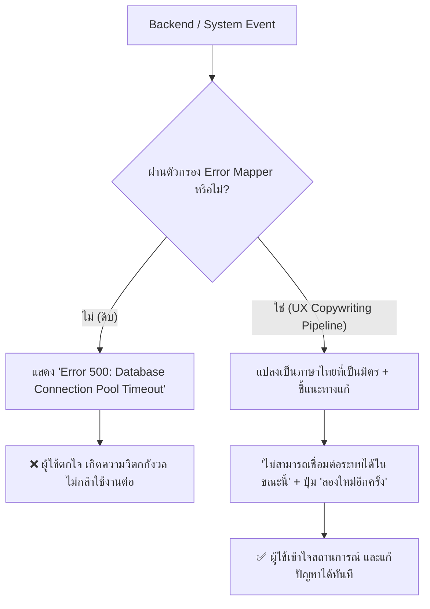

## 1. แนวคิด (Concept)

Toast Notification เป็นหนึ่งในองค์ประกอบ UI ที่มี **เวลาในการแสดงผลสั้นที่สุด (Transient UI - เฉลี่ย 3 ถึง 5 วินาที)** แต่กลับส่งผลต่อความรู้สึกมั่นใจของผู้ใช้งานมากที่สุด (Perceived Reliability)

บ่อยครั้งที่นักพัฒนาทุ่มเทเวลาไปกับการทำแอนิเมชันที่สวยงาม แต่ตกม้าตายเรื่อง **UX Copywriting** เช่น การปล่อยให้ข้อความ Error จากฐานข้อมูลหลุดไปยังหน้าจอ (`PrismaClientKnownRequestError: P2002 Unique constraint failed`) หรือใช้คำกำกวมที่ผู้ใช้ไม่รู้ว่าต้องทำอะไรต่อ

การเขียนข้อความแจ้งเตือนภาษาไทยระดับมืออาชีพ ยึดหลักการสำคัญ 4 ประการ (**4 Pillars of Toast Copywriting**):
1. **สั้นกระชับ (Concise)**: มนุษย์อ่านภาษาไทยบนหน้าจอด้วยความเร็วเฉลี่ย 180–220 คำต่อนาที ข้อความ Toast ควรจบภายใน 1–2 บรรทัด (ไม่เกิน 15 คำ)
2. **ชัดเจน ไม่คลุมเครือ (Clear)**: ระบุเป้าหมายอย่างตรงไปตรงมาว่า "เกิดอะไรขึ้น" หรือ "ทำอะไรเสร็จแล้ว"
3. **บอกทางแก้ที่ทำได้ทันที (Actionable)**: เมื่อเกิดปัญหา ต้องบอกผู้ใช้เสมอว่าต้องทำอย่างไรต่อไป เช่น "ลองใหม่อีกครั้ง" หรือ "ติดต่อเจ้าหน้าที่"
4. **มนุษย์เข้าใจได้ (Human & Empathetic)**: ใช้น้ำเสียงที่สุภาพ เป็นมิตร ไม่โทษผู้ใช้ และปราศจากศัพท์เทคนิคเชิงคอมพิวเตอร์ (No Technical Jargon)



---

## 2. หลักการเบื้องหลัง (Under the Hood)

### 2.1 ภาระทางปัญญา (Cognitive Load) และสรีรวิทยาการอ่านภาษาไทย
ภาษาไทยเป็นภาษาที่เขียนติดกันโดยไม่มีการเว้นวรรคระหว่างคำ (Scriptio Continua) ทำให้สมองของผู้ใช้ต้องใช้เวลา "ตัดคำ (Word Segmentation)" มากกว่าภาษาอังกฤษที่มีการเว้นวรรคชัดเจน:
* หากเราใส่ข้อความยาวเป็นพารากราฟลงใน Toast ผู้ใช้จะอ่านไม่ทันก่อนที่ Toast จะสลายไป (Auto-dismiss) ก่อให้เกิดความหงุดหงิด (Frustration)
* **กฎ 2 บรรทัด**: บรรทัดแรกคือ **หัวข้อสรุปสั้น (Title)** ความยาว 2–4 คำ และบรรทัดที่สองคือ **คำอธิบายเสริม (Description)** ความยาวไม่เกิน 1 ประโยค

### 2.2 คลังคำศัพท์มาตรฐานระบบ (Standard Thai Lexicon & Tone of Voice)
เพื่อความเป็นมืออาชีพ ทั้งองค์กรควรใช้ชุดคำศัพท์ที่สอดคล้องกัน (Consistency):
* **กริยานำหน้า**: นิยมใช้คำกริยาเป็นคำเปิด เช่น "บันทึก...", "ส่ง...", "ลบ...", "อัปเดต..."
* **การเลือกใช้คำ**:
  - ใช้ **"เรียบร้อยแล้ว"** หรือ **"สำเร็จ"** (เลือกคำใดคำหนึ่งให้เหมือนกันทั้งระบบ อย่าสลับไปสลับมา)
  - แยกความต่างระหว่าง **"ลบ (Delete)"** (ข้อมูลหายไปถาวร) กับ **"ยกเลิก (Cancel)"** (หยุดการกระทำ)
  - แยกความต่างระหว่าง **"ออกจากระบบ (Sign Out)"** กับ **"เซสชันหมดอายุ (Session Expired)"**

---

## 3. ตัวอย่างโค้ด (TypeScript / TSX)

### ตัวอย่างที่ 1: Safe Thai Error Parser & Translation Mapper

ระบบแปลงข้อความ Error จาก Technical Stack (Prisma, Axios, Network, Zod) ให้กลายเป็นข้อความภาษาไทยที่สุภาพ ปลอดภัย และมีปุ่ม Action ที่เหมาะสม

```tsx filename="src/lib/thai-error-mapper.ts"
export interface FormattedNotification {
  title: string;
  description: string;
  actionLabel?: string;
}

/**
 * แปลง Raw Technical Error ให้เป็นข้อความ UX ภาษาไทยที่ปลอดภัย
 */
export function mapErrorToThaiNotification(error: unknown): FormattedNotification {
  if (!error) {
    return {
      title: 'เกิดข้อผิดพลาดที่ไม่ทราบสาเหตุ',
      description: 'กรุณาลองใหม่อีกครั้ง หรือติดต่อฝ่ายสนับสนุน',
      actionLabel: 'ลองอีกครั้ง',
    };
  }

  const errString = String(error);
  const errObject = typeof error === 'object' && error !== null ? (error as Record<string, unknown>) : {};

  // 1. ดักจับปัญหา Network / Offline
  if (
    errString.includes('NetworkError') ||
    errString.includes('Failed to fetch') ||
    errString.includes('ECONNREFUSED')
  ) {
    return {
      title: 'ขาดการเชื่อมต่ออินเทอร์เน็ต',
      description: 'กรุณาตรวจสอบสัญญาณเน็ตและลองใหม่อีกครั้ง',
      actionLabel: 'ลองเชื่อมต่อใหม่',
    };
  }

  // 2. ดักจับปัญหา Prisma Unique Constraint (P2002)
  if (errString.includes('P2002') || errString.includes('Unique constraint')) {
    return {
      title: 'ข้อมูลนี้มีอยู่ในระบบแล้ว',
      description: 'กรุณาตรวจสอบอีเมลหรือรหัสอ้างอิงที่ไม่ซ้ำกับผู้อื่น',
    };
  }

  // 3. ดักจับปัญหา HTTP Status Codes
  const status = Number(errObject.status ?? errObject.statusCode);

  switch (status) {
    case 400:
      return {
        title: 'ข้อมูลไม่ถูกต้อง',
        description: 'กรุณาตรวจสอบความถูกต้องของข้อมูลในแบบฟอร์ม',
      };
    case 401:
      return {
        title: 'เซสชันการใช้งานหมดอายุ',
        description: 'กรุณาเข้าสู่ระบบใหม่อีกครั้งเพื่อความปลอดภัย',
        actionLabel: 'เข้าสู่ระบบ',
      };
    case 403:
      return {
        title: 'ไม่มีสิทธิ์เข้าถึงข้อมูล',
        description: 'บัญชีของคุณไม่ได้รับอนุญาตให้ดำเนินการในส่วนนี้',
      };
    case 404:
      return {
        title: 'ไม่พบข้อมูลที่ต้องการ',
        description: 'รายการนี้อาจถูกลบไปแล้วหรือไม่มีอยู่ในระบบ',
      };
    case 429:
      return {
        title: 'ทำรายการบ่อยเกินไป',
        description: 'ระบบตรวจพบคำขอจำนวนมาก กรุณารอ 1 นาทีแล้วลองใหม่',
      };
    case 500:
    case 502:
    case 503:
      return {
        title: 'เซิร์ฟเวอร์ขัดข้องชั่วคราว',
        description: 'ทีมงานกำลังเร่งแก้ไข กรุณาลองใหม่อีกครั้งในภายหลัง',
        actionLabel: 'ลองอีกครั้ง',
      };
    default:
      return {
        title: 'ดำเนินการไม่สำเร็จ',
        description: 'ระบบไม่สามารถประมวลผลคำขอได้ กรุณาลองใหม่อีกครั้ง',
        actionLabel: 'ลองอีกครั้ง',
      };
  }
}
```

---

### ตัวอย่างที่ 2: ระบบ Toast มาตรฐานองค์กรด้วยคลังคำศัพท์ไทยสม่ำเสมอ

ตัวอย่างนี้รวบรวมฟังก์ชันสำหรับเรียก Toast ที่มีการบังคับใช้ Tone of Voice และโครงสร้างภาษาไทยที่ได้มาตรฐานทั้งระบบ

```tsx filename="src/lib/notify-thai.ts"
'use client';

import { toast } from 'sonner';
import { mapErrorToThaiNotification } from './thai-error-mapper';

export const notify = {
  /**
   * แจ้งผลบันทึกข้อมูลสำเร็จ
   */
  saved: (resourceName = 'ข้อมูล', onUndo?: () => void) => {
    toast.success(`บันทึก${resourceName}สำเร็จ`, {
      description: `ระบบได้ทำการจัดเก็บ${resourceName}ล่าสุดเรียบร้อยแล้ว`,
      action: onUndo
        ? {
            label: 'เลิกทำ (Undo)',
            onClick: onUndo,
          }
        : undefined,
    });
  },

  /**
   * แจ้งผลลบรายการ พร้อมโอกาสกู้คืน
   */
  deleted: (resourceName = 'รายการ', onRestore?: () => void) => {
    toast.success(`ลบ${resourceName}เรียบร้อยแล้ว`, {
      description: onRestore ? 'คุณสามารถกู้คืนรายการนี้ได้ภายใน 10 วินาที' : undefined,
      duration: onRestore ? 8000 : 4000,
      action: onRestore
        ? {
            label: 'กู้คืน',
            onClick: onRestore,
          }
        : undefined,
    });
  },

  /**
   * แจ้งผลคัดลอกข้อความ
   */
  copied: (label = 'ข้อความ') => {
    toast.success(`คัดลอก${label}แล้ว`, {
      description: 'พร้อมสำหรับการนำไปวางใช้งาน',
      duration: 2500,
    });
  },

  /**
   * แจ้งข้อผิดพลาดที่ผ่านการแปลงเป็นภาษาไทยที่สุภาพแล้ว
   */
  error: (rawError: unknown, onRetry?: () => void) => {
    const parsed = mapErrorToThaiNotification(rawError);

    toast.error(parsed.title, {
      description: parsed.description,
      action:
        onRetry && parsed.actionLabel
          ? {
              label: parsed.actionLabel,
              onClick: onRetry,
            }
          : undefined,
    });
  },
};
```

---

## 4. ตารางเปรียบเทียบข้อความภาษาไทย: "แย่ vs ดีเยี่ยม"

| สถานการณ์ | ❌ ตัวอย่างข้อความที่แย่ (Bad Copywriting) | ✅ ตัวอย่างข้อความที่ยอดเยี่ยม (Professional Copywriting) | บทวิเคราะห์ความต่าง |
| :--- | :--- | :--- | :--- |
| **การลบสินค้าออกจากตะกร้า** | "ลบสินค้าสำเร็จแล้ว (Product ID #9812 has been purged from cart table)" | **Title**: ลบสินค้าออกจากตะกร้าแล้ว<br/>**Action**: [กู้คืน] | สั้น กระชับ มีปุ่มกู้คืน (Undo) ไม่แสดง ID ของตารางในฐานข้อมูล |
| **การชำระเงินล้มเหลว** | "Error: Stripe charge declined with code card_declined_insufficient_funds" | **Title**: ชำระเงินไม่สำเร็จ<br/>**Description**: ยอดเงินในบัตรไม่เพียงพอ กรุณาเปลี่ยนบัตรหรือลองใหม่ | แปลงรหัส Error เป็นภาษาไทย และบอกทางแก้ทันทีว่าต้องเปลี่ยนบัตร |
| **การเชื่อมต่อเครือข่ายหลุด** | "WebSocket connection to wss://api.app/live failed: Connection timeout" | **Title**: ขาดการเชื่อมต่ออินเทอร์เน็ต<br/>**Description**: กำลังพยายามเชื่อมต่อระบบใหม่อัตโนมัติ... | ไม่โชว์ URL ของเซิร์ฟเวอร์ และสร้างความมั่นใจว่าระบบกำลังกู้คืนตัวเอง |
| **การบันทึกร่างบทความ** | "Success! Your draft was saved at 2026-10-17T04:00:00Z by User Admin" | **Title**: บันทึกฉบับร่างแล้ว<br/>**Description**: อัปเดตล่าสุดเมื่อสักครู่ | ใช้คำไทยธรรมชาติ ไม่ใช้รูปแบบวันที่ ISO ดิบจากเซิร์ฟเวอร์ |
| **การกรอกข้อมูลฟอร์มผิด** | "Invalid Form: validation failed at field 'nationalId'" | **Inline Error ใต้ช่อง**: เลขบัตรประชาชนต้องเป็นตัวเลข 13 หลัก<br/>*(ไม่ต้องยิง Toast)* | ปัญหาเฉพาะช่องควรอยู่ที่ช่องกรอก ไม่ควรยิง Toast รบกวนหน้าจอ |

---

## 5. ผิด vs ถูก (Anti-patterns vs Best Practices)

### 1) การโยน Raw Error Object ขึ้นไปบน Toast
* ❌ **ผิด**: `toast.error(JSON.stringify(error))` หรือแสดงรหัสข้อผิดพลาดของฐานข้อมูล ทำให้ผู้ใช้หวาดระแวงเรื่องความปลอดภัย และเปิดเผยช่องโหว่ระบบ
* ✅ **ถูก**: ครอบด้วย Error Mapper เสมอ และบันทึก Raw Error ลงเครื่องมือ Monitoring หลังบ้าน (เช่น Sentry, Datadog) แทน

### 2) การใช้คำกำกวมที่ไร้ทิศทาง
* ❌ **ผิด**: แสดงข้อความว่า *"เกิดข้อผิดพลาด"* หรือ *"มีบางอย่างผิดปกติ"* โดยไม่มีคำอธิบายเพิ่มเติม
* ✅ **ถูก**: ระบุสาเหตุที่ผู้ใช้แก้ได้ เช่น *"ไม่สามารถเชื่อมต่อเซิร์ฟเวอร์ได้ กรุณาลองใหม่อีกครั้งในอีกสักครู่"* พร้อมปุ่ม Retry

### 3) การใช้สรรพนามหรือคำสั่งที่แข็งกระด้าง
* ❌ **ผิด**: *"คุณกรอกข้อมูลผิดพลาด ไปแก้มาใหม่เดี๋ยวนี้"* (กล่าวโทษผู้ใช้)
* ✅ **ถูก**: *"กรุณาตรวจสอบความถูกต้องของข้อมูลอีกครั้ง"* (สุภาพและมุ่งเน้นการแก้ปัญหา)

---

## 6. ควรใช้เมื่อไหร่ / ไม่ควรใช้เมื่อไหร่

### ควรใช้ (When to use):
* การยืนยันผลลัพธ์ของคำสั่งที่เสร็จสมบูรณ์ในพริบตา (บันทึก, คัดลอก, ย้ายโฟลเดอร์)
* แจ้งเตือนข้อผิดพลาดระดับภาพรวมพร้อมปุ่ม Action เพื่อลองใหม่
* แจ้งเตือนกระบวนการเบื้องหลังที่เสร็จสิ้นโดยไม่ต้องรอคอย

### ไม่ควรใช้ (When NOT to use):
* แสดงข้อความที่มีศัพท์เทคนิคเฉพาะทางที่ผู้ใช้ทั่วไปไม่เข้าใจ
* ข้อความเตือนความปลอดภัยขั้นวิกฤต เช่น การระงับบัญชี (ควรใช้ Modal หรือ Banner ถาวร)
* ข้อความที่มีรายละเอียดมากกว่า 2 ประโยค (ผู้ใช้จะอ่านไม่ทันก่อน Toast หายไป)

---

## 7. คำถามสัมภาษณ์งาน (Senior Interview Questions & Answers)

### Q1: ในฐานะ Senior Frontend Engineer คุณจะวางมาตรฐานให้ทีมพัฒนากว่า 10 คน ไม่เผลอแสดง Technical Error ข้อความดิบจากเซิร์ฟเวอร์บนหน้าจอของผู้ใช้ได้อย่างไร?
**แนวทางตอบแบบ Senior Developer**:
1. **Abstraction Layer ผ่าน Custom Notification Service**: เราต้องไม่อนุญาตให้นักพัฒนาเรียกไลบรารี `toast()` โดยตรงตามอำเภอใจ แต่ต้องผ่าน `notify` wrapper กลางขององค์กร ซึ่งภายในจะบังคับให้ส่ง Error ผ่านฟังก์ชัน `mapErrorToThaiNotification()` เสมอ
2. **TypeScript Strict Typing**: กำหนดให้ฟังก์ชันรับ Parameter เป็นชนิดที่ปลอดภัย หากเป็น Raw Error จะถูกแปลงอัตโนมัติ และไม่อนุญาตให้ส่ง `any` ข้อความดิบ
3. **Automated Error Logging (Observability)**: ในตัวแปลงข้อความ หากตรวจพบ Error ที่ไม่ตรงกับ Dictionary มาตรฐาน ให้แปลงเป็นข้อความกลางที่สุภาพ และยิง Log รายละเอียดทางเทคนิคฉบับเต็มส่งต่อไปยัง Sentry พร้อม Stack Trace ทันที
4. **Linting Rules (ESLint)**: สร้าง Custom ESLint Rule ห้ามการ `import { toast } from 'sonner'` โดยตรงในโฟลเดอร์ฟีเจอร์ ให้ import จาก `@/lib/notify` เท่านั้น

### Q2: ภาษาไทยมีความเร็วในการกวาดสายตา (Scanning Speed) แตกต่างจากภาษาอังกฤษอย่างไร และสิ่งนี้ส่งผลต่อการตั้งค่า Duration ของ Toast อย่างไรในทางสถิติ?
**แนวทางตอบแบบ Senior Developer**:
- ตัวอักษรภาษาไทยมีวรรณยุกต์และสระทั้งบนและล่าง (Vertical Complexity) และไม่มีการเว้นวรรคระหว่างคำ ทำให้การอ่านคำไทยต้องใช้การโฟกัสทางสายตามากกว่าภาษาอังกฤษประมาณ 15–20%
- ในการตั้งค่า `duration` สำหรับข้อความสั้นภาษาไทย (ไม่เกิน 6 คำ) ค่ามาตรฐานอยู่ที่ **3,500 – 4,000 มิลลิวินาที** (3.5–4 วินาที)
- หากมีคำอธิบายเพิ่มเติม 1 บรรทัดหรือมีปุ่ม Action (เช่น ปุ่ม "เลิกทำ") ต้องเพิ่มเวลาเป็นอย่างน้อย **6,000 – 8,000 มิลลิวินาที** พร้อมทั้งเปิดฟีเจอร์ `pauseOnHover` และ `pauseOnFocus` เสมอ เพื่อให้สอดคล้องกับมาตรฐาน WCAG 2.2.1
