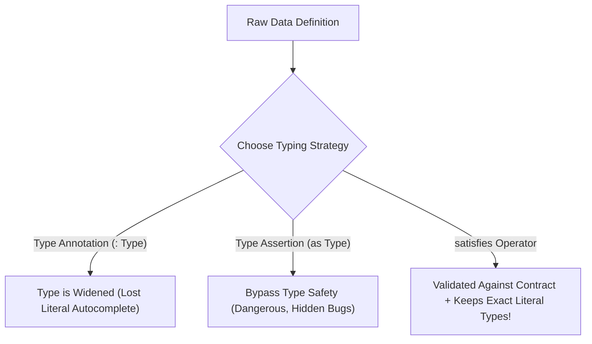

## 1. แนวคิด (Concept)

เมื่อระบบขยายขนาดขึ้นจนมี Business Logic ที่ซับซ้อน Type System พื้นฐานอย่าง `string`, `number` หรือ `interface` แบบแบนราบจะไม่เพียงพออีกต่อไป ปัญหาคลาสสิกที่พบในระบบขนาดใหญ่คือ **"Primitive Obsession"** เช่น การส่งค่าตัวแปร `orderId` สลับกับ `userId` เนื่องจากทั้งคู่เป็นชนิดข้อมูล `string` เหมือนกัน หรือการที่ฟังก์ชันคำนวณราคาเนื้อวากิวไม่สามารถจับคู่เงื่อนไขของเกรดเนื้อที่เปลี่ยนแปลงได้อย่างรัดกุม

**TypeScript 5.x** ได้ยกระดับการเขียน Type สู่ระดับ **Metaprogramming (Type-level Programming)** ซึ่งช่วยให้โปรแกรมเมอร์สามารถเขียนฟังก์ชันคำนวณ Type ได้ราวกับเขียนอัลกอริทึม โดยมีเครื่องมือหัวหอกสำคัญได้แก่:

1. **`satisfies` Operator (TS 4.9+)**: ตรวจสอบว่าข้อมูลตรงตามสัญญาของ Type หรือไม่ โดย **ไม่สูญเสียความแม่นยำดั้งเดิมของ Literal Type (Preserve Exact Inferred Types)** ขจัดจุดอ่อนของทั้ง Type Annotation (`:`) และ Type Assertion (`as`)
2. **`keyof` & `typeof`**: การสกัดโครงสร้างและชื่อ Property ออกมาจากรันไทม์อ็อบเจกต์จริง
3. **Mapped Types & Key Remapping**: การวนลูปแปลง Type เก่าเป็น Type ใหม่ พร้อมความสามารถในการกรองหรือเปลี่ยนชื่อคีย์
4. **Conditional Types & `infer`**: การเขียนตรรกะแบบ `if-else` ในระดับ Type และการแกะชำแหละชนิดข้อมูลภายใน
5. **Template Literal Types**: การประกอบสตริงในระดับ Type เช่น `order:created` หรือ `payment:refunded`
6. **Branded Types (Nominal Typing Simulation)**: การสร้าง "แสตมป์ประทับตรา" ป้องกันไม่ให้ Primitive Types ที่มีหน้าตาเหมือนกันถูกส่งสลับกันโดยไม่ตั้งใจ

<Callout type="tip" title="การปฏิวัติของ satisfies ใน TypeScript ยุคใหม่">
ลืม `as Type` ที่อันตรายและลืม `: Type` ที่ทำให้ Type กลายเป็นมิติแบนราบไปได้เลย การใช้ `satisfies` ช่วยให้คุณมั่นใจได้ว่าข้อมูลถูกต้องตามสัญญา 100% ในขณะที่ IDE ยังคง Autocomplete ชื่อคีย์และชนิดตัวแปรเฉพาะตัวได้อย่างคมกริบ
</Callout>

---

## 2. หลักการเบื้องหลัง (Under the Hood)

เพื่อก้าวขึ้นสู่ระดับ Senior TypeScript Architect จำเป็นต้องเข้าใจกลไกการคำนวณของ Type Checker Engine:

### 2.1 ทำไม TypeScript ถึงเป็น Structural Type System และ Branded Types ทำงานอย่างไร?
TypeScript ยึดหลัก **Duck Typing (Structural Subtyping)**:
- หากอ็อบเจกต์ A มีรูปร่าง (Shape) เหมือนอ็อบเจกต์ B ตัว TypeScript จะถือว่าทั้งสองเป็น Type เดียวกันเสมอ
- ปัญหานี้ทำให้ `type OrderId = string` และ `type UserId = string` สามารถกำหนดค่าแทนกันได้โดยไม่มี Error
- **กลไก Branded Types**: เราจำลอง **Nominal Typing** โดยการแนบ Phantom Property ที่ไม่มีตัวตนอยู่จริงตอนรันไทม์ เช่น `& { readonly __brand: unique symbol }` ทำให้ Type Checker ปฏิเสธการสลับข้อมูล แม้ว่าตอนรันไทม์ทั้งคู่จะเป็นสตริงธรรมดาก็ตาม (Zero Runtime Overhead)

### 2.2 การเปรียบเทียบ `:` vs `as` vs `satisfies`
- **Type Annotation (`const x: Type = ...`)**: บังคับให้ตัวแปร `x` เป็น `Type` ส่งผลให้ **Type ถูก Widening** เช่น จาก `'A5'` กลายเป็น `string` และสูญเสีย Autocomplete รายชื่อฟิลด์เฉพาะ
- **Type Assertion (`const x = ... as Type`)**: เป็นการ "ปิดปากคอมไพเลอร์" (Unsafe) หากเราใส่ข้อมูลตกหล่นหรือพิมพ์ฟิลด์ผิด TypeScript จะไม่เตือน นำไปสู่ Runtime Error
- **`satisfies` (`const x = ... satisfies Type`)**: คอมไพเลอร์จะตรวจสอบว่า `x` สอดคล้องกับ `Type` ทุกประการ แต่ Type ของ `x` จะยังคง **Inferred Type ที่แคบที่สุด (Most Specific Literal Type)** ไว้อย่างสมบูรณ์แบบ

### 2.3 กลไก Distributive Conditional Types
เมื่อเราเขียน `type ToArray<T> = T extends any ? T[] : never;`
- หากเราส่ง Naked Type Parameter ที่เป็น Union เช่น `ToArray<string | number>`
- TypeScript จะกระจาย (Distribute) การประเมินผลออกเป็น `ToArray<string> | ToArray<number>` ได้ผลลัพธ์เป็น `string[] | number[]` แทนที่จะเป็น `(string | number)[]`



---

## 3. ตัวอย่างโค้ด (Smart Butcher Marketplace)

### ตัวอย่างที่ 1: Nominal Branded Types System กำจัดปัญหา Primitive Obsession

ในระบบร้านค้าเนื้อวากิวพรีเมียม เรามี ID และตัวเลขหลายชนิด: รหัสลูกค้า (`UserId`), รหัสสินค้าเนื้อ (`ProductId`), รหัสคำสั่งตัด (`OrderId`), และจำนวนเงิน (`Money`) การส่งสลับกันจะทำให้เกิดข้อผิดพลาดทางการเงินทันที เราจึงสร้าง Branded Types ป้องกันความผิดพลาด

```typescript filename="src/shared/types/branded-types.ts"
// -------------------------------------------------------------------------
// 1. สัญลักษณ์พิเศษสำหรับการสร้าง Brand (Zero Runtime Cost)
// -------------------------------------------------------------------------
declare const BrandSymbol: unique symbol;

export type Brand<T, TBrand extends string> = T & {
  readonly [BrandSymbol]: TBrand;
};

// 2. กำหนด Branded Types เฉพาะทางสำหรับ Smart Butcher Marketplace
export type UserId = Brand<string, 'UserId'>;
export type ProductId = Brand<string, 'ProductId'>;
export type OrderId = Brand<string, 'OrderId'>;
export type Money = Brand<number, 'Money'>;
export type GramWeight = Brand<number, 'GramWeight'>;

// -------------------------------------------------------------------------
// 3. Constructor Helpers / Type Assertion Guards ที่ปลอดภัย
// -------------------------------------------------------------------------
export function makeUserId(rawId: string): UserId {
  if (!rawId.startsWith('usr_')) {
    throw new Error(`รูปแบบ UserId ไม่ถูกต้อง: ${rawId} (ต้องขึ้นต้นด้วย usr_)`);
  }
  return rawId as UserId;
}

export function makeProductId(rawId: string): ProductId {
  if (!rawId.startsWith('prd_')) {
    throw new Error(`รูปแบบ ProductId ไม่ถูกต้อง: ${rawId} (ต้องขึ้นต้นด้วย prd_)`);
  }
  return rawId as ProductId;
}

export function makeOrderId(rawId: string): OrderId {
  if (!rawId.startsWith('ord_')) {
    throw new Error(`รูปแบบ OrderId ไม่ถูกต้อง: ${rawId} (ต้องขึ้นต้นด้วย ord_)`);
  }
  return rawId as OrderId;
}

export function makeMoney(amount: number): Money {
  if (amount < 0 || !Number.isFinite(amount)) {
    throw new Error(`จำนวนเงินไม่ถูกต้อง: ${amount}`);
  }
  return amount as Money;
}

// -------------------------------------------------------------------------
// 4. การทดสอบการใช้งานเพื่อยืนยัน Type Safety
// -------------------------------------------------------------------------
export interface ButcherOrderSummary {
  orderId: OrderId;
  customerId: UserId;
  meatProductId: ProductId;
  totalCost: Money;
}

export function dispatchOrderToButcher(order: ButcherOrderSummary): void {
  console.log(`ส่งคำสั่งตัดเนื้อ ${order.orderId} ของลูกค้า ${order.customerId}`);
}

// โค้ดทดสอบ:
const validUser = makeUserId('usr_chef_ton');
const validProduct = makeProductId('prd_wagyu_a5');
const validOrder = makeOrderId('ord_2026_001');
const price = makeMoney(4500);

// ✅ ถูกต้อง: ประเภทข้อมูลตรงทุกประการ
dispatchOrderToButcher({
  orderId: validOrder,
  customerId: validUser,
  meatProductId: validProduct,
  totalCost: price,
});

// ❌ ตัวอย่างที่จะคอมไพล์ไม่ผ่าน (Compile Error):
// dispatchOrderToButcher({
//   orderId: validUser,    // Type 'UserId' is not assignable to type 'OrderId'
//   customerId: validOrder, // Type 'OrderId' is not assignable to type 'UserId'
//   meatProductId: validProduct,
//   totalCost: price,
// });
```

---

### ตัวอย่างที่ 2: Advanced Type-Safe Event Bus & Pricing Rules ด้วย Mapped Types, Template Literals และ `satisfies`

ตัวอย่างนี้แสดงการสร้างระบบ Event Driven สำหรับห้องตัดแต่งเนื้อและระบบคำนวณส่วนลดตามเกรดเนื้อวากิว โดยใช้ **Template Literal Types** กำหนดชื่ออีเวนต์ และใช้ **`satisfies`** ในการรักษา Type ให้ละเอียดที่สุด

```typescript filename="src/core/events/butcher-event-bus.ts"
// -------------------------------------------------------------------------
// 1. Template Literal Types: สร้างชื่ออีเวนต์ตามหมวดหมู่
// -------------------------------------------------------------------------
export type DomainResource = 'order' | 'inventory' | 'payment';
export type DomainAction = 'created' | 'updated' | 'cancelled' | 'dispatched';

// สร้าง Union Type: 'order:created' | 'order:updated' | ...
export type ButcherEventType = `${DomainResource}:${DomainAction}`;

// แมปชนิดข้อมูล Payload ของแต่ละอีเวนต์
export interface EventPayloadMap {
  'order:created': { orderId: string; totalGrams: number; chefNotes?: string };
  'order:dispatched': { orderId: string; courierName: string; temperatureCelsius: number };
  'inventory:updated': { sku: string; remainingKg: number };
  'inventory:cancelled': { sku: string; reason: string };
  'payment:created': { paymentId: string; amount: number; method: 'PROMPTPAY' | 'CREDIT' };
  'payment:dispatched': never; // การกระทำที่เป็นไปไม่ได้
}

// -------------------------------------------------------------------------
// 2. Mapped Types พร้อม Conditional Types สำหรับ Event Handler
// -------------------------------------------------------------------------
export type EventHandler<E extends ButcherEventType> = (
  payload: EventPayloadMap[E]
) => Promise<void> | void;

export class ButcherEventBus {
  private handlers = new Map<string, Function[]>();

  // Type-Safe Subscribe: บังคับให้ Payload ตรงกับชื่ออีเวนต์เสมอ
  on<E extends keyof EventPayloadMap>(event: E, handler: EventHandler<E>): void {
    const list = this.handlers.get(event) || [];
    list.push(handler);
    this.handlers.set(event, list);
  }

  // Type-Safe Emit: ไม่สามารถส่ง Payload มั่วซั่วได้
  async emit<E extends keyof EventPayloadMap>(
    event: E,
    payload: EventPayloadMap[E]
  ): Promise<void> {
    const list = this.handlers.get(event) || [];
    for (const fn of list) {
      await fn(payload);
    }
  }
}

// -------------------------------------------------------------------------
// 3. การประยุกต์ใช้ satisfies กับตารางโปรโมชันเนื้อวากิว
// -------------------------------------------------------------------------
export type WagyuTier = 'A5_CHAMPION' | 'A4_PREMIUM' | 'F1_SELECT';

export interface PromotionRule {
  discountPercent: number;
  freeDryAgingDays?: number;
  giftItem?: string;
}

// ใช้ satisfies เพื่อบังคับว่าต้องใส่ครบทุก Tier แต่ยังคงรู้ว่าแต่ละ Tier มีฟิลด์อะไรเจาะจง
export const WAGYU_PROMO_CONFIG = {
  A5_CHAMPION: {
    discountPercent: 15,
    freeDryAgingDays: 45,
    giftItem: 'เกลือเห็ดทรัฟเฟิลดำ',
  },
  A4_PREMIUM: {
    discountPercent: 10,
    freeDryAgingDays: 30,
  },
  F1_SELECT: {
    discountPercent: 5,
  },
} satisfies Record<WagyuTier, PromotionRule>;

// สังเกตว่า TypeScript รู้ทันทีว่า A5_CHAMPION มีฟิลด์ giftItem!
// (หากใช้ Type Annotation `: Record<WagyuTier, PromotionRule>` giftItem จะกลายเป็น optional string)
const gift = WAGYU_PROMO_CONFIG.A5_CHAMPION.giftItem.toUpperCase();
console.log('ของแถมสำหรับเนื้อเกรดสูงสุด:', gift);
```

---

## 4. ข้อผิดพลาดที่พบบ่อย (Anti-pattern vs Best Practice)

### 4.1 การใช้ Type Assertion `as` พร่ำเพรื่อเพื่อปิดข้อความเตือน
- **Anti-pattern**: เมื่อ TypeScript ฟ้องว่า Type ไม่ตรงกัน นักพัฒนาใช้วิธีลัดใส่ `as any` หรือ `as ExpectedType` ส่งผลให้ระบบ Type ทั้งหมดพังทลาย และบั๊กจะไปโผล่ตอน Production แทน
- **Best Practice**: แก้ไขปัญหาที่ต้นตอ หรือหากต้องการยืนยันความถูกต้องของ Object ให้ใช้ `satisfies` แทน เพื่อให้ TypeScript ตรวจสอบจริงโดยไม่ฝืนครอบ Type

### 4.2 การลืม Modifier ใน Mapped Types
- **Anti-pattern**: สร้าง Mapped Type โดยไม่ระบุเครื่องหมายลบ (`-readonly`, `-?`) เมื่อต้องการสร้าง Type สำหรับ Mutation ส่งผลให้ฟิลด์ยังคงติดสถานะ `readonly` จาก Type ต้นทาง
- **Best Practice**: ใช้ Utility Modifiers อย่างเหมาะสม เช่น `type Mutable<T> = { -readonly [K in keyof T]: T[K] }` หรือ `type Concrete<T> = { [K in keyof T]-?: T[K] }`

### 4.3 การใช้ String ธรรมดาแทน Template Literal Types สำหรับ Routing และ Event Names
- **Anti-pattern**: กำหนดชื่อ Event เป็น `string` ธรรมดา ทำให้เมื่อพิมพ์ตกหล่น เช่น `'order:creatd'` แทนที่จะเป็น `'order:created'` คอมไพเลอร์จะไม่แจ้งเตือนใดๆ
- **Best Practice**: ประกอบชื่อ Event ผ่าน Template Literal Types เพื่อให้ได้ Union ที่พิมพ์ซ้ำได้และมี Autocomplete ครบถ้วน

```typescript filename="src/types/type-system-comparison.ts"
// ตารางวิเคราะห์เปรียบเทียบเครื่องมือ Type System
export interface TypingTechnique {
  tool: 'as' | ':' | 'satisfies' | 'Branded Type';
  safetyLevel: 'High' | 'Medium' | 'Zero' | 'Maximum';
  preservesLiteral: boolean;
  idealUse: string;
}

export const TYPING_TECHNIQUES: TypingTechnique[] = [
  {
    tool: 'as',
    safetyLevel: 'Zero',
    preservesLiteral: false,
    idealUse: 'การแปลง DOM Elements หรือ Legacy Third-party Types ที่ไม่มี Definition',
  },
  {
    tool: ':',
    safetyLevel: 'High',
    preservesLiteral: false,
    idealUse: 'การระบุ Type ของตัวแปรเดี่ยว หรือ Return Type ของฟังก์ชันสาธารณะ',
  },
  {
    tool: 'satisfies',
    safetyLevel: 'Maximum',
    preservesLiteral: true,
    idealUse: 'การสร้าง Configuration Dictionaries, Theme Objects และ Route Tables',
  },
  {
    tool: 'Branded Type',
    safetyLevel: 'Maximum',
    preservesLiteral: true,
    idealUse: 'การจำแนก Entity IDs (UserId vs OrderId) และหน่วยวัดทางคณิตศาสตร์',
  },
];
```

---

## 5. ควรใช้เมื่อไหร่ และ ไม่ควรใช้เมื่อไหร่

### ควรใช้ (Recommended Use Cases)
- **`satisfies`**: ใช้กับ Configuration Objects, Table Schemas, Route Mappings, และ Theme Definitions ที่ต้องการตรวจสัญญาแต่ต้องการ Autocomplete ละเอียด
- **Branded Types**: ใช้กับรหัสประจำตัวของโดเมนหลัก (User, Order, Payment, Product) และค่าทางการเงิน (Currency, Gram, Percentage) เพื่อป้องกันการคำนวณสลับหน่วย
- **Template Literal Types**: ใช้กำหนด API Routes, Event Bus Topics, และ Action Types ใน Redux/Zustand

### ไม่ควรใช้ (When NOT to Use)
- **ไม่ควรเขียน Recursive Conditional Types ที่ลึกเกินไป**: การเขียน Type ซ้อนกันเกิน 5-10 ชั้นอาจทำให้ `tsc` คอมไพล์ช้าลงอย่างเห็นได้ชัด หรือเกิดข้อผิดพลาด `Type instantiation is excessively deep and possibly infinite`
- **ไม่ควรใช้ Branded Types กับตัวแปรชั่วคราวภายในฟังก์ชัน**: หากตัวแปรนั้นใช้แค่ลูปเดียวจบ การสร้าง Brand จะเป็นการเพิ่มภาระทางโค้ดโดยไม่คุ้มค่า

---

## 6. คำถามสัมภาษณ์งาน (Interview Q&A)

### Q1: Operator `satisfies` ใน TypeScript 4.9+ เข้ามาแก้ปัญหาข้อจำกัดใดของ Type Annotation (`:`) และ Type Assertion (`as`)?
**แนวคำตอบระดับ Senior**:
ก่อนหน้า TypeScript 4.9 นักพัฒนามีเพียง 2 ทางเลือกในการจัดการ Configuration Object:
1. **ทางเลือกที่ 1: Type Annotation (`const config: Config = { ... }`)**: ข้อดีคือมีความปลอดภัยในการตรวจสัญญา แต่ข้อเสียร้ายแรงคือ **Type Widening** เช่น หากฟิลด์หนึ่งสามารถเป็น `string | number` การใช้ `:` จะทำให้ฟิลด์นั้นถูกเหมารวมเป็นประเภทกว้าง ส่งผลให้เราไม่สามารถเรียกใช้ Method เฉพาะของสตริง (เช่น `.toUpperCase()`) ได้โดยไม่ต้องทำ Narrowing ซ้ำ
2. **ทางเลือกที่ 2: Type Assertion (`const config = { ... } as Config`)**: ข้อดีคือรักษา Type เฉพาะตัวไว้ได้ แต่ข้อเสียร้ายแรงคือ **มันปิดระบบความปลอดภัย** หากเราพิมพ์ชื่อคีย์ผิด หรือใส่ค่าผิดประเภท TypeScript จะไม่เตือนเลย

**`satisfies` เข้ามาแก้ปัญหานี้โดยมอบข้อดีของทั้งสองฝั่ง**:
- มันทำหน้าที่ **ตรวจสอบความถูกต้อง (Validate)** ว่า Object ตรงตามสัญญาของ Type หรือไม่
- ในเวลาเดียวกัน มันจะ **เก็บรักษา Exact Literal Type** ของค่านั้นไว้ ทำให้ Autocomplete และ Type Narrowing ของคีย์ที่ระบุยังคงแม่นยำ 100% โดยไม่ต้องพิมพ์ `as` หรือทำ Type Guard เพิ่มเติม

### Q2: ในการออกแบบ Conditional Types คำสั่ง `infer` ทำงานอย่างไร และยกตัวอย่างการแกะ Unwrap เอาชนิดข้อมูลข้างใน Promise หรือ Array ออกมา?
**แนวคำตอบระดับ Senior**:
คำสั่ง `infer` เป็นเครื่องมือสำหรับ **การประกาศตัวแปร Type ชั่วคราว (Pattern Matching)** ภายในเงื่อนไขของ Conditional Type เพื่อให้ TypeScript ช่วยสกัด (Deduce) ชนิดข้อมูลที่ซ่อนอยู่ภายในโครงสร้างที่ซับซ้อนออกมา

**ตัวอย่างการทำงาน**:
```typescript filename="src/types/infer-helpers.ts"
// แกะชนิดข้อมูลข้างใน Promise
export type UnwrapPromise<T> = T extends Promise<infer U> ? U : T;

// แกะชนิดข้อมูลสมาชิกข้างใน Array
export type ElementOf<T> = T extends (infer E)[] ? E : T;

// ตัวอย่างใช้งาน:
type MeatPricePromise = Promise<number>;
type MeatPrice = UnwrapPromise<MeatPricePromise>; // ได้เป็น number ทันที
```
เมื่อคอมไพเลอร์ประเมินนิพจน์ มันจะเปรียบเทียบโครงสร้าง หาก `T` มีลักษณะเป็น `Promise<something>` ตัวแปร `U` จะถูกผูกเข้ากับ `something` นั้นโดยอัตโนมัติ ทำให้เรานำ `U` ออกมาใช้งานต่อได้

---

## ลำดับการเรียนที่แนะนำ และ ดูเพิ่มเติมที่

1. พื้นฐานและฟังก์ชันของ TypeScript: [TypeScript Basics](/docs/typescript/basics)
2. การใช้งาน Generics ระดับสูง: [TypeScript Generics](/docs/typescript/generics)
3. การออกแบบ Type ใน Backend: [TypeScript in Backend](/docs/typescript/backend-ts)
4. การเขียน Object-Oriented Programming: [TypeScript Classes & OOP](/docs/typescript/classes-oop)
5. สถาปัตยกรรม Next.js App Router: [Next.js RSC & Client Components](/docs/nextjs/rsc-client)
