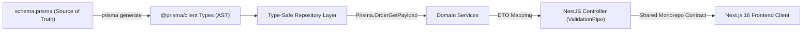

## 1. แนวคิด (Concept)

ในยุคที่สถาปัตยกรรมแบบ Full-stack เติบโตอย่างรวดเร็ว ช่องว่างที่อันตรายที่สุดในระบบมักเกิดขึ้นที่ **"ขอบเขตการเชื่อมต่อระหว่าง Frontend และ Backend (API Boundary)"** ในอดีตเมื่อทีม Backend เปลี่ยนชื่อคอลัมน์ในฐานข้อมูล หรือปรับปรุงโครงสร้าง JSON Response ทีม Frontend มักจะไม่รู้ตัวจนกระทั่งหน้าเว็บแครชในสภาพแวดล้อม Production

การใช้ **TypeScript 5.x** ร่วมกับเฟรมเวิร์กฝั่งเซิร์ฟเวอร์ระดับ Enterprise อย่าง **NestJS 11** และ ORM สมัยใหม่อย่าง **Prisma ORM** ช่วยให้เราสร้างระบบที่เรียกว่า **"End-to-End Type Safety (Type-Safe Backbone)"** 

ในระบบ **Smart Butcher Marketplace** สถาปัตยกรรม Type-safe ครอบคลุมตั้งแต่:
1. **Database Layer (Prisma Schema)**: แหล่งความจริงหนึ่งเดียว (Single Source of Truth) ของโครงสร้างข้อมูลใน PostgreSQL
2. **Repository & Service Layer**: การสกัด Type ที่แม่นยำด้วย `Prisma.validator` และ `Prisma.OrderGetPayload` เพื่อรับประกันว่าเฉพาะฟิลด์ที่ Join หรือ Select มาจริงเท่านั้นที่จะปรากฏใน Type
3. **Transport Layer (DTOs & Decorators)**: การใช้ `class-validator` และ `class-transformer` ตรวจสอบความถูกต้องของข้อมูล (Runtime Validation) ควบคู่กับความถูกต้องของ Type System (Compile-time Type Safety)
4. **Client Contract Sharing**: การแชร์ Type สู่ Next.js ฝั่งหน้าบ้านผ่าน Monorepo Package เพื่อขจัด Human Error จากการพิมพ์ชื่อฟิลด์ผิด

<Callout type="note" title="ความจริงเรื่อง Type Erasure ใน Backend">
TypeScript Type ทั้งหมดจะถูกลบหายไป (Type Erasure) เมื่อคอมไพล์เป็น JavaScript ทำให้นักพัฒนาต้องไม่พึ่งพา Type เพียงอย่างเดียวในการป้องกันข้อมูลแปลกปลอมที่ส่งมาจากผู้ใช้ จำเป็นต้องมี Runtime Validation Layer (เช่น class-validator หรือ Zod) เสมอ
</Callout>

---

## 2. หลักการเบื้องหลัง (Under the Hood)

เพื่อออกแบบสถาปัตยกรรมแบ็กเอนด์ที่ปราศจากช่องโหว่ วิศวกรซอฟต์แวร์ต้องเข้าใจกลไกการทำงานของ TypeScript Compiler, Decorators และ Prisma AST:

### 2.1 กลไก Reflection Metadata และ Decorator Evaluation
NestJS ทำงานบนรากฐานของ Metadata Reflection:
- เมื่อเปิดใช้งาน `experimentalDecorators` และ `emitDecoratorMetadata` ใน `tsconfig.json` ตัวคอมไพเลอร์ TypeScript จะแอบบันทึก Type ของพารามิเตอร์และ Property ลงใน JavaScript Object โดยใช้ไลบรารี `reflect-metadata`
- เมื่อ `ValidationPipe` ใน NestJS ได้รับ Request Body เข้ามา มันจะอ่าน Decorators เช่น `@IsString()`, `@Min()` และอ่าน Metadata Type เพื่อทำการ Parse ข้อมูลสตริงเป็น Class Instance ก่อนส่งต่อให้ Controller
- **TypeScript 5 ECMAScript Stage 3 Decorators**: ใน TS 5 มีการรองรับ Decorator มาตรฐานใหม่ แต่สำหรับ NestJS 11 ยังคงพึ่งพา Legacy Parameter Decorators (`@Body()`, `@Param()`) เป็นหลัก จึงต้องระวังการตั้งค่า `tsconfig.json` ให้ถูกต้อง

### 2.2 Prisma Type Generation & AST
เมื่อเรารันคำสั่ง `npx prisma generate`:
1. Prisma Engine จะอ่านไฟล์ `schema.prisma` แล้วแปลงเป็น Abstract Syntax Tree (AST) ของ DMMF (Data Model Meta Format)
2. เครื่องมือจะสร้างโค้ด TypeScript Definition ขนาดใหญ่ใน `node_modules/@prisma/client`
3. เพื่อหลีกเลี่ยงปัญหา N+1 Query และ Over-fetching Prisma มี Generic Type Helper ชื่อ `Prisma.Payload<...>` ซึ่งช่วยคำนวณ Type ขาออกให้สอดคล้องกับอ็อบเจกต์ `include` หรือ `select` อย่างแม่นยำ 100%



---

## 3. ตัวอย่างโค้ด (Smart Butcher Marketplace)

### ตัวอย่างที่ 1: Type-safe Prisma Model Payload Extraction และ Repository สำหรับระบบสั่งตัดเนื้อ

การดึงข้อมูลออเดอร์พร้อมรายการเนื้อย่อย (`OrderItem`) และข้อมูลลูกค้า (`User`) หากเขียน Type เองมักจะหลงลืมหรือพิมพ์ผิด เราใช้ `Prisma.validator` สร้าง Type ที่สัมพันธ์กับ Database Query โดยอัตโนมัติ

```typescript filename="src/modules/orders/repositories/order.repository.ts"
import { Injectable } from '@nestjs/common';
import { PrismaClient, Prisma } from '@prisma/client';

// -------------------------------------------------------------------------
// 1. กำหนด Query Shape ด้วย Prisma.validator
// -------------------------------------------------------------------------
// กำหนดว่าเราต้องการ Include ตารางใดบ้าง เพื่อสกัดเป็น Type กลาง
export const orderWithDetailsPayload = Prisma.validator<Prisma.OrderDefaultArgs>()({
  include: {
    user: {
      select: {
        id: true,
        email: true,
        fullName: true,
        phoneNumber: true,
      },
    },
    items: {
      include: {
        product: {
          select: {
            id: true,
            title: true,
            sku: true,
            grade: true,
            origin: true,
            pricePerKg: true,
          },
        },
      },
    },
    payment: true,
  },
});

// 2. สกัดเป็น TypeScript Type สำหรับส่งต่อให้ Service หรือ Controller
export type OrderWithFullDetails = Prisma.OrderGetPayload<typeof orderWithDetailsPayload>;

// -------------------------------------------------------------------------
// 3. Repository Layer ที่รับประกัน Type Safety ระดับสูงสุด
// -------------------------------------------------------------------------
@Injectable()
export class OrderRepository {
  constructor(private readonly prisma: PrismaClient) {}

  /**
   * ค้นหาคำสั่งซื้อเนื้อพรีเมียมตาม ID พร้อมข้อมูลความสัมพันธ์ครบถ้วน
   */
  async findOrderById(orderId: string): Promise<OrderWithFullDetails | null> {
    const order = await this.prisma.order.findUnique({
      where: { id: orderId },
      include: orderWithDetailsPayload.include,
    });

    return order;
  }

  /**
   * ค้นหารายการคำสั่งซื้อที่รอการตัดชิ้นเนื้อ (PENDING_CUT)
   */
  async findPendingCuttingOrders(limit: number = 20): Promise<OrderWithFullDetails[]> {
    return this.prisma.order.findMany({
      where: {
        status: 'PENDING_CUT',
      },
      include: orderWithDetailsPayload.include,
      orderBy: { createdAt: 'asc' },
      take: limit,
    });
  }
}
```

---

### ตัวอย่างที่ 2: Shared Contract DTO ใน NestJS พร้อม Validation Decorators และ Type Safety ข้ามชั้น

ตัวอย่างนี้แสดง DTO สำหรับการสั่งซื้อเนื้อพรีเมียมพร้อมการตัดแต่งพิเศษ (Custom Cut Specs) ซึ่งสามารถแชร์ Type ไปใช้ฝั่ง Next.js และมี Decorators ตรวจสอบความถูกต้องที่ Runtime ใน NestJS

```typescript filename="src/shared/contracts/create-meat-order.dto.ts"
import {
  IsString,
  IsNotEmpty,
  IsNumber,
  IsArray,
  ValidateNested,
  Min,
  Max,
  IsEnum,
  IsOptional,
} from 'class-validator';
import { Type } from 'class-transformer';

// เกรดของเนื้อพรีเมียมที่รองรับ
export enum WagyuGrade {
  A5 = 'A5',
  A4 = 'A4',
  A3 = 'A3',
  F1 = 'F1',
  ANGUS_PRIME = 'ANGUS_PRIME',
}

// สเปกการตัดแต่งเนื้อตามความต้องการของเชฟ
export class CuttingSpecDto {
  @IsNumber()
  @Min(150, { message: 'น้ำหนักชิ้นเนื้อขั้นต่ำต้องไม่น้อยกว่า 150 กรัม' })
  @Max(2000, { message: 'น้ำหนักชิ้นเนื้อสูงสุดต้องไม่เกิน 2,000 กรัมต่อชิ้น' })
  targetWeightGrams!: number;

  @IsNumber()
  @Min(1.0, { message: 'ความหนาการสเต๊กขั้นต่ำ 1.0 ซม.' })
  @Max(7.0, { message: 'ความหนาสูงสุด 7.0 ซม.' })
  thicknessCm!: number;

  @IsOptional()
  @IsString()
  specialInstructions?: string;
}

// รายการเนื้อแต่ละชิ้นในคำสั่งซื้อ
export class CreateOrderItemDto {
  @IsString()
  @IsNotEmpty({ message: 'รหัสสินค้าเนื้อ (ProductId) ห้ามว่าง' })
  productId!: string;

  @IsEnum(WagyuGrade, { message: 'เกรดเนื้อไม่ถูกต้องตามมาตรฐานตลาด' })
  grade!: WagyuGrade;

  @IsNumber()
  @Min(1, { message: 'จำนวนชิ้นต้องอย่างน้อย 1 ชิ้น' })
  quantity!: number;

  @ValidateNested()
  @Type(() => CuttingSpecDto)
  cuttingSpec!: CuttingSpecDto;
}

// DTO หลักสำหรับการสร้างออเดอร์
export class CreateMeatOrderDto {
  @IsString()
  @IsNotEmpty({ message: 'รหัสลูกค้าต้องระบุเสมอ' })
  userId!: string;

  @IsArray({ message: 'รายการเนื้อต้องเป็น Array' })
  @ValidateNested({ each: true })
  @Type(() => CreateOrderItemDto)
  items!: CreateOrderItemDto[];

  @IsString()
  @IsNotEmpty({ message: 'ที่อยู่สำหรับจัดส่งห้องเย็นห้ามว่าง' })
  shippingAddress!: string;
}
```

```typescript filename="src/modules/orders/controllers/orders.controller.ts"
import {
  Controller,
  Post,
  Body,
  Get,
  Param,
  UsePipes,
  ValidationPipe,
  HttpCode,
  HttpStatus,
  NotFoundException,
} from '@nestjs/common';
import { CreateMeatOrderDto } from '../../../shared/contracts/create-meat-order.dto';
import { OrderRepository, OrderWithFullDetails } from '../repositories/order.repository';

@Controller('api/v1/meat-orders')
@UsePipes(
  new ValidationPipe({
    whitelist: true,              // ตัดฟิลด์แปลกปลอมที่ไม่ได้นิยามใน DTO ทิ้ง ป้องกัน Injection
    forbidNonWhitelisted: true,  // โยน Error ทันทีหากมีฟิลด์ที่ไม่รู้จักส่งเข้ามา
    transform: true,              // แปลง Plain Object เป็น Class Instance อัตโนมัติ
  })
)
export class OrdersController {
  constructor(private readonly orderRepository: OrderRepository) {}

  @Post()
  @HttpCode(HttpStatus.CREATED)
  async createOrder(@Body() dto: CreateMeatOrderDto) {
    // dto ผ่านการตรวจสอบ runtime validation เรียบร้อยแล้ว 100%
    console.log(`Creating order for customer ${dto.userId} with ${dto.items.length} items.`);
    
    // ส่งต่อไปยัง OrderService เพื่อสร้าง Transaction และตัดสต็อก...
    return {
      success: true,
      message: 'คำสั่งซื้อเนื้อพรีเมียมถูกส่งเข้าระบบเตรียมตัดเรียบร้อย',
      trackingId: 'TRK-WAGYU-9982',
    };
  }

  @Get(':id')
  async getOrder(@Param('id') id: string): Promise<OrderWithFullDetails> {
    const order = await this.orderRepository.findOrderById(id);
    if (!order) {
      throw new NotFoundException(`ไม่พบข้อมูลคำสั่งซื้อเนื้อรหัส ${id}`);
    }
    return order;
  }
}
```

---

## 4. ข้อผิดพลาดที่พบบ่อย (Anti-pattern vs Best Practice)

### 4.1 การหลงเชื่อว่า TypeScript Interface สามารถตรวจสอบข้อมูลตอน Runtime ได้
- **Anti-pattern**: ประกาศ `interface CreateOrderRequest { weight: number; }` ใน Controller แล้วคิดว่าหาก Client ส่ง `{ weight: "abc" }` เข้ามา ระบบจะหยุดทำงาน ทว่า Interface ถูกลบหายไปตั้งแต่ขั้นตอนคอมไพล์ ส่งผลให้ข้อมูลสตริงหลุดเข้าไปจนฐานข้อมูลหรือการคำนวณราคาพัง
- **Best Practice**: ใช้ Class ควบคู่กับ Decorators ของ `class-validator` หรือใช้ Zod Schema เพื่อตรวจสอบประเภทและเงื่อนไขของข้อมูลจริง ณ รันไทม์เสมอ

### 4.2 การใช้ Type Assertion `as` ครอบผลลัพธ์ของ Prisma Query
- **Anti-pattern**: `const order = (await prisma.order.findUnique(...)) as OrderWithUser;` การใช้ `as` คือการปิดปาก TypeScript หากในอนาคตมีคนลบคำสั่ง `include: { user: true }` ออกจาก Query ตัว TypeScript จะไม่แจ้งเตือน แต่หน้าบ้านจะเกิด Error `Cannot read properties of undefined (reading 'fullName')`
- **Best Practice**: ใช้ `Prisma.validator` หรือ `Prisma.OrderGetPayload` สกัด Type ตรงจาก Query Definition

### 4.3 การเปิดรับ Request Body โดยไม่ตั้งค่า `whitelist: true`
- **Anti-pattern**: ไม่เปิด `whitelist: true` ใน `ValidationPipe` ทำให้ผู้โจมตีสามารถยิงฟิลด์แปลกปลอม เช่น `{ isAdmin: true }` หรือ `{ discountPercent: 99 }` เข้ามาในระบบ และถูกส่งต่อไปบันทึกลงฐานข้อมูล (Mass Assignment Vulnerability)
- **Best Practice**: เปิดใช้งาน `{ whitelist: true, forbidNonWhitelisted: true }` เป็นค่าตั้งต้นของแอปพลิเคชันเสมอ

```typescript filename="src/types/backend-anti-patterns.ts"
// สรุปเช็คลิสต์ความปลอดภัยของสถาปัตยกรรม Backend
export interface BackendSafetyRule {
  area: 'Validation' | 'Prisma Typing' | 'Contract';
  danger: string;
  remedy: string;
}

export const BACKEND_RULES: BackendSafetyRule[] = [
  {
    area: 'Validation',
    danger: 'Mass assignment attack via extra unvalidated fields',
    remedy: 'Enable whitelist & forbidNonWhitelisted in ValidationPipe',
  },
  {
    area: 'Prisma Typing',
    danger: 'Runtime crash due to missing relation includes using "as"',
    remedy: 'Extract types via Prisma.OrderGetPayload<typeof query>',
  },
  {
    area: 'Contract',
    danger: 'Desynchronized API response types between Next.js and NestJS',
    remedy: 'Share DTO types in a monorepo shared package',
  },
];
```

---

## 5. ควรใช้เมื่อไหร่ และ ไม่ควรใช้เมื่อไหร่

### ควรใช้ (Recommended Use Cases)
- **Prisma Generated Types (`Prisma.Payload`)**: ใช้ทุกครั้งที่มีการคิวรีฐานข้อมูลพร้อม Relation (`include`) หรือเลือกเฉพาะบางฟิลด์ (`select`)
- **DTOs พร้อม `class-validator`**: ใช้กับทุก Endpoint ที่รับข้อมูลจากภายนอก (`@Body()`, `@Query()`, `@Param()`)
- **Shared Contracts ใน Monorepo**: ใช้เมื่อทั้ง Frontend (Next.js) และ Backend (NestJS) อยู่ในที่เก็บโค้ดเดียวกัน เพื่อให้ Type ของ API Response และ Request อัปเดตตรงกันทันทีที่โค้ดเปลี่ยน

### ไม่ควรใช้ (When NOT to Use)
- **ไม่ควรแชร์ Prisma Database Entities ไปยัง Frontend โดยตรง**: ไม่ควรส่ง Entity ของ Database เช่น Password Hash หรือ Internal Timestamps ข้ามไปให้ Client ควรสร้าง Response DTO คัดเฉพาะฟิลด์ที่ปลอดภัยผ่าน `Pick` หรือ `Omit`
- **ไม่ควรเขียน Custom Validation Regex สำหรับทุกสิ่ง**: ควรใช้ Built-in Decorators ของ `class-validator` เช่น `@IsEmail()`, `@IsUUID()` ก่อนที่จะลงมือเขียน Custom Validator

---

## 6. คำถามสัมภาษณ์งาน (Interview Q&A)

### Q1: อะไรคือความแตกต่างระหว่าง Type Checking ตอน Compile-time กับ Runtime Validation ในสถาปัตยกรรม NestJS และทำไมเราถึงต้องมีทั้งคู่?
**แนวคำตอบระดับ Senior**:
- **Compile-time Type Checking**: เป็นหน้าที่ของ TypeScript Compiler (`tsc`) ที่ทำหน้าที่ตรวจสอบ Static Type ในระหว่างที่นักพัฒนากำลังเขียนโค้ดและคอมไพล์ เพื่อป้องกันความผิดพลาด เช่น การเรียกชื่อ Method ผิด หรือการส่ง Arguments ผิดลำดับ ข้อจำกัดคือเมื่อแปลงเป็น JavaScript โค้ด Type ทั้งหมดจะถูกลบหายไป (Type Erasure)
- **Runtime Validation**: เป็นหน้าที่ของโค้ด JavaScript ที่กำลังรันอยู่จริงบนเซิร์ฟเวอร์ โดยใช้ `ValidationPipe` และ `class-validator` เพื่อดักจับข้อมูล Payload จริงที่ส่งผ่าน HTTP Request จาก Client ซึ่งอยู่นอกเหนือการควบคุมของ TypeScript
- **เหตุผลที่ต้องมีทั้งคู่**: หากขาด Compile-time เราจะสูญเสียความสามารถในการทำ Refactor และความคล่องตัวของทีม แต่หากขาด Runtime Validation ระบบจะไม่มีเกราะป้องกันการโจมตีหรือข้อมูลผิดรูปจากภายนอก สถาปัตยกรรมที่ดีต้องใช้ Class DTO ทำหน้าที่เป็นพิมพ์เขียวสำหรับ Compile-time และใช้ Decorators ทำหน้าที่เป็นด่านตรวจตอน Runtime ไปพร้อมกัน

### Q2: ในการทำงานกับ Prisma ORM ทำไมการใช้ `Prisma.OrderGetPayload` จึงปลอดภัยกว่าการเขียน `interface OrderWithItems extends Order` ด้วยตนเอง?
**แนวคำตอบระดับ Senior**:
เมื่อเราเขียน `interface OrderWithItems extends Order { items: OrderItem[] }` ด้วยตนเอง (Manual Typing):
1. **เสี่ยงต่อ Desynchronization**: หากเราลืมใส่ `include: { items: true }` ในคำสั่ง `prisma.order.findUnique` ตัว TypeScript จะไม่สามารถตรวจสอบได้ และจะปล่อยให้โค้ดผ่าน ส่งผลให้เมื่อแอปพลิเคชันพยายามเข้าถึง `order.items[0]` ตอน Runtime จะพังทันที
2. **ละเลย Deep Relation & Selection**: หากใน `items` เราไม่ได้ดึงมาทุกฟิลด์ หรือมีการซ้อนตาราง `product` ลงไปอีกชั้น การเขียน Interface เองจะทำให้เกิดความคลาดเคลื่อนได้ง่ายมาก

การใช้ `Prisma.validator` คู่กับ `Prisma.OrderGetPayload<typeof queryPayload>` จะทำให้ TypeScript **คำนวณ Type จากโครงสร้างคำสั่งคิวรีจริง** หากคิวรีไม่มีการดึงตารางใดเข้ามา Type ตัวนั้นจะไม่มีฟิลด์นั้นอยู่จริง ช่วยป้องกันบั๊ก Null/Undefined Pointer ได้ 100%

---

## ลำดับการเรียนที่แนะนำ และ ดูเพิ่มเติมที่

1. พื้นฐานและฟังก์ชันของ TypeScript: [TypeScript Basics](/docs/typescript/basics)
2. การใช้งาน Generics ระดับสูง: [TypeScript Generics](/docs/typescript/generics)
3. การเขียน Object-Oriented Programming: [TypeScript Classes & OOP](/docs/typescript/classes-oop)
4. การจัดการ Type ระดับสูงและ satisfies: [TypeScript Advanced Types](/docs/typescript/advanced-types)
5. การจัดการสถาปัตยกรรม NestJS ระดับองค์กร: [NestJS Architecture](/docs/backend/nestjs/architecture)
