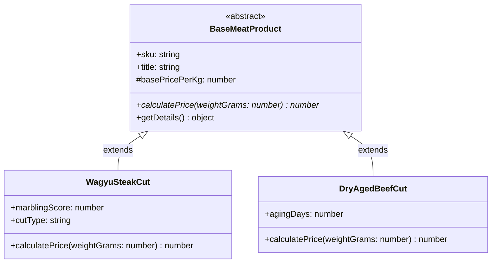

## 1. แนวคิด (Concept)

แม้ว่าวงการ Frontend ยุคปัจจุบันจะเอนเอียงไปทางกระบวนทัศน์แบบ Functional Programming (Hooks, Pure Functions, Immutability) ทว่าในโลกของ Enterprise Backend, Domain-Driven Design (DDD), และเฟรมเวิร์กอย่าง **NestJS 11** นั้น **Object-Oriented Programming (OOP)** ยังคงเป็นกระดูกสันหลังที่แข็งแกร่งที่สุดในการจัดการความซับซ้อนของ Business Logic

TypeScript ยกระดับคลาสมาตรฐานของ ECMAScript ขึ้นสู่ระดับมืออาชีพ โดยนำเสนอระบบ **Access Modifiers** (`public`, `private`, `protected`, `readonly`), **Abstract Classes**, **Parameter Properties**, และการบังคับใช้สัญญาด้วย **`implements`**

ในระบบ **Smart Butcher Marketplace** ระบบต้องรับมือกับความหลากหลายของผลิตภัณฑ์เนื้อเกรดพรีเมียม (Wagyu, Dry-Aged Beef, Offals), กลยุทธ์การตัดแต่งตามคำสั่งของเชฟ, และช่องทางการชำระเงินหลายรูปแบบ การออกแบบระบบโดยยึดมั่นใน **SOLID Principles** และหลักการ **Composition over Inheritance** ช่วยรับประกันว่าโค้ดจะไม่กลายเป็นสปาเกตตีเมื่อมีประเภทสินค้าหรือโปรโมชันใหม่ๆ เพิ่มเข้ามาในอนาคต

<Callout type="note" title="OOP ในสไตล์ TypeScript ยุคใหม่">
หัวใจของ OOP ยุคใหม่ไม่ใช่การสืบทอดคลาสลูกซ้อนกันหลายสิบชั้น (Deep Inheritance Hierarchies) แต่เป็นการกำหนดสัญญาระดับสูงผ่าน Interfaces, การซ่อนรายละเอียดภายในด้วย Encapsulation, และการประกอบร่างอ็อบเจกต์ผ่าน Dependency Injection
</Callout>

---

## 2. หลักการเบื้องหลัง (Under the Hood)

เพื่อเป็น Senior Architect ที่เข้าใจทะลุปรุโปร่ง เราต้องเข้าใจว่าคลาสและ OOP ใน TypeScript แปลงไปเป็นอะไรในระดับ V8 JavaScript Engine:

### 2.1 Prototype-based Inheritance vs Syntactic Sugar
ในเบื้องลึก JavaScript ยังคงเป็น **Prototype-based Language**:
- เมื่อ TypeScript คอมไพล์คำสั่ง `class Dog extends Animal`:
  - ตัวคอมไพเลอร์จะสร้างฟังก์ชัน Constructor และเชื่อมโยง Prototype Chain ด้วย `Object.setPrototypeOf(Dog.prototype, Animal.prototype)`
  - การเรียกใช้ `super()` คือการรัน Constructor ของฟังก์ชันแม่โดยผูกค่า Context ผ่าน `Animal.call(this, ...)`
- **TypeScript `private` vs JavaScript `#private` (Private Fields)**:
  - `private foo: string`: เป็นเพียง **Compile-time Check** ของ TypeScript เท่านั้น เมื่อคอมไพล์เป็น JavaScript มันจะกลายเป็น Property ปกติที่สามารถเข้าถึงได้ผ่าน `obj['foo']`
  - `#foo: string`: เป็น **Hard Runtime Private** ที่เบราว์เซอร์และ V8 บังคับใช้จริงผ่าน Internal WeakMap ไม่สามารถเข้าถึงหรือสะท้อนค่านอกคลาสได้เลยแม้จะใช้ Reflection ก็ตาม

### 2.2 กลไก Parameter Properties & DI Metadata
เมื่อเราเขียน:
```typescript filename="src/example/parameter-properties.ts"
constructor(private readonly prisma: PrismaService) {}
```
TypeScript จะสร้างโค้ด JavaScript ที่เทียบเท่ากับ:
```javascript filename="dist/example/parameter-properties.js"
constructor(prisma) {
  this.prisma = prisma;
}
```
และหากเปิดใช้งาน `emitDecoratorMetadata` ตัวคอมไพเลอร์จะแนบ Metadata ชื่อ `design:paramtypes` ระบุว่าพารามิเตอร์ตัวแรกคือ Class Constructor ของ `PrismaService` ซึ่ง IoC (Inversion of Control) Container ของ NestJS จะอ่าน Metadata นี้ตอน Runtime เพื่อค้นหา Instance ที่ตรงกันมาฉีด (Inject) ให้อัตโนมัติ



---

## 3. ตัวอย่างโค้ด (Smart Butcher Marketplace)

### ตัวอย่างที่ 1: Domain-Driven Clean Architecture ด้วย Abstract Classes, Interfaces และ Encapsulation

ตัวอย่างนี้แสดงการสร้างโครงสร้างโดเมนชิ้นเนื้อพรีเมียม โดยใช้ **Abstract Class** เพื่อแชร์พฤติกรรมพื้นฐาน และบังคับให้คลาสลูกต้องคำนวณราคาตามสูตรเฉพาะของเกรดเนื้อนั้นๆ

```typescript filename="src/domain/meat/base-meat-product.ts"
// สัญญา Interface สำหรับการระบุน้ำหนักและคำนวณราคา
export interface IPriceCalculable {
  calculatePrice(weightGrams: number): number;
}

// สัญญา Interface สำหรับการจัดเก็บบันทึกประวัติ
export interface IAuditable {
  readonly createdAt: Date;
  readonly updatedAt: Date;
}

// -------------------------------------------------------------------------
// 1. Abstract Base Class: กำหนดโครงร่างและพฤติกรรมแกนกลาง
// -------------------------------------------------------------------------
export abstract class BaseMeatProduct implements IPriceCalculable, IAuditable {
  // ECMAScript Private Field: ความลับต้นทุนห้ามรั่วไหลออกนอกคลาสระดับ Runtime
  #wholesaleCostPerKg: number;

  public readonly createdAt: Date;
  public readonly updatedAt: Date;

  // Parameter Properties ใน Constructor: ประกาศตัวแปรพร้อมกำหนดค่าในบรรทัดเดียว
  constructor(
    public readonly id: string,
    public readonly sku: string,
    public readonly title: string,
    protected basePricePerKg: number,
    wholesaleCostPerKg: number,
    public readonly isAvailable: boolean = true
  ) {
    if (basePricePerKg <= 0) {
      throw new Error(`ราคาต่อกิโลกรัมของสินค้า ${title} ต้องมากกว่า 0`);
    }
    this.#wholesaleCostPerKg = wholesaleCostPerKg;
    this.createdAt = new Date();
    this.updatedAt = new Date();
  }

  // Method สาธารณะที่แชร์ให้ทุกคลาสลูกใช้งาน
  public getProductBadge(): string {
    return `[${this.sku}] ${this.title}`;
  }

  // Encapsulated Method สำหรับตรวจสอบอัตรากำไรขั้นต้น
  protected getMarginRate(): number {
    return (this.basePricePerKg - this.#wholesaleCostPerKg) / this.basePricePerKg;
  }

  // Abstract Method: คลาสลูกต้องนิยามอัลกอริทึมการคิดราคาเองเสมอ
  abstract calculatePrice(weightGrams: number): number;
}

// -------------------------------------------------------------------------
// 2. Concrete Class: เนื้อวากิวญี่ปุ่น (คิดราคาตาม Marbling Score BMS)
// -------------------------------------------------------------------------
export class WagyuSteakProduct extends BaseMeatProduct {
  constructor(
    id: string,
    sku: string,
    title: string,
    basePricePerKg: number,
    wholesaleCostPerKg: number,
    public readonly marblingScore: number, // BMS 1-12
    public readonly originPrefecture: string
  ) {
    super(id, sku, title, basePricePerKg, wholesaleCostPerKg);
    if (marblingScore < 3 || marblingScore > 12) {
      throw new Error('ระดับ Marbling Score สำหรับเนื้อเกรดพรีเมียมต้องอยู่ระหว่าง 3 ถึง 12');
    }
  }

  // คำนวณราคาจริง: มีตัวคูณ Premium Multiplier ตามคะแนนลายไขมัน BMS
  calculatePrice(weightGrams: number): number {
    const kg = weightGrams / 1000;
    const bmsMultiplier = 1 + (this.marblingScore - 3) * 0.08; // ยิ่ง BMS สูง ยิ่งแพงขึ้น
    const finalPrice = kg * this.basePricePerKg * bmsMultiplier;
    return Math.round(finalPrice);
  }
}

// -------------------------------------------------------------------------
// 3. Concrete Class: เนื้อบ่มแห้ง Dry-Aged (คิดราคาบวกตามจำนวนวันที่บ่ม)
// -------------------------------------------------------------------------
export class DryAgedProduct extends BaseMeatProduct {
  constructor(
    id: string,
    sku: string,
    title: string,
    basePricePerKg: number,
    wholesaleCostPerKg: number,
    public readonly agingDays: number // จำนวนวันบ่ม เช่น 30, 45, 60 วัน
  ) {
    super(id, sku, title, basePricePerKg, wholesaleCostPerKg);
  }

  calculatePrice(weightGrams: number): number {
    const kg = weightGrams / 1000;
    // ค่าห้องบ่มความชื้นควบคุมพิเศษ วันละ 15 บาทต่อกิโลกรัม
    const agingSurcharge = this.agingDays * 15;
    const finalPrice = kg * (this.basePricePerKg + agingSurcharge);
    return Math.round(finalPrice);
  }
}
```

---

### ตัวอย่างที่ 2: Dependency Injection & Strategy Pattern ใน NestJS สำหรับระบบชำระเงินค่าเนื้อ

ตัวอย่างนี้แสดงการนำหลักการ **Open/Closed Principle (OCP)** และ **Dependency Inversion Principle (DIP)** มาใช้จริงใน NestJS เพื่อรองรับช่องทางการชำระเงินที่หลากหลาย (PromptPay, Credit Card, Butcher Wallet) โดยไม่ต้องเขียน `switch-case` ขนาดยักษ์

```typescript filename="src/modules/payments/interfaces/payment-strategy.interface.ts"
// สัญญากลางของทุกช่องทางชำระเงิน (DIP: High-level modules rely on abstractions)
export interface IPaymentStrategy {
  readonly channelName: string;
  supports(method: string): boolean;
  processPayment(orderId: string, amount: number): Promise<{ transactionId: string; success: boolean }>;
}

// Token สำหรับการ Inject หลาย Strategies เข้ามาพร้อมกัน
export const PAYMENT_STRATEGIES_TOKEN = Symbol('PAYMENT_STRATEGIES_TOKEN');
```

```typescript filename="src/modules/payments/strategies/promptpay-payment.strategy.ts"
import { Injectable, Logger } from '@nestjs/common';
import { IPaymentStrategy } from '../interfaces/payment-strategy.interface';

@Injectable()
export class PromptPayPaymentStrategy implements IPaymentStrategy {
  public readonly channelName = 'PROMPTPAY_QR';
  private readonly logger = new Logger(PromptPayPaymentStrategy.name);

  supports(method: string): boolean {
    return method.toUpperCase() === 'PROMPTPAY';
  }

  async processPayment(orderId: string, amount: number): Promise<{ transactionId: string; success: boolean }> {
    this.logger.log(`สร้าง Dynamic QR Code สำหรับคำสั่งซื้อ ${orderId} ยอดเงิน ฿${amount}`);
    // จำลองการเรียก API ธนาคารแห่งประเทศไทย
    const txnId = `PP-TXN-${Date.now()}`;
    return { transactionId: txnId, success: true };
  }
}
```

```typescript filename="src/modules/payments/strategies/credit-card-payment.strategy.ts"
import { Injectable, Logger } from '@nestjs/common';
import { IPaymentStrategy } from '../interfaces/payment-strategy.interface';

@Injectable()
export class CreditCardPaymentStrategy implements IPaymentStrategy {
  public readonly channelName = 'CREDIT_CARD_OMISE';
  private readonly logger = new Logger(CreditCardPaymentStrategy.name);

  supports(method: string): boolean {
    return method.toUpperCase() === 'CREDIT_CARD';
  }

  async processPayment(orderId: string, amount: number): Promise<{ transactionId: string; success: boolean }> {
    this.logger.log(`ตัดวงเงินบัตรเครดิตสำหรับคำสั่งซื้อเนื้อ ${orderId} จำนวน ฿${amount}`);
    // จำลองการเชื่อมต่อ Payment Gateway
    const txnId = `CC-TXN-${Date.now()}`;
    return { transactionId: txnId, success: true };
  }
}
```

```typescript filename="src/modules/payments/services/payment.service.ts"
import { Injectable, Inject, BadRequestException, Logger } from '@nestjs/common';
import { IPaymentStrategy, PAYMENT_STRATEGIES_TOKEN } from '../interfaces/payment-strategy.interface';

@Injectable()
export class PaymentService {
  private readonly logger = new Logger(PaymentService.name);

  // Constructor Dependency Injection: ฉีด Array ของ Strategies ทั้งหมดเข้ามา
  constructor(
    @Inject(PAYMENT_STRATEGIES_TOKEN)
    private readonly strategies: IPaymentStrategy[]
  ) {}

  /**
   * ดำเนินการชำระเงินตามช่องทางที่ลูกค้าเลือก
   * (Open for extension, Closed for modification - เพิ่ม Strategy ใหม่ได้โดยไม่ต้องแตะไฟล์นี้!)
   */
  async executePayment(orderId: string, paymentMethod: string, amount: number) {
    const selectedStrategy = this.strategies.find((strategy) => strategy.supports(paymentMethod));

    if (!selectedStrategy) {
      this.logger.error(`ไม่พบช่องทางการชำระเงินที่รองรับ: ${paymentMethod}`);
      throw new BadRequestException(`ระบบยังไม่รองรับช่องทางการชำระเงิน: ${paymentMethod}`);
    }

    this.logger.log(`เลือกใช้งาน Strategy: ${selectedStrategy.channelName}`);
    return await selectedStrategy.processPayment(orderId, amount);
  }
}
```

---

## 4. ข้อผิดพลาดที่พบบ่อย (Anti-pattern vs Best Practice)

### 4.1 การสืบทอดคลาสลึกเกินไป (Deep Inheritance Hierarchies)
- **Anti-pattern**: สร้างคลาสต่อกันเป็นทอดๆ เช่น `LivingEntity -> Animal -> Mammal -> Cow -> WagyuCow -> WagyuSteakCut` การสืบทอดลึกแบบนี้ทำให้คลาสล่างสุดผูกติดกับพฤติกรรมที่ไม่จำเป็นของคลาสบน (Fragile Base Class Problem) เมื่อแก้คลาสแม่ คลาสลูกทั้งหมดพังทลาย
- **Best Practice**: ยึดหลัก **Composition over Inheritance** ใช้ Interfaces กำหนดสัญญา และดึงคลาสบริการย่อยเข้ามาทำงานผ่าน Dependency Injection แทนการสืบทอด

### 4.2 การพึ่งพา TypeScript `private` สำหรับความปลอดภัยของข้อมูลลับ
- **Anti-pattern**: ใช้ `private secretApiKey: string` แล้วคิดว่าภายนอกจะไม่สามารถอ่านค่าได้ ในโลกจริง TypeScript จะลบ `private` ทิ้งตอนคอมไพล์ โค้ด JavaScript ภายนอกหรือผู้ที่ใช้ `Object.keys()` หรือ `JSON.stringify()` จะยังมองเห็นคีย์ลับนั้นอยู่
- **Best Practice**: ใช้ JavaScript Private Fields อย่างเป็นทางการ (`#secretApiKey`) หรือเก็บค่านอกอ็อบเจกต์ใน Closure เพื่อรับประกันความปลอดภัยระดับ Runtime

### 4.3 การละเมิด Liskov Substitution Principle (LSP)
- **Anti-pattern**: คลาสลูกทำการ Override Method ของคลาสแม่ แล้วเปลี่ยนพฤติกรรมจนขัดแย้งกับสัญญาเดิม เช่น โยน Exception ในฟังก์ชันที่คลาสแม่ระบุว่าจะส่งค่ากลับมาเสมอ ทำให้โค้ดภายนอกที่เรียกใช้งานผ่านคลาสแม่เกิดข้อผิดพลาด
- **Best Practice**: คลาสลูกต้องสามารถนำไปใช้งานแทนที่คลาสแม่ได้ทุกประการโดยไม่ทำให้โปรแกรมทำงานผิดปกติ

```typescript filename="src/types/solid-principles-matrix.ts"
// สรุปการประยุกต์ใช้หลักการ SOLID ใน TypeScript
export interface SolidPrincipleDetail {
  code: 'S' | 'O' | 'L' | 'I' | 'D';
  name: string;
  definition: string;
  butcherExample: string;
}

export const SOLID_MATRIX: SolidPrincipleDetail[] = [
  {
    code: 'S',
    name: 'Single Responsibility Principle',
    definition: 'คลาสหนึ่งควรมีเหตุผลในการเปลี่ยนแปลงเพียงเรื่องเดียว',
    butcherExample: 'แยก MeatPriceCalculator ออกจาก MeatOrderRepository',
  },
  {
    code: 'O',
    name: 'Open/Closed Principle',
    definition: 'เปิดให้ต่อขยายพฤติกรรม แต่ปิดไม่ให้แก้ไขโค้ดเดิม',
    butcherExample: 'เพิ่มช่องทางจ่ายเงินใหม่ด้วยการเขียน Strategy Class ใหม่โดยไม่ต้องแก้ PaymentService',
  },
  {
    code: 'L',
    name: 'Liskov Substitution Principle',
    definition: 'คลาสลูกต้องแทนที่คลาสแม่ได้โดยไม่เกิดข้อผิดพลาด',
    butcherExample: 'WagyuSteakProduct ต้องคำนวณราคาตามสัญญา BaseMeatProduct ได้สมบูรณ์',
  },
  {
    code: 'I',
    name: 'Interface Segregation Principle',
    definition: 'แยก Interface ขนาดใหญ่ออกเป็นชิ้นเล็กตรงจุด',
    butcherExample: 'แยก IPriceCalculable ออกจาก IAuditable',
  },
  {
    code: 'D',
    name: 'Dependency Inversion Principle',
    definition: 'โมดูลระดับสูงต้องไม่พึ่งพาโมดูลระดับล่าง ทั้งคู่ต้องพึ่งพา Abstraction',
    butcherExample: 'PaymentService พึ่งพา IPaymentStrategy Interface ไม่พึ่งพาคลาสธนาคารตรงๆ',
  },
];
```

---

## 5. ควรใช้เมื่อไหร่ และ ไม่ควรใช้เมื่อไหร่

### ควรใช้ (Recommended Use Cases)
- **Domain-Driven Design (DDD)**: เมื่อต้องสร้าง Rich Domain Models, Entities, และ Value Objects ที่มี Business Logic และ Validation Rules ซับซ้อน
- **NestJS Architecture**: ใช้ Classes ในการสร้าง Controllers, Services, Repositories, และ Middleware ร่วมกับ Dependency Injection
- **Strategy & Factory Patterns**: ใช้เมื่อระบบมีขั้นตอนการทำงานหลายรูปแบบที่ต้องสลับเปลี่ยนได้ตามเงื่อนไขทางธุรกิจ เช่น รูปแบบการคิดภาษี, ระบบคำนวณส่วนลด, และการตัดสต็อก

### ไม่ควรใช้ (When NOT to Use)
- **ไม่ควรใช้ Classes ใน React Components หรือ Hooks**: React ยุคปัจจุบันถูกออกแบบมาสำหรับ Functional Programming การเขียน Class Components ใน React 19 ถือเป็นเรื่องล้าสมัยและไม่รองรับฟีเจอร์ใหม่ๆ
- **ไม่ควรใช้ Class เป็น Data Transfer Object (DTO) ที่ไม่มี Logic ใดๆ ในฝั่ง Client**: ในฝั่ง Next.js หน้าบ้าน การใช้ Plain TypeScript Types หรือ Zod Infer มีความกระชับและลดขนาด Bundle ได้ดีกว่า Class Instance

---

## 6. คำถามสัมภาษณ์งาน (Interview Q&A)

### Q1: อะไรคือความแตกต่างเชิงโครงสร้างและทางเทคนิคระหว่าง Abstract Class กับ Interface ใน TypeScript และควรเลือกใช้อย่างไร?
**แนวคำตอบระดับ Senior**:
1. **การแปลงเป็น JavaScript (Type Erasure)**:
   - **Interface**: เป็นฟีเจอร์ที่มีอยู่เฉพาะใน Compile-time ของ TypeScript เท่านั้น เมื่อคอมไพล์เป็น JavaScript มันจะถูกลบหายไปโดยสิ้นเชิง (Zero Runtime Footprint) ทำให้ไม่สามารถใช้เป็น Token ในการทำ Dependency Injection ตอน Runtime ได้โดยตรง
   - **Abstract Class**: เป็นคลาสจริงใน JavaScript (แม้ว่าจะไม่สามารถเรียก `new AbstractClass()` ได้ใน TS) ทำให้มันยังคงมีตัวตนอยู่ใน Runtime และสามารถถูกใช้เป็น DI Injection Token หรือใช้ในการตรวจสอบ `instanceof` ได้
2. **การแชร์โค้ด (Implementation Sharing)**:
   - Interface กำหนดได้เฉพาะสัญญา (Method Signatures, Properties) แต่ไม่สามารถใส่ Implementation Code จริงลงไปได้
   - Abstract Class สามารถใส่ Implementation จริงของ Method ทั่วไปได้ และเปิดโอกาสให้ประกาศเฉพาะ Method บางตัวเป็น `abstract` เพื่อให้คลาสลูกไปเขียนต่อ
3. **เกณฑ์การเลือกใช้**: ให้ใช้ **Interface** เมื่อต้องการกำหนดสัญญาของโครงสร้างข้อมูลหรือต้องการความยืดหยุ่นในการทำ Multiple Implementation และเลือกใช้ **Abstract Class** เมื่อต้องการแชร์โค้ดการทำงานร่วมกันระหว่างคลาสในโดเมนเดียวกัน หรือต้องการ Injection Token ในระบบ DI

### Q2: Parameter Properties ใน Constructor ของ TypeScript ทำงานอย่างไร และมีข้อควรระวังใดบ้างเมื่อใช้ร่วมกับ Decorators หรือ Inheritance?
**แนวคำตอบระดับ Senior**:
Parameter Properties คือ語法พิเศษ (Syntactic Sugar) ที่ช่วยให้นักพัฒนาสามารถใส่ Access Modifier (`public`, `private`, `protected`, `readonly`) นำหน้าพารามิเตอร์ใน Constructor ซึ่ง TypeScript จะทำการประกาศ Field นั้นให้เป็น Property ของคลาสและกำหนดค่า `this.fieldName = fieldName` ให้อัตโนมัติทันที

**ข้อควรระวังในระดับ Senior**:
1. **ลำดับการเกิด (Execution Timing)**: Parameter Properties จะถูกกำหนดค่า **หลังจาก** คำสั่ง `super(...)` ในคลาสลูกทำงานเสร็จสิ้น ดังนั้นหากใน Constructor ของคลาสแม่มีการเรียกใช้งาน Virtual Method ที่อ้างอิง Property ของคลาสลูก ค่าของตัวแปรนั้นในคลาสลูกอาจจะยังเป็น `undefined` อยู่
2. **ความชัดเจนของโค้ด**: การใส่ Parameter Properties ร่วมกับ Dependency Injection ใน NestJS ทำให้โค้ดสะอาดมาก แต่ต้องระวังอย่าให้ Constructor รับพารามิเตอร์มากเกินไป (Constructor Bloat) หากมีเกิน 5-6 ตัว แสดงว่าคลาสนั้นอาจกำลังละเมิด Single Responsibility Principle (SRP)

---

## ลำดับการเรียนที่แนะนำ และ ดูเพิ่มเติมที่

1. พื้นฐานภาษาและชนิดข้อมูล: [TypeScript Basics](/docs/typescript/basics)
2. การใช้งาน Generics ระดับสูง: [TypeScript Generics](/docs/typescript/generics)
3. การจัดการ Type ระดับสูงและ satisfies: [TypeScript Advanced Types](/docs/typescript/advanced-types)
4. สถาปัตยกรรม Backend ร่วมกับ NestJS: [TypeScript in Backend](/docs/typescript/backend-ts)
5. สถาปัตยกรรม NestJS DI เชิงลึก: [NestJS Dependency Injection](/docs/backend/nestjs/dependency-injection)
