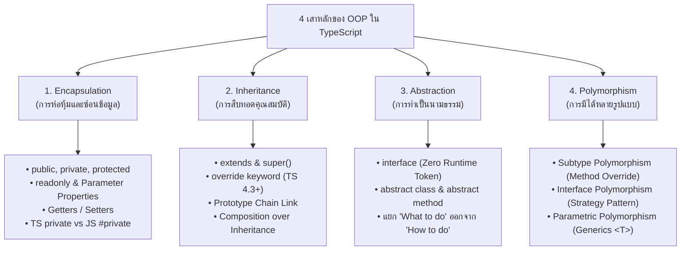

## 1. แนวคิด (Concept)

แม้ว่าในฝั่ง Frontend ยุคปัจจุบันจะนิยมกระบวนทัศน์แบบ Functional Programming (React Hooks, Pure Functions, Immutability) ทว่าในโลกของ Enterprise Backend, Domain-Driven Design (DDD), และเฟรมเวิร์กยอดนิยมอย่าง **NestJS 11** นั้น **Object-Oriented Programming (OOP)** ยังคงเป็นเสาหลักที่ขาดไม่ได้ในการสร้างระบบที่มีโครงสร้างมั่นคง จัดการความซับซ้อนของ Business Logic และรองรับการสเกล

หลายคนมักมีคำถามว่า: **"JavaScript ก็มีคลาส (ES6 Class) อยู่แล้ว แล้ว TypeScript มีอะไรเพิ่มใหม่ในเรื่อง OOP?"**

คำตอบคือ **JavaScript ดั้งเดิมไม่มีระบบ Type System และขาดฟีเจอร์ OOP ระดับองค์กรเกือบทั้งหมด** ในขณะที่ **TypeScript ได้เติมเต็ม "4 เสาหลักของ OOP (The 4 Pillars of OOP)"** ให้สมบูรณ์แบบ แข็งแกร่ง และปลอดภัยตั้งแต่ขั้นตอนคอมไพล์ (Compile-time Type Safety):

| เสาหลักของ OOP | ใน JavaScript ดั้งเดิม (ES6 / ES2022) | สิ่งที่ TypeScript เพิ่มใหม่และยกระดับขึ้นมา |
| :--- | :--- | :--- |
| **1. Encapsulation**<br/>(การห่อหุ้ม / ซ่อนข้อมูล) | เดิมทุกตัวเป็นสาธารณะ (Public) ทั้งหมด เพิ่งมี `#private` ใน ES2022 แต่ไม่มี `protected` หรือ `readonly` | เพิ่ม Access Modifiers (`public`, `private`, `protected`), เพิ่ม `readonly`, เพิ่ม **Parameter Properties** ใน Constructor และตรวจสอบ Type ของ Getters/Setters อย่างเคร่งครัด |
| **2. Inheritance**<br/>(การสืบทอดคุณสมบัติ) | มี `extends` และ `super()` บน Prototype แต่ไม่ตรวจ Type ของพารามิเตอร์ และไม่ตรวจความเข้ากันได้ของการ Override | ตรวจสอบ Type ของ `super()` ครบถ้วน, มีคีย์เวิร์ด **`override`** (TS 4.3+) ป้องกันพิมพ์ชื่อฟังก์ชันผิด, และควบคุมการเข้าถึงด้วย `protected` |
| **3. Abstraction**<br/>(การทำเป็นนามธรรม) | **ไม่มีเลย** (ไม่มีทั้ง `interface` และ `abstract class`) ต้องเขียน Error ดักเองตอน Runtime | เพิ่ม **`interface`** (สัญญาบริสุทธิ์แบบ Zero Runtime Cost) และ **`abstract class` / `abstract method`** บังคับคลาสลูกต้องเขียนการทำงานตามสัญญา |
| **4. Polymorphism**<br/>(การมีได้หลายรูปแบบ) | มีเพียง Duck Typing แบบหลวมๆ เสี่ยงต่อ Runtime Error (`is not a function`) หากส่งอ็อบเจกต์ผิด | รองรับ **Subtype Polymorphism**, **Interface Polymorphism** (Strategy Pattern), และ **Parametric Polymorphism (Generics)** พร้อม Type Safety 100% |

ในระบบ **Smart Butcher Marketplace** เราต้องจัดการความหลากหลายของชิ้นเนื้อเกรดพรีเมียม (Japanese Wagyu A5, Dry-Aged Ribeye, Tomahawk), นโยบายการคำนวณราคาตามลายไขมัน (Marbling Score), และช่องทางการชำระเงินที่หลากหลาย การประยุกต์ใช้ 4 เสาหลักของ OOP ร่วมกับ **SOLID Principles** และหลักการ **Composition over Inheritance** จะช่วยรับประกันว่าระบบจะไม่เกิด Regression Bug เมื่อมีการขยายธุรกิจ

<Callout type="tip" title="กฎทองของ OOP ใน TypeScript ยุคใหม่">
หัวใจของ OOP ใน TypeScript ไม่ใช่การสืบทอดคลาสลูกต่อกันหลายสิบชั้น (Deep Inheritance Tree) แต่เป็นการออกแบบ **Abstraction ผ่าน Interfaces**, การปกป้องข้อมูลด้วย **Encapsulation**, และการประกอบร่างวัตถุผ่าน **Dependency Injection** เพื่อให้ระบบยืดหยุ่นและทดสอบได้ง่าย (Testable)
</Callout>

---

## 2. หลักการเบื้องหลังและ 4 เสาหลักของ OOP (The 4 Pillars Under the Hood)

เพื่อให้เข้าใจลึกซึ้งระดับ Senior Architect เราจะมาผ่าดูการทำงานของทั้ง 4 เสาหลักใน TypeScript และกลไกที่ V8 JavaScript Engine ประมวลผลเบื้องหลัง:



---

### 2.1 เสาหลักที่ 1: Encapsulation (การห่อหุ้มและการซ่อนข้อมูล)

**Encapsulation** คือการรวมกลุ่ม State (ข้อมูล) และ Behavior (ฟังก์ชันการทำงาน) ให้อยู่ภายในหน่วยเดียวกัน (Class) พร้อมทั้ง **ซ่อนรายละเอียดภายในที่ไม่จำเป็น** ไม่ให้โค้ดภายนอกเข้าถึงหรือแก้ไขได้โดยตรง เพื่อป้องกันการเปลี่ยนแปลงค่าที่ผิดกฎธุรกิจ

#### สิ่งที่ TypeScript เพิ่มเข้ามา:
1. **Access Modifiers (ตัวกำหนดขอบเขตการเข้าถึง)**:
   - `public` (Default): เข้าถึงได้จากทุกที่ ทั้งภายในคลาส, คลาสลูก, และโค้ดภายนอก
   - `protected`: เข้าถึงได้เฉพาะ **ภายในคลาสตัวเองและคลาสลูกที่สืบทอดไปเท่านั้น** แต่ภายนอกห้ามเรียกใช้
   - `private`: เข้าถึงได้เฉพาะ **ภายในคลาสตัวเองเท่านั้น** แม้แต่คลาสลูกก็เข้าถึงไม่ได้
2. **`readonly` Property**: กำหนดให้ค่าถูกเขียนได้เฉพาะตอนประกาศหรือภายใน `constructor` เท่านั้น หลังจากนั้นห้ามแก้ไข (Immutability)
3. **Parameter Properties**: ไวยากรณ์พิเศษที่ช่วยประกาศและกำหนดค่า Property อัตโนมัติใน Constructor เพียงใส่ Access Modifier ข้างหน้า เช่น `constructor(private readonly price: number) {}`
4. **Getters และ Setters**: ช่วยดักจับการอ่านและเขียนค่า พร้อมตรวจสอบความถูกต้องของข้อมูล (Validation) ก่อนบันทึกจริง

#### ข้อแตกต่างสำคัญ: TypeScript `private` vs JavaScript `#private` (Hard Runtime Private)
นี่คือจุดที่นักพัฒนาหลายคนเข้าใจผิดมากที่สุด:
- **TypeScript `private foo: string`**: เป็นการตรวจเช็กเฉพาะตอน **Compile-time** เท่านั้น เมื่อถูกคอมไพล์เป็น JavaScript คำว่า `private` จะถูกลบทิ้งกลายเป็น Property ปกติ (`this.foo`) ซึ่งโค้ดภายนอกหรือผู้ไม่ประสงค์ดีสามารถอ่านหรือเข้าถึงผ่าน `obj["foo"]` หรือผ่าน `JSON.stringify()` ได้
- **JavaScript `#foo: string`**: เป็นมาตรฐานทางการของ ECMAScript (Private Identifier) ตัว V8 Engine จะบังคับใช้ความปลอดภัยนี้ที่ระดับ **Runtime จริง** ผ่าน Internal WeakMap ไม่สามารถเข้าถึงหรือแก้ไขจากภายนอกคลาสได้เลยแม้จะใช้ `obj["#foo"]` หรือ Object Reflection ก็ตาม

```typescript filename="src/example/encapsulation-comparison.ts"
export class ButcherWallet {
  // 1. TypeScript private: ป้องกันระดับ Type-check (แต่หายไปใน runtime JS)
  private softSecretPin: string = '1234';

  // 2. JavaScript Hard Private (#): ป้องกันระดับ Runtime ของ JavaScript Engine
  #hardAccountBalance: number = 50000;

  // 3. readonly: ห้ามเขียนซ้ำหลังจากสร้างอ็อบเจกต์
  public readonly accountId: string;

  constructor(accountId: string) {
    this.accountId = accountId;
  }

  // Getter สำหรับเปิดให้อ่านยอดเงิน แต่ไม่อนุญาตให้เขียนค่าตรงๆ จากภายนอก
  public get balance(): number {
    return this.#hardAccountBalance;
  }

  // Method สำหรับควบคุมการตัดเงินอย่างปลอดภัย
  public withdraw(amount: number, pin: string): boolean {
    if (this.softSecretPin !== pin) throw new Error('รหัส PIN ไม่ถูกต้อง');
    if (amount > this.#hardAccountBalance) throw new Error('ยอดเงินในกระเป๋าไม่เพียงพอ');
    this.#hardAccountBalance -= amount;
    return true;
  }
}
```

---

### 2.2 เสาหลักที่ 2: Inheritance (การสืบทอดคุณสมบัติ)

**Inheritance** คือกลไกที่ช่วยให้คลาสใหม่ (Child Class / Subclass) สามารถรับคุณสมบัติ (Properties) และพฤติกรรม (Methods) จากคลาสที่มีอยู่เดิม (Parent Class / Superclass) ได้ เพื่อลดการเขียนโค้ดซ้ำซ้อน (DRY: Don't Repeat Yourself)

#### สิ่งที่ TypeScript เพิ่มเข้ามา:
1. **Type-checked `super()`**: บังคับให้คลาสลูกต้องส่งพารามิเตอร์ให้กับ Constructor ของคลาสแม่ให้ครบถ้วนและถูก Type ตามที่คลาสแม่กำหนด
2. **`override` Keyword (TypeScript 4.3+)**: เมื่อเปิดใช้งานคอมไพเลอร์ออปชัน `noImplicitOverride: true` การใส่คีย์เวิร์ด `override` หน้าฟังก์ชันจะช่วยป้องกัน Human Error เช่น หากคลาสแม่เปลี่ยนชื่อฟังก์ชันจาก `calculateDiscount()` เป็น `getDiscount()` แต่คลาสลูกยังใช้ชื่อเดิม TypeScript จะแจ้ง Error ทันทีว่าไม่มีฟังก์ชันชื่อนี้ในคลาสแม่ให้ Override
3. **Protected Member Access**: ใน JavaScript ดั้งเดิมไม่มีคำว่า `protected` หากต้องการแชร์โค้ดให้คลาสลูกใช้งาน ต้องเปิดเป็นสาธารณะ (Public) ทั้งหมด แต่ TypeScript อนุญาตให้แชร์ตัวแปรหรือฟังก์ชันเฉพาะภายในตระกูลคลาสได้

```typescript filename="src/example/inheritance-override.ts"
export class BaseMeatCut {
  constructor(
    public readonly sku: string,
    protected basePricePerKg: number
  ) {}

  public getPrice(): number {
    return this.basePricePerKg;
  }
}

export class PremiumWagyuCut extends BaseMeatCut {
  constructor(
    sku: string,
    basePricePerKg: number,
    public readonly marblingScore: number
  ) {
    // TypeScript ตรวจสอบ Type และจำนวน Parameter ของ super() อย่างเข้มงวด
    super(sku, basePricePerKg);
  }

  // ใช้คีย์เวิร์ด override เพื่อรับประกันว่าเราเขียนทับฟังก์ชันที่มีอยู่จริงใน BaseMeatCut
  public override getPrice(): number {
    const marblingBonus = this.marblingScore * 150;
    return this.basePricePerKg + marblingBonus;
  }
}
```

<Callout type="warning" title="คำเตือนสถาปัตยกรรม: ระวัง Fragile Base Class">
อย่านำ Inheritance มาใช้เพียงเพื่อต้องการแชร์ฟังก์ชันเล็กๆ น้อยๆ การสืบทอดสร้าง **Coupling (ความผูกพันที่แน่นหนา)** ระหว่างคลาสแม่และคลาสลูก หากคลาสแม่เปลี่ยนแปลง อาจทำให้คลาสลูกทั้งหมดเสียหาย แนะนำให้ใช้ **Composition over Inheritance** เป็นค่าเริ่มต้นเสมอ
</Callout>

---

### 2.3 เสาหลักที่ 3: Abstraction (การทำเป็นนามธรรม)

**Abstraction** คือการซ่อนรายละเอียดการทำงานที่ซับซ้อนภายใน (Implementation Details) และเปิดเผยเฉพาะสิ่งที่จำเป็นต่อการใช้งาน (Interface หรือ Contract) โดยเน้นที่คำถามว่า **"วัตถุนี้ทำอะไรได้บ้าง? (What it does)"** แทนที่จะสนใจว่า **"มันทำสิ่งนั้นอย่างไร? (How it does it)"**

#### สิ่งที่ TypeScript เพิ่มเข้ามา (ซึ่ง JavaScript ดั้งเดิมไม่มีเลย!):
1. **`interface`**: เป็นโครงสร้าง Type บริสุทธิ์สำหรับกำหนดสัญญา (Contract) ไม่มีโค้ดการทำงานจริงอยู่ข้างในเลย และที่สำคัญคือ **มีค่าตัวตนเป็นศูนย์ใน Runtime (Zero Runtime Footprint)** เพราะคอมไพเลอร์จะลบทิ้งทั้งหมดเมื่อแปลงเป็น JS
2. **`abstract class`**: คลาสแม่แบบที่เป็นนามธรรม **ไม่สามารถสร้าง Instance โดยตรงผ่านคำสั่ง `new AbstractClass()` ได้** แต่สามารถบรรจุฟังก์ชันที่มีการทำงานจริง (Concrete Methods) เพื่อแชร์ให้คลาสลูก และสามารถมี **`abstract method`** ที่บังคับให้คลาสลูกต้องไปเขียน Implementation เองเสมอ

#### เปรียบเทียบ `interface` vs `abstract class`:

| คุณสมบัติ | Interface | Abstract Class |
| :--- | :--- | :--- |
| **ตัวตนใน Runtime (JavaScript)** | ถูกลบทิ้งหมด (Zero Footprint) | ยังคงมีตัวตนเป็น Function Constructor ใน JS |
| **การสร้าง Instance** | ทำไม่ได้ (`new` ไม่ได้) | ทำไม่ได้ใน TS (`new` ไม่ได้) |
| **การแชร์โค้ด (Method Implementation)** | ทำไม่ได้ (มีได้เฉพาะ Type Signatures) | **ทำได้** (ใส่ Logic กลางที่แชร์ร่วมกันได้) |
| **การใช้งานร่วมกับคลาส** | ใช้คำสั่ง `implements` (สืบทอดได้หลายตัวพร้อมกัน) | ใช้คำสั่ง `extends` (สืบทอดได้เพียงคลาสเดียว) |
| **การใช้เป็น DI Token ใน NestJS** | ใช้ตรงๆ ไม่ได้ (ต้องใช้ `Symbol` หรือ String Token) | **ใช้เป็น Injection Token ได้โดยตรง** เพราะมีตัวตนตอน Runtime |

```typescript filename="src/example/abstraction-demo.ts"
// สัญญา Interface (Abstraction ระดับ Type Contract)
export interface IInventoryTrackable {
  readonly currentStockKg: number;
  deductStock(amountKg: number): void;
}

// คลาสนามธรรม Abstract Class (Abstraction พร้อมแชร์โค้ดพื้นฐาน)
export abstract class AbstractMeatProduct implements IInventoryTrackable {
  public currentStockKg: number = 0;

  constructor(
    public readonly id: string,
    public readonly name: string
  ) {}

  // Concrete Method: มีโค้ดจริงที่แชร์ให้คลาสลูกใช้ได้ทันที
  public deductStock(amountKg: number): void {
    if (amountKg > this.currentStockKg) {
      throw new Error(`สต็อกเนื้อ ${this.name} ไม่เพียงพอสำหรับการตัดแต่ง`);
    }
    this.currentStockKg -= amountKg;
  }

  // Abstract Method: บังคับให้คลาสลูกต้องเขียนฟังก์ชันคำนวณราคาเฉพาะตัวเสมอ!
  public abstract calculateFinalPrice(grams: number): number;
}
```

---

### 2.4 เสาหลักที่ 4: Polymorphism (การมีได้หลายรูปแบบ)

**Polymorphism** มาจากภาษากรีก แปลว่า "มีได้หลายรูปร่าง" คือความสามารถของโปรแกรมในการปฏิบัติต่ออ็อบเจกต์ต่างชนิดกันผ่าน **อินเทอร์เฟซหรือคลาสแม่ตัวเดียวกัน** โดยที่แต่ละอ็อบเจกต์จะตอบสนองต่อคำสั่งเดียวกันด้วยพฤติกรรมเฉพาะตัวของมันเอง

ใน TypeScript มี Polymorphism อยู่ 3 รูปแบบหลัก:

1. **Subtype Polymorphism (Inclusion Polymorphism)**:
   - คลาสลูกทำการ Override Method ของคลาสแม่
   - เราสามารถเก็บ Instance ของคลาสลูกหลายๆ ชนิดไว้ในอาเรย์ของ Type คลาสแม่ เช่น `BaseMeatProduct[]` แล้ววนลูปสั่ง `.calculatePrice()` ได้พร้อมกัน โดยแต่ละก้อนจะคำนวณตามสูตรของมันเอง
2. **Interface Polymorphism (Parametric Contract)**:
   - อ็อบเจกต์หรือคลาสที่ไม่มีความเกี่ยวข้องทางสายเลือด แต่ทำตามสัญญา Interface เดียวกัน เช่น `IPaymentStrategy` ทำให้เราสลับเปลี่ยนตัวตัดเงินระหว่าง PromptPay, CreditCard, และ TrueMoney ได้อย่างอิสระโดยไม่ต้องแก้โค้ดหลัก
3. **Parametric Polymorphism (Generics `<T>`)**:
   - การเขียนคลาสหรือฟังก์ชันที่ทำงานร่วมกับ Type ใดๆ ก็ได้ เช่น `GenericRepository<T>` โดยยังคงรักษา Type Safety ไว้ครบถ้วน

```typescript filename="src/example/polymorphism-concept.ts"
// Subtype Polymorphism ใน Action
function printMeatPrice(product: AbstractMeatProduct, grams: number) {
  // ฟังก์ชันนี้ไม่สนว่า product จะเป็น Wagyu, DryAged หรือ Pork Chop
  // ตราบใดที่สืบทอดมาจาก AbstractMeatProduct มันจะรัน calculateFinalPrice ตามสูตรของคลาสนั้นๆ!
  const price = product.calculateFinalPrice(grams);
  console.log(`สินค้า: ${product.name} | น้ำหนัก: ${grams}g | ราคา: ฿${price}`);
}
```

---

### 2.5 Prototype Chain และ Dependency Injection ใน NestJS

เบื้องหลังแล้ว TypeScript Class เมื่อถูกแปลงเป็น JavaScript จะทำงานบนกลไก **Prototype Chain**:
- คำสั่ง `class Dog extends Animal` จะกลายเป็นการเชื่อม `Object.setPrototypeOf(Dog.prototype, Animal.prototype)`
- การเรียก `super.speak()` คือการเรียก `Animal.prototype.speak.call(this)`

ในเฟรมเวิร์กอย่าง **NestJS 11** เมทาดาทาของคลาสจะถูกบันทึกผ่าน TypeScript Decorator (`@Injectable()`, `@Inject()`) โดยตัวคอมไพเลอร์จะส่งออกข้อมูลประเภทพารามิเตอร์ลงใน `design:paramtypes` ทำให้ NestJS IoC Container สามารถค้นหาคลาสที่ตรงกับสัญญามาฉีด (Inject) ให้อัตโนมัติในตอน Runtime

---

## 3. ตัวอย่างโค้ด (Smart Butcher Marketplace)

### ตัวอย่างที่ 1: 4 เสาหลัก OOP ครบวงจรในระบบตัดแต่งและคำนวณราคาเนื้อพรีเมียม

ตัวอย่างนี้รวบรวม **Encapsulation, Inheritance, Abstraction, และ Polymorphism** เข้าไว้ด้วยกันในโมเดลสินค้าชิ้นเนื้อระดับพรีเมียม:

```typescript filename="src/domain/meat/meat-products.ts"
// =========================================================================
// 1. ABSTRACTION: สัญญา Interface และ Abstract Base Class
// =========================================================================

export interface ISliceable {
  slice(thicknessMm: number): string;
}

export abstract class BaseMeatCut implements ISliceable {
  // ENCAPSULATION: Hard Private Field ซ่อนต้นทุนราคาส่งระดับ Runtime ไม่ให้รั่วไหล
  #wholesaleCostPerKg: number;

  public readonly createdAt: Date = new Date();

  // Parameter Properties (Encapsulation ผ่าน public, protected, readonly)
  constructor(
    public readonly sku: string,
    public readonly name: string,
    protected basePricePerKg: number,
    wholesaleCostPerKg: number,
    public readonly stockGrams: number
  ) {
    if (basePricePerKg <= 0) throw new Error('ราคาฐานต่อกิโลกรัมต้องมากกว่า 0');
    this.#wholesaleCostPerKg = wholesaleCostPerKg;
  }

  // Encapsulated Method สำหรับคำนวณกำไรขั้นต้น (เข้าถึงได้เฉพาะในตระกูลคลาส)
  protected calculateGrossMargin(): number {
    return (this.basePricePerKg - this.#wholesaleCostPerKg) / this.basePricePerKg;
  }

  public slice(thicknessMm: number): string {
    return `ตัดแต่งชิ้นเนื้อ ${this.name} ความหนา ${thicknessMm} มิลลิเมตรมาตรฐาน`;
  }

  // ABSTRACTION: บังคับคลาสลูกต้องเขียนสูตรคิดราคาตามเอกลักษณ์ของตนเอง
  public abstract calculatePrice(weightGrams: number): number;
}

// =========================================================================
// 2. INHERITANCE: คลาสลูกสืบทอดคุณสมบัติและพฤติกรรมจาก BaseMeatCut
// =========================================================================

export class JapaneseWagyuCut extends BaseMeatCut {
  constructor(
    sku: string,
    name: string,
    basePricePerKg: number,
    wholesaleCostPerKg: number,
    stockGrams: number,
    public readonly bmsScore: number // Marbling Score 3 - 12
  ) {
    super(sku, name, basePricePerKg, wholesaleCostPerKg, stockGrams);
    if (bmsScore < 3 || bmsScore > 12) {
      throw new Error('ระดับลายไขมันวากิว (BMS) ต้องอยู่ระหว่าง 3 ถึง 12');
    }
  }

  // POLYMORPHISM: Override คำนวณราคาด้วยตัวคูณ BMS
  public override calculatePrice(weightGrams: number): number {
    const kg = weightGrams / 1000;
    const bmsMultiplier = 1 + (this.bmsScore - 3) * 0.12; // BMS ยิ่งสูง ราคายิ่งทวีคูณ
    return Math.round(kg * this.basePricePerKg * bmsMultiplier);
  }

  public override slice(thicknessMm: number): string {
    return `[เชฟญี่ปุ่น] สไลด์เนื้อวากิว ${this.name} BMS ${this.bmsScore} ความหนา ${thicknessMm} มม. อย่างประณีต`;
  }
}

export class DryAgedBeefCut extends BaseMeatCut {
  constructor(
    sku: string,
    name: string,
    basePricePerKg: number,
    wholesaleCostPerKg: number,
    stockGrams: number,
    public readonly agingDays: number // จำนวนวันบ่ม เช่น 30, 45, 60 วัน
  ) {
    super(sku, name, basePricePerKg, wholesaleCostPerKg, stockGrams);
  }

  // POLYMORPHISM: Override คำนวณราคาโดยบวกค่าห้องบ่มตามจำนวนวัน
  public override calculatePrice(weightGrams: number): number {
    const kg = weightGrams / 1000;
    const agingStorageCostPerKg = this.agingDays * 20; // ค่าห้องบ่มวันละ 20 บาท/กก.
    return Math.round(kg * (this.basePricePerKg + agingStorageCostPerKg));
  }
}

// =========================================================================
// 3. POLYMORPHISM ในการประมวลผลคำสั่งซื้อรวม (Dynamic Dispatch)
// =========================================================================

export class ButcherOrderService {
  public static calculateTotalCartPrice(items: { product: BaseMeatCut; grams: number }[]): number {
    // เรียก calculatePrice โดยไม่ต้องเช็ก if-else ว่าเป็น Wagyu หรือ Dry-Aged
    return items.reduce((total, item) => {
      return total + item.product.calculatePrice(item.grams);
    }, 0);
  }
}
```

---

### ตัวอย่างที่ 2: Interface Polymorphism & Strategy Pattern ในระบบชำระเงิน NestJS 11

ตัวอย่างนี้แสดงการใช้ **Interface Polymorphism** เพื่อให้ระบบชำระเงินสามารถสลับช่องทางจ่ายเงินได้อย่างยืดหยุ่นตามหลัก Open/Closed Principle:

```typescript filename="src/modules/payments/interfaces/payment-strategy.interface.ts"
// Abstraction: สัญญาสำหรับกลยุทธ์การชำระเงิน
export interface IPaymentStrategy {
  readonly providerName: string;
  supports(method: string): boolean;
  charge(orderId: string, amountThb: number): Promise<{ transactionId: string; status: 'SUCCESS' | 'FAILED' }>;
}

export const PAYMENT_STRATEGIES_TOKEN = Symbol('PAYMENT_STRATEGIES_TOKEN');
```

```typescript filename="src/modules/payments/strategies/promptpay.strategy.ts"
import { Injectable, Logger } from '@nestjs/common';
import { IPaymentStrategy } from '../interfaces/payment-strategy.interface';

@Injectable()
export class PromptPayStrategy implements IPaymentStrategy {
  public readonly providerName = 'PromptPay QR (BOT Standard)';
  private readonly logger = new Logger(PromptPayStrategy.name);

  supports(method: string): boolean {
    return method.toUpperCase() === 'PROMPTPAY';
  }

  async charge(orderId: string, amountThb: number) {
    this.logger.log(`สร้าง QR Code สำหรับบิล ${orderId} ยอดเงิน ฿${amountThb}`);
    return { transactionId: `PP-TXN-${Date.now()}`, status: 'SUCCESS' as const };
  }
}
```

```typescript filename="src/modules/payments/strategies/credit-card.strategy.ts"
import { Injectable, Logger } from '@nestjs/common';
import { IPaymentStrategy } from '../interfaces/payment-strategy.interface';

@Injectable()
export class CreditCardStrategy implements IPaymentStrategy {
  public readonly providerName = 'Credit Card Gateway (2C2P / Omise)';
  private readonly logger = new Logger(CreditCardStrategy.name);

  supports(method: string): boolean {
    return method.toUpperCase() === 'CREDIT_CARD';
  }

  async charge(orderId: string, amountThb: number) {
    this.logger.log(`ตัดวงเงินบัตรเครดิตสำหรับบิล ${orderId} ยอดเงิน ฿${amountThb}`);
    return { transactionId: `CC-TXN-${Date.now()}`, status: 'SUCCESS' as const };
  }
}
```

```typescript filename="src/modules/payments/services/payment.service.ts"
import { Injectable, Inject, BadRequestException, Logger } from '@nestjs/common';
import { IPaymentStrategy, PAYMENT_STRATEGIES_TOKEN } from '../interfaces/payment-strategy.interface';

@Injectable()
export class PaymentService {
  private readonly logger = new Logger(PaymentService.name);

  // Constructor Injection: รับ Array ของทุก Strategy ที่ลงทะเบียนไว้ใน Module
  constructor(
    @Inject(PAYMENT_STRATEGIES_TOKEN)
    private readonly strategies: IPaymentStrategy[]
  ) {}

  public async processPayment(orderId: string, method: string, amountThb: number) {
    // Polymorphism: ค้นหา Strategy ที่รองรับ แล้วสั่ง charge ทันที
    const matchedStrategy = this.strategies.find((s) => s.supports(method));

    if (!matchedStrategy) {
      throw new BadRequestException(`ระบบยังไม่รองรับการชำระเงินด้วยช่องทาง: ${method}`);
    }

    this.logger.log(`ดำเนินการชำระเงินผ่าน: ${matchedStrategy.providerName}`);
    return await matchedStrategy.charge(orderId, amountThb);
  }
}
```

---

### ตัวอย่างที่ 3: Encapsulation ด้วย Getters/Setters และ State Machine ใน Order Entity

ตัวอย่างนี้แสดงการใช้ **Encapsulation** เพื่อปกป้องสถานะของคำสั่งซื้อ ไม่ให้ถูกเปลี่ยนข้ามขั้นตอนอย่างผิดกฎหมาย:

```typescript filename="src/domain/orders/order.entity.ts"
export type OrderStatus = 'PENDING' | 'PAID' | 'PREPARING_MEAT' | 'DELIVERED' | 'CANCELLED';

export class ButcherOrder {
  // ซ่อนสถานะไว้ภายในคลาสเพื่อป้องกันการแก้ไขตรงๆ จากภายนอก
  private _status: OrderStatus = 'PENDING';
  private readonly _createdAt: Date = new Date();

  constructor(
    public readonly orderId: string,
    public readonly customerId: string,
    public readonly totalAmount: number
  ) {}

  // Getter สำหรับเปิดให้อ่านสถานะได้แบบ Read-only
  public get status(): OrderStatus {
    return this._status;
  }

  public get createdAt(): Date {
    return new Date(this._createdAt.getTime()); // ส่งคืน Clone ป้องกันการแก้ไข Date
  }

  // Encapsulated Business Rules: การเปลี่ยนสถานะต้องเป็นไปตามขั้นตอนเท่านั้น
  public markAsPaid(): void {
    if (this._status !== 'PENDING') {
      throw new Error(`ไม่สามารถชำระเงินได้เนื่องจากสถานะปัจจุบันคือ ${this._status}`);
    }
    this._status = 'PAID';
  }

  public startPreparingMeat(): void {
    if (this._status !== 'PAID') {
      throw new Error('เชฟไม่สามารถเริ่มแล่เนื้อได้จนกว่าลูกค้าจะชำระเงินเรียบร้อยแล้ว');
    }
    this._status = 'PREPARING_MEAT';
  }

  public markAsDelivered(): void {
    if (this._status !== 'PREPARING_MEAT') {
      throw new Error('ไม่สามารถจัดส่งได้ก่อนที่การแล่เนื้อจะเสร็จสิ้น');
    }
    this._status = 'DELIVERED';
  }
}
```

---

## 4. ข้อผิดพลาดที่พบบ่อย (Anti-pattern vs Best Practice)

### 4.1 คิดว่า TypeScript `private` ซ่อนข้อมูลลับได้จริงระดับ Runtime
- **Anti-pattern**: เก็บ API Secret หรือ Password Hash ไว้ในตัวแปร `private apiKey: string` ของคลาส โดยคิดว่าจะปลอดภัย แต่เมื่อส่งอ็อบเจกต์ผ่าน `JSON.stringify(wallet)` หรือถูกอ่านผ่านโค้ดภายนอก ค่านั้นจะหลุดออกไปทันทีเพราะคำว่า `private` หายไปตอนคอมไพล์
- **Best Practice**: หากต้องการความปลอดภัยระดับ Runtime ให้ใช้ **ECMAScript Private Identifier (`#apiKey`)** ซึ่งตัว V8 Engine จะซ่อนจริง หรือไม่เก็บความลับไว้ใน Property ของ Object เลยตั้งแต่แรก

### 4.2 การสืบทอดคลาสลึกเกินไป (Deep Inheritance Hierarchies)
- **Anti-pattern**: สร้างคลาสสืบทอดกันเป็นห่วงโซ่ยาวเหยียด เช่น `Entity -> AuditableEntity -> Product -> MeatProduct -> BeefProduct -> WagyuProduct` ทำให้เกิดปัญหา **Fragile Base Class** เมื่อแก้คลาสบน คลาสล่างพังทั้งยวง
- **Best Practice**: ยึดถือหลักการ **Composition over Inheritance** ใช้ Interfaces กำหนดสัญญา และดึง Service หรือ Helper เข้ามาทำงานร่วมกันผ่าน Dependency Injection

### 4.3 การละเมิด Liskov Substitution Principle (LSP) ใน Polymorphism
- **Anti-pattern**: คลาสลูกไป Override ฟังก์ชันของคลาสแม่ แต่กลับโยน Exception ในเงื่อนไขที่คลาสแม่ยอมรับได้ หรือเปลี่ยนเงื่อนไข Return Type จนทำให้โค้ดภายนอกที่เรียกใช้งานผ่านคลาสแม่พังทลาย
- **Best Practice**: คลาสลูกทุกตัวต้องสามารถนำไปใช้งานแทนที่คลาสแม่ได้ 100% โดยไม่ทำให้การทำงานของระบบผิดเพี้ยน

```typescript filename="src/types/solid-matrix.ts"
// ตารางเชื่อมโยง 4 เสาหลักของ OOP กับหลักการ SOLID ใน TypeScript
export interface SolidOopMapping {
  pillar: 'Encapsulation' | 'Inheritance' | 'Abstraction' | 'Polymorphism';
  solidPrinciple: string;
  butcherApplication: string;
}

export const SOLID_OOP_MAPPINGS: SolidOopMapping[] = [
  {
    pillar: 'Encapsulation',
    solidPrinciple: 'Single Responsibility Principle (SRP)',
    butcherApplication: 'ซ่อน State ของสต็อกเนื้อและสถานะบิลไว้ใน Entity ไม่ให้ Service อื่นแก้ตามใจชอบ',
  },
  {
    pillar: 'Inheritance',
    solidPrinciple: 'Liskov Substitution Principle (LSP)',
    butcherApplication: 'คลาส WagyuSteakCut ต้องแทนที่ BaseMeatCut ได้โดยไม่ทำให้การคำนวณราคารวมล้มเหลว',
  },
  {
    pillar: 'Abstraction',
    solidPrinciple: 'Interface Segregation & Dependency Inversion (ISP / DIP)',
    butcherApplication: 'PaymentService พึ่งพา IPaymentStrategy Interface ไม่พึ่งพาคลาสของธนาคารตรงๆ',
  },
  {
    pillar: 'Polymorphism',
    solidPrinciple: 'Open/Closed Principle (OCP)',
    butcherApplication: 'เพิ่มช่องทางจ่ายเงินใหม่ (เช่น TrueMoney) ด้วยการเขียนคลาสใหม่โดยไม่ต้องแก้โค้ดเดิม',
  },
];
```

---

## 5. ควรใช้เมื่อไหร่ และ ไม่ควรใช้เมื่อไหร่

### ควรใช้ (Recommended Use Cases)
- **Enterprise Backend Architecture (NestJS 11)**: ใช้สร้าง Controllers, Services, Guards, Pipes, และ Interceptors ร่วมกับระบบ Inversion of Control (IoC)
- **Domain-Driven Design (DDD)**: ใช้ Class ในการสร้าง Entities, Aggregates, และ Value Objects ที่มี State และ Business Rules ที่ต้องปกป้อง
- **Design Patterns เชิงพฤติกรรม**: เช่น Strategy Pattern, Factory Pattern, Command Pattern, และ State Pattern เพื่อรองรับการปรับแต่งที่ยืดหยุ่น

### ไม่ควรใช้ (When NOT to Use)
- **React 19 Components**: อย่าใช้ Class Components ใน React ยุคใหม่ ให้ใช้ Functional Components และ Hooks เท่านั้น
- **Data Transfer Objects (DTO) ในฝั่ง Frontend**: ใน Next.js หน้าบ้าน การใช้ Plain TypeScript Interfaces หรือ Type Aliases ที่ Infer มาจาก Zod สั้นกระชับกว่าและไม่เปลือง Bundle Size
- **ฟังก์ชันคำนวณเดี่ยวๆ (Utility Functions)**: ไม่จำเป็นต้องสร้างคลาสที่มีแต่ `static method` เช่น `MathHelper.add(a, b)` การเขียนเป็น Pure Function แบบ `export function add(a, b)` ให้ผลดีต่อ Tree-shaking มากกว่า

---

## 6. คำถามสัมภาษณ์งาน (Interview Q&A)

### Q1: อธิบาย 4 เสาหลักของ OOP ใน TypeScript และระบุว่า TypeScript เพิ่มอะไรใหม่ที่ JavaScript ดั้งเดิมไม่มี?
**แนวคำตอบระดับ Senior**:
4 เสาหลักของ OOP ประกอบด้วย:
1. **Encapsulation**: การห่อหุ้มและซ่อนข้อมูล — ใน JavaScript ดั้งเดิมไม่มี Access Modifiers เลย แต่ TypeScript เพิ่ม `public`, `private`, `protected`, `readonly`, และ Parameter Properties เข้ามาช่วยบังคับตรวจสิทธิ์ในขั้นตอน Compile-time
2. **Inheritance**: การสืบทอดคุณสมบัติ — แม้ JS จะมี `extends` แต่ TypeScript เพิ่มการตรวจ Type ที่เข้มงวดของ `super()` และมีคีย์เวิร์ด `override` (TS 4.3+) ป้องกันการเขียนทับชื่อฟังก์ชันผิด
3. **Abstraction**: การทำเป็นนามธรรม — **นี่คือสิ่งที่ JS ไม่มีเลย** แต่ TypeScript เพิ่ม `interface` (สัญญาบริสุทธิ์แบบไม่มี overhead ตอน runtime) และ `abstract class` / `abstract method` เพื่อแยก What (สัญญา) ออกจาก How (การทำงานจริง)
4. **Polymorphism**: การมีได้หลายรูปแบบ — ใน JS มีเพียง Duck typing ที่ไร้ Type safety แต่ TypeScript ยกระดับเป็น Subtype Polymorphism, Interface Polymorphism (Strategy Pattern), และ Parametric Polymorphism (Generics) ที่ตรวจจับบั๊กได้ตั้งแต่ตอนเขียนโค้ด

### Q2: อะไรคือความต่างระหว่าง `interface` กับ `abstract class` ใน TypeScript และมีเกณฑ์เลือกใช้อย่างไร?
**แนวคำตอบระดับ Senior**:
- **Interface**: เป็น Type-level contract ล้วนๆ เมื่อคอมไพล์เป็น JavaScript จะถูกลบทิ้งทั้งหมด (Zero Runtime Footprint) ไม่สามารถบรรจุ Implementation ใดๆ ได้ และคลาสหนึ่งสามารถ `implements` ได้หลาย Interface
- **Abstract Class**: เป็นคลาสจริงที่มีตัวตนอยู่ใน Runtime JavaScript หลังคอมไพล์ แม้จะ `new` ตรงๆ ใน TS ไม่ได้ แต่สามารถใส่ Concrete Methods (Logic ร่วมที่แชร์ให้คลาสลูก) ได้ และใน NestJS เราสามารถนำ Abstract Class มาใช้เป็น Injection Token สำหรับ Dependency Injection ได้โดยตรง
- **เกณฑ์เลือกใช้**: ใช้ **Interface** สำหรับกำหนดรูปร่างของข้อมูล (DTO/Data Model) หรือกำหนดสัญญาระดับสูงที่ต้องการ Multiple Implementation ส่วน **Abstract Class** ใช้เมื่อต้องการแชร์โค้ดการทำงานร่วมกันระหว่างคลาสในตระกูลเดียวกัน หรือต้องการ DI Token ใน Runtime

### Q3: TypeScript `private` ต่างจาก JavaScript `#private` อย่างไร และ Parameter Properties ใน Constructor มีการทำงานอย่างไร?
**แนวคำตอบระดับ Senior**:
- **`private foo`**: เป็น Soft compile-time privacy ของ TypeScript เท่านั้น ช่วยเตือนไม่ให้เขียนโค้ดเข้าถึงจากภายนอก แต่เมื่อคอมไพล์เป็น JS มันจะกลายเป็น property ธรรมดาที่เข้าถึงผ่าน `obj['foo']` หรือสะท้อนผ่าน `JSON.stringify()` ได้
- **`#foo`**: เป็น Hard runtime privacy ตามมาตรฐาน ECMAScript V8 Engine จะใช้ WeakMap ภายในป้องกันการเข้าถึงจากภายนอกคลาส 100% แม้ตอน Runtime
- **Parameter Properties**: เป็น Syntactic Sugar ใน Constructor เช่น `constructor(private readonly price: number) {}` ซึ่ง TypeScript จะประกาศตัวแปรและใส่ `this.price = price;` ให้ในโค้ด JavaScript ที่คอมไพล์ออกมาโดยอัตโนมัติ ช่วยลดโค้ดซ้ำซ้อนอย่างมาก

---

## ลำดับการเรียนที่แนะนำ และ ดูเพิ่มเติมที่

1. พื้นฐานภาษาและชนิดข้อมูล: [TypeScript Basics](/docs/typescript/basics)
2. สัญลักษณ์และความหมายใน TypeScript: [TypeScript Symbols & Operators](/docs/typescript/basics#3-สัญลักษณ์และเครื่องหมายที่พบบ่อยใน-typescript-symbols--syntax)
3. ฟังก์ชันและ Built-in Methods ยอดนิยม: [TypeScript Built-in Functions](/docs/typescript/builtin-functions)
4. การใช้งาน Generics ระดับสูง: [TypeScript Generics](/docs/typescript/generics)
5. สถาปัตยกรรม Backend ร่วมกับ NestJS: [TypeScript in Backend](/docs/typescript/backend-ts)
6. สถาปัตยกรรม Dependency Injection ใน NestJS: [NestJS Dependency Injection](/docs/backend/nestjs/dependency-injection)
