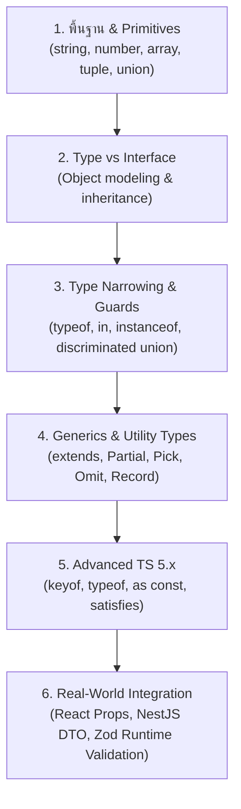

## 1. แนวคิด (Concept)

TypeScript ถูกออกแบบมาเพื่อเพิ่มความปลอดภัยและความมั่นใจในการเขียนโค้ด แต่บ่อยครั้งที่นักพัฒนาอาจเลือก "ทางลัด" ที่ทำลายความสามารถในการคุ้มกันของ TypeScript ลงโดยไม่รู้ตัว

การหลีกเลี่ยง **3 ปีศาจแห่ง Anti-Patterns** (`any`, Type Assertion `as`, และ Non-null Assertion `!`) คือจุดตัดระหว่างนักพัฒนาทั่วไปกับวิศวกรซอฟต์แวร์ระดับมืออาชีพ

---

## 2. สามปีศาจยอดฮิต (The Three Major Anti-Patterns)

### 1. การใช้ `any` พร่ำเพรื่อ
`any` ไม่ใช่แค่ชนิดข้อมูลหนึ่ง แต่คือคำสั่ง **"ปิดระบบตรวจจับ TypeScript ทั้งหมดสำหรับตัวแปรนี้"** เปรียบเหมือนการปิดระบบเตือนภัยไฟไหม้เพื่อไม่ให้ได้ยินเสียงร้องเตือน

### 2. การใช้ Type Assertion (`as Type`) หลอก Compiler
`as` ไม่ได้ทำการแปลงข้อมูล (Type Cast) ใน Runtime แต่อย่างใด มันเพียงแค่บอก TypeScript ว่า *"เชื่อฉันเถอะ ฉันรู้ดีกว่านาย"* แต่ถ้าข้อมูลจริงไม่ตรงกับที่อ้าง โปรแกรมจะแครชในทันที

### 3. การใช้ Non-null Assertion (`!`)
เครื่องหมายอัศเจรีย์ต่อท้ายตัวแปร เช่น `user!.profile!.avatar` เป็นการรับรองด้วยชีวิตว่าค่าตรงนั้นจะไม่มีทางเป็น `null` หรือ `undefined` ซึ่งหากเกิดข้อผิดพลาดขึ้น โค้ดจะหยุดทำงานทันที

---

## 3. ตัวอย่างโค้ด: เปรียบเทียบ ผิด vs ถูก

### ตัวอย่างที่ 1: `any` vs `unknown` พร้อม Narrowing

#### ❌ โค้ดที่ผิด: ใช้ `any` หนีปัญหา
```typescript
function processUserData(data: any) {
  // ไม่มีการแจ้งเตือนใดๆ แม้ว่า data จะเป็นตัวเลข หรือ null
  console.log(data.profile.fullName.toUpperCase()); 
}
```

#### ✅ โค้ดที่ถูกต้อง: ใช้ `unknown` แล้วบีบขอบเขต (Narrowing)
```typescript
interface UserProfile {
  profile: {
    fullName: string;
  };
}

function isUserProfile(value: unknown): value is UserProfile {
  return (
    typeof value === 'object' &&
    value !== null &&
    'profile' in value &&
    typeof (value as { profile: unknown }).profile === 'object' &&
    (value as { profile: { fullName: unknown } }).profile !== null &&
    typeof (value as { profile: { fullName: unknown } }).profile.fullName === 'string'
  );
}

function processUserData(data: unknown) {
  if (isUserProfile(data)) {
    // ปลอดภัย 100% Compiler มั่นใจได้ว่ามี fullName อยู่จริง
    console.log(data.profile.fullName.toUpperCase());
  } else {
    console.error('รูปแบบข้อมูลผู้ใช้ไม่ถูกต้อง');
  }
}
```

### ตัวอย่างที่ 2: Type Assertion `as` vs Type Guard

#### ❌ โค้ดที่ผิด: ใช้ `as` ดื้อๆ กับข้อมูลจากภายนอก
```typescript
interface Order {
  id: string;
  totalPrice: number;
}

const rawResponse = JSON.parse('{"id": "ORD-001"}'); // ขาด totalPrice
const order = rawResponse as Order; // Compiler ไม่เตือนเลย!

// 💥 เกิด NaN หรือ Logic Error ในระบบบัญชี
const tax = order.totalPrice * 0.07; 
```

#### ✅ โค้ดที่ถูกต้อง: ใช้ Runtime Validation (เช่น Zod)
```typescript
import { z } from 'zod';

const OrderSchema = z.object({
  id: z.string(),
  totalPrice: z.number().positive(),
});

const parseResult = OrderSchema.safeParse(rawResponse);
if (parseResult.success) {
  const tax = parseResult.data.totalPrice * 0.07;
  console.log(`คำนวณภาษีสำเร็จ: ${tax}`);
} else {
  console.error('ข้อมูลคำสั่งซื้อผิดพลาด ขาดฟิลด์สำคัญ');
}
```

### ตัวอย่างที่ 3: Non-null Assertion `!` vs Optional Chaining & Nullish Coalescing

#### ❌ โค้ดที่ผิด: ปักธง `!` เสี่ยงดวง
```typescript
const searchInput = document.getElementById('search-box')!; // ถ้า id เปลี่ยน หรือยังไม่ render -> crash ทันที
searchInput.focus();
```

#### ✅ โค้ดที่ถูกต้อง: ตรวจสอบหรือใช้ Optional Chaining
```typescript
const searchInput = document.getElementById('search-box');
if (searchInput instanceof HTMLInputElement) {
  searchInput.focus();
}
```

---

## 4. Checklist สรุปสิ่งที่ต้องรู้สำหรับ TypeScript

- [x] **เข้าใจ Type Erasure**: จำไว้เสมอว่า Type ทั้งหมดจะหายไปตอนรันไทม์
- [x] **แยกความแตกต่าง `any` vs `unknown`**: เลิกใช้ `any` ให้ใช้ `unknown` แทนเมื่อไม่แน่ใจ
- [x] **Interface vs Type**: ใช้ `interface` กับ Object/OOP/Extends และใช้ `type` กับ Unions/Primitives/Utilities
- [x] **Discriminated Unions**: ใช้ Tagged Union จัดการ State ของหน้าจอ (Loading, Error, Success) เสมอ
- [x] **Utility Types พื้นฐาน**: คล่องแคล่วกับ `Pick`, `Omit`, `Partial`, `Record`, `ReturnType`, `Awaited`
- [x] **Runtime Validation**: ใช้ Zod ร่วมกับ TypeScript เสมอในจุดรับข้อมูลภายนอก (API, Form, Env)
- [x] **tsconfig ที่เข้มงวด**: เปิด `strict: true` และ `noUncheckedIndexedAccess: true` เสมอ

---

## 5. ลำดับการเรียนรู้ที่แนะนำ (Recommended Learning Roadmap)



---

## 6. คำถามสัมภาษณ์งานยอดนิยม (Top Interview Questions)

### Q1: จงอธิบายความแตกต่างระหว่าง `any`, `unknown` และ `never`?
**แนวทางคำตอบ**:
- `any`: ปิด Type Checking ทั้งหมด เรียก method อะไรก็ได้ assign ค่าให้ type อะไรก็ได้ (เสี่ยงสูงสุด)
- `unknown`: เป็น Top Type เหมือน any แต่มีความปลอดภัย เพราะ TypeScript จะไม่อนุญาตให้นำตัวแปรไปเรียกใช้หรือ assign ให้ type อื่น จนกว่าจะทำการ Narrowing หรือ Type Guard ก่อน
- `never`: เป็น Bottom Type แทนค่าที่ไม่มีวันเกิดขึ้นจริง (Empty set) เช่น ฟังก์ชันที่ throw error ตลอดกาล หรือตัวแปรใน `default` case ของ exhaustive check ที่ตรวจครบทุกเงื่อนไขแล้ว

### Q2: ตัวดำเนินการ `satisfies` ที่เพิ่มเข้ามาใน TypeScript 4.9+ ช่วยแก้ปัญหาของ Type Annotation ได้อย่างไร?
**แนวทางคำตอบ**:
การระบุ Type Annotation แบบเดิม เช่น `const palette: Record<string, string | number[]> = { ... }` จะทำให้ Type ของ Object ขยายกลายเป็น Union กว้างๆ ส่งผลให้เวลาเรียกใช้งาน เช่น `palette.primary.toUpperCase()` ตัว TypeScript จะเตือน error เพราะคิดว่าอาจเป็น number[] ได้

แต่การใช้ `satisfies` เช่น `const palette = { ... } satisfies Record<string, string | number[]>` จะเป็นการ **ตรวจสอบว่าโครงสร้างตรงตามสัญญาหรือไม่ โดยที่ยังคงรักษา Type ดั้งเดิมที่เจาะจง (Exact Literal Type)** เอาไว้ ทำให้เรายังสามารถเรียกใช้ String methods บน property ที่เป็น string ได้อย่างปลอดภัย 100%
