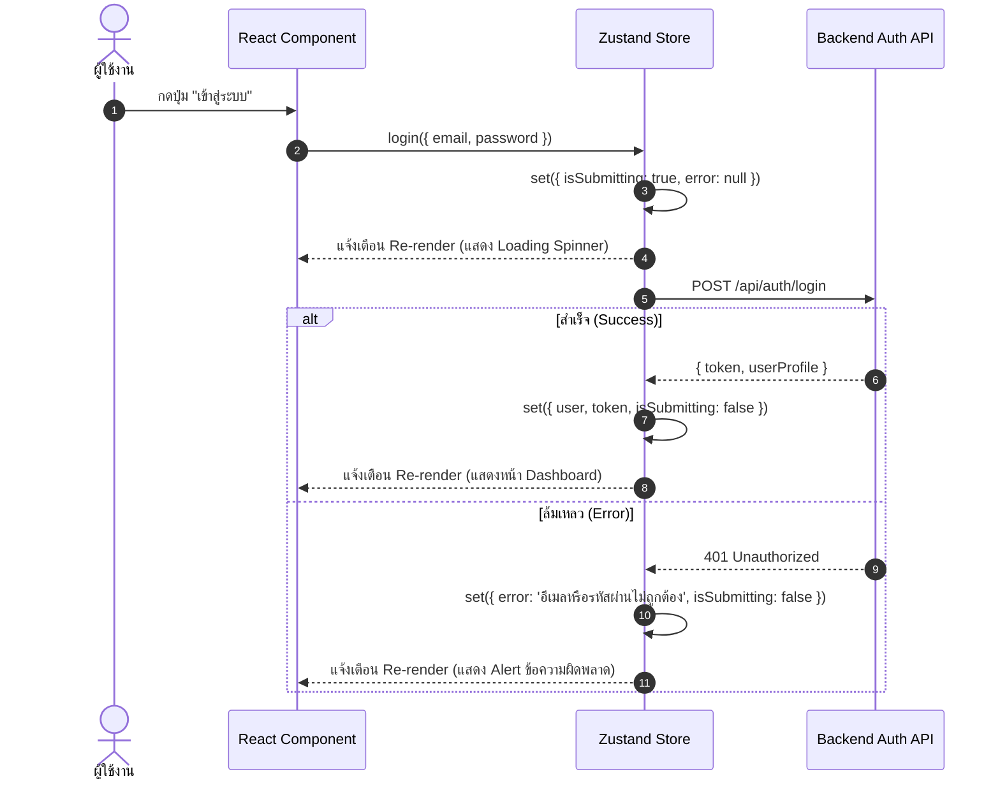

## 1. แนวคิด (Concept)

ใน Zustand การจัดการตรรกะแบบไม่ประสานเวลา (Asynchronous Logic) มีความตรงไปตรงมาและเป็นธรรมชาติที่สุด:
1. **ไม่ต้องพึ่ง Middleware พิเศษ**: ต่างจาก Redux ที่ต้องติดตั้ง `redux-thunk` หรือ `redux-saga` ใน Zustand ฟังก์ชัน Action ใดๆ ก็ตามสามารถเป็น `async/await` ได้ทันที โดยสามารถสั่ง `set()` เมื่อไหร่ก็ได้ตามต้องการ (ก่อนส่งคำขอ, หลังได้ข้อมูล, หรือเมื่อเกิดข้อผิดพลาด)
2. **ขอบเขตการใช้งาน Async ใน Zustand**:
   - เหมาะกับ **Workflow-based Async**: การล็อกอิน/ล็อกเอาท์ (Auth Flow), การเชื่อมต่อ WebSocket, การอัปโหลดไฟล์ขนาดใหญ่พร้อม Progress Bar, หรือการทำงานแบบ Multi-step Checkout
3. **เมื่อไหร่ควรย้ายไป TanStack Query**:
   - หากตรรกะ Async นั้นเป็นการทำ **CRUD ทั่วไป** (ดึงลิสต์, แสดงหน้าแสดงรายละเอียด, ลบแถว) ที่ต้องการระบบ Cache, Background Invalidation, Polling หรือ Auto-retry ควรย้ายไปใช้ TanStack Query ทันที เพื่อไม่ให้เกิดภาระการจัดการ State ซ้ำซ้อนใน Zustand

---

## 2. หลักการเบื้องหลัง (Under the Hood)

ลำดับการทำงานของ Async Action ภายใน Zustand Store:



- เพราะว่า `set()` เป็นเพียงฟังก์ชันที่เข้าถึง closure ของ store ตัว Zustand จึงไม่สนใจว่าคุณจะเรียก `set()` ภายใน Microtask, Macrotask, `setTimeout`, หรือหลังจากคำสั่ง `await`
- ทุกครั้งที่ `set()` ทำงาน ผู้ฟัง (Listeners) จะได้รับ State ก้อนใหม่และส่งต่อไปยัง React 19 อย่างถูกต้อง

---

## 3. ตัวอย่างโค้ด (TypeScript / TSX)

ตัวอย่างจริง: ระบบ **Authentication & Login Flow Store** พร้อม Loading State, Error Handling, และ Token Management

```tsx filename="store/auth-flow-store.ts"
import { create } from 'zustand';

export interface AuthUser {
  id: string;
  email: string;
  fullName: string;
  role: 'admin' | 'customer';
}

interface LoginCredentials {
  email: string;
  password: string;
}

interface AuthFlowStore {
  user: AuthUser | null;
  token: string | null;
  isSubmitting: boolean;
  errorMessage: string | null;

  // Async Actions
  login: (credentials: LoginCredentials) => Promise<boolean>;
  logout: () => Promise<void>;
  clearError: () => void;
}

export const useAuthFlowStore = create<AuthFlowStore>()((set, get) => ({
  user: null,
  token: null,
  isSubmitting: false,
  errorMessage: null,

  login: async ({ email, password }) => {
    // 1. เริ่มต้นการส่งคำขอ: ปรับสถานะ Loading และล้าง Error เดิม
    set({ isSubmitting: true, errorMessage: null });

    try {
      const response = await fetch('/api/auth/login', {
        method: 'POST',
        headers: { 'Content-Type': 'application/json' },
        body: JSON.stringify({ email, password }),
      });

      if (!response.ok) {
        const errorData = await response.json();
        throw new Error(errorData.message || 'เข้าสู่ระบบไม่สำเร็จ กรุณาลองใหม่อีกครั้ง');
      }

      const { user, token } = await response.json();

      // 2. เมื่อสำเร็จ: บันทึกข้อมูลและปิด Loading
      set({
        user,
        token,
        isSubmitting: false,
        errorMessage: null,
      });

      return true;
    } catch (err) {
      // 3. เมื่อเกิดข้อผิดพลาด: ดักจับและบันทึกข้อความผิดพลาด
      const message = err instanceof Error ? err.message : 'เกิดข้อผิดพลาดที่ไม่คาดคิด';
      set({
        errorMessage: message,
        isSubmitting: false,
      });
      return false;
    }
  },

  logout: async () => {
    const currentToken = get().token;
    if (currentToken) {
      try {
        await fetch('/api/auth/logout', {
          method: 'POST',
          headers: { Authorization: `Bearer ${currentToken}` },
        });
      } catch (e) {
        console.error('Logout error on server', e);
      }
    }
    // ล้าง State ในเครื่อง
    set({ user: null, token: null, errorMessage: null });
  },

  clearError: () => set({ errorMessage: null }),
}));
```

### คอมโพเนนต์หน้าจอฟอร์มเข้าสู่ระบบ (LoginForm)

```tsx filename="components/LoginForm.tsx"
'use client';

import { useState } from 'react';
import { useAuthFlowStore } from '@/store/auth-flow-store';

export function LoginForm() {
  const [email, setEmail] = useState('');
  const [password, setPassword] = useState('');

  // อ่าน State และ Actions ผ่าน Selector
  const isSubmitting = useAuthFlowStore((state) => state.isSubmitting);
  const errorMessage = useAuthFlowStore((state) => state.errorMessage);
  const login = useAuthFlowStore((state) => state.login);
  const clearError = useAuthFlowStore((state) => state.clearError);

  const handleSubmit = async (e: React.FormEvent) => {
    e.preventDefault();
    const isSuccess = await login({ email, password });
    if (isSuccess) {
      window.location.href = '/dashboard';
    }
  };

  return (
    <form onSubmit={handleSubmit} className="max-w-sm mx-auto p-6 border rounded-2xl shadow-sm space-y-4">
      <h2 className="text-xl font-bold">เข้าสู่ระบบ</h2>

      {errorMessage && (
        <div className="p-3 bg-red-50 text-red-600 rounded-lg text-sm flex justify-between items-center">
          <span>{errorMessage}</span>
          <button type="button" onClick={clearError} className="font-bold">✕</button>
        </div>
      )}

      <div>
        <label className="block text-xs font-semibold text-slate-600 mb-1">อีเมล</label>
        <input
          type="email"
          required
          value={email}
          onChange={(e) => setEmail(e.target.value)}
          disabled={isSubmitting}
          className="w-full px-3 py-2 border rounded-lg"
          placeholder="name@company.com"
        />
      </div>

      <div>
        <label className="block text-xs font-semibold text-slate-600 mb-1">รหัสผ่าน</label>
        <input
          type="password"
          required
          value={password}
          onChange={(e) => setPassword(e.target.value)}
          disabled={isSubmitting}
          className="w-full px-3 py-2 border rounded-lg"
          placeholder="••••••••"
        />
      </div>

      <button
        type="submit"
        disabled={isSubmitting}
        className="w-full py-2.5 bg-blue-600 text-white rounded-lg font-medium hover:bg-blue-700 disabled:opacity-50 transition"
      >
        {isSubmitting ? 'กำลังตรวจสอบ...' : 'เข้าสู่ระบบ'}
      </button>
    </form>
  );
}
```

---

## 4. เทียบกับวิธีอื่น (Context / Redux vs Zustand)

| มิติการเปรียบเทียบ | Redux (Thunk / Saga) | React Context + useReducer | Zustand v5 |
| :--- | :--- | :--- | :--- |
| **ความซับซ้อนของ Async** | ต้องติดตั้ง `redux-thunk`, สร้าง `createAsyncThunk` พร้อม `pending/fulfilled/rejected` | Reducer ไม่รองรับ async ต้องเขียน async ข้างนอกแล้ว dispatch | **เขียนฟังก์ชัน `async/await` ใน Store ได้โดยตรง เป็น Native JavaScript** |
| **การเข้าถึง State ใน Async** | ผ่าน `thunkAPI.getState()` | ส่งผ่าน Argument ลำบาก | **เรียก `get()` เพื่ออ่าน State ณ เสี้ยววินาทีนั้นได้ทันที** |
| **การจัดการ Race Condition** | จัดการได้ดีผ่าน Saga/RTK Query | จัดการได้ยากมาก | จัดการได้ง่ายผ่าน AbortController หรือตัวนับ Request ID |

---

## 5. ผิด vs ถูก

### กรณีที่ 1: การลืมตั้งค่า Loading หรือล้าง Error ก่อนเริ่มยิง Async Action

```tsx
// ❌ ผิด: ไม่ได้เซ็ต isLoading และค้าง error เก่าไว้
loginBad: async (credentials) => {
  const res = await fetch('/api/login', { body: JSON.stringify(credentials) });
  const data = await res.json();
  set({ user: data.user }); // หากเคยมี error ค้างอยู่ หน้าจอจะยังแสดงข้อความผิดพลาด
};

// ✅ ถูก: ล้าง Error เดิมและเปิด Loading ก่อนยิงคำขอเสมอ
loginGood: async (credentials) => {
  set({ isSubmitting: true, errorMessage: null });
  try {
    const res = await fetch('/api/login', { body: JSON.stringify(credentials) });
    const data = await res.json();
    set({ user: data.user, isSubmitting: false });
  } catch (err) {
    set({ errorMessage: 'เกิดข้อผิดพลาด', isSubmitting: false });
  }
};
```

### กรณีที่ 2: ใช้ Async Action ใน Zustand สำหรับงาน Fetch ข้อมูลที่ต้องการแคชซ้ำๆ

```tsx
// ❌ ผิด: พยายามเขียนระบบแคช Pagination และ Invalidation เองใน Zustand
fetchArticlesPage: async (page) => {
  set({ loading: true });
  const data = await getArticles(page);
  // ต้องเขียนโค้ดเพื่อจำลองแคชหน้า 1, 2, 3 เอง ซึ่งเปราะบางต่อบั๊ก
  set({ articles: data, loading: false });
};

// ✅ ถูก: ยกงานประเภทนี้ให้ TanStack Query ดูแล
const { data, isLoading } = useQuery({
  queryKey: ['articles', page],
  queryFn: () => getArticles(page),
});
```

---

## 6. ควรใช้เมื่อไหร่ / ไม่ควรใช้เมื่อไหร่

### ควรเขียน Async Action ใน Zustand เมื่อ:
- การทำงานนั้นเป็น **Workflow ระดับระบบ** เช่น การยืนยันตัวตน (Authentication / Onboarding)
- มีการติดต่อสื่อสารแบบสองทางผ่าน **WebSockets / Server-Sent Events (SSE)**
- การทำงานที่ต้องบันทึกสถานะชั่วคราวลงใน LocalStorage หลังเสร็จสิ้น (เช่น Session Sync)

### ไม่ควรเขียน Async ใน Zustand เมื่อ:
- เป็นการอ่าน/เขียนข้อมูลตาราง (Database CRUD) ทั่วไป ให้ใช้ **TanStack Query**
- ต้องการความสามารถ เช่น Polling ข้อมูลทุก 5 วินาที หรือ Automatic Background Revalidation

---

## 7. คำถามสัมภาษณ์งาน (Interview Questions)

### Q1: ทำไม Zustand จึงสามารถรัน Async Action ได้โดยไม่ต้องพึ่ง Middleware เหมือน Redux Thunk?
**แนวทางคำตอบ**:
เพราะสถาปัตยกรรมของ Redux ถูกออกแบบบนหลักการของ Pure Functions ซึ่ง Reducer ห้ามมี Side Effects หรือ Async Logic ใดๆ ทั้งสิ้น Redux จึงต้องแทรก Middleware คอยดักจับ Action ที่ส่งคืนฟังก์ชันแทน Object ธรรมดา

ในขณะที่ Zustand สร้างขึ้นบนหลักการของ **Closure-based Store** ที่ฟังก์ชัน `set` และ `get` ถูกส่งเข้ามาเป็นอาร์กิวเมนต์ตัวธรรมดา เราจึงสามารถเรียกฟังก์ชัน `set` เมื่อไหร่ก็ได้ตามต้องการ (ไม่ว่าจะเป็นก่อน ระหว่าง หรือหลังคำสั่ง `await`) ตัว Store จะทำการอัปเดต State และแจ้งเตือน Subscribers ทันทีที่มีการเรียก `set`

### Q2: ในการเขียน Async Action ด้วย Zustand เราจะป้องกันปัญหา Race Condition (เช่น การตอบกลับของคำขอเก่าแซงหน้าคำขอใหม่) ได้อย่างไร?
**แนวทางคำตอบ**:
สามารถทำได้ 2 วิธีหลัก:
1. **การใช้ `AbortController`**: เก็บอ็อบเจกต์ `controller` ไว้ในตัวแปรของ Store เมื่อมีการเรียก Action ซ้ำ ให้สั่ง `abortController.abort()` คำขอเดิมทิ้งก่อนเริ่มคำขอใหม่
2. **การใช้ Request Timestamp / Sequence Counter**: กำหนดตัวแปรนับรอบ (เช่น `requestId = ++currentRequestId`) ก่อนส่งคำขอ และเมื่อการเรียกเสร็จสิ้น ให้ตรวจสอบเงื่อนไข `if (requestId === currentRequestId) set(...)` หากตัวเลขไม่ตรงกันแปลว่ามีคำขอใหม่กว่าเข้ามาแล้ว ให้ละทิ้งผลลัพธ์เก่านั้นไป
