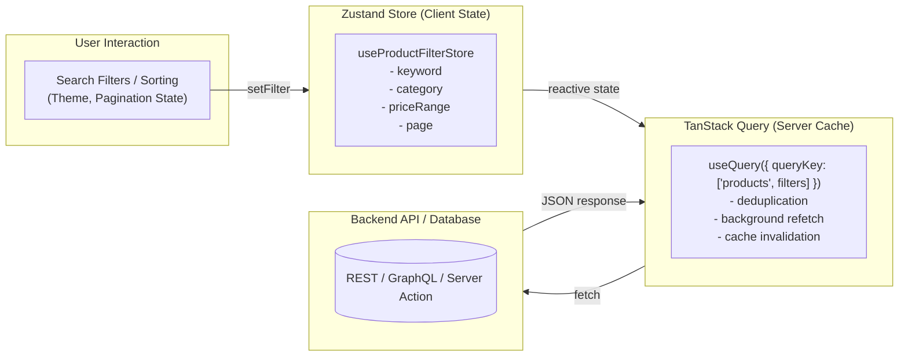

## 1. แนวคิด (Concept)

หนึ่งในข้อผิดพลาดที่ร้ายแรงที่สุดของนักพัฒนา Frontend ยุคก่อนคือการนำ **ข้อมูลทั้งหมดในแอปพลิเคชันไปยัดไว้ใน Global State เพียงก้อนเดียว** โดยไม่แยกระหว่าง **Client State** และ **Server State**:

1. **Client State (สภาวะฝั่งไคลเอนต์)**:
   - คือข้อมูลที่เป็นกรรมสิทธิ์ของเบราว์เซอร์ผู้ใช้โดยสมบูรณ์
   - ไม่มีแหล่งข้อมูลภายนอก (No Remote Source of Truth)
   - ไม่ต้องกังวลเรื่อง Network Caching, Invalidation, หรือ Stale Data
   - มักเป็นสถานะชั่วคราว (Ephemeral UI State) เช่น สถานะเปิด/ปิด Modal, Sidebar ที่ยุบอยู่, แท็บปัจจุบันที่เลือก, ตะกร้าสินค้าในเครื่อง, ตัวกรองค้นหา (Filters) ที่ผู้ใช้กำลังกรอก
   - **เครื่องมือที่เหมาะสม**: **Zustand v5**

2. **Server State (สภาวะฝั่งเซิร์ฟเวอร์)**:
   - คือข้อมูลที่จัดเก็บและเป็นกรรมสิทธิ์ของฐานข้อมูลหลังบ้าน (Database / Backend API)
   - ฝั่งไคลเอนต์เป็นเพียงผู้ "ยืมมาแคชไว้ชั่วคราว" (Remote Snapshot)
   - มีความเป็นไปได้ที่จะล้าสมัย (Stale Data) ตลอดเวลา เพราะมีผู้ใช้อื่นแก้ไขพร้อมกัน
   - ต้องการกลไกซับซ้อน: Caching, Deduping Requests, Polling, Optimistic Updates, Pagination, และ Retry on Failure
   - **เครื่องมือที่เหมาะสม**: **TanStack Query (React Query)** หรือ **Next.js Server Components**

---

## 2. หลักการเบื้องหลัง (Under the Hood)

การจับคู่ที่สมบูรณ์แบบใน Modern Web Architecture (React 19 & Next.js 16) คือการแยกความรับผิดชอบอย่างชัดเจนระหว่าง Zustand และ TanStack Query:



- **Zustand ขับเคลื่อน Query Key**: State ที่เก็บใน Zustand (เช่น คีย์เวิร์ดค้นหาและหมวดหมู่ที่เลือก) จะถูกส่งเข้าไปเป็น `queryKey` ของ TanStack Query
- เมื่อผู้ใช้เปลี่ยนตัวกรองใน Zustand ตัว `useQuery` จะทำการ Fetch ข้อมูลจาก Server ใหม่และสลับแคชให้อัตโนมัติ โดยไม่ต้องเขียนตรรกะจัดการ Loading หรือ Error เองใน Zustand เลย

---

## 3. ตัวอย่างโค้ด (TypeScript / TSX)

ตัวอย่างการทำงานร่วมกัน: Zustand จัดการตัวกรองและ Pagination (Client State) ส่วน TanStack Query จัดการรายการสินค้าจาก API (Server State)

### ฝั่ง Client State: จัดการตัวกรองสินค้าด้วย Zustand

```tsx filename="store/product-filter-store.ts"
import { create } from 'zustand';

export interface ProductFilters {
  keyword: string;
  category: string;
  minPrice: number;
  maxPrice: number;
  page: number;
}

interface ProductFilterStore extends ProductFilters {
  setKeyword: (keyword: string) => void;
  setCategory: (category: string) => void;
  setPriceRange: (min: number, max: number) => void;
  setPage: (page: number) => void;
  resetFilters: () => void;
}

const initialFilters: ProductFilters = {
  keyword: '',
  category: 'all',
  minPrice: 0,
  maxPrice: 50000,
  page: 1,
};

export const useProductFilterStore = create<ProductFilterStore>()((set) => ({
  ...initialFilters,
  setKeyword: (keyword) => set({ keyword, page: 1 }), // รีเซ็ตหน้ากลับเป็น 1 เมื่อค้นหาใหม่
  setCategory: (category) => set({ category, page: 1 }),
  setPriceRange: (minPrice, maxPrice) => set({ minPrice, maxPrice, page: 1 }),
  setPage: (page) => set({ page }),
  resetFilters: () => set(initialFilters),
}));
```

### ฝั่ง Server State: เชื่อมต่อตัวกรองกับ TanStack Query

```tsx filename="components/ProductCatalog.tsx"
'use client';

import { useQuery } from '@tanstack/react-query';
import { useProductFilterStore } from '@/store/product-filter-store';

interface Product {
  id: string;
  name: string;
  price: number;
  category: string;
}

async function fetchProducts(filters: {
  keyword: string;
  category: string;
  minPrice: number;
  maxPrice: number;
  page: number;
}): Promise<{ data: Product[]; totalPages: number }> {
  const params = new URLSearchParams({
    q: filters.keyword,
    cat: filters.category,
    min: filters.minPrice.toString(),
    max: filters.maxPrice.toString(),
    page: filters.page.toString(),
  });

  const res = await fetch(`/api/products?${params.toString()}`);
  if (!res.ok) throw new Error('ไม่สามารถโหลดข้อมูลสินค้าได้');
  return res.json();
}

export function ProductCatalog() {
  // 1. อ่าน Client State จาก Zustand
  const keyword = useProductFilterStore((state) => state.keyword);
  const category = useProductFilterStore((state) => state.category);
  const minPrice = useProductFilterStore((state) => state.minPrice);
  const maxPrice = useProductFilterStore((state) => state.maxPrice);
  const page = useProductFilterStore((state) => state.page);
  const setPage = useProductFilterStore((state) => state.setPage);

  // 2. ส่ง Client State ไปเป็น queryKey ใน TanStack Query
  const { data, isLoading, isError, error } = useQuery({
    queryKey: ['products', { keyword, category, minPrice, maxPrice, page }],
    queryFn: () => fetchProducts({ keyword, category, minPrice, maxPrice, page }),
    staleTime: 1000 * 60 * 5, // แคชไว้ 5 นาที
  });

  if (isLoading) return <div className="p-8 text-center">กำลังโหลดสินค้า...</div>;
  if (isError) return <div className="p-8 text-red-500">เกิดข้อผิดพลาด: {error.message}</div>;

  return (
    <div className="space-y-6">
      <div className="grid grid-cols-1 md:grid-cols-3 gap-4">
        {data?.data.map((product) => (
          <div key={product.id} className="p-4 border rounded-xl bg-white dark:bg-slate-800 shadow-xs">
            <h3 className="font-bold text-lg">{product.name}</h3>
            <p className="text-emerald-600 font-semibold mt-2">฿{product.price.toLocaleString()}</p>
            <span className="text-xs text-slate-400">{product.category}</span>
          </div>
        ))}
      </div>

      {/* Pagination Controls */}
      <div className="flex items-center justify-between border-t pt-4">
        <button
          onClick={() => setPage(Math.max(1, page - 1))}
          disabled={page === 1}
          className="px-4 py-2 bg-slate-100 rounded disabled:opacity-50"
        >
          ก่อนหน้า
        </button>
        <span>หน้า {page} จาก {data?.totalPages || 1}</span>
        <button
          onClick={() => setPage(page + 1)}
          disabled={page >= (data?.totalPages || 1)}
          className="px-4 py-2 bg-slate-100 rounded disabled:opacity-50"
        >
          ถัดไป
        </button>
      </div>
    </div>
  );
}
```

---

## 4. เทียบกับวิธีอื่น (Context / Redux vs Zustand)

| เกณฑ์การพิจารณา | Redux แบบดั้งเดิม (All-in-One) | React Context API | สถาปัตยกรรมแยกส่วน: Zustand + TanStack Query |
| :--- | :--- | :--- | :--- |
| **การจัดการ Server State** | เขียน `createAsyncThunk` + `loading/error` flags ใน Reducer เองทั้งหมด | ต้องเขียน `useEffect` + `useState(loading)` ซ้ำๆ ในแต่ละ Component | **มอบหมายให้ TanStack Query ดูแลอัตโนมัติ 100%** |
| **การจัดการ Client State** | อยู่รวมกันใน Store เดียว ทำให้ State ก้อนใหญ่เกินจำเป็น | ปวดหัวเรื่อง Re-render และยากที่จะแชร์ข้ามหลายหน้าจอ | **Zustand เก็บเฉพาะ Client State เบาหวิว รวดเร็ว** |
| **การ Invalidate Cache** | ต้องเขียน Logic Dispatch ล้างค่าเองด้วยมือ | ทำได้ยาก เสี่ยง Memory Leak | มีฟังก์ชัน `queryClient.invalidateQueries()` สั่ง Refresh ได้ทันที |
| **ขนาดและภาระโค้ด** | โค้ดเยอะมาก (Boilerplate สูง) | โค้ดซ้ำซ้อน ไม่มีมาตรฐานแคช | **โค้ดสั้น ชัดเจน และมีประสิทธิภาพสูงสุด** |

---

## 5. ผิด vs ถูก

### กรณีที่ 1: การใช้ Zustand ทำหน้าที่เป็น HTTP Cache แทน Server State Library

```tsx
// ❌ ผิด: เขียน Fetch API + จัดการ Loading / Error เองใน Zustand Store
interface BadProductStore {
  products: Product[];
  isLoading: boolean;
  error: string | null;
  fetchProducts: () => Promise<void>;
}

export const useBadProductStore = create<BadProductStore>()((set) => ({
  products: [],
  isLoading: false,
  error: null,
  fetchProducts: async () => {
    set({ isLoading: true, error: null });
    try {
      const res = await fetch('/api/products');
      const data = await res.json();
      set({ products: data, isLoading: false });
    } catch (err: any) {
      set({ error: err.message, isLoading: false });
    }
  },
}));
```

```tsx
// ✅ ถูก: ใช้ Zustand สำหรับ Client State และใช้ TanStack Query สำหรับ Server State
// Zustand เก็บเพียงค่าตัวกรอง (Client State)
export const useFilterStore = create<{ category: string; setCategory: (c: string) => void }>()((set) => ({
  category: 'all',
  setCategory: (category) => set({ category }),
}));

// TanStack Query จัดการการดึงข้อมูล, แคช, สถานะ Loading, Error, และ Revalidation
export function useProducts() {
  const category = useFilterStore((state) => state.category);
  return useQuery({
    queryKey: ['products', category],
    queryFn: () => fetchProductsByCategory(category),
  });
}
```
*เหตุผล*: การเขียนแคชเองใน Zustand ทำให้คุณขาดฟีเจอร์สำคัญ เช่น Auto Re-fetch on Window Focus, Request Deduplication (ป้องกันการยิง API ซ้ำเมื่อเรียกพร้อมกัน 2 จุด), และ Garbage Collection ของข้อมูลที่ไม่ได้ใช้งาน

---

## 6. ควรใช้เมื่อไหร่ / ไม่ควรใช้เมื่อไหร่

### ตารางเกณฑ์การตัดสินใจ (Decision Criteria)

| ข้อมูลประเภทนี้... | ใช้ Zustand | ใช้ TanStack Query |
| :--- | :---: | :---: |
| ข้อมูลมาจากการเรียก REST / GraphQL API | ❌ | ✅ |
| ต้องการ Background Refetch เมื่อผู้ใช้สลับแท็บกลับมา | ❌ | ✅ |
| สถานะเปิด/ปิด Modal, Slide-over, Tooltip | ✅ | ❌ |
| ข้อมูลตะกร้าสินค้าที่ยังไม่ได้ Checkout (Local Cart) | ✅ | ❌ |
| คีย์เวิร์ดค้นหา, แท็บที่เลือก, การตั้งค่าคอลัมน์ของตาราง | ✅ | ❌ |
| รายชื่อ User โปรไฟล์ที่ดึงจาก Database | ❌ | ✅ |
| แผนที่พิกัดตำแหน่งเมาส์ / การลากวาง (Drag & Drop) | ✅ | ❌ |

---

## 7. คำถามสัมภาษณ์งาน (Interview Questions)

### Q1: ทำไมสถาปัตยกรรม Frontend สมัยใหม่จึงแนะนำให้แยก "Server State" ออกจาก "Client State"?
**แนวทางคำตอบ**:
เพราะ State ทั้งสองประเภทนี้มีพฤติกรรมและวงจรชีวิต (Lifecycle) ที่ต่างกันอย่างสิ้นเชิง:
- **Server State** ไม่ได้เป็นกรรมสิทธิ์ของ Client ตัวมันเปลี่ยนแปลงได้ตลอดเวลาจากฝั่งเซิร์ฟเวอร์ จึงต้องการระบบจัดการเรื่อง Asynchronous, Caching, Stale Detection, Deduping, และ Error Handling
- **Client State** เป็นกรรมสิทธิ์ของผู้ใช้เพียงคนเดียว เป็น Synchronous ไม่มีความหน่วงของเน็ตเวิร์ก และไม่จำเป็นต้องมีระบบ Refetching
หากเรานำข้อมูลทั้งสองมารวมไว้ใน Store ตัวเดียวกัน (เช่น Zustand หรือ Redux) เราจะต้องเขียนโค้ด Boilerplate ซ้ำซ้อนมหาศาลเพื่อจำลองระบบ Caching ที่ TanStack Query ทำได้สมบูรณ์แบบอยู่แล้ว

### Q2: หากจำเป็นต้องใช้ข้อมูลจาก API ในหลายๆ คอมโพเนนต์ เราควรเก็บผลลัพธ์ของ API นั้นไว้ใน Zustand หรือไม่?
**แนวทางคำตอบ**:
ไม่ควรเก็บผลลัพธ์ของ API ลงใน Zustand เพราะ TanStack Query มีระบบ In-memory Cache ภายในตัวอยู่แล้ว หากเราเรียก `useQuery(['userProfile'], fetchUser)` ในคอมโพเนนต์ 5 ตัวที่ต่างกัน TanStack Query จะทำการ Deduplicate และส่งค่าแคชก้อนเดียวกันให้กับคอมโพเนนต์ทั้ง 5 ทันทีโดยไม่ต้องยิง API 5 รอบ การก๊อปปี้ข้อมูลไปใส่ Zustand อีกชั้นหนึ่งจะก่อให้เกิดปัญหา "Dual Sources of Truth" ทำให้ข้อมูลไม่ตรงกันและซิงค์ยาก
