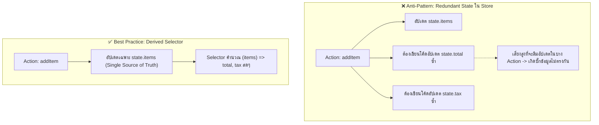

## 1. แนวคิด (Concept)

**Derived State (สถานะที่คำนวณได้)** คือข้อมูลใดๆ ที่สามารถคำนวณออกมาได้จาก State หลักที่มีอยู่แล้ว เช่น:
- ราคารวมสินค้า = ผลรวมของ `(price * quantity)`
- จำนวนสินค้าที่เลือก = การนับจำนวนไอเทมที่มี `selected === true`
- การตรวจสอบสิทธิ์ Admin = `user?.role === 'ADMIN'`

กฎเหล็กของการออกแบบ State คือ: **"อย่าเก็บสิ่งที่คุณสามารถคำนวณได้" (Don't store what you can compute)**:
1. **การคำนวณใน Selector**: เป็นแนวทางที่ดีที่สุดของ Zustand เพราะคำนวณเฉพาะเมื่อ State ต้นทางเปลี่ยน และไม่ทำให้ Store มีข้อมูลซ้ำซ้อน
2. **การทำ Memoization ด้วย `useMemo` หรือ Memoized Selectors**: หากการคำนวณมีความซับซ้อนสูง (เช่น การวนลูป Array นับหมื่นรายการ) สามารถใช้ `useMemo` ภายในคอมโพเนนต์ หรือสร้าง Reusable Memoized Selector เพื่อป้องกันการคำนวณซ้ำโดยไม่จำเป็น

---

## 2. หลักการเบื้องหลัง (Under the Hood)

เปรียบเทียบการทำงานระหว่างการเก็บข้อมูลซ้ำซ้อน (Redundant State) กับการใช้ Derived Selector:



- เมื่อใช้ Selector การคำนวณจะเกิดขึ้นเฉพาะเมื่อคอมโพเนนต์นั้น Render หากคอมโพเนนต์อื่นขยับโดยไม่แตะต้อง `items` ฟังก์ชัน Selector นี้จะไม่ถูกกระตุ้น

---

## 3. ตัวอย่างโค้ด (TypeScript / TSX)

ตัวอย่างจริง: ระบบ **Inventory & Stock Management Store** พร้อมการคำนวณสินค้าหมด, สินค้าเหลือน้อย, และมูลค่าคลังสินค้าสุทธิ

### การสร้าง Store พื้นฐาน (เก็บเฉพาะ Raw State)

```tsx filename="store/inventory-store.ts"
import { create } from 'zustand';

export interface ProductInventory {
  id: string;
  sku: string;
  name: string;
  stock: number;
  costPrice: number;
  sellingPrice: number;
}

interface InventoryStore {
  products: ProductInventory[];
  searchQuery: string;
  setSearchQuery: (query: string) => void;
  updateStock: (id: string, newStock: number) => void;
}

export const useInventoryStore = create<InventoryStore>()((set) => ({
  products: [
    { id: '1', sku: 'KB-01', name: 'Mechanical Keyboard Blue Switch', stock: 12, costPrice: 1500, sellingPrice: 2490 },
    { id: '2', sku: 'MS-02', name: 'Wireless Ergonomic Mouse', stock: 3, costPrice: 800, sellingPrice: 1290 },
    { id: '3', sku: 'HD-03', name: 'Noise-Cancelling Headphones', stock: 0, costPrice: 3000, sellingPrice: 4500 },
    { id: '4', sku: 'MP-04', name: 'RGB Gaming Mousepad XL', stock: 25, costPrice: 200, sellingPrice: 590 },
  ],
  searchQuery: '',
  setSearchQuery: (searchQuery) => set({ searchQuery }),
  updateStock: (id, stock) =>
    set((state) => ({
      products: state.products.map((p) => (p.id === id ? { ...p, stock } : p)),
    })),
}));
```

### การสร้าง Reusable Pure Selectors (นิยามนอก Store)

```tsx filename="store/inventory-selectors.ts"
import { ProductInventory } from './inventory-store';

// Pure Functions คำนวณ Derived State เพื่อนำกลับมาใช้ซ้ำและทำ Unit Test ได้ง่าย
export const selectOutOfStockCount = (products: ProductInventory[]): number =>
  products.filter((p) => p.stock === 0).length;

export const selectLowStockProducts = (products: ProductInventory[]): ProductInventory[] =>
  products.filter((p) => p.stock > 0 && p.stock <= 5);

export const selectTotalValuation = (products: ProductInventory[]) => {
  const totalCost = products.reduce((acc, p) => acc + p.costPrice * p.stock, 0);
  const potentialRevenue = products.reduce((acc, p) => acc + p.sellingPrice * p.stock, 0);
  return {
    totalCost,
    potentialRevenue,
    projectedProfit: potentialRevenue - totalCost,
  };
};
```

### การเรียกใช้ใน Component ร่วมกับ `useShallow` และ `useMemo`

```tsx filename="components/InventoryDashboard.tsx"
'use client';

import { useMemo } from 'react';
import { useShallow } from 'zustand/react/shallow';
import { useInventoryStore } from '@/store/inventory-store';
import {
  selectOutOfStockCount,
  selectLowStockProducts,
  selectTotalValuation,
} from '@/store/inventory-selectors';

export function InventoryDashboard() {
  const products = useInventoryStore((state) => state.products);
  const searchQuery = useInventoryStore((state) => state.searchQuery);
  const setSearchQuery = useInventoryStore((state) => state.setSearchQuery);

  // 1. คำนวณ Derived State แบบเบาๆ ผ่าน Selector
  const outOfStockCount = useMemo(() => selectOutOfStockCount(products), [products]);
  const lowStockProducts = useMemo(() => selectLowStockProducts(products), [products]);

  // 2. คำนวณตัวเลขการเงินรวมด้วย useMemo
  const valuation = useMemo(() => selectTotalValuation(products), [products]);

  // 3. กรองรายการตามคำค้นหา
  const filteredProducts = useMemo(() => {
    if (!searchQuery.trim()) return products;
    return products.filter((p) =>
      p.name.toLowerCase().includes(searchQuery.toLowerCase()) ||
      p.sku.toLowerCase().includes(searchQuery.toLowerCase())
    );
  }, [products, searchQuery]);

  return (
    <div className="space-y-6 p-6">
      <div className="grid grid-cols-1 md:grid-cols-3 gap-4">
        <div className="p-4 border rounded-xl bg-red-50 dark:bg-red-950/30 border-red-200">
          <p className="text-sm font-semibold text-red-600">สินค้าหมดสต็อก</p>
          <p className="text-3xl font-bold mt-1 text-red-700">{outOfStockCount} รายการ</p>
        </div>

        <div className="p-4 border rounded-xl bg-amber-50 dark:bg-amber-950/30 border-amber-200">
          <p className="text-sm font-semibold text-amber-600">สินค้าใกล้หมด (≤ 5 ชิ้น)</p>
          <p className="text-3xl font-bold mt-1 text-amber-700">{lowStockProducts.length} รายการ</p>
        </div>

        <div className="p-4 border rounded-xl bg-emerald-50 dark:bg-emerald-950/30 border-emerald-200">
          <p className="text-sm font-semibold text-emerald-600">กำไรที่คาดการณ์</p>
          <p className="text-3xl font-bold mt-1 text-emerald-700">
            ฿{valuation.projectedProfit.toLocaleString()}
          </p>
        </div>
      </div>

      <div className="flex gap-4 items-center">
        <input
          type="text"
          value={searchQuery}
          onChange={(e) => setSearchQuery(e.target.value)}
          placeholder="ค้นหาชื่อสินค้า หรือ SKU..."
          className="px-4 py-2 border rounded-lg w-full max-w-sm"
        />
      </div>

      <table className="w-full text-left border-collapse border rounded-xl overflow-hidden">
        <thead className="bg-slate-100 dark:bg-slate-800 text-xs uppercase">
          <tr>
            <th className="p-3">SKU</th>
            <th className="p-3">ชื่อสินค้า</th>
            <th className="p-3 text-right">คงเหลือ</th>
            <th className="p-3 text-right">ราคาขาย</th>
          </tr>
        </thead>
        <tbody className="divide-y text-sm">
          {filteredProducts.map((p) => (
            <tr key={p.id}>
              <td className="p-3 font-mono text-xs">{p.sku}</td>
              <td className="p-3 font-medium">{p.name}</td>
              <td className="p-3 text-right font-bold">
                <span className={p.stock === 0 ? 'text-red-500' : p.stock <= 5 ? 'text-amber-500' : ''}>
                  {p.stock}
                </span>
              </td>
              <td className="p-3 text-right">฿{p.sellingPrice.toLocaleString()}</td>
            </tr>
          ))}
        </tbody>
      </table>
    </div>
  );
}
```

---

## 4. เทียบกับวิธีอื่น (Context / Redux vs Zustand)

| รูปแบบการคำนวณ | Redux Toolkit (Reselect) | React Context | Zustand v5 |
| :--- | :--- | :--- | :--- |
| **เครื่องมือช่วย Memoize** | ต้องติดตั้งและเขียน `createSelector()` ของ Reselect | ต้องห่อ `useMemo` รอบ Provider Value | **ใช้ Selector ร่วมกับ `useMemo` หรือ `useShallow` ได้อย่างยืดหยุ่น** |
| **การทดสอบความถูกต้อง** | ทดสอบผ่าน Redux Store Mock | ทดสอบได้ยาก ต้อง Render Provider | **ทดสอบ Pure Selector Function ได้โดยตรง 100%** |
| **Bundle Overhead** | มีขนาดเพิ่มขึ้นจากไลบรารี Reselect | 0 KB | **0 KB (ใช้ Native JavaScript + React Hooks)** |

---

## 5. ผิด vs ถูก

### กรณีที่ 1: การเขียน Action เพื่อคอยอัปเดตข้อมูลที่ได้จากการคำนวณ

```tsx
// ❌ ผิด: จัดเก็บ filteredList และ totalCount ลงใน Store
interface BadState {
  items: string[];
  filter: string;
  filteredItems: string[]; // ข้อมูลซ้ำซ้อน
  setFilter: (f: string) => void;
}
// ทุกครั้งที่ setFilter หรือเพิ่ม items ต้องเขียนโค้ด sync filteredItems เสมอ!

// ✅ ถูก: จัดเก็บเฉพาะ items และ filter แล้วกรองสดใน Selector หรือ Component
const items = useStore((s) => s.items);
const filter = useStore((s) => s.filter);
const filteredItems = useMemo(
  () => items.filter((i) => i.includes(filter)),
  [items, filter]
);
```

### กรณีที่ 2: คืนค่า Array / Object ที่ผ่านการคำนวณใน Selector โดยไม่ใช้ `useShallow` หรือ `useMemo`

```tsx
// ❌ ผิด: คำนวณ Object ใหม่ใน Selector เปล่าๆ ทำให้เกิด Infinite Loop ใน Zustand v5
const stats = useInventoryStore((state) => ({
  count: state.products.length,
  hasZeroStock: state.products.some((p) => p.stock === 0),
})); // {} ก้อนใหม่ทุกรอบ!

// ✅ ถูก: ครอบด้วย useShallow เสมอ
import { useShallow } from 'zustand/react/shallow';

const stats = useInventoryStore(
  useShallow((state) => ({
    count: state.products.length,
    hasZeroStock: state.products.some((p) => p.stock === 0),
  }))
);
```

---

## 6. ควรใช้เมื่อไหร่ / ไม่ควรใช้เมื่อไหร่

### ควรคำนวณผ่าน Selector หรือ `useMemo` เมื่อ:
- ข้อมูลนั้นเป็นผลลัพธ์ที่แปลงมาจาก State อื่น (เช่น การกรอง, การนับ, การคำนวณผลรวมเงิน, การเรียงลำดับ)
- ต้องการรับประกันว่าข้อมูลจะไม่มีวันหลุดการซิงค์ (Always Consistent)

### ควรจัดเก็บลง State โดยตรงเมื่อ:
- ข้อมูลนั้นไม่สามารถคำนวณได้จากสิ่งใดเลย เป็น **Input เริ่มต้น** จากผู้ใช้หรือจาก API
- ข้อมูลที่การคำนวณต้องพึ่งพาปัจจัยภายนอกที่ไม่แน่นอน เช่น การรับค่า Response จากเซิร์ฟเวอร์

---

## 7. คำถามสัมภาษณ์งาน (Interview Questions)

### Q1: ทำไมการเก็บ "Derived State" ซ้ำซ้อนลงใน Global Store จึงถือเป็น Anti-pattern ที่อันตราย?
**แนวทางคำตอบ**:
เพราะมันทำลายหลักการ **Single Source of Truth**:
1. **Sync Overhead**: นักพัฒนาต้องจำให้ได้ว่าทุกครั้งที่มี Action ใดๆ ปรับปรุง State ตั้งต้น จะต้องตามไปสั่งอัปเดต State ที่เป็นผลพลอยได้ให้ครบทุกจุด
2. **State Desynchronization Bug**: หากมี Action ใหม่ถูกเพิ่มเข้ามาในอนาคตแล้วผู้พัฒนาคนใหม่ลืมสั่งอัปเดตค่าผลลัพธ์ จะทำให้ข้อมูลสองส่วนใน Store ขัดแย้งกันเอง (เช่น ใน Array มีสินค้า 3 ชิ้น แต่ตัวแปร `itemCount` ยังค้างอยู่ที่ 2) ซึ่งเป็นบั๊กที่ตรวจจับได้ยากมาก
การใช้ Selector Function หรือ `useMemo` จะการันตีว่าค่าที่แสดงผลถูกต้องตามข้อมูลตั้งต้นเสมอ 100%

### Q2: ใน Zustand v5 เราควรจัดการกับการคำนวณ Derived State ที่มีต้นทุนการประมวลผลสูง (Expensive Computations) อย่างไร?
**แนวทางคำตอบ**:
มี 2 แนวทางหลัก:
1. **การใช้ `useMemo` ภายใน Component**: ดึงเฉพาะ Raw State ออกมาจาก Zustand ผ่าน Atomic Selector จากนั้นนำมาประมวลผลด้วย `useMemo(() => compute(data), [data])` ซึ่งจะคำนวณใหม่เฉพาะเมื่อ Reference ของ `data` เปลี่ยนแปลงเท่านั้น
2. **การใช้ Memoized Selector**: สร้าง Selector ด้วยไลบรารีภายนอก เช่น `reselect` หรือเขียน Memoization Wrapper เอง แล้วส่งให้ `useStore(memoizedSelector)` เพื่อแชร์ผลลัพธ์ที่ถูกแคชไว้ข้ามคอมโพเนนต์
