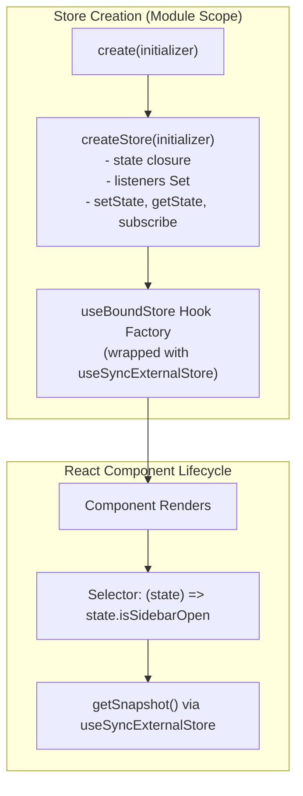

## 1. แนวคิด (Concept)

จุดเด่นที่เป็นเอกลักษณ์ที่สุดของ **Zustand** คือความเรียบง่ายและเป็นอิสระ:
1. **State และ Actions รวมอยู่ในที่เดียวกัน (Co-location)**: ต่างจาก Redux ที่ต้องแยก Action Types, Action Creators, และ Reducers ออกจากกัน ใน Zustand เราสามารถนิยามทั้งข้อมูล (State) และฟังก์ชันแก้ไขข้อมูล (Actions) ไว้ภายใน Object ก้อนเดียวกันได้ทันที
2. **Providerless (ไม่ต้องมี Provider ครอบ)**: การสร้าง Store ด้วยคำสั่ง `create()` จะให้ Custom Hook ที่พร้อมใช้งานทันที คุณสามารถนำไปเรียกในคอมโพเนนต์ใดก็ได้โดยไม่ต้องหุ้ม `<Provider>` ที่ `layout.tsx` หรือ `_app.tsx` ให้เกิดปัญหา Component Tree ลึกโดยไม่จำเป็น
3. **Atomic Consumption**: คอมโพเนนต์สามารถเลือกดึงเฉพาะ State หรือเฉพาะ Action ที่ต้องการใช้งานได้อย่างยืดหยุ่น

---

## 2. หลักการเบื้องหลัง (Under the Hood)

เมื่อเราเรียกใช้ฟังก์ชัน `create()` ของ Zustand เบื้องหลังจะเกิดกระบวนการดังนี้:



1. **Vanilla Store ใน Closure**: ฟังก์ชัน `create` จะเรียก `createStore` ภายใน ซึ่งเป็นตัวจัดการ State ล้วนๆ ในระดับ JavaScript Closure ที่มีตัวแปร `state` และรายการผู้ฟัง `listeners = new Set()`
2. **การแปลงเป็น React Hook**: Zustand จะหุ้ม Vanilla Store นั้นด้วย `useSyncExternalStore` เพื่อส่งออกเป็น Hook เช่น `useSidebarStore`
3. **Action Immutability**: ฟังก์ชัน `set` ที่ส่งเข้ามาใน Store จะทำการผสานข้อมูล (Shallow Merge) ระดับตื้นโดยอัตโนมัติ ทำให้เราไม่ต้องเขียน Destructuring ซ้ำๆ ในระดับนอกสุด

---

## 3. ตัวอย่างโค้ด (TypeScript / TSX)

ตัวอย่างการสร้าง **UI Layout Store** เพื่อจัดการสถานะการเปิด/ปิด Sidebar และการเลือกแท็บหน้าต่างการทำงาน

### การสร้าง Store

```tsx filename="store/ui-layout-store.ts"
import { create } from 'zustand';

export type ActiveTab = 'dashboard' | 'orders' | 'inventory' | 'settings';

interface UiLayoutState {
  // 1. Data States
  isSidebarOpen: boolean;
  activeTab: ActiveTab;
  notificationCount: number;

  // 2. Actions (ฟังก์ชันปรับปรุง State)
  toggleSidebar: () => void;
  setSidebarOpen: (isOpen: boolean) => void;
  setActiveTab: (tab: ActiveTab) => void;
  incrementNotifications: () => void;
  clearNotifications: () => void;
}

export const useUiLayoutStore = create<UiLayoutState>()((set) => ({
  // กำหนดค่าเริ่มต้น
  isSidebarOpen: true,
  activeTab: 'dashboard',
  notificationCount: 0,

  // นิยาม Actions
  toggleSidebar: () => set((state) => ({ isSidebarOpen: !state.isSidebarOpen })),
  setSidebarOpen: (isSidebarOpen) => set({ isSidebarOpen }),
  setActiveTab: (activeTab) => set({ activeTab }),
  incrementNotifications: () =>
    set((state) => ({ notificationCount: state.notificationCount + 1 })),
  clearNotifications: () => set({ notificationCount: 0 }),
}));
```

### การเรียกใช้ใน Component ผ่าน Selector

```tsx filename="components/AppHeader.tsx"
'use client';

import { useUiLayoutStore } from '@/store/ui-layout-store';

export function AppHeader() {
  // เลือกอ่านเฉพาะ Action toggleSidebar และจำนวน Notification
  const toggleSidebar = useUiLayoutStore((state) => state.toggleSidebar);
  const notificationCount = useUiLayoutStore((state) => state.notificationCount);
  const clearNotifications = useUiLayoutStore((state) => state.clearNotifications);

  return (
    <header className="h-16 border-b px-4 flex items-center justify-between bg-white dark:bg-slate-900">
      <button
        onClick={toggleSidebar}
        className="p-2 border rounded-lg hover:bg-slate-100 dark:hover:bg-slate-800"
      >
        ☰ เมนู
      </button>

      <div className="flex items-center gap-3">
        <button
          onClick={clearNotifications}
          className="relative px-3 py-1.5 rounded-lg bg-slate-100 dark:bg-slate-800 text-sm font-medium"
        >
          การแจ้งเตือน
          {notificationCount > 0 && (
            <span className="ml-2 px-1.5 py-0.5 text-xs bg-red-500 text-white rounded-full">
              {notificationCount}
            </span>
          )}
        </button>
      </div>
    </header>
  );
}
```

```tsx filename="components/AppSidebar.tsx"
'use client';

import { useUiLayoutStore, ActiveTab } from '@/store/ui-layout-store';

const tabs: { id: ActiveTab; label: string }[] = [
  { id: 'dashboard', label: 'แดชบอร์ด' },
  { id: 'orders', label: 'คำสั่งซื้อ' },
  { id: 'inventory', label: 'คลังสินค้า' },
  { id: 'settings', label: 'ตั้งค่า' },
];

export function AppSidebar() {
  // ดึงเฉพาะสถานะของ Sidebar และ Tab ปัจจุบัน
  const isSidebarOpen = useUiLayoutStore((state) => state.isSidebarOpen);
  const activeTab = useUiLayoutStore((state) => state.activeTab);
  const setActiveTab = useUiLayoutStore((state) => state.setActiveTab);

  if (!isSidebarOpen) return null;

  return (
    <aside className="w-64 border-r bg-slate-50 dark:bg-slate-950 p-4 min-h-screen">
      <h2 className="text-xs font-bold text-slate-400 uppercase tracking-wider mb-4">
        เมนูหลัก
      </h2>
      <nav className="space-y-1">
        {tabs.map((tab) => (
          <button
            key={tab.id}
            onClick={() => setActiveTab(tab.id)}
            className={`w-full text-left px-3 py-2 rounded-lg text-sm font-medium transition ${
              activeTab === tab.id
                ? 'bg-blue-600 text-white'
                : 'text-slate-600 dark:text-slate-300 hover:bg-slate-200 dark:hover:bg-slate-800'
            }`}
          >
            {tab.label}
          </button>
        ))}
      </nav>
    </aside>
  );
}
```

---

## 4. เทียบกับวิธีอื่น (Context / Redux vs Zustand)

| รูปแบบ | Redux Toolkit | React Context API | Zustand v5 |
| :--- | :--- | :--- | :--- |
| **การติดตั้ง Provider** | ต้องหุ้ม `<Provider store={store}>` | ต้องสร้าง Custom Provider และหุ้ม Root | **ไม่ต้องมี Provider (เรียก Hook ได้ตรงๆ)** |
| **โครงสร้างไฟล์** | แยก Slice, Reducers, Actions, Store | สร้าง Context, Type, Provider, Custom Hook | **ทุกอย่างรวมในไฟล์เดียวผ่าน `create()`** |
| **การ Dispatch Action** | ต้องใช้ `const dispatch = useDispatch(); dispatch(myAction())` | ต้องส่งผ่าน Value ของ Provider | **เรียก Action ได้เสมือนฟังก์ชันธรรมดา (`store.toggle()`)** |
| **ความเข้ากันได้กับ SSR** | ต้องเซ็ตอัป Hydration state | มีความปลอดภัยระดับ Request แต่ Re-render หนัก | **ใช้ Singleton ฝั่งไคลเอนต์ หรือ Factory Context สำหรับ SSR** |

---

## 5. ผิด vs ถูก

### กรณีที่ 1: การประกาศฟังก์ชัน Action ไว้นอก Store แล้วนำไปเรียก `setState` กระจัดกระจาย

```tsx
// ❌ ผิด: แยก Actions ออกไปเป็นฟังก์ชันเดี่ยวๆ นอก Store ทำให้ติดตามตรรกะได้ยาก
export const useBadStore = create<{ count: number }>(() => ({ count: 0 }));

// Action ลอยอยู่นอก Store ทำให้ขาดการ Encapsulation
export const incrementBad = () => {
  useBadStore.setState((s) => ({ count: s.count + 1 }));
};
```

```tsx
// ✅ ถูก: รวม Actions ไว้ใน Store เพื่อให้เป็น Single Source of Truth และมี Type Safety ชัดเจน
interface GoodState {
  count: number;
  increment: () => void;
}

export const useGoodStore = create<GoodState>()((set) => ({
  count: 0,
  increment: () => set((state) => ({ count: state.count + 1 })),
}));
```
*เหตุผล*: การรวม Actions ไว้ใน Store ทำให้คอมโพเนนต์อื่นสามารถตรวจพบและนำไปใช้ต่อได้อย่างชัดเจนผ่าน Auto-complete ของ TypeScript อีกทั้งยังง่ายต่อการทำ Unit Test และใช้ Redux DevTools ติดตามการเปลี่ยนแปลง

### กรณีที่ 2: ลืมครอบวงเล็บ Currying ใน TypeScript ของ Zustand v5

```tsx
// ❌ ผิด (ใน Zustand v5 เมื่อมี Middleware หรือ Generic ที่ซับซ้อน):
// export const useStore = create<MyState>((set) => ({ ... })); // Type inference อาจผิดเพี้ยน

// ✅ ถูก (ไวยากรณ์ Curried ที่เป็นทางการใน Zustand v5):
export const useStore = create<MyState>()((set) => ({
  // ...
}));
```

---

## 6. ควรใช้เมื่อไหร่ / ไม่ควรใช้เมื่อไหร่

### ควรใช้:
- เมื่อต้องการสร้าง Global Store ใหม่อย่างรวดเร็วโดยไม่ต้องเสียเวลากำหนด Provider
- เมื่อ State นั้นเป็นข้อมูลระดับ UI หรือ Business Logic ฝั่ง Client ที่หลายคอมโพเนนต์ต้องเข้าถึงร่วมกัน
- แอปพลิเคชันขนาดเล็กไปจนถึงขนาดใหญ่ ที่ต้องการความคล่องตัวในการพัฒนาสูงสุด

### ไม่ควรใช้:
- ไม่ควรใช้แทน `useState` เมื่อข้อมูลนั้นต้องการคงอยู่เฉพาะในรอบชีวิตของคอมโพเนนต์ตัวเดียว เช่น ข้อความในช่อง Input ขณะพิมพ์
- ในงาน Next.js App Router Server Components (RSC): คอมโพเนนต์ฝั่งเซิร์ฟเวอร์ไม่สามารถใช้ Hook ของ Zustand ได้ (ต้องใช้เฉพาะใน Client Components ที่มีคำสั่ง `'use client'`)

---

## 7. คำถามสัมภาษณ์งาน (Interview Questions)

### Q1: ทำไม Zustand ถึงสามารถทำงานได้โดยไม่ต้องมี `<Provider>` ครอบ Root Component ของ React?
**แนวทางคำตอบ**:
เพราะ Zustand สร้าง Store ขึ้นเป็น JavaScript Module Singleton อยู่นอก React Tree โดยตรง ตัวแปร State ถูกเก็บไว้ใน Memory Heap ของ JavaScript Runtime และเมื่อคอมโพเนนต์เรียกใช้ Hook ของ Zustand ตัว Hook จะเชื่อมต่อกับ Store ผ่านฟังก์ชัน `useSyncExternalStore` ซึ่งเป็น React API มาตรฐานที่คอยดักฟังการเปลี่ยนแปลงจาก External Source โดยไม่ต้องพึ่งพา Context Tree ของ React เลย

### Q2: การรวม Actions ไว้ใน Store ก้อนเดียว (Action Co-location) มีข้อดีเหนือกว่าการยิง Action Dispatcher แบบ Redux อย่างไร?
**แนวทางคำตอบ**:
1. **ลด Boilerplate**: ไม่จำเป็นต้องนิยาม String Action Types หรือสร้าง Action Creator ให้วุ่นวาย
2. **Type Safety สมบูรณ์แบบ**: TypeScript สามารถตรวจสอบ Parameter และ Return Type ของ Action ได้โดยตรงผ่าน Interface ของ Store
3. **Tree-shakeable & Refactor ง่าย**: สามารถกระโดดไปยังคำจำกัดความ (Go to Definition) ของฟังก์ชันได้ทันที ต่างจาก Redux ที่ต้องกระโดดข้ามไฟล์ระหว่าง Action และ Reducer
