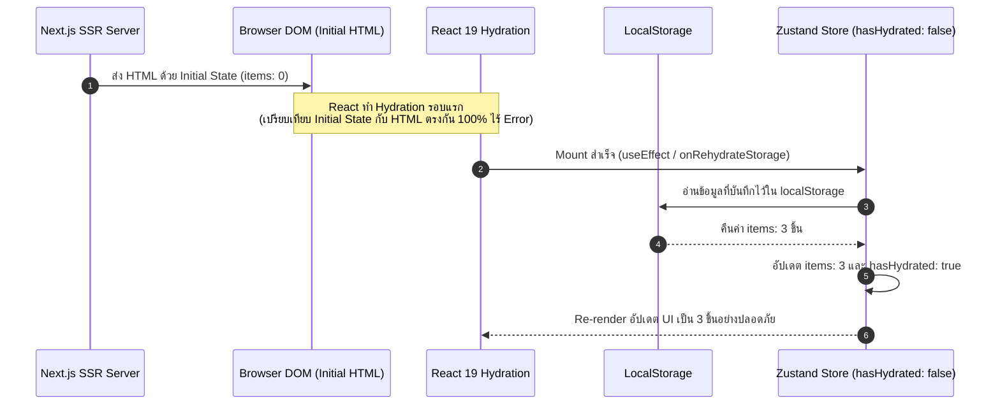

## 1. แนวคิด (Concept)

เมื่อใช้งาน **`persist` middleware** ร่วมกับ Next.js (SSR) นักพัฒนาแทบทุกคนจะพบเจอกับข้อผิดพลาดคลาสสิก: **Hydration Error (Text content did not match server-rendered HTML)**:

1. **สาเหตุของ Hydration Mismatch**:
   - **บนเซิร์ฟเวอร์**: ไม่มี `localStorage` เซิร์ฟเวอร์จึงเรนเดอร์ HTML ออกมาด้วย State เริ่มต้น (เช่น ตะกร้าสินค้ามี 0 ชิ้น: `🛒 (0)`)
   - **บนเบราว์เซอร์ (Client)**: ในวินาทีที่เริ่ม Hydrate ตัว `persist` middleware อ่านข้อมูลจาก `localStorage` ทันทีและพบว่าผู้ใช้เคยมีสินค้า 3 ชิ้น จึงพยายามเรนเดอร์ `🛒 (3)`
   - React 19 ตรวจพบว่า HTML ที่ส่งมาจากเซิร์ฟเวอร์ (`(0)`) ไม่ตรงกับ Virtual DOM บนเบราว์เซอร์ (`(3)`) จึงพ่น Error และบังคับทำ Client-side Recovery Render
2. **ทางออกที่เป็นมาตรฐานของ Zustand v5**:
   - การใช้ Flag **`hasHydrated`** หรือ Custom Hook **`useHydration`**
   - การตั้งค่า **`skipHydration: true`** เพื่อหน่วงเวลาให้ Client เรนเดอร์รอบแรกให้ตรงกับ Server ก่อน แล้วจึงสั่ง `.rehydrate()` ตามหลังอย่างราบรื่นไร้อาการหน้าจอกระพริบ (No Layout Flash)

---

## 2. หลักการเบื้องหลัง (Under the Hood)

ลำดับการทำงานที่ป้องกัน Hydration Mismatch:



- การแบ่งเป็น 2 จังหวะอย่างชัดเจนทำให้ React Hydration สำเร็จลุล่วงโดยไม่มี Mismatch จากนั้นจึงเกิดการ Render อัปเดตข้อมูลจริงจาก Storage ในรอบถัดไป

---

## 3. ตัวอย่างโค้ด (TypeScript / TSX)

ตัวอย่างจริง: ระบบ **E-Commerce Shopping Cart Store** ที่รองรับ Persist ใน LocalStorage พร้อมการจัดการ Hydration อย่างสมบูรณ์

### 1. การสร้าง Store พร้อม `hasHydrated` Flag

```tsx filename="store/cart-persist-store.ts"
import { create } from 'zustand';
import { persist, createJSONStorage } from 'zustand/middleware';

export interface CartItem {
  id: string;
  name: string;
  price: number;
  quantity: number;
}

interface CartPersistStore {
  items: CartItem[];
  _hasHydrated: boolean; // Flag ภายในเพื่อระบุว่าอ่าน LocalStorage สำเร็จหรือยัง
  setHasHydrated: (state: boolean) => void;
  addItem: (item: CartItem) => void;
  clearCart: () => void;
}

export const useCartPersistStore = create<CartPersistStore>()(
  persist(
    (set) => ({
      items: [],
      _hasHydrated: false,
      setHasHydrated: (hasHydrated) => set({ _hasHydrated: hasHydrated }),

      addItem: (item) =>
        set((state) => {
          const existing = state.items.find((i) => i.id === item.id);
          if (existing) {
            return {
              items: state.items.map((i) =>
                i.id === item.id ? { ...i, quantity: i.quantity + 1 } : i
              ),
            };
          }
          return { items: [...state.items, item] };
        }),

      clearCart: () => set({ items: [] }),
    }),
    {
      name: 'ecommerce-cart-v1',
      storage: createJSONStorage(() => localStorage),
      // ละเว้น _hasHydrated ไม่ให้บันทึกลง localStorage
      partialize: (state) => ({ items: state.items }),
      onRehydrateStorage: () => (state) => {
        // เมื่ออ่านข้อมูลเสร็จสิ้น ปรับสถานะเป็น true
        state?.setHasHydrated(true);
      },
    }
  )
);
```

### 2. Custom Hook อำนวยความสะดวก `useStoreHydration`

```tsx filename="hooks/useStoreHydration.ts"
'use client';

import { useState, useEffect } from 'react';

/**
 * Hook ตรวจสอบว่า Component ได้รับการ Mount บน Client แล้วหรือไม่
 * เพื่อใช้สลับแสดง Skeleton / Loading ป้องกันอาการ Hydration Mismatch
 */
export function useStoreHydration() {
  const [isHydrated, setIsHydrated] = useState(false);

  useEffect(() => {
    setIsHydrated(true);
  }, []);

  return isHydrated;
}
```

### 3. คอมโพเนนต์ที่เรียกใช้งานอย่างปลอดภัย ไร้ Hydration Error

```tsx filename="components/NavbarCartIndicator.tsx"
'use client';

import { useCartPersistStore } from '@/store/cart-persist-store';
import { useStoreHydration } from '@/hooks/useStoreHydration';

export function NavbarCartIndicator() {
  const isHydrated = useStoreHydration();
  const hasStoreHydrated = useCartPersistStore((state) => state._hasHydrated);
  const items = useCartPersistStore((state) => state.items);

  // คำนวณจำนวนชิ้น
  const totalCount = items.reduce((acc, item) => acc + item.quantity, 0);

  // ในระหว่างที่ยังไม่ Hydrate ให้แสดง Skeleton หรือค่าว่าง
  if (!isHydrated || !hasStoreHydrated) {
    return (
      <div className="h-9 w-20 bg-slate-200 dark:bg-slate-800 animate-pulse rounded-full" />
    );
  }

  return (
    <div className="flex items-center gap-2 px-3 py-1.5 bg-blue-50 dark:bg-blue-900/40 text-blue-600 dark:text-blue-300 rounded-full font-medium text-sm">
      <span>🛒 ตะกร้า</span>
      <span className="px-2 py-0.5 bg-blue-600 text-white text-xs rounded-full font-bold">
        {totalCount}
      </span>
    </div>
  );
}
```

---

## 4. เทียบกับวิธีอื่น (Context / Redux vs Zustand)

| วิธีแก้ Hydration Mismatch | ข้อดี | ข้อเสีย |
| :--- | :--- | :--- |
| **`suppressHydrationWarning` ของ React** | เขียนง่าย ใส่บนแท็ก HTML | แก้ปัญหาที่ปลายเหตุ ซ่อน Error แต่หน้าจอยังอาจกระตุก |
| **Dynamic Import `{ ssr: false }`** | ปิดการเรนเดอร์บนเซิร์ฟเวอร์ทันที | เสียประโยชน์ด้าน SEO และเพิ่มขนาด JavaScript Chunk |
| **Zustand `onRehydrateStorage` + `hasHydrated`** | **แก้ที่ต้นเหตุ รองรับ SSR เต็มรูปแบบ และควบคุม Fallback UI ได้อย่างละเอียด** | ต้องเขียน Flag เพิ่มใน Store หรือใช้ Custom Hook |

---

## 5. ผิด vs ถูก

### กรณีที่ 1: แสดงข้อมูลจาก Persist Store ทันทีในรอบ Render แรกบน Next.js

```tsx
// ❌ ผิด: อ่าน items.length และพิมพ์ลงใน DOM ทันทีใน Client Component
export function BadCart() {
  const count = useCartPersistStore((state) => state.items.length);
  // บน Server ได้ 0 แต่บน Browser ได้ 5 -> เกิด Hydration Error ทันที!
  return <span>สินค้า: {count} ชิ้น</span>;
}

// ✅ ถูก: รอจนกว่า Hydration จะเสร็จสิ้นก่อนแสดงข้อมูล
export function GoodCart() {
  const isHydrated = useStoreHydration();
  const count = useCartPersistStore((state) => state.items.length);

  if (!isHydrated) {
    return <span>สินค้า: - ชิ้น</span>; // หรือ Skeleton Loader
  }

  return <span>สินค้า: {count} ชิ้น</span>;
}
```

### กรณีที่ 2: เผลอบันทึก Flag `hasHydrated` ลงใน LocalStorage

```tsx
// ❌ ผิด: ไม่ได้ระบุ partialize ทำให้ _hasHydrated ถูกเซฟเป็น true ลง storage
// เมื่อเปิดเว็บครั้งถัดไป ค่าจะอ่านมาเป็น true ตั้งแต่วินาทีแรก ซึ่งทำลายกลไกการรอ Hydration

// ✅ ถูก: ใช้ partialize กรอง _hasHydrated ทิ้งไป
partialize: (state) => ({ items: state.items }),
```

---

## 6. ควรใช้เมื่อไหร่ / ไม่ควรใช้เมื่อไหร่

### ควรใช้รูปแบบนี้เมื่อ:
- มีการใช้งาน **`persist` middleware** ร่วมกับ **Next.js App Router (SSR)** หรือ Remix
- ข้อมูลที่เก็บใน LocalStorage มีผลต่อการเรนเดอร์โครงสร้างหน้าตาของ HTML เช่น ตัวเลขยอดสินค้า, ชื่อผู้ใช้, สถานะการล็อกอิน

### ไม่จำเป็นต้องใช้เมื่อ:
- เป็นแอปพลิเคชันแบบ Client-Only Single Page Application (Vite / CRA) ที่ไม่มี Server-Side Rendering
- Store นั้นไม่ได้ใช้ Middleware `persist` (ไม่มีการอ่าน LocalStorage ตอนเปิดหน้าเว็บ)

---

## 7. คำถามสัมภาษณ์งาน (Interview Questions)

### Q1: ทำไมการใช้ `localStorage` ร่วมกับ SSR ใน Next.js จึงมักทำให้เกิด Hydration Error และเราจะแก้ปัญหานี้ได้อย่างหมดจดได้อย่างไร?
**แนวทางคำตอบ**:
เพราะในขั้นตอน SSR เซิร์ฟเวอร์ Node.js ไม่มีสิทธิ์เข้าถึง `window.localStorage` จึงต้องเรนเดอร์ HTML ออกมาโดยอิงจากค่าเริ่มต้น (Initial State เช่น อาเรย์ว่างเปล่า) แต่เมื่อเบราว์เซอร์รับ HTML มาแล้วเริ่มกระบวนการ Hydration ตัวเบราว์เซอร์จะอ่านค่าจริงจาก LocalStorage ทันที ทำให้ Virtual DOM ฝั่งไคลเอนต์ไม่ตรงกับ HTML ที่เซิร์ฟเวอร์ส่งมา

การแก้ปัญหาอย่างถูกต้องคือการทำให้การเรนเดอร์รอบแรกบนไคลเอนต์ใช้ค่าเดียวกับเซิร์ฟเวอร์เสมอ โดยใช้เทคนิค **Two-pass Rendering** ผ่าน Hook `useEffect` หรือ Flag `onRehydrateStorage` ของ Zustand เพื่อรอให้ Hydration ผ่านไปก่อน แล้วจึงค่อยสั่งให้อ่านค่าจาก LocalStorage มาเรนเดอร์ทับในรอบที่สอง

### Q2: อ็อปชัน `skipHydration: true` ใน `persist` middleware มีประโยชน์อย่างไร?
**แนวทางคำตอบ**:
โดยปกติ `persist` จะพยายามอ่าน Storage และ Rehydrate State ทันทีที่ Store ถูกสร้าง ซึ่งจะไวกว่า React Lifecycle การเปิด `skipHydration: true` จะสั่งให้ Zustand **ระงับการ Rehydrate อัตโนมัติไว้ก่อน** เพื่อให้นักพัฒนาสามารถเรียกคำสั่ง `useStore.persist.rehydrate()` ด้วยตนเองภายใน `useEffect` ฝั่งไคลเอนต์ ช่วยรับประกันว่าการ Rehydrate จะเกิดขึ้นหลังจากการทำ React Hydration เสร็จสิ้นแล้วอย่างแน่นอน
