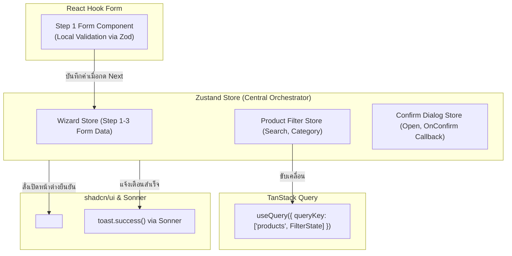

## 1. แนวคิด (Concept)

ในระบบงานจริง Zustand แทบไม่เคยทำงานอยู่อย่างโดดเดี่ยว แต่มักทำหน้าที่เป็น **"ข้อต่อศูนย์กลาง" (Orchestration Layer)** ที่ประสานงานร่วมกับไลบรารียอดนิยม:

1. **React Hook Form (RHF) + Zustand**: ใช้ทำ **Multi-step Wizard Form** โดยให้ RHF จัดการ Validation และ Input State ประจำแต่ละหน้า ส่วน Zustand ทำหน้าที่เก็บค่า Snapshot ข้ามแต่ละขั้นตอน (Step 1 -> Step 2 -> Step 3)
2. **TanStack Query + Zustand**: Zustand รับผิดชอบ **Client Filter / Sort / Pagination State** และส่งค่านั้นเข้าไปเป็น `queryKey` เพื่อกระตุ้นให้ TanStack Query ยิง API และจัดการ Cache ของผลลัพธ์
3. **shadcn/ui (Dialog / Sonner Toast) + Zustand**: จัดการ **Global Alert / Confirmation Dialog** และการสั่งเด้ง Toast แจ้งเตือนจาก Action ใดๆ ใน Store ได้ทันทีโดยไม่ต้องผูกติดกับ JSX Tree

---

## 2. หลักการเบื้องหลัง (Under the Hood)

แผนภาพความสัมพันธ์ระหว่าง Zustand และระบบ Ecosystem อื่นๆ:



- การแบ่งหน้าที่แบบนี้ช่วยป้องกันปัญหา State บวม และให้แต่ละเครื่องมือทำงานในจุดแข็งที่สุดของตนเอง

---

## 3. ตัวอย่างโค้ด (TypeScript / TSX)

ตัวอย่างจริง: ระบบ **Multi-Step Onboarding Form + shadcn Dialog + Sonner Toast**

### 1. Store สำหรับ Multi-Step Wizard

```tsx filename="store/onboarding-wizard-store.ts"
import { create } from 'zustand';
import { toast } from 'sonner';

export interface OnboardingData {
  // Step 1: Personal Info
  fullName: string;
  email: string;
  // Step 2: Company Info
  companyName: string;
  teamSize: string;
}

interface OnboardingWizardStore {
  step: number;
  formData: OnboardingData;
  setStep: (step: number) => void;
  updateFormData: (data: Partial<OnboardingData>) => void;
  submitFinalOnboarding: () => Promise<void>;
  resetWizard: () => void;
}

const initialData: OnboardingData = {
  fullName: '',
  email: '',
  companyName: '',
  teamSize: '1-5',
};

export const useOnboardingWizardStore = create<OnboardingWizardStore>()((set, get) => ({
  step: 1,
  formData: initialData,

  setStep: (step) => set({ step }),

  updateFormData: (data) =>
    set((state) => ({
      formData: { ...state.formData, ...data },
    })),

  submitFinalOnboarding: async () => {
    const finalData = get().formData;

    try {
      const res = await fetch('/api/onboarding', {
        method: 'POST',
        headers: { 'Content-Type': 'application/json' },
        body: JSON.stringify(finalData),
      });

      if (!res.ok) throw new Error('เกิดข้อผิดพลาดในการลงทะเบียน');

      // ผสานการทำงานกับ Sonner Toast นอก React Tree ได้ทันที!
      toast.success('ยินดีต้อนรับ! บันทึกข้อมูลองค์กรเรียบร้อยแล้ว');
      get().resetWizard();
    } catch (err: any) {
      toast.error(err.message || 'ไม่สามารถส่งข้อมูลได้');
    }
  },

  resetWizard: () => set({ step: 1, formData: initialData }),
}));
```

### 2. คอมโพเนนต์ Step 1 ทำงานร่วมกับ React Hook Form

```tsx filename="components/onboarding/StepOnePersonal.tsx"
'use client';

import { useForm } from 'react-hook-form';
import { useOnboardingWizardStore } from '@/store/onboarding-wizard-store';

interface FormValues {
  fullName: string;
  email: string;
}

export function StepOnePersonal() {
  const formData = useOnboardingWizardStore((s) => s.formData);
  const updateFormData = useOnboardingWizardStore((s) => s.updateFormData);
  const setStep = useOnboardingWizardStore((s) => s.setStep);

  // ตั้งค่า React Hook Form ด้วยค่าเดิมที่อาจเคยกรอกไว้ใน Zustand
  const { register, handleSubmit, formState: { errors } } = useForm<FormValues>({
    defaultValues: {
      fullName: formData.fullName,
      email: formData.email,
    },
  });

  const onSubmit = (data: FormValues) => {
    // 1. บันทึกข้อมูลของ Step 1 ลง Zustand
    updateFormData(data);
    // 2. นำทางไปยัง Step 2
    setStep(2);
  };

  return (
    <form onSubmit={handleSubmit(onSubmit)} className="space-y-4">
      <div>
        <label className="block text-sm font-medium mb-1">ชื่อ-นามสกุล</label>
        <input
          {...register('fullName', { required: 'กรุณากรอกชื่อ' })}
          className="w-full px-3 py-2 border rounded-lg"
          placeholder="สมชาย ใจดี"
        />
        {errors.fullName && <p className="text-xs text-red-500 mt-1">{errors.fullName.message}</p>}
      </div>

      <div>
        <label className="block text-sm font-medium mb-1">อีเมลทำงาน</label>
        <input
          type="email"
          {...register('email', { required: 'กรุณากรอกอีเมล' })}
          className="w-full px-3 py-2 border rounded-lg"
          placeholder="somchai@company.com"
        />
        {errors.email && <p className="text-xs text-red-500 mt-1">{errors.email.message}</p>}
      </div>

      <button type="submit" className="w-full py-2 bg-blue-600 text-white rounded-lg font-medium">
        ถัดไป: ข้อมูลบริษัท →
      </button>
    </form>
  );
}
```

### 3. Store จัดการ Global Confirmation Dialog สำหรับ shadcn/ui

```tsx filename="store/confirm-dialog-store.ts"
import { create } from 'zustand';

interface ConfirmDialogOptions {
  title: string;
  description: string;
  confirmText?: string;
  cancelText?: string;
  onConfirm: () => Promise<void> | void;
}

interface ConfirmDialogStore {
  isOpen: boolean;
  options: ConfirmDialogOptions | null;
  openConfirm: (options: ConfirmDialogOptions) => void;
  closeConfirm: () => void;
}

export const useConfirmDialogStore = create<ConfirmDialogStore>()((set) => ({
  isOpen: false,
  options: null,
  openConfirm: (options) => set({ isOpen: true, options }),
  closeConfirm: () => set({ isOpen: false, options: null }),
}));
```

### 4. คอมโพเนนต์ Global Dialog วางไว้ที่ Root Layout

```tsx filename="components/GlobalConfirmDialog.tsx"
'use client';

import { useConfirmDialogStore } from '@/store/confirm-dialog-store';

export function GlobalConfirmDialog() {
  const isOpen = useConfirmDialogStore((s) => s.isOpen);
  const options = useConfirmDialogStore((s) => s.options);
  const close = useConfirmDialogStore((s) => s.closeConfirm);

  if (!isOpen || !options) return null;

  const handleConfirm = async () => {
    await options.onConfirm();
    close();
  };

  return (
    <div className="fixed inset-0 z-50 flex items-center justify-center bg-black/50 backdrop-blur-xs">
      <div className="bg-white dark:bg-slate-900 p-6 rounded-2xl max-w-sm w-full space-y-4 shadow-xl">
        <h3 className="text-lg font-bold">{options.title}</h3>
        <p className="text-sm text-slate-500">{options.description}</p>
        <div className="flex justify-end gap-2 pt-2">
          <button
            onClick={close}
            className="px-4 py-2 text-sm border rounded-lg hover:bg-slate-100"
          >
            {options.cancelText || 'ยกเลิก'}
          </button>
          <button
            onClick={handleConfirm}
            className="px-4 py-2 text-sm bg-red-600 text-white rounded-lg hover:bg-red-700 font-medium"
          >
            {options.confirmText || 'ยืนยัน'}
          </button>
        </div>
      </div>
    </div>
  );
}
```

---

## 4. เทียบกับวิธีอื่น (Context / Redux vs Zustand)

| รูปแบบการทำงานร่วมกัน | ผูก State ทั้งหมดไว้ใน Redux | ส่งผ่าน Props และ Context | สถาปัตยกรรมแยกส่วนด้วย Zustand |
| :--- | :--- | :--- | :--- |
| **การจัดการ Form State** | หนักเครื่องมาก ทุกตัวอักษรที่พิมพ์สั่ง Dispatch Reducer | ติดปัญหา Prop Drilling ระหว่างขั้นตอน | **RHF จัดการ Local Input, Zustand จำผลรวมระหว่างขั้นตอน** |
| **การสั่ง Toast / Notification** | ต้องมี Middleware พิเศษคอยดักจับ Action | ผูกติดกับ JSX Tree ของ Component | **เรียก `toast()` ภายใน Zustand Action ได้ทันที** |
| **การเปิด Dialog จากทุกที่** | ซับซ้อน ต้องระบุ Action Type | ต้องครอบ Context ซ้อนกันหลายชั้น | **เรียก `useConfirmDialogStore.getState().openConfirm()` ได้ทุกที่** |

---

## 5. ผิด vs ถูก

### กรณีที่ 1: การซิงค์ Input Change ทุกตัวอักษรลงใน Zustand Store โดยตรง

```tsx
// ❌ ผิด: อัปเดต Zustand Store ทุกครั้งที่ผู้ใช้กดแป้นพิมพ์ตัวอักษร
<input
  value={text}
  onChange={(e) => useFormStore.getState().setText(e.target.value)} // Re-render หนักเกินไป!
/>

// ✅ ถูก: ปล่อยให้ React Hook Form จัดการ Uncontrolled DOM ภายในฟอร์ม แล้วบันทึกลง Zustand เมื่อกด "ถัดไป" หรือ "ส่งข้อมูล"
const onSubmit = (values) => {
  useWizardStore.getState().saveStepData(values);
};
```

### กรณีที่ 2: การสั่งยิง React Query ซ้ำด้วยมือแทนที่จะส่ง Zustand State เข้า `queryKey`

```tsx
// ❌ ผิด: สั่ง queryClient.refetchQueries() ทุกครั้งที่กดเปลี่ยนตัวกรองใน Zustand
setFilter: (category) => {
  set({ category });
  queryClient.refetchQueries(['products']); // ซ้ำซ้อนและควบคุมยาก
}

// ✅ ถูก: ส่ง category จาก Zustand ไปใส่ใน queryKey ของ useQuery โดยตรง
const category = useFilterStore((s) => s.category);
useQuery({
  queryKey: ['products', category], // เมื่อ category ขยับ React Query จัดการ refetch ให้อัตโนมัติ
  queryFn: () => fetchProducts(category),
});
```

---

## 6. ควรใช้เมื่อไหร่ / ไม่ควรใช้เมื่อไหร่

### ควรใช้การผสมผสานนี้เมื่อ:
- มี **Multi-step Form** ข้ามหน้าจอหลายหน้า (Onboarding, Checkout, Booking)
- ต้องการ **Global Imperative Dialog** (เช่น สั่งเปิดกล่องยืนยันการลบจากตารางข้อมูลได้ในบรรทัดเดียว)
- ต้องการยิงการแจ้งเตือน **Sonner Toast** ทันทีหลังจาก Async Action ใน Store สำเร็จ

### ไม่ควรใช้:
- ไม่ควรใช้ Zustand แทน React Hook Form ในฟอร์มธรรมดาหน้าเดียวที่ไม่มีความจำเป็นต้องแชร์ข้อมูลข้ามหน้าจอ

---

## 7. คำถามสัมภาษณ์งาน (Interview Questions)

### Q1: ทำไมการใช้ React Hook Form ร่วมกับ Zustand สำหรับ Multi-step Wizard จึงมีประสิทธิภาพเหนือกว่าการใช้ Zustand เก็บ Form State ทั้งหมดตั้งแต่ต้น?
**แนวทางคำตอบ**:
เพราะ React Hook Form ทำงานบนพื้นฐานของ **Uncontrolled Components** ซึ่งไม่ได้กระตุ้นให้เกิดการ Re-render ของ React ทุกครั้งที่ผู้ใช้พิมพ์ตัวอักษรลงในช่อง Input ทำให้การกรอกข้อมูลลื่นไหลสูงสุด

หากเรานำ Zustand มาผูกกับทุกช่อง Input ผ่าน `onChange` ทุกตัวอักษรที่พิมพ์จะทำให้ Zustand ทำการ Notify และบังคับให้ React Re-render ส่วนประกอบที่เกี่ยวข้องทั้งหมด ส่งผลให้หน้าจอกระตุก การแบ่งบทบาทโดยให้ React Hook Form ดูแล Local Input + Validation และใช้ Zustand เก็บเฉพาะผลลัพธ์ที่ผ่านการตรวจสอบแล้วเมื่อเปลี่ยน Step จึงเป็น Architecture ที่สมดุลและมีประสิทธิภาพสูงสุด

### Q2: เราสามารถเรียกใช้งานไลบรารีประเภท Alert / Notification เช่น `sonner` หรือ `sweetalert2` ภายในฟังก์ชัน Action ของ Zustand ได้หรือไม่ เพราะเหตุใด?
**แนวทางคำตอบ**:
**สามารถทำได้อย่างสมบูรณ์แบบ** เพราะ Zustand Action เป็นฟังก์ชัน JavaScript ธรรมดาที่ไม่ได้ถูกผูกมัดอยู่กับ React Lifecycle Rules เราสามารถ Import ฟังก์ชัน `toast.success()` จาก `sonner` เข้ามาเรียกใช้งานได้ทันทีหลังจากคำสั่ง `await api.post()` สำเร็จ ช่วยให้โค้ดส่วน UI ของ Component สั้นลง และรวบตรรกะ Side-effect ทั้งหมดไว้ในจุดเดียว
