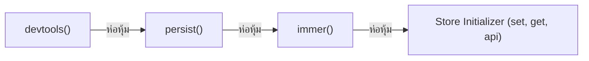

## 1. แนวคิด (Concept)

**Middleware ใน Zustand** คือฟังก์ชันระดับสูง (Higher-Order Functions) ที่ใช้ห่อหุ้ม Store Initializer เพื่อขยายขีดความสามารถโดยไม่ต้องแก้ไขโค้ดการทำงานหลัก:
1. **`persist`**: จัดเก็บและกู้คืน State อัตโนมัติไปยัง Storage ภายนอก เช่น `localStorage`, `sessionStorage`, หรือ `AsyncStorage` (สำหรับ React Native) พร้อมฟังก์ชัน `partialize` เพื่อเลือกบันทึกเฉพาะบางฟิลด์ที่จำเป็น
2. **`devtools`**: เชื่อมต่อ Store เข้ากับส่วนขยายเบราว์เซอร์ **Redux DevTools** ช่วยให้สามารถดู Log การเปลี่ยนแปลง, Action names, และทำ Time-travel Debugging ได้
3. **`immer`**: ช่วยให้นักพัฒนาสามารถเขียนโค้ดอัปเดต Nested State แบบ Mutating ตรงๆ (เช่น `state.user.preferences.theme = 'dark'`) โดย Immer จะเปลี่ยนเป็นการสร้าง Immutable Object ก้อนใหม่ให้หลังบ้านโดยอัตโนมัติ
4. **`subscribeWithSelector`**: เพิ่มความสามารถให้ฟังก์ชัน `store.subscribe()` ภายนอก React สามารถดักฟังเฉพาะการเปลี่ยนแปลงของฟิลด์ที่ระบุได้

---

## 2. หลักการเบื้องหลัง (Under the Hood)

โครงสร้างแบบ Pipeline ของ Zustand Middleware:



- **Higher-Order StateCreator Pattern**: Middleware แต่ละตัวจะรับฟังก์ชัน `(set, get, api)` เข้ามา และส่ง `set` รุ่นดัดแปลง (Enhanced Set) ต่อไปให้ตัวถัดไป
- ตัวอย่างเช่น `immer` จะแปลง `set(fn)` ให้รันฟังก์ชัน `produce` ของ Immer ก่อนส่งต่อไปยัง `set` ของ `persist` ซึ่งจะทำการ Serialize ข้อมูลลง Storage ก่อนจะส่งต่อให้ `devtools` บันทึกลง Redux DevTools Panel

---

## 3. ตัวอย่างโค้ด (TypeScript / TSX)

ตัวอย่างจริง: ระบบ **User Settings & App Theme Store** ที่ผสานทั้ง 4 Middlewares เข้าด้วยกันอย่างสมบูรณ์

```tsx filename="store/user-settings-store.ts"
import { create } from 'zustand';
import { devtools, persist, subscribeWithSelector } from 'zustand/middleware';
import { immer } from 'zustand/middleware/immer';

export interface NotificationSettings {
  push: boolean;
  emailDigest: boolean;
  marketingEmails: boolean;
}

export interface UserSettingsState {
  theme: 'light' | 'dark' | 'system';
  fontSize: number;
  notifications: NotificationSettings;
  temporarySessionId: string; // ฟิลด์นี้ไม่ต้องการเซฟลง localStorage

  // Actions
  setTheme: (theme: 'light' | 'dark' | 'system') => void;
  setFontSize: (size: number) => void;
  toggleMarketingEmails: () => void;
  updatePushNotification: (enabled: boolean) => void;
  resetSettings: () => void;
}

const initialSettings = {
  theme: 'system' as const,
  fontSize: 16,
  notifications: {
    push: true,
    emailDigest: true,
    marketingEmails: false,
  },
  temporarySessionId: 'sess_' + Math.random().toString(36).substring(7),
};

// การเรียงลำดับ: devtools -> persist -> subscribeWithSelector -> immer
export const useUserSettingsStore = create<UserSettingsState>()(
  devtools(
    persist(
      subscribeWithSelector(
        immer((set) => ({
          ...initialSettings,

          // การใช้ immer ช่วยให้อัปเดตค่าตัวแปรลึกๆ ได้ตรงๆ โดยไม่ต้องเขียน Spread Operator ซ้ำ
          setTheme: (theme) =>
            set((state) => {
              state.theme = theme;
            }),

          setFontSize: (fontSize) =>
            set((state) => {
              state.fontSize = Math.min(Math.max(fontSize, 12), 24); // จำกัด 12 - 24 px
            }),

          toggleMarketingEmails: () =>
            set((state) => {
              // แก้ไขค่า Nested ได้อย่างปลอดภัยด้วย Immer Draft Proxy
              state.notifications.marketingEmails = !state.notifications.marketingEmails;
            }),

          updatePushNotification: (enabled) =>
            set((state) => {
              state.notifications.push = enabled;
            }),

          resetSettings: () =>
            set((state) => {
              state.theme = initialSettings.theme;
              state.fontSize = initialSettings.fontSize;
              state.notifications = { ...initialSettings.notifications };
            }),
        }))
      ),
      {
        name: 'app-user-settings', // localStorage key
        // 1. partialize: คัดเลือกเฉพาะข้อมูลถาวร ละเว้น temporarySessionId
        partialize: (state) => ({
          theme: state.theme,
          fontSize: state.fontSize,
          notifications: state.notifications,
        }),
        // 2. onRehydrateStorage: ดักฟังเมื่ออ่านข้อมูลจาก localStorage เสร็จสิ้น
        onRehydrateStorage: () => (state, error) => {
          if (error) {
            console.error('Failed to rehydrate user settings:', error);
          } else {
            console.log('User settings rehydrated successfully:', state?.theme);
          }
        },
      }
    ),
    { name: 'UserSettingsStore' }
  )
);

// ตัวอย่างการใช้ subscribeWithSelector นอก React Component
// เช่น ปรับ class dark บนแท็ก <html> ทันทีที่ theme มีการเปลี่ยนแปลง
if (typeof window !== 'undefined') {
  useUserSettingsStore.subscribe(
    (state) => state.theme,
    (theme) => {
      const root = document.documentElement;
      if (theme === 'dark') {
        root.classList.add('dark');
      } else if (theme === 'light') {
        root.classList.remove('dark');
      } else {
        const prefersDark = window.matchMedia('(prefers-color-scheme: dark)').matches;
        root.classList.toggle('dark', prefersDark);
      }
    },
    { fireImmediately: true }
  );
}
```

### คอมโพเนนต์หน้าตั้งค่าระบบ

```tsx filename="components/SettingsView.tsx"
'use client';

import { useUserSettingsStore } from '@/store/user-settings-store';

export function SettingsView() {
  const theme = useUserSettingsStore((state) => state.theme);
  const setTheme = useUserSettingsStore((state) => state.setTheme);
  const fontSize = useUserSettingsStore((state) => state.fontSize);
  const setFontSize = useUserSettingsStore((state) => state.setFontSize);
  const marketing = useUserSettingsStore((state) => state.notifications.marketingEmails);
  const toggleMarketing = useUserSettingsStore((state) => state.toggleMarketingEmails);

  return (
    <div className="max-w-md mx-auto p-6 space-y-6 bg-white dark:bg-slate-900 border rounded-2xl">
      <h2 className="text-xl font-bold">การตั้งค่าแอปพลิเคชัน</h2>

      <div>
        <label className="block text-sm font-semibold mb-2">ธีมการแสดงผล</label>
        <div className="flex gap-2">
          {(['light', 'dark', 'system'] as const).map((t) => (
            <button
              key={t}
              onClick={() => setTheme(t)}
              className={`px-3 py-1.5 rounded-lg text-sm capitalize ${
                theme === t ? 'bg-blue-600 text-white' : 'bg-slate-100 dark:bg-slate-800'
              }`}
            >
              {t}
            </button>
          ))}
        </div>
      </div>

      <div>
        <label className="block text-sm font-semibold mb-2">ขนาดฟอนต์ ({fontSize}px)</label>
        <input
          type="range"
          min="12"
          max="24"
          value={fontSize}
          onChange={(e) => setFontSize(Number(e.target.value))}
          className="w-full"
        />
      </div>

      <div className="flex items-center justify-between border-t pt-4">
        <span className="text-sm">รับอีเมลข่าวสารและการตลาด</span>
        <button
          onClick={toggleMarketing}
          className={`w-12 h-6 flex items-center rounded-full p-1 transition ${
            marketing ? 'bg-emerald-500' : 'bg-slate-300 dark:bg-slate-700'
          }`}
        >
          <div
            className={`bg-white w-4 h-4 rounded-full shadow-md transform transition ${
              marketing ? 'translate-x-6' : 'translate-x-0'
            }`}
          />
        </button>
      </div>
    </div>
  );
}
```

---

## 4. เทียบกับวิธีอื่น (Context / Redux vs Zustand)

| ฟีเจอร์ Middleware | Redux Toolkit | Zustand v5 |
| :--- | :--- | :--- |
| **Immer Integration** | รวมมาให้แบบ Built-in บังคับใช้ในทุก Reducer | เลือกได้ว่าจะใช้หรือไม่ผ่าน `immer()` middleware |
| **Persistence** | ต้องใช้ไลบรารีภายนอก (`redux-persist`) ที่ขนาดใหญ่และเซ็ตอัปซับซ้อน | Built-in มาให้ผ่าน `'zustand/middleware'` ขนาดเบาหวิว |
| **DevTools** | รองรับผ่าน Browser Extension อัตโนมัติ | รองรับผ่าน `devtools()` middleware พร้อมกำหนด Action Name |
| **Selective Subscriptions นอก React** | ต้องเขียน Custom Middleware หรือใช้ Reselect | Built-in ผ่าน `subscribeWithSelector` |

---

## 5. ผิด vs ถูก

### กรณีที่ 1: การเผลอบันทึกข้อมูล Sensitve หรือข้อมูลชั่วคราวลงใน Persist Storage

```tsx
// ❌ ผิด: บันทึกทั้ง Store ลง localStorage โดยตรง รวมถึงรหัสผ่านและค่าชั่วคราว
export const useBadStore = create(
  persist((set) => ({
    passwordDraft: '123456',
    isSearching: true,
  }), { name: 'bad-store' })
);

// ✅ ถูก: ใช้ partialize เพื่อกรองเฉพาะข้อมูลที่ปลอดภัยและจำเป็นต้องคงอยู่
export const useGoodStore = create(
  persist((set) => ({
    passwordDraft: '123456',
    isSearching: true,
    theme: 'dark',
  }), {
    name: 'good-store',
    partialize: (state) => ({ theme: state.theme }), // บันทึกเฉพาะ theme
  })
);
```

### กรณีที่ 2: ลำดับการเรียง Middleware ผิด (Middleware Ordering)

```tsx
// ❌ เสี่ยงต่อบั๊ก: เอา immer ไว้ข้างนอก persist หรือ devtools
// devtools(immer(persist(...))) อาจทำให้ devtools ไม่สามารถอ่าน Action Type หรือเกิด Type Error

// ✅ ถูก: เรียงจากนอกสุดไปในสุด devtools -> persist -> immer
devtools(
  persist(
    immer((set) => ({
      // store logic
    })),
    { name: 'my-store' }
  )
)
```

---

## 6. ควรใช้เมื่อไหร่ / ไม่ควรใช้เมื่อไหร่

### ควรใช้:
- **`persist`**: เมื่อต้องการให้ข้อมูลคงอยู่หลังจากผู้ใช้ Refresh หรือปิดแท็บเบราว์เซอร์ (เช่น ตะกร้าสินค้า, ธีมมืด/สว่าง, โทเคนผู้ใช้)
- **`immer`**: เมื่อ State มีโครงสร้างเป็น Object หรือ Array ซ้อนกันมากกว่า 2 ชั้นขึ้นไป เพื่อลดการเขียน Spread Operator ที่รุงรัง
- **`devtools`**: ในสภาพแวดล้อม Development (`process.env.NODE_ENV !== 'production'`) เพื่อช่วยตรวจสอบ State Flow

### ไม่ควรใช้:
- ไม่ควรใช้ `persist` เก็บข้อมูลขนาดใหญ่มาก (เกิน 5 MB) เช่น ไฟล์รูปภาพ Base64 ลงใน LocalStorage เพราะจะทำให้ Quota เต็มและเกิด Error
- ไม่ควรใช้ `immer` กับ Store ธรรมดาที่มีแต่ Flat Primitive เช่น `{ count: 0, isOpen: false }` เพราะจะเพิ่ม Overhead โดยไม่จำเป็น

---

## 7. คำถามสัมภาษณ์งาน (Interview Questions)

### Q1: ฟังก์ชัน `partialize` ใน `persist` middleware มีความสำคัญอย่างไรในแง่ความปลอดภัยและประสิทธิภาพ?
**แนวทางคำตอบ**:
`partialize` มีความสำคัญ 2 ประการ:
1. **ความปลอดภัย (Security)**: ช่วยคัดกรองข้อมูลที่เป็นความลับ เช่น รหัสผ่าน, Temporary CSRF Tokens หรือ Sensitive PII ข้อมูลส่วนบุคคล ไม่ให้ถูกบันทึกลงใน Web Storage (LocalStorage/SessionStorage) ของเบราว์เซอร์ ซึ่งอาจถูกโจมตีผ่าน XSS ได้
2. **ความถูกต้องและประสิทธิภาพ (State Integrity)**: ช่วยตัดทิ้งสถานะที่เป็น Transient หรือ Ephemeral เช่น `isLoading: true` หรือ `isModalOpen: true` เพราะหากผู้ใช้ปิดแท็บไปขณะโหลด แล้วกลับมาใหม่ แอปพลิเคชันจะไม่ติดสถานะ Loading ค้างอย่างถาวร

### Q2: การทำงานของ `subscribeWithSelector` แตกต่างจากฟังก์ชัน `subscribe` ปกติของ Zustand อย่างไร?
**แนวทางคำตอบ**:
ฟังก์ชัน `subscribe` พื้นฐานของ Zustand จะถูกเรียกเมื่อ **ส่วนใดส่วนหนึ่งของ Store มีการเปลี่ยนแปลง** โดยส่งค่า State ทั้งก้อนเข้ามาใน Callback ทำให้นักพัฒนาต้องเขียนเงื่อนไขตรวจสอบความเปลี่ยนแปลงเอง

ในขณะที่ `subscribeWithSelector` ช่วยให้เราสามารถระบุ Selector Function เพื่อเฝ้าดูเฉพาะฟิลด์ที่สนใจได้ (เช่น `store.subscribe(s => s.theme, (theme) => ...)` และยังรองรับ Options พิเศษ เช่น `{ fireImmediately: true }` เพื่อให้ Callback ทำงานทันที 1 ครั้งตอนเริ่มต้น และ `{ equalityFn: shallow }` สำหรับการเปรียบเทียบเชิงลึก
