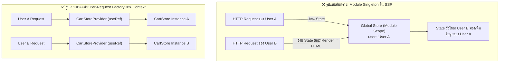

## 1. แนวคิด (Concept)

เมื่อใช้งาน **Next.js 16 (App Router)** ร่วมกับ **React 19** การจัดการ Global State มีความท้าทายที่อันตรายมากที่นักพัฒนาต้องระวัง:

1. **ปัญหา Cross-Request State Pollution (การรั่วไหลของ State ข้ามคำขอ)**:
   - บนเซิร์ฟเวอร์ Node.js ตัวแปรระดับ Global/Module Scope (`const useStore = create(...)`) จะมีสถานะเป็น **Singleton ที่แชร์ร่วมกันระหว่างทุก HTTP Request ที่ส่งเข้ามาพร้อมกัน**
   - หากผู้ใช้ A ส่งคำขอเข้ามาและระบบเซ็ตข้อมูล User A ลงใน Global Store จากนั้นผู้ใช้ B ส่งคำขอเข้ามาในเสี้ยววินาทีเดียวกัน เซิร์ฟเวอร์อาจเรนเดอร์หน้า HTML ของผู้ใช้ B โดยมีข้อมูลส่วนตัวของผู้ใช้ A ติดไปด้วย! ก่อให้เกิดช่องโหว่ความปลอดภัยระดับร้ายแรง (Security Breach)
2. **ทางออกที่ถูกต้อง: Per-Request Store Factory + React Context**:
   - สร้างฟังก์ชันโรงงาน `createCartStore(initialProps)` ด้วย `createStore` (Vanilla API)
   - ผูก Store Instance เข้ากับวงจรชีวิตของ Request แต่ละรอบผ่าน **React Context Provider** ร่วมกับ `useRef` เพื่อรับประกันว่า Store จะถูกสร้างใหม่ 1 ตัวต่อ 1 Request และแยกขาดจากกัน 100%

---

## 2. หลักการเบื้องหลัง (Under the Hood)

ความแตกต่างระหว่าง Client Singleton และ Per-Request SSR Isolation:



- **`createStore` จาก `'zustand/vanilla'`**: ใช้สร้าง Store บริสุทธิ์ที่ไม่มี React Hook ผูกติด เพื่อเตรียมส่งต่อให้ Context
- **`useRef` ใน Provider**: รับประกันว่าฝั่ง Client เมื่อมีการ Hydrate หรือ Re-render ตัว Store Instance จะถูกสร้างเพียงครั้งเดียวและคงอยู่ตลอดอายุของ Component Tree

---

## 3. ตัวอย่างโค้ด (TypeScript / TSX)

ตัวอย่างจริง: ระบบ **SSR-Safe Shopping Cart Store** ใน Next.js 16 App Router พร้อมการรับค่า Initial Props จาก Server Component

### 1. สร้าง Vanilla Store Factory

```tsx filename="store/cart-store.ts"
import { createStore } from 'zustand/vanilla';

export interface CartItem {
  id: string;
  name: string;
  price: number;
  quantity: number;
}

export interface CartState {
  items: CartItem[];
  currency: string;
}

export interface CartActions {
  addItem: (item: CartItem) => void;
  removeItem: (id: string) => void;
}

export type CartStore = CartState & CartActions;

// ฟังก์ชันโรงงานผลิต Store ใหม่ตาม Initial Props ที่ส่งมาจาก Server
export const createCartStore = (initState: CartState = { items: [], currency: 'THB' }) => {
  return createStore<CartStore>()((set) => ({
    ...initState,
    addItem: (item) =>
      set((state) => ({ items: [...state.items, item] })),
    removeItem: (id) =>
      set((state) => ({
        items: state.items.filter((i) => i.id !== id),
      })),
  }));
};

export type CartStoreApi = ReturnType<typeof createCartStore>;
```

### 2. สร้าง Store Provider และ Custom Hook

```tsx filename="components/providers/cart-store-provider.tsx"
'use client';

import { type ReactNode, createContext, useRef, useContext } from 'react';
import { useStore } from 'zustand';
import { type CartStore, type CartStoreApi, createCartStore, type CartState } from '@/store/cart-store';

export const CartStoreContext = createContext<CartStoreApi | undefined>(undefined);

export interface CartStoreProviderProps {
  children: ReactNode;
  initialState?: CartState;
}

export function CartStoreProvider({ children, initialState }: CartStoreProviderProps) {
  // ใช้ useRef เพื่อให้ Store instance ถูกสร้างเพียงครั้งเดียวต่อ Render Tree
  const storeRef = useRef<CartStoreApi | null>(null);
  if (!storeRef.current) {
    storeRef.current = createCartStore(initialState);
  }

  return (
    <CartStoreContext.Provider value={storeRef.current}>
      {children}
    </CartStoreContext.Provider>
  );
}

// Custom Hook เพื่ออ่านค่าผ่าน Selector อย่างปลอดภัย
export function useCartStore<T>(selector: (state: CartStore) => T): T {
  const cartStoreContext = useContext(CartStoreContext);

  if (!cartStoreContext) {
    throw new Error('useCartStore ต้องถูกเรียกใช้งานภายใต้ CartStoreProvider เท่านั้น');
  }

  return useStore(cartStoreContext, selector);
}
```

### 3. การใช้งานใน Next.js 16 App Router Layout & Components

```tsx filename="app/layout.tsx"
import { CartStoreProvider } from '@/components/providers/cart-store-provider';

export default async function RootLayout({ children }: { children: React.ReactNode }) {
  // ดึงค่าการตั้งค่าเริ่มต้นจาก Server หรือ Cookie
  const initialCartState = {
    items: [],
    currency: 'THB',
  };

  return (
    <html lang="th">
      <body>
        <CartStoreProvider initialState={initialCartState}>
          {children}
        </CartStoreProvider>
      </body>
    </html>
  );
}
```

```tsx filename="components/CartTotal.tsx"
'use client';

import { useCartStore } from '@/components/providers/cart-store-provider';

export function CartTotal() {
  // เรียกใช้ Hook ผ่าน Selector ได้เหมือน Zustand ปกติทุกประการ
  const count = useCartStore((state) => state.items.length);
  const currency = useCartStore((state) => state.currency);

  return (
    <div className="p-3 bg-blue-50 dark:bg-blue-950 rounded-xl text-blue-600 font-medium text-sm">
      ตะกร้าสินค้า: {count} ชิ้น ({currency})
    </div>
  );
}
```

---

## 4. เทียบกับวิธีอื่น (Context / Redux vs Zustand)

| รูปแบบ | Next.js Server Components | Redux Toolkit ใน App Router | Zustand SSR Factory + Context |
| :--- | :--- | :--- | :--- |
| **การแยก Request บนเซิร์ฟเวอร์** | ปลอดภัยโดยสมบูรณ์ผ่าน Async Context | ต้องสร้าง Redux Store ผ่าน Custom Provider per request | **ปลอดภัย 100% ผ่าน `createStore` + Context Provider** |
| **ความซับซ้อนของโค้ด** | ต่ำ แต่จัดการ Interactive Client State ลำบาก | สูงมาก มีขั้นตอน Boilerplate เยอะ | **ปานกลาง โค้ดกระชับ ได้พลังของ Zustand ครบถ้วน** |
| **การส่งต่อ Initial Props จาก Server** | ส่งผ่าน Props ปกติ | ต้องใช้ `store.dispatch(hydrate(data))` | **ส่งเข้า Parameter ของ Factory function ได้โดยตรง** |

---

## 5. ผิด vs ถูก

### กรณีที่ 1: การใช้ Global Module Singleton ใน Server-side Code ของ Next.js

```tsx
// ❌ ผิดมหันต์ใน SSR: สร้าง Global Singleton ไว้ที่ Root File
// store/bad-store.ts
export const useBadStore = create((set) => ({ user: null }));

// เมื่อผู้ใช้คนหนึ่งยิง Request มาแล้วเกิดการ set state บน Server
// ผู้ใช้คนถัดไปที่เข้ามาจะมองเห็นค่านั้นทันที!

// ✅ ถูก: สร้าง Factory Function `createStore` และส่งต่อผ่าน React Context Provider
export const createGoodStore = (init) => createStore(...)
```

### กรณีที่ 2: การสร้าง Store ใหม่ในทุกๆ รอบ Render ฝั่ง Client

```tsx
// ❌ ผิด: เขียน createCartStore() ใน Component Body โดยไม่มี useRef
export function BadProvider({ children }) {
  const store = createCartStore(); // สั่งสร้าง Store ใหม่เอี่ยมทุกครั้งที่ Provider Re-render!
  return <Context.Provider value={store}>{children}</Context.Provider>;
}

// ✅ ถูก: ใช้ useRef หรือ useState เพื่อคง Instance เดิมไว้ตลอดไป
export function GoodProvider({ children }) {
  const storeRef = useRef<CartStoreApi | null>(null);
  if (!storeRef.current) {
    storeRef.current = createCartStore();
  }
  return <Context.Provider value={storeRef.current}>{children}</Context.Provider>;
}
```

---

## 6. ควรใช้เมื่อไหร่ / ไม่ควรใช้เมื่อไหร่

### ควรใช้รูปแบบ SSR Factory + Context เมื่อ:
- พัฒนาเว็บแอปพลิเคชันด้วย **Next.js 16 (App Router)** หรือ Framework ที่มี Server-Side Rendering (SSR / SSG)
- State นั้นจำเป็นต้องรับค่าเริ่มต้น (**Initial State**) มาจากฝั่ง Server ก่อนส่งต่อให้ Client Components
- State นั้นเกี่ยวข้องกับข้อมูลส่วนตัวของผู้ใช้ (User Data, Cart, Billing)

### สามารถใช้ Zustand Singleton แบบเดิม (`create()`) ได้เมื่อ:
- State นั้นเป็น **Pure Client UI State** ล้วนๆ ที่ไม่มีข้อมูลส่วนบุคคล และไม่มีการเซ็ตค่าใดๆ บนเซิร์ฟเวอร์ (เช่น การสลับเปิด/ปิด Modal หรือ Drawer ภายในเบราว์เซอร์)

---

## 7. คำถามสัมภาษณ์งาน (Interview Questions)

### Q1: ปัญหา "Cross-request State Pollution" ใน Next.js SSR เกิดขึ้นได้อย่างไร และ Zustand จัดการปัญหานี้อย่างไร?
**แนวทางคำตอบ**:
ในสภาพแวดล้อม Server-Side Rendering เซิร์ฟเวอร์ Node.js ตัวเดียวจะคอยประมวลผลคำขอจากผู้ใช้หลายร้อยคนพร้อมกัน หากเราสร้าง Global Store ผ่าน `create()` ในระดับ Module Scope ตัวแปร Store จะเป็น Global Singleton บน Memory ของ Node.js Process

เมื่อคำขอของ User A มีการอัปเดต State ระหว่างการประมวลผลบนเซิร์ฟเวอร์ ข้อมูลนั้นจะค้างอยู่ในตัวแปร Singleton และรั่วไหลไปยังคำขอของ User B ทันที 

วิธีแก้คือการเปลี่ยนจากการใช้ Global Singleton ไปใช้ **Store Factory Pattern** ด้วย `createStore` ร่วมกับ **React Context** เพื่อให้แต่ละ HTTP Request มีการสร้าง Store Instance เฉพาะตัวแยกขาดจากกันอย่างสิ้นเชิง

### Q2: ในการสร้าง Store Provider ด้วย Zustand ทำไมเราจึงต้องใช้ `useRef` แทนที่จะใช้ `useState` หรือสร้างตัวแปรธรรมดา?
**แนวทางคำตอบ**:
เพราะ `useRef` ช่วยให้เราสามารถสร้าง Instance ของ Store แบบ Lazy Initialization (`if (!storeRef.current) storeRef.current = createCartStore()`) ได้ตั้งแต่ก่อนการ Render ครั้งแรกจะเกิดขึ้น และรับประกันว่า Store Instance จะคงอยู่ข้ามรอบการ Re-render ของ Provider โดยไม่ถูกทำลายหรือสร้างใหม่ซ้ำซ้อน ต่างจากการประกาศตัวแปรธรรมดาที่จะสร้างใหม่ทุกรอบ Render ซึ่งจะทำให้ State ภายใน Store สูญหาย
