## 1. แนวคิด (Concept)

Zustand ถูกสร้างขึ้นโดยมี **ประสิทธิภาพสูงสุด (Peak Performance)** เป็นเป้าหมายหลัก:
1. **Bundle Size ต่ำกว่า 1.5 KB**: แทบไม่มีผลกระทบต่อเวลาดาวน์โหลดหรือการรัน JavaScript ของเบราว์เซอร์ (Core Web Vitals - INP / LCP)
2. **Fine-grained Atomic Selectors**: แยกการ Subscribe เป็นระดับ Property ย่อย เพื่อให้ React Re-render เฉพาะคอมโพเนนต์ที่จำเป็นจริงๆ
3. **Transient Updates (การอัปเดตแบบทะลุผ่านข้าม React)**: สำหรับงานที่มีการเปลี่ยนแปลงความถี่สูงระดับ 60 FPS เช่น การเลื่อนหน้าจอ (Scroll Position), พิกัดเคอร์เซอร์เมาส์, การลากวาง (Drag & Drop), หรือการวาดกราฟิก Canvas เราสามารถใช้ `store.subscribe()` เพื่ออัปเดต DOM Reference ตรงๆ **โดยไม่ต้องให้ React เกิดการ Re-render เลยแม้แต่เฟรมเดียว**!
4. **Memory Optimization**: การป้องกัน Memory Leaks ด้วยการยกเลิก Subscription อัตโนมัติเมื่อคอมโพเนนต์ Unmount

---

## 2. หลักการเบื้องหลัง (Under the Hood)

เปรียบเทียบการอัปเดตแบบ React Render ปกติ กับ Transient Update ข้าม React Tree:

```mermaid
flowchart TD
    subgraph StandardUpdate ["การอัปเดตมาตรฐาน (React Re-render)"]
        StateChange1["State มีการเปลี่ยนแปลง"]
        VdomDiff["React เข้าสู่ Reconciliation (Virtual DOM Diffing)"]
        DomPatch["อัปเดตลง Real DOM"]
        RenderLag["หากเกิด 60 ครั้งต่อวินาที -> CPU ร้อน พัดลมดัง จอกระตุก"]

        StateChange1 --> VdomDiff --> DomPatch --> RenderLag
    end

    subgraph TransientUpdate ["Transient Update (Bypassing React 19 Engine)"]
        StateChange2["State เปลี่ยนแปลงถี่ (เช่น พิกัดเมาส์ x, y)"]
        SubCallback["useStore.subscribe() ดักฟัง Callback โดยตรง"]
        DirectDom["ref.current.style.transform = `translate3d(...)`"]
        Smooth60FPS["ลื่นไหล 60-120 FPS โดยไม่ต้องมี React Re-render!"]

        StateChange2 --> SubCallback --> DirectDom --> Smooth60FPS
    end
```



- การใช้ `subscribe` ร่วมกับ Mutable Ref (`useRef`) จะแยกงานที่เป็น High-frequency ออกจากวงจรชีวิตของ React ทำให้ Main Thread มีเวลาว่างไปประมวลผลงานสำคัญอื่นๆ

---

## 3. ตัวอย่างโค้ด (TypeScript / TSX)

ตัวอย่างจริง: ระบบ **Real-Time Canvas Cursor Tracking & Scroll Progress Indicator** ที่รันที่ 60 FPS อย่างราบรื่น

### 1. Store สำหรับเก็บพิกัดเคอร์เซอร์และระดับการเลื่อนหน้าจอ

```tsx filename="store/viewport-tracking-store.ts"
import { create } from 'zustand';
import { subscribeWithSelector } from 'zustand/middleware';

export interface ViewportTrackingStore {
  cursorX: number;
  cursorY: number;
  scrollProgress: number; // 0 ถึง 100%
  activeSection: string;

  setCursorPosition: (x: number, y: number) => void;
  setScrollProgress: (progress: number) => void;
  setActiveSection: (section: string) => void;
}

export const useViewportTrackingStore = create<ViewportTrackingStore>()(
  subscribeWithSelector((set) => ({
    cursorX: 0,
    cursorY: 0,
    scrollProgress: 0,
    activeSection: 'intro',

    setCursorPosition: (cursorX, cursorY) => set({ cursorX, cursorY }),
    setScrollProgress: (scrollProgress) => set({ scrollProgress }),
    setActiveSection: (activeSection) => set({ activeSection }),
  }))
);
```

### 2. คอมโพเนนต์ Progress Bar ที่ใช้ Transient Update (ข้าม React Render 100%)

```tsx filename="components/TransientProgressBar.tsx"
'use client';

import { useEffect, useRef } from 'react';
import { useViewportTrackingStore } from '@/store/viewport-tracking-store';

export function TransientProgressBar() {
  const barRef = useRef<HTMLDivElement>(null);

  useEffect(() => {
    // ผูก Event Listener เลื่อนหน้าจอ
    const handleScroll = () => {
      const totalScroll = document.documentElement.scrollHeight - window.innerHeight;
      const progress = totalScroll > 0 ? (window.scrollY / totalScroll) * 100 : 0;
      // อัปเดตลง Store นอกวงรอบการ Render
      useViewportTrackingStore.getState().setScrollProgress(progress);
    };

    window.addEventListener('scroll', handleScroll, { passive: true });

    // ✅ Transient Subscription: อัปเดต DOM โดยตรงผ่าน Ref ไม่กระตุ้น React Re-render!
    const unsubscribe = useViewportTrackingStore.subscribe(
      (state) => state.scrollProgress,
      (progress) => {
        if (barRef.current) {
          barRef.current.style.transform = `scaleX(${progress / 100})`;
        }
      }
    );

    return () => {
      window.removeEventListener('scroll', handleScroll);
      unsubscribe(); // ป้องกัน Memory Leak
    };
  }, []);

  return (
    <div className="fixed top-0 left-0 right-0 h-1 z-50 bg-slate-200 dark:bg-slate-800">
      <div
        ref={barRef}
        className="h-full bg-blue-600 origin-left transform scale-x-0 transition-transform duration-75 will-change-transform"
      />
    </div>
  );
}
```

### 3. คอมโพเนนต์ที่เลือก Subscribe เฉพาะข้อมูลที่เปลี่ยนน้อย (Low-frequency)

```tsx filename="components/SectionIndicator.tsx"
'use client';

import { useViewportTrackingStore } from '@/store/viewport-tracking-store';

export function SectionIndicator() {
  // Subscribe เฉพาะชื่อ Section: จะไม่ถูกกระทบเลยแม้ scrollProgress จะเปลี่ยนตลอดเวลา!
  const activeSection = useViewportTrackingStore((state) => state.activeSection);

  return (
    <div className="fixed bottom-4 right-4 px-3 py-1 bg-black/70 text-white text-xs rounded-full backdrop-blur-xs">
      ส่วนปัจจุบัน: <span className="font-bold uppercase">{activeSection}</span>
    </div>
  );
}
```

---

## 4. เทียบกับวิธีอื่น (Context / Redux vs Zustand)

| เกณฑ์วัดประสิทธิภาพ | React Context API | Redux Toolkit | Zustand v5 (Optimized) |
| :--- | :--- | :--- | :--- |
| **ความเร็วในการประมวลผล** | ช้ามากเมื่อ State เปลี่ยนถี่ | เร็วเมื่อใช้ Selector ละเอียด | **เร็วที่สุดในกลุ่ม State Management ของ React** |
| **Transient Updates (ข้าม React)** | ❌ ทำไม่ได้ ต้องผ่าน Fiber Tree เสมอ | ⚠️ ทำได้ผ่าน manual store subscribe | ✅ **รองรับอย่างเป็นทางการผ่าน `subscribe` / `subscribeWithSelector`** |
| **ผลกระทบต่อ Bundle Size** | 0 KB | ~11-15 KB | **~1.2 KB (จิ๋วที่สุด)** |
| **Overhead ของ Memory** | ต่ำ แต่เสีย CPU ในการ Render | ปานกลาง มี Action Objects เกิดใหม่ตลอด | **ต่ำมาก ทำงานบน Closure และ Set ธรรมดา** |

---

## 5. ผิด vs ถูก

### กรณีที่ 1: การสั่ง `set` State ความถี่สูง (High Frequency) เข้า React Component ตรงๆ

```tsx
// ❌ ผิด: อัปเดตพิกัดเมาส์ x, y เข้า State ที่ผูกกับ useStore() ภายใน Component
function BadCursorTracker() {
  const { x, y } = useCursorStore(); // Component นี้จะ Re-render 120 ครั้งต่อวินาที! พัดลมหมุนติ้ว
  return <div style={{ left: x, top: y }} className="fixed" />;
}

// ✅ ถูก: ใช้ Transient Update อัปเดต DOM Style ผ่าน ref
function GoodCursorTracker() {
  const dotRef = useRef<HTMLDivElement>(null);

  useEffect(() => {
    return useCursorStore.subscribe(
      (s) => ({ x: s.x, y: s.y }),
      ({ x, y }) => {
        if (dotRef.current) {
          dotRef.current.style.transform = `translate3d(${x}px, ${y}px, 0)`;
        }
      }
    );
  }, []);

  return <div ref={dotRef} className="fixed will-change-transform" />;
}
```

### กรณีที่ 2: สร้างฟังก์ชัน Inline Selector โดยไม่จำเป็น

```tsx
// ❌ ไม่แนะนำ: เขียน Selector ที่คำนวณ Filter ซ้ำทุกครั้งจนเกิด Garbage Collection
const filtered = useStore((s) => s.items.filter((i) => i.active)); // ได้ Array ใหม่ทุกรอบ

// ✅ ถูก: ใช้ Selector ดึงเฉพาะ items แล้วใช้ useMemo ในคอมโพเนนต์ หรือใช้ useShallow
const items = useStore((s) => s.items);
const filtered = useMemo(() => items.filter((i) => i.active), [items]);
```

---

## 6. ควรใช้เมื่อไหร่ / ไม่ควรใช้เมื่อไหร่

### ควรใช้การจูนประสิทธิภาพเหล่านี้เมื่อ:
- มีการคำนวณหรือจับสัญญาณจาก Event ที่เกิดขึ้นต่อเนื่อง เช่น `mousemove`, `touchmove`, `scroll`, หรือ `resize`
- มีกราฟิก Animation, แผนที่แบบโต้ตอบ, หรือเกม HTML5 Canvas บนหน้าเว็บ
- ต้องการลดภาระการ Re-render ของแอปพลิเคชันบนอุปกรณ์สเปกต่ำ (Low-end Mobile Devices)

### ไม่จำเป็นต้องจูนแบบ Transient เมื่อ:
- ข้อมูลนั้นเปลี่ยนจากการกระทำทั่วไปของผู้ใช้ เช่น การคลิกปุ่ม, การพิมพ์ข้อความในฟอร์ม, หรือการเปลี่ยนหน้า

---

## 7. คำถามสัมภาษณ์งาน (Interview Questions)

### Q1: เทคนิค "Transient Update" ใน Zustand คืออะไร และแก้ปัญหาด้าน Performance ได้อย่างไร?
**แนวทางคำตอบ**:
Transient Update คือเทคนิคการเชื่อมโยง State ใน Zustand เข้ากับ Real DOM โดยตรงผ่าน `useRef` และ `store.subscribe()` โดย **หลีกเลี่ยงกระบวนการ React Render Cycle และ Virtual DOM Reconciliation อย่างสิ้นเชิง**

ในงานที่มีความถี่สูง เช่น การติดตามตำแหน่งเคอร์เซอร์เมาส์ หรือแถบความคืบหน้าการเลื่อนหน้าจอที่เกิดขึ้น 60-120 ครั้งต่อวินาที หากเราสั่งอัปเดต State ผ่าน React ปกติ ตัว React จะต้องสร้าง Virtual DOM และคำนวณ Diffing ซ้ำๆ ส่งผลให้ CPU ทำงานหนักและเกิดอาการเฟรมเรตร่วง (Jank) การใช้ Transient Update ช่วยให้การแสดงผลลื่นไหลเต็ม 60 FPS โดยที่ React ยังคงอยู่นิ่ง

### Q2: ขนาด Bundle Size ของ Zustand ที่เล็กเพียง ~1.2 KB ส่งผลต่อประสิทธิภาพของเว็บแอปพลิเคชันในโลกความจริงอย่างไร?
**แนวทางคำตอบ**:
ส่งผลอย่างมีนัยสำคัญต่อคะแนน **Core Web Vitals** โดยเฉพาะ:
1. **Interaction to Next Paint (INP)**: โค้ดที่มีขนาดเล็กทำให้กระบวนการ Parse, Compile และ Execute JavaScript บน Main Thread ของเบราว์เซอร์เกิดขึ้นอย่างรวดเร็ว เบราว์เซอร์จึงพร้อมตอบสนองต่อการคลิกของผู้ใช้ได้ทันที
2. **Bandwidth & Cache**: เหมาะอย่างยิ่งสำหรับผู้ใช้เครือข่ายมือถือที่สัญญาณจำกัด และการแยก Chunk ด้วย Code-splitting จะทำได้ง่ายและคุ้มค่ากว่าไลบรารีขนาดใหญ่
