## 1. แนวคิด (Concept)

แม้ว่า **Zustand v5** จะเป็นไลบรารีที่เรียบง่ายและเป็นมิตรต่อนักพัฒนาอย่างยิ่ง แต่ด้วยความยืดหยุ่นที่สูงมาก (Unopinionated) จึงเปิดช่องให้เกิดข้อผิดพลาดทางสถาปัตยกรรม (Anti-patterns) ได้ง่ายหากขาดความเข้าใจในหลักการของ React 19 และ Next.js 16:

1. **บั๊ก Infinite Loop จาก Selector Object ใหม่ใน v5**: การลืมใช้ `useShallow` เมื่อส่งคืน Object หรือ Array
2. **การนำ Server Cache ไปยัดไว้ใน Zustand**: ทำให้ต้องเขียนตรรกะ Invalidation และ Caching เองอย่างเหน็ดเหนื่อย
3. **การ Destructuring Store Hook โดยตรง**: เช่น `const { count, inc } = useStore()` ซึ่งทำลาย Selective Subscriptions
4. **Hydration Mismatch จาก LocalStorage ใน Next.js SSR**: เรนเดอร์ข้อมูลจาก Persist Store ก่อน Hydration เสร็จสิ้น
5. **State Pollution ข้าม Request ใน SSR**: ใช้ Global Singleton Store ใน Next.js Server Components

---

## 2. หลักการเบื้องหลัง (Under the Hood)

สาเหตุของ Anti-Patterns ยอดนิยมในเชิงลึก:

```mermaid
flowchart TD
    subgraph AntiPattern1 ["Destructuring ทั้ง Store: const { a, b } = useStore()"]
        SubAll["Component ขอ Subscribe State ทั้งก้อน"]
        AnyChange["เมื่อฟิลด์ z เปลี่ยนแปลง (แม้ a, b จะเท่าเดิม)"]
        ForceRender["Component ถูกบังคับ Re-render! ประสิทธิภาพลดฮวบ"]
        SubAll --> AnyChange --> ForceRender
    end

    subgraph AntiPattern2 ["คืนค่า Object ใหม่ใน v5 Selector"]
        ReturnObj["return { x: state.x, y: state.y }"]
        NewRef["สร้าง Memory Reference ใหม่ทุกรอบ"]
        ReactCheck["React เปรียบเทียบ prev !== next (Strict Equality ===)"]
        Loop["เกิด Infinite Loop 'Maximum update depth exceeded'"]
        ReturnObj --> NewRef --> ReactCheck --> Loop
    end
```



- ความเข้าใจในเรื่อง **Object Reference Equality** และ **React 19 Fiber Lifecycle** จึงเป็นสิ่งที่ขาดไม่ได้สำหรับนักพัฒนา Frontend ระดับสูง

---

## 3. ตัวอย่างโค้ด (TypeScript / TSX)

ตัวอย่างจริง: **Production-Grade Checklist Store & Anti-Pattern Fixer** พร้อมคู่มือแก้ไขข้อผิดพลาดแบบสดๆ

```tsx filename="store/production-checklist-store.ts"
import { create } from 'zustand';
import { devtools, persist } from 'zustand/middleware';
import { useShallow } from 'zustand/react/shallow';

export interface ChecklistItem {
  id: string;
  task: string;
  isCompleted: boolean;
  category: 'SECURITY' | 'PERFORMANCE' | 'SSR';
}

interface ChecklistStore {
  items: ChecklistItem[];
  filterCategory: string;
  toggleTask: (id: string) => void;
  setFilterCategory: (category: string) => void;
  resetChecklist: () => void;
}

const defaultTasks: ChecklistItem[] = [
  { id: '1', task: 'ใช้ Atomic Selector หรือ useShallow เสมอ', isCompleted: true, category: 'PERFORMANCE' },
  { id: '2', task: 'แยก Server State ไปให้ TanStack Query ดูแล', isCompleted: true, category: 'PERFORMANCE' },
  { id: '3', task: 'ป้องกัน Hydration Error ด้วย onRehydrateStorage Flag', isCompleted: true, category: 'SSR' },
  { id: '4', task: 'ใช้ Store Factory + Context เมื่อต้องการ Per-request SSR', isCompleted: true, category: 'SSR' },
  { id: '5', task: 'กรองข้อมูลลับด้วย partialize ใน persist middleware', isCompleted: true, category: 'SECURITY' },
];

export const useChecklistStore = create<ChecklistStore>()(
  devtools(
    persist(
      (set) => ({
        items: defaultTasks,
        filterCategory: 'ALL',

        toggleTask: (id) =>
          set(
            (state) => ({
              items: state.items.map((item) =>
                item.id === id ? { ...item, isCompleted: !item.isCompleted } : item
              ),
            }),
            false,
            'checklist/toggleTask'
          ),

        setFilterCategory: (filterCategory) =>
          set({ filterCategory }, false, 'checklist/setFilterCategory'),

        resetChecklist: () =>
          set({ items: defaultTasks, filterCategory: 'ALL' }, false, 'checklist/resetChecklist'),
      }),
      {
        name: 'production-checklist-v5',
        partialize: (state) => ({ items: state.items }),
      }
    ),
    { name: 'ProductionChecklistStore' }
  )
);
```

### การเรียกใช้อย่างถูกต้อง 100% (Clean Consumer Component)

```tsx filename="components/ChecklistView.tsx"
'use client';

import { useShallow } from 'zustand/react/shallow';
import { useChecklistStore } from '@/store/production-checklist-store';

export function ChecklistView() {
  // 1. อ่าน State แบบ Multi-property ด้วย useShallow อย่างปลอดภัย ไม่เกิด Loop!
  const { filteredItems, totalCompleted, totalTasks } = useChecklistStore(
    useShallow((state) => {
      const filtered =
        state.filterCategory === 'ALL'
          ? state.items
          : state.items.filter((i) => i.category === state.filterCategory);

      return {
        filteredItems: filtered,
        totalCompleted: state.items.filter((i) => i.isCompleted).length,
        totalTasks: state.items.length,
      };
    })
  );

  // 2. ดึง Action แบบ Atomic ไม่ทำให้เกิด Re-render ซ้ำซ้อน
  const toggleTask = useChecklistStore((state) => state.toggleTask);
  const filterCategory = useChecklistStore((state) => state.filterCategory);
  const setFilterCategory = useChecklistStore((state) => state.setFilterCategory);

  return (
    <div className="max-w-xl mx-auto p-6 bg-white dark:bg-slate-900 border rounded-2xl shadow-sm space-y-4">
      <div className="flex justify-between items-center border-b pb-3">
        <h2 className="text-xl font-bold">Checklist ความพร้อมก่อนขึ้น Production</h2>
        <span className="text-xs font-semibold px-2.5 py-1 bg-emerald-100 dark:bg-emerald-950 text-emerald-700 dark:text-emerald-300 rounded-full">
          ผ่านแล้ว {totalCompleted} / {totalTasks} ข้อ
        </span>
      </div>

      <div className="flex gap-2">
        {['ALL', 'SECURITY', 'PERFORMANCE', 'SSR'].map((cat) => (
          <button
            key={cat}
            onClick={() => setFilterCategory(cat)}
            className={`px-3 py-1 rounded-lg text-xs font-medium transition ${
              filterCategory === cat
                ? 'bg-blue-600 text-white'
                : 'bg-slate-100 dark:bg-slate-800 text-slate-600 dark:text-slate-300'
            }`}
          >
            {cat}
          </button>
        ))}
      </div>

      <ul className="space-y-2">
        {filteredItems.map((item) => (
          <li
            key={item.id}
            onClick={() => toggleTask(item.id)}
            className="p-3 border rounded-xl flex items-center justify-between cursor-pointer hover:bg-slate-50 dark:hover:bg-slate-800/50 transition"
          >
            <div className="flex items-center gap-3">
              <input
                type="checkbox"
                checked={item.isCompleted}
                onChange={() => {}} // ควบคุมผ่าน onClick ของ li
                className="w-4 h-4 rounded text-blue-600"
              />
              <span className={`text-sm ${item.isCompleted ? 'line-through text-slate-400' : 'text-slate-800 dark:text-slate-100'}`}>
                {item.task}
              </span>
            </div>
            <span className="text-2xs font-mono px-2 py-0.5 rounded bg-slate-100 dark:bg-slate-800 text-slate-500">
              {item.category}
            </span>
          </li>
        ))}
      </ul>
    </div>
  );
}
```

---

## 4. เทียบกับวิธีอื่น (Context / Redux vs Zustand)

| หลุมพรางที่พบบ่อย | React Context API | Redux Toolkit | Zustand v5 |
| :--- | :--- | :--- | :--- |
| **ความเสี่ยง Re-render ทั้งแอพ** | **สูงมาก** (เป็นพฤติกรรมปกติของ Context) | ต่ำ (มี `useSelector` บังคับในตัว) | **ต่ำมากเมื่อใช้ Selector หรือ `useShallow`** |
| **โอกาสเกิด Infinite Loop ใน Hook** | ต่ำ | ต่ำ (มี shallowEqual ในตัว) | **ปานกลาง หากลืมใช้ `useShallow` ใน v5** |
| **ความเสี่ยง State รั่วไหลใน SSR** | ต่ำ (Context แยกตาม React Tree) | ปานกลาง หากเผลอสร้าง store ไว้ข้างนอก | **ต้องระวัง: ควรใช้ Store Factory เมื่อมี SSR State** |
| **การเรียนรู้และการเขียนผิด** | ปานกลาง มักเขียนซ้ำซ้อน | โค้ดเยอะ แต่มี Boilerplate ช่วยคุมกรอบ | **อิสระสูง ต้องอาศัยวินัยและการปฏิบัติตาม Best Practices** |

---

## 5. ผิด vs ถูก

### สรุป 5 ข้อผิดพลาดยอดฮิต (Top 5 Anti-patterns)

| ลำดับ | ❌ วิธีที่ผิด | ✅ วิธีที่ถูกต้อง | ผลกระทบ |
| :--- | :--- | :--- | :--- |
| **1** | `const { a, b } = useStore()` | `const a = useStore(s => s.a)` หรือใช้ `useShallow` | คอมโพเนนต์ Re-render ทุกครั้งที่ Store ขยับ |
| **2** | `useStore(s => ({ a: s.a }))` | `useStore(useShallow(s => ({ a: s.a })))` | เกิด Maximum update depth exceeded ใน v5 |
| **3** | เก็บรายการบทความจาก API ลงใน Zustand | ใช้ TanStack Query ดูแล Cache จาก API | เสียเวลาเขียนแคชเองและเสี่ยงข้อมูลล้าสมัย |
| **4** | เซฟ Token ลง `localStorage` โดยไม่มี `partialize` | คัดเลือกเฉพาะฟิลด์ที่ปลอดภัยด้วย `partialize` | เสี่ยงต่อช่องโหว่ความปลอดภัย XSS |
| **5** | สร้าง Store Singleton ไว้ที่ Layout ใน Next.js SSR | ใช้ Factory `createStore` + Context Provider | ข้อมูลผู้ใช้คนหนึ่งรั่วไหลไปหาผู้ใช้อีกคนหนึ่ง |

---

## 6. ควรใช้เมื่อไหร่ / ไม่ควรใช้เมื่อไหร่

### Checklist สรุปความพร้อมก่อน Deploy โปรดักชัน:
- [x] ตรวจสอบว่าไม่มีการ Destructure Store ตรงๆ โดยปราศจาก Selector
- [x] ตรวจสอบว่า Selector ที่คืนค่า Object/Array ได้รับการหุ้มด้วย `useShallow` แล้ว
- [x] มีการตั้งค่า `partialize` เพื่อไม่ให้ Transient Flag เช่น `isLoading` ค้างใน LocalStorage
- [x] มีการจัดการเรื่อง Hydration ด้วย `onRehydrateStorage` หรือ Custom Hook ใน Next.js
- [x] แยกความรับผิดชอบชัดเจน: Server State อยู่ใน TanStack Query, Client State อยู่ใน Zustand
- [x] เขียน Unit Test พร้อมสั่ง Reset Store ใน `beforeEach()`

---

## 7. คำถามสัมภาษณ์งาน (Interview Questions)

### Q1: จงอธิบายข้อผิดพลาดที่ร้ายแรงที่สุด 3 ประการที่นักพัฒนามักทำเมื่อเริ่มใช้ Zustand ในแอปพลิเคชัน Next.js App Router และแนวทางแก้ไข?
**แนวทางคำตอบ**:
1. **การ Destructuring Hook โดยตรง (`const { user, cart } = useStore()`)**: ส่งผลให้คอมโพเนนต์ Subscribe State ทั้งหมดของ Store และเกิดการ Re-render ทุกครั้งที่มี Action ใดๆ ทำงาน *แก้ไขโดย*: ใช้ Atomic Selector หรือ `useShallow`
2. **การคืนค่า Object ใหม่ใน Selector บน Zustand v5**: ทำให้เกิด Infinite Re-render Loop เพราะ React 19 `useSyncExternalStore` ตรวจจับ Reference ใหม่ตลอดเวลา *แก้ไขโดย*: หุ้ม Selector ด้วย `useShallow` จาก `zustand/react/shallow`
3. **ปัญหา Cross-request State Pollution บน Server**: การสร้าง Global Store Singleton ในไฟล์ที่ SSR ใช้งาน จะทำให้ข้อมูลของผู้ใช้คนแรกค้างอยู่ใน Node.js Memory และรั่วไหลไปยังผู้ใช้คนถัดไป *แก้ไขโดย*: ใช้ Store Factory Pattern คู่กับ React Context Provider แยก 1 Instance ต่อ 1 Request

### Q2: ในฐานะ Senior Frontend Engineer คุณมีเกณฑ์และ Roadmap ในการตัดสินใจเลือกใช้ State Management ในโปรเจกต์ขนาดใหญ่อย่างไร?
**แนวทางคำตอบ**:
ผมจะแบ่งการจัดการ State ออกเป็น 3 เสาหลัก (3 Pillars of State):
1. **Server State**: มอบหมายให้ **TanStack Query (React Query)** หรือ **Next.js Server Components** จัดการข้อมูลจาก Remote API ทั้งหมด (Caching, Invalidation, Deduping)
2. **Global Client State**: เลือกใช้ **Zustand v5** สำหรับข้อมูลระดับแอพพลิเคชันที่ต้องแชร์ข้ามหน้าจอ (Cart, Auth Token, Modals, Theme) เนื่องจาก Bundle Size เล็กจิ๋ว, ไร้ Provider, และมี Selective Subscriptions ที่ปรับจูนได้ละเอียด
3. **Local UI State**: ใช้ React Built-in Hooks (`useState`, `useReducer`, `useRef`) สำหรับข้อมูลชั่วคราวที่มีอายุอยู่เฉพาะในคอมโพเนนต์เดียว และใช้ **React Hook Form** สำหรับงานฟอร์มที่ซับซ้อน

สถาปัตยกรรมนี้ช่วยให้ทีมไม่ต้องพึ่งพา Monolithic Store ขนาดใหญ่แบบ Redux ดั้งเดิม และได้ทั้งความเร็วของระบบ (Web Performance) ควบคู่กับความสุขของนักพัฒนา (Developer Experience)
