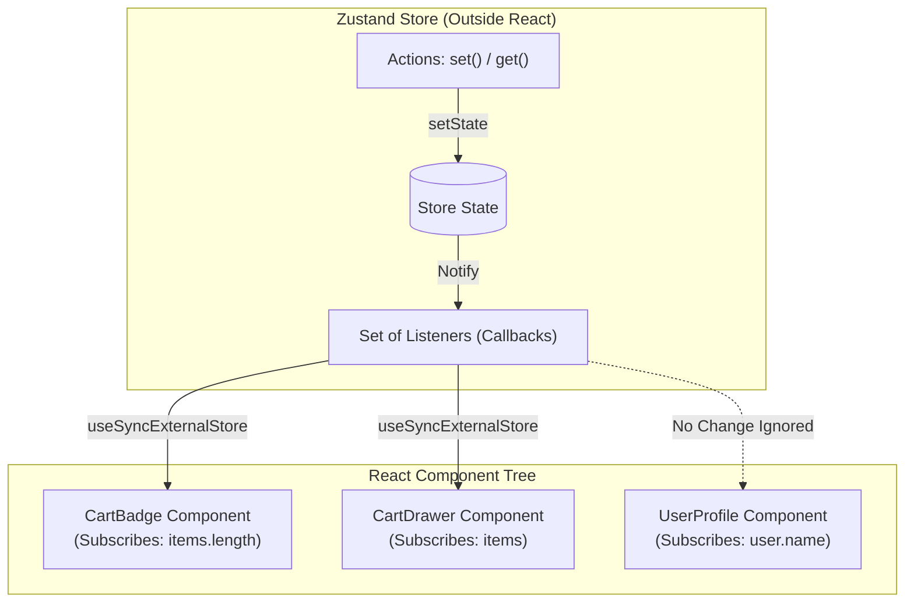

## 1. แนวคิด (Concept)

ในการพัฒนาเว็บแอปพลิเคชันด้วย React ปัญหาคลาสสิกที่นักพัฒนาทุกคนต้องเผชิญคือ **การจัดการ State ที่ต้องแชร์ระหว่างหลายคอมโพเนนต์**:

1. **Prop Drilling**: การส่งต่อ State และฟังก์ชัน Setter ผ่าน Props ลึกลงไปหลายชั้น (Parent -> Child -> Grandchild -> Great-Grandchild) แม้คอมโพเนนต์ตรงกลางจะไม่ได้ใช้งานค่านั้นเลย ทำให้โค้ดผูกมัดกันแน่น (Tight Coupling) แก้ไขยาก และ Refactor ลำบาก
2. **Context API Re-renders**: แม้ React จะมี Built-in Context API เพื่อแก้ปัญหา Prop Drilling แต่ Context ไม่ใช่เครื่องมือ State Management ตัว Context ทำหน้าที่เป็นเพียงท่อส่งข้อมูล (Dependency Injection) เมื่อค่าใน Context เปลี่ยนแปลง **คอมโพเนนต์ทุกตัวที่เรียกใช้ `useContext` จะถูกบังคับ Re-render เสมอ** แม้จะใช้ข้อมูลคนละฟิลด์กันก็ตาม
3. **Redux Toolkit Boilerplate**: แม้จะแก้ปัญหา Re-render ได้ดี แต่ต้องแลกมาด้วยความซับซ้อน มโนทัศน์ของ Actions, Reducers, Dispatchers, Store Providers และขนาด Bundle Size ที่ค่อนข้างใหญ่ (~10-15 KB)

**Zustand (ภาษาเยอรมันแปลว่า "สภาวะ" หรือ "State")** ถูกสร้างขึ้นเพื่อปิดช่องว่างเหล่านี้ โดยเป็น Global State Management ที่:
- **ขนาดจิ๋วสุดขั้ว**: Bundle Size ต่ำกว่า 1.5 KB
- **ไร้ Provider**: เรียกใช้ผ่าน Custom Hook ได้ทันที ไม่ต้องครอบ `<Provider>` ที่ Root Component
- **เลือกอ่านเฉพาะส่วน (Selective Subscriptions)**: Re-render เฉพาะคอมโพเนนต์ที่ฟิลด์ที่ Subscribe เปลี่ยนแปลงเท่านั้น
- **ใช้งานได้ทั้งในและนอก React**: อ่าน/เขียน State ได้ทั้งใน Component, Custom Hooks และ Vanilla JS (เช่น API Interceptors)

---

## 2. หลักการเบื้องหลัง (Under the Hood)

Zustand ทำงานบนโมเดล **External Store** แบบ **Publish/Subscribe (Pub/Sub)** ควบคู่กับ React 18/19 Hook **`useSyncExternalStore`**:



1. **Store อยู่นอก React Tree**: State ของ Zustand ถูกเก็บไว้ใน JavaScript Closure ธรรมดา ทำให้สามารถเข้าถึงและแก้ไขได้จากทุกที่ แม้กระทั่งนอกวงรอบ Lifecycle ของ React
2. **การทำงานของ `useSyncExternalStore`**: ใน React 18/19 Zustand เชื่อมต่อกับ React ผ่าน `useSyncExternalStoreWithSelector` ซึ่งรับประกัน:
   - **No Tearing**: ป้องกันการแสดงผลข้อมูลไม่ตรงกันระหว่าง Concurrent Rendering
   - **Selector Optimization**: เมื่อ State เปลี่ยนแปลง Zustand จะรัน Selector Function เพื่อเปรียบเทียบค่าใหม่กับค่าเดิม หากค่าที่คืนกลับมาเท่ากัน (ผ่าน Object Identity `===`) จะข้ามการ Re-render ทันที

---

## 3. ตัวอย่างโค้ด (TypeScript / TSX)

### ตะกร้าสินค้า E-Commerce ด้วย Zustand v5

```tsx filename="store/cart-store.ts"
import { create } from 'zustand';

export interface CartProduct {
  id: string;
  title: string;
  price: number;
  quantity: number;
}

interface CartStore {
  items: CartProduct[];
  isOpen: boolean;
  addItem: (product: Omit<CartProduct, 'quantity'>) => void;
  removeItem: (id: string) => void;
  toggleDrawer: () => void;
  clearCart: () => void;
}

export const useCartStore = create<CartStore>()((set) => ({
  items: [],
  isOpen: false,
  addItem: (product) =>
    set((state) => {
      const existing = state.items.find((item) => item.id === product.id);
      if (existing) {
        return {
          items: state.items.map((item) =>
            item.id === product.id ? { ...item, quantity: item.quantity + 1 } : item
          ),
        };
      }
      return { items: [...state.items, { ...product, quantity: 1 }] };
    }),
  removeItem: (id) =>
    set((state) => ({
      items: state.items.filter((item) => item.id !== id),
    })),
  toggleDrawer: () => set((state) => ({ isOpen: !state.isOpen })),
  clearCart: () => set({ items: [] }),
}));
```

### คอมโพเนนต์ที่ Subscribe เฉพาะส่วนย่อย

```tsx filename="components/NavbarCartBadge.tsx"
'use client';

import { useCartStore } from '@/store/cart-store';

export function NavbarCartBadge() {
  // Subscribe เฉพาะ items.length: คอมโพเนนต์นี้จะไม่ Re-render เมื่อ isOpen เปลี่ยน!
  const itemCount = useCartStore((state) => state.items.length);
  const toggleDrawer = useCartStore((state) => state.toggleDrawer);

  return (
    <button
      onClick={toggleDrawer}
      className="relative p-2 rounded-xl bg-slate-100 dark:bg-slate-800 text-slate-800 dark:text-slate-100 hover:bg-slate-200 transition"
      aria-label="เปิดตะกร้าสินค้า"
    >
      <span>🛒 ตะกร้า</span>
      {itemCount > 0 && (
        <span className="absolute -top-1 -right-1 px-2 py-0.5 text-xs font-bold bg-rose-500 text-white rounded-full">
          {itemCount}
        </span>
      )}
    </button>
  );
}
```

```tsx filename="components/CartDrawer.tsx"
'use client';

import { useCartStore } from '@/store/cart-store';

export function CartDrawer() {
  // อ่าน isOpen เพื่อควบคุมการแสดงผล Drawer
  const isOpen = useCartStore((state) => state.isOpen);
  const toggleDrawer = useCartStore((state) => state.toggleDrawer);
  const items = useCartStore((state) => state.items);
  const removeItem = useCartStore((state) => state.removeItem);

  if (!isOpen) return null;

  return (
    <div className="fixed inset-0 z-50 flex justify-end bg-black/40 backdrop-blur-xs">
      <div className="w-full max-w-md bg-white dark:bg-slate-900 p-6 shadow-2xl flex flex-col justify-between">
        <div>
          <div className="flex justify-between items-center border-b pb-4 mb-4">
            <h2 className="text-xl font-bold">รายการสินค้าในตะกร้า</h2>
            <button onClick={toggleDrawer} className="text-slate-500 hover:text-slate-800">
              ✕
            </button>
          </div>
          {items.length === 0 ? (
            <p className="text-slate-400">ยังไม่มีสินค้าในตะกร้า</p>
          ) : (
            <ul className="space-y-3 divide-y divide-slate-100 dark:divide-slate-800">
              {items.map((item) => (
                <li key={item.id} className="pt-3 flex justify-between items-center">
                  <div>
                    <p className="font-semibold">{item.title}</p>
                    <p className="text-sm text-slate-500">
                      ฿{item.price.toLocaleString()} × {item.quantity}
                    </p>
                  </div>
                  <button
                    onClick={() => removeItem(item.id)}
                    className="text-xs text-rose-500 hover:underline"
                  >
                    ลบ
                  </button>
                </li>
              ))}
            </ul>
          )}
        </div>
      </div>
    </div>
  );
}
```

---

## 4. เทียบกับวิธีอื่น (Context / Redux vs Zustand)

| มิติการเปรียบเทียบ | React Context API | Redux Toolkit (RTK) | Jotai (Atomic) | Zustand v5 (Store-based) |
| :--- | :--- | :--- | :--- | :--- |
| **ปรัชญาการออกแบบ** | Dependency Injection สำหรับค่าคงที่/เปลี่ยนน้อย | Flux / Single Source of Truth รวมศูนย์ | Atomic State (กระจายเป็นอะตอมแบบ Recoil) | Flux-like Store รวมศูนย์ แต่แยกได้หลาย Store |
| **Bundle Size (Gzipped)** | 0 KB (Built-in) | ~11 KB | ~3.5 KB | **~1.2 KB** |
| **Fine-grained Re-renders** | ❌ ไม่มี (Re-render ทั้งกิ่งที่เรียก use) | ✅ มี (ผ่าน `useSelector`) | ✅ มี (ผ่าน `useAtomValue`) | ✅ **มี (ผ่าน Selector Function)** |
| **ความต้องการ Provider** | บังคับ `<Context.Provider>` | บังคับ `<Provider store={...}>` | ไม่จำเป็น (เว้นแต่ต้องการ SSR Scoping) | **ไม่ต้องใช้ Provider (Client Default)** |
| **การใช้งานนอก React** | ❌ ทำไม่ได้ | ✅ ทำได้ผ่าน `store.dispatch` | ⚠️ ทำได้ผ่าน custom store | ✅ **ทำได้ทันที (`store.getState()`)** |
| **ระดับความซับซ้อน (Boilerplate)** | ต่ำ แต่จัดการยากเมื่อขยายตัว | สูง (Action, Reducer, Slice, Typed Hook) | ต่ำ (สร้าง atom แยกทีละชิ้น) | **ต่ำมาก (ฟังก์ชัน `create` ตัวเดียวจบ)** |

---

## 5. ผิด vs ถูก

### กรณีที่ 1: การเรียก Store ทั้งก้อนโดยไม่ใช้ Selector

```tsx
// ❌ ผิด: ดึง Store มาทั้งก้อน ทำให้ Component Re-render ทุกครั้งที่ฟิลด์ใดๆ ใน Store ขยับ
function BadCartBadge() {
  const store = useCartStore(); // ได้ Object ทั้ง store
  return <span>{store.items.length}</span>;
}

// ✅ ถูก: ใช้ Selector เลือกเฉพาะข้อมูลที่คอมโพเนนต์นี้สนใจ
function GoodCartBadge() {
  const itemCount = useCartStore((state) => state.items.length);
  return <span>{itemCount}</span>;
}
```
*เหตุผล*: การเรียก `useCartStore()` โดยไม่ส่ง Selector แปลว่าคอมโพเนนต์ขอ Subscribe การเปลี่ยนแปลงของ State ทั้งหมด เมื่อ `isOpen` หรือฟิลด์อื่นๆ เปลี่ยน คอมโพเนนต์นี้จะ Re-render ทันทีโดยไม่จำเป็น

### กรณีที่ 2: ใช้ Context API สำหรับข้อมูลที่อัปเดตถี่

```tsx
// ❌ ผิด: สร้าง Context สำหรับข้อมูลตำแหน่งเมาส์ หรือความคืบหน้าการเล่นวิดีโอ
export const VideoProgressContext = createContext({ progress: 0 });

// ✅ ถูก: ใช้ Zustand เก็บข้อมูลที่มีการเปลี่ยนแปลงบ่อย (High Frequency)
export const useVideoStore = create<{ progress: number; setProgress: (p: number) => void }>()((set) => ({
  progress: 0,
  setProgress: (progress) => set({ progress }),
}));
```
*เหตุผล*: Context API จะกระจายการแจ้งเตือนแบบ Broad-brush ทำให้คอมโพเนนต์ทุกตัวที่บริโภค Context นั้นต้อง Re-render พร้อมกัน ส่งผลให้เฟรมเรตร่วงและกระตุก

---

## 6. ควรใช้เมื่อไหร่ / ไม่ควรใช้เมื่อไหร่

### ควรใช้ Zustand เมื่อ:
- มี **Client State ระดับโกลบอล** ที่ต้องแชร์ข้ามหน้าจอหรือข้ามคอมโพเนนต์ เช่น ตะกร้าสินค้า, การสลับเปิดปิด Sidebar/Modal, การตั้งค่า UI (Theme/Font size)
- ต้องการเข้าถึงหรืออัปเดต State **นอก React Lifecycle** เช่น การอ่าน Auth Token ภายใน Axios Interceptor หรือ WebSocket Handler
- ต้องการแอปพลิเคชันที่ **โหลดเร็ว ขนาด Bundle เล็ก** และไม่ต้องเสียเวลาเซ็ตอัป Redux Boilerplate
- มี State ที่อัปเดตบ่อย และต้องการควบคุมการ Re-render ของคอมโพเนนต์อย่างละเอียด (Fine-grained performance)

### ไม่ควรใช้ Zustand เมื่อ:
- **Server Cache / Remote Data**: ข้อมูลที่ดึงมาจาก API หลังบ้าน เช่น รายการบทความ, ข้อมูลโปรไฟล์ผู้ใช้จาก Database ควรใช้ **TanStack Query (React Query)** หรือ **Next.js Server Components** จัดการ Cache, Revalidation, และ Loading/Error States แทน
- **Local Component State**: สเตทที่ใช้เฉพาะในคอมโพเนนต์เดียว เช่น สถานะการเปิด/ปิด Accordion ข้อความเดียว ให้ใช้ `useState` หรือ `useReducer` ของ React ตามเดิม
- **Dependency Injection ข้อมูลที่ไม่เปลี่ยน**: เช่น การส่ง Instance ของ SDK หรือ Configuration คงที่ Context API ตอบโจทย์ได้ดีและเรียบง่ายกว่า

---

## 7. คำถามสัมภาษณ์งาน (Interview Questions)

### Q1: ทำไม Zustand จึงให้ประสิทธิภาพ (Performance) ดีกว่า React Context API ในการจัดการ State ขนาดใหญ่?
**แนวทางคำตอบ**: 
React Context ถูกออกแบบมาเพื่อแก้ปัญหา Prop Drilling เท่านั้น ตัว Context Provider ไม่มีกลไก Selective Subscriptions ภายใน เมื่อค่า Value ของ Provider เปลี่ยน React จะบังคับให้คอมโพเนนต์ลูกทุกตัวที่เรียกใช้ `useContext` ทำการ Re-render ใหม่ทั้งหมด

ในทางกลับกัน Zustand เก็บ State อยู่นอก React Tree และเชื่อมต่อผ่าน `useSyncExternalStore` ด้วย Selector Pattern (`useCartStore(state => state.items.length)`) Zustand จะคำนวณและเปรียบเทียบผลลัพธ์ของ Selector ก่อน หากค่าที่เลือกไม่มีการเปลี่ยนแปลง Zustand จะสั่งข้ามการ Re-render ของคอมโพเนนต์นั้นอย่างสิ้นเชิง ทำให้หน้าจออัปเดตเฉพาะจุดที่มีการเปลี่ยนแปลงจริง

### Q2: ระหว่าง Zustand กับ Redux Toolkit มีความแตกต่างทางสถาปัตยกรรมที่สำคัญอย่างไรบ้าง และมีเหตุผลใดที่ทีมยังควรเลือก Redux Toolkit?
**แนวทางคำตอบ**:
- **ความต่างทางสถาปัตยกรรม**: Zustand เป็น Store แบบ Minimalist ที่รวม State และ Actions ไว้ด้วยกันภายในฟังก์ชัน `create()` ไม่ต้องมี Dispatcher หรือ Action Creators และไม่ต้องครอบ `<Provider>` ที่ Root ในขณะที่ Redux ใช้ Flux สถาปัตยกรรมแบบเคร่งครัด แยก Action Type, Reducer, และ Middleware อย่างเป็นทางการ
- **เมื่อไหร่ที่ยังควรเลือก Redux Toolkit**: สำหรับองค์กรขนาดใหญ่ที่มีทีมพัฒนาหลายสิบคน โครงสร้างที่เข้มงวดของ RTK (Redux Toolkit) ช่วยบังคับแบบแผน (Convention) ให้โค้ดเหมือนกันทั้งองค์กร อีกทั้ง RTK ยังมีเครื่องมือ RTK Query ที่ผสาน Server State ในตัว และ Ecosystem ของ Redux DevTools ที่รองรับ Time-travel debugging แบบเต็มรูปแบบระดับ Enterprise
