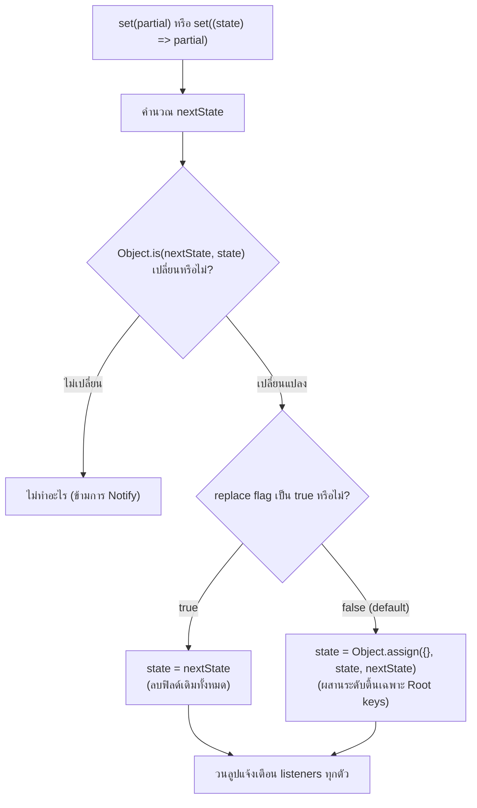

## 1. แนวคิด (Concept)

หัวใจสำคัญของการทำงานกับ Zustand คือการทำความเข้าใจกลไกการ **อ่าน (Read)** และ **อัปเดต (Update)** ข้อมูลใน Store:

1. **`set()` Shallow Merge**: โดยค่าเริ่มต้น ฟังก์ชัน `set` ของ Zustand จะทำการ "ผสานระดับตื้น" (Shallow Merge) เสมอ หมายความว่าหากเราส่ง `{ theme: 'dark' }` เข้าไป ตัวแปรอื่นๆ ที่อยู่ในระดับ Root จะยังคงอยู่ครบ ไม่ถูกลบทิ้ง
2. **Updater Function vs Direct Partial**:
   - *Direct Partial*: `set({ count: 10 })` เหมาะสำหรับการตั้งค่าคงที่ที่ไม่ขึ้นกับ State เดิม
   - *Updater Function*: `set((state) => ({ count: state.count + 1 }))` จำเป็นอย่างยิ่งเมื่อการคำนวณค่าใหม่ต้องอาศัยค่าปัจจุบัน เพื่อป้องกัน Race Condition
3. **`get()` สำหรับอ่านค่าปัจจุบันใน Actions**: ฟังก์ชัน `get()` ช่วยให้อ่าน Snapshot ล่าสุดของ Store ภายใน Action ได้ทันทีโดยไม่ต้องผ่าน `set`
4. **Nested Immutability**: Shallow Merge ของ `set()` ทำงานเฉพาะชั้นนอกสุดเท่านั้น หาก State มีโครงสร้างซ้อนกันลึก (Nested Objects/Arrays) เราต้องจัดการ Immutability ด้วย Spread Operator หรือใช้ Immer มิฉะนั้นการอัปเดตจะไม่ลึกถึงชั้นในหรือเผลอ Mutate อ็อบเจกต์เดิมโดยไม่รู้ตัว

---

## 2. หลักการเบื้องหลัง (Under the Hood)

โค้ดภายในของฟังก์ชัน `setState` ใน Zustand ทำงานเรียบง่ายอย่างน่าทึ่ง:

```typescript
// โครงสร้างภายในคร่าวๆ ของ Zustand vanilla store
const setState = (partial, replace) => {
  const nextState = typeof partial === 'function' ? partial(state) : partial;
  if (!Object.is(nextState, state)) {
    const previousState = state;
    // หาก replace = true จะทับทั้งก้อน หาก false (default) จะทำการ shallow merge
    state = (replace ?? (typeof nextState !== 'object' || nextState === null))
      ? nextState
      : Object.assign({}, state, nextState);

    listeners.forEach((listener) => listener(state, previousState));
  }
};
```



---

## 3. ตัวอย่างโค้ด (TypeScript / TSX)

ตัวอย่างจริง: ระบบ **User Preferences & Shipping Address Store** ที่มีข้อมูลซ้อนกันหลายชั้น

```tsx filename="store/user-preferences-store.ts"
import { create } from 'zustand';

export interface ShippingAddress {
  street: string;
  city: string;
  postalCode: string;
  country: string;
}

export interface UserPreferencesState {
  theme: 'light' | 'dark' | 'system';
  notifications: {
    email: boolean;
    sms: boolean;
    inApp: boolean;
  };
  shippingAddress: ShippingAddress;

  // Actions
  setTheme: (theme: 'light' | 'dark' | 'system') => void;
  toggleEmailNotification: () => void;
  updateShippingAddress: (updates: Partial<ShippingAddress>) => void;
  getFormattedAddress: () => string;
  resetPreferences: () => void;
}

const initialPreferences = {
  theme: 'system' as const,
  notifications: {
    email: true,
    sms: false,
    inApp: true,
  },
  shippingAddress: {
    street: '123 ถนนสุขุมวิท',
    city: 'กรุงเทพมหานคร',
    postalCode: '10110',
    country: 'ประเทศไทย',
  },
};

export const useUserPreferencesStore = create<UserPreferencesState>()((set, get) => ({
  ...initialPreferences,

  // 1. อัปเดตแบบ Direct Partial (ระดับบนสุด)
  setTheme: (theme) => set({ theme }),

  // 2. อัปเดตแบบ Nested State ด้วย Updater Function + Spread Operator
  toggleEmailNotification: () =>
    set((state) => ({
      notifications: {
        ...state.notifications, // ต้องกระจายค่าเดิมของชั้น notifications ออกมาก่อน
        email: !state.notifications.email,
      },
    })),

  // 3. อัปเดต Nested Object เฉพาะบางฟิลด์ที่ส่งเข้ามา
  updateShippingAddress: (updates) =>
    set((state) => ({
      shippingAddress: {
        ...state.shippingAddress,
        ...updates,
      },
    })),

  // 4. การใช้ get() เพื่ออ่านค่าปัจจุบันมาประมวลผลโดยไม่ต้องอัปเดต State
  getFormattedAddress: () => {
    const { street, city, postalCode, country } = get().shippingAddress;
    return `${street}, ${city} ${postalCode}, ${country}`;
  },

  // 5. การใช้ Replace Flag เพื่อคืนค่าเริ่มต้นทั้งหมด
  resetPreferences: () =>
    set(
      (state) => ({
        ...initialPreferences,
        // คง Actions เดิมไว้
        setTheme: state.setTheme,
        toggleEmailNotification: state.toggleEmailNotification,
        updateShippingAddress: state.updateShippingAddress,
        getFormattedAddress: state.getFormattedAddress,
        resetPreferences: state.resetPreferences,
      }),
      true // replace = true
    ),
}));
```

### การเรียกใช้งานใน Component

```tsx filename="components/AddressEditor.tsx"
'use client';

import { useUserPreferencesStore } from '@/store/user-preferences-store';

export function AddressEditor() {
  const address = useUserPreferencesStore((state) => state.shippingAddress);
  const updateAddress = useUserPreferencesStore((state) => state.updateShippingAddress);
  const getFormatted = useUserPreferencesStore((state) => state.getFormattedAddress);

  return (
    <div className="p-4 border rounded-xl bg-white dark:bg-slate-900 space-y-4">
      <h3 className="font-bold text-lg">ที่อยู่สำหรับจัดส่ง</h3>
      <div className="space-y-2">
        <input
          type="text"
          value={address.street}
          onChange={(e) => updateAddress({ street: e.target.value })}
          placeholder="บ้านเลขที่ / ถนน"
          className="w-full px-3 py-2 border rounded-lg"
        />
        <input
          type="text"
          value={address.city}
          onChange={(e) => updateAddress({ city: e.target.value })}
          placeholder="จังหวัด / อำเภอ"
          className="w-full px-3 py-2 border rounded-lg"
        />
      </div>

      <div className="pt-2 text-xs text-slate-500">
        <strong>ที่อยู่ฉบับเต็ม:</strong> {getFormatted()}
      </div>
    </div>
  );
}
```

---

## 4. เทียบกับวิธีอื่น (Context / Redux vs Zustand)

| รูปแบบการเขียน | React `useState` | Redux Toolkit (Immer) | Zustand v5 (Default) |
| :--- | :--- | :--- | :--- |
| **พฤติกรรม Merge** | ไม่ Merge เลย (ต้องเขียน `...prev` เองทุกชั้น) | ใช้ Draft Proxy แก้ไขค่าตรงๆ ได้ | **Auto Shallow Merge เฉพาะชั้นนอกสุด** |
| **Nested Objects** | ต้อง Manual Spread ซ้ำๆ | เขียน `state.address.city = 'BKK'` ได้เลย | ต้อง Manual Spread หรือติดตั้ง Immer Middleware |
| **การอ่านค่าปัจจุบัน** | ต้องรอรอบ Render ถัดไป หรือพึ่ง Callback | อยู่ในพารามิเตอร์ `state` ของ Reducer | **เรียก `get()` ได้ทันทีทุกเวลา** |

---

## 5. ผิด vs ถูก

### กรณีที่ 1: การ Mutate ข้อมูล Nested Object โดยตรง (Direct Mutation Bug)

```tsx
// ❌ ผิด: ไปแก้ไข Property ภายในตรงๆ โดยไม่สร้าง Reference ใหม่
updateStreetBad: (newStreet) =>
  set((state) => {
    state.shippingAddress.street = newStreet; // เกิด Mutation! React จะมองไม่เห็นความต่างและไม่อัปเดต UI
    return { shippingAddress: state.shippingAddress };
  }),

// ✅ ถูก: กระจาย Object ใหม่ เพื่อสร้าง Reference ใหม่ให้ React ตรวจพบ
updateStreetGood: (newStreet) =>
  set((state) => ({
    shippingAddress: {
      ...state.shippingAddress,
      street: newStreet,
    },
  })),
```
*เหตุผล*: React และ Zustand เปรียบเทียบการเปลี่ยนแปลงด้วย Object Reference (`===`) หากเราไปแก้ค่าข้างในโดยใช้อ็อบเจกต์ตัวเดิม `state.shippingAddress` จะมี Reference เท่าเดิมเสมอ ทำให้ข้ามการ Re-render และเกิดบั๊ก UI ไม่ยอมขยับ

### กรณีที่ 2: การใช้ `get()` อัปเดต State ซ้อนใน `set()` แทนที่จะใช้ Callback Argument

```tsx
// ❌ ผิด/เสี่ยง: อ่านค่าจาก get() ขณะกำลังจะเขียน set() ในจังหวะ Async
incrementBad: () => {
  const currentCount = get().count;
  set({ count: currentCount + 1 }); // อาจได้ค่า Stale หากมีการสั่งพร้อมกันถี่ๆ
};

// ✅ ถูก: ใช้ Function Updater ของ set() เพื่อการันตี Atomic State Update
incrementGood: () => {
  set((state) => ({ count: state.count + 1 }));
};
```

---

## 6. ควรใช้เมื่อไหร่ / ไม่ควรใช้เมื่อไหร่

### ควรใช้:
- **`set({ key: value })` Direct Partial**: ใช้กับการตั้งค่าข้อมูลที่ทราบแน่นอน เช่น `set({ theme: 'dark' })` หรือ `set({ isOpen: false })`
- **`set((state) => ...)` Function Updater**: ใช้เมื่อค่าใหม่ขึ้นอยู่กับค่าเดิม เช่น การบวกเลข, การกรองอาเรย์, หรือการสลับบูลีน `!state.isOpen`
- **`get()`**: ใช้เมื่อ Action ต้องการตรวจสอบเงื่อนไขก่อนตัดสินใจว่าจะอัปเดตหรือไม่ เช่น `if (!get().isAuthenticated) return;`

### ไม่ควรใช้:
- ไม่ควรใช้ `replace = true` ใน `set(newState, true)` โดยไม่จำเป็น เพราะจะลบ Actions และฟิลด์อื่นๆ ที่ไม่ได้ส่งมาทิ้งจนหมดเกลี้ยง
- หากมี State ซ้อนกันเกิน 3 ชั้น แนะนำให้ใช้ **`immer` middleware** แทนการเขียน Nested Spread ซ้อนกันหลายชั้นเพื่อให้อ่านง่ายขึ้น

---

## 7. คำถามสัมภาษณ์งาน (Interview Questions)

### Q1: กลไก Shallow Merge ของฟังก์ชัน `set` ใน Zustand ทำงานอย่างไร และมีข้อจำกัดเรื่อง Nested Object อย่างไร?
**แนวทางคำตอบ**:
โดยค่าเริ่มต้น ฟังก์ชัน `set` ของ Zustand จะใช้ `Object.assign({}, currentState, partialState)` เพื่อผสานข้อมูลใหม่เข้ากับ State เดิมในระดับความลึกเพียง 1 ชั้น (Top-level keys) ข้อดีคือเราสามารถอัปเดตฟิลด์ใดฟิลด์หนึ่งได้ทันทีโดยไม่ต้องเขียน `...state` คลุมข้างนอก

อย่างไรก็ตาม ข้อจำกัดคือ มันไม่ทำการ Deep Merge หาก State ของเรามี Nested Object (เช่น `user: { profile: { avatar: '' } }`) การสั่ง `set({ user: { avatar: 'new.jpg' } })` จะทำให้ฟิลด์อื่นๆ ภายใน `user` หายไปทั้งหมด นักพัฒนาจึงจำเป็นต้องเขียน Nested Spread Operator ด้วยตนเอง หรือเปิดใช้งาน Immer Middleware เพื่อรับมือกับปัญหานี้

### Q2: ฟังก์ชัน `get()` ใน Zustand ควรถูกนำมาใช้ในสถานการณ์ใด และมีข้อควรระวังอย่างไร?
**แนวทางคำตอบ**:
`get()` มีประโยชน์หลักในการเข้าถึง State ล่าสุดภายในขอบเขตของ Actions:
1. การอ่านค่าเพื่อตรวจสอบ Guard Clause เช่น ตรวจสอบ Token ก่อนยิง API
2. การส่งต่อข้อมูลข้ามไปยังบริการภายนอก เช่น การดึงค่า User ID ไปยิง Analytics
3. การอ่าน State ปัจจุบันใน Asynchronous Action ระหว่างขั้นตอน `await`

ข้อควรระวัง: หากเป็นการคำนวณ State ใหม่ที่ขึ้นกับ State เดิม (เช่น เพิ่มค่า Counter หรือแทรกของลง Array) ควรใช้รูปแบบฟังก์ชัน Updater `set((state) => ...)` แทนการอ่านผ่าน `get()` เพราะ `set(updater)` จะรับประกันความปลอดภัยจาก Race Condition เมื่อมีการสั่งงานพร้อมๆ กัน
