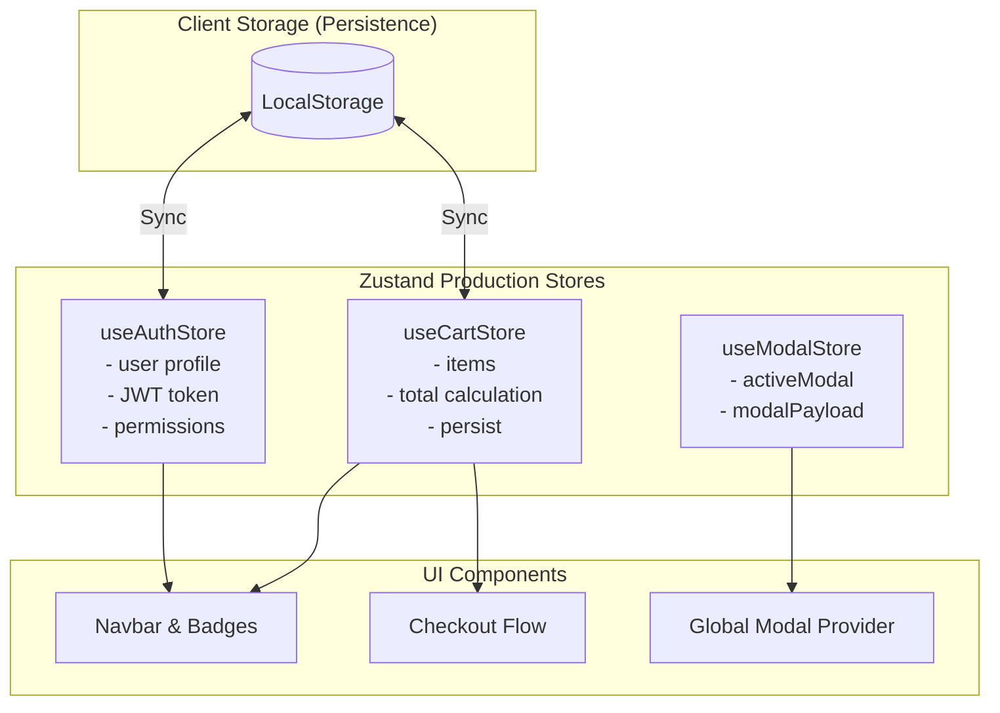

## 1. แนวคิด (Concept)

ในการสร้างเว็บแอปพลิเคชันระดับโปรดักชัน งานส่วนใหญ่จะวนเวียนอยู่กับ 4 รูปแบบการจัดเก็บ State หลัก (Patterns):
1. **Shopping Cart Store (ตะกร้าสินค้า E-Commerce)**: มีรายการสินค้า, เพิ่ม/ลดจำนวน, ลบสินค้า, คำนวณยอดเงินรวม (Subtotal, Tax, Shipping, Grand Total)
2. **Auth & Session Store (การยืนยันตัวตน)**: จัดเก็บโปรไฟล์ผู้ใช้, Access Token, สถานะสิทธิ์ (Roles/Permissions)
3. **UI Overlay Store (Modal / Dialog / Slide-over)**: ควบคุมการเปิด/ปิดหน้าต่างแจ้งเตือน โดยไม่ต้องพึ่งพา State กระจัดกระจายตามปุ่มต่างๆ
4. **Theme & Preference Store (การตั้งค่ารูปลักษณ์)**: สลับ Dark/Light mode, ขนาดฟอนต์, และซิงค์กับ LocalStorage

การใช้ Zustand ช่วยรวบตรรกะเหล่านี้ให้กลายเป็นโมดูลเดี่ยวที่อ่านง่าย ปลอดภัยต่อ TypeScript และนำกลับมาใช้ซ้ำได้ข้ามหน้าจอ

---

## 2. หลักการเบื้องหลัง (Under the Hood)

สถาปัตยกรรมรวมของ Real-World Production Stores ใน Next.js 16:



- แต่ละ Store มีขอบเขตความรับผิดชอบเดี่ยว (Single Responsibility Principle)
- ไม่เก็บ Derived Data ซ้ำซ้อน (เช่น ไม่เซฟ Grand Total ลง Database/LocalStorage แต่คำนวณสดใน Selector)

---

## 3. ตัวอย่างโค้ด (TypeScript / TSX)

### ตัวอย่างที่ 1: Shopping Cart พร้อมการคำนวณยอดเงินรวมสด

```tsx filename="store/cart-store.ts"
import { create } from 'zustand';
import { persist } from 'zustand/middleware';

export interface CartProduct {
  id: string;
  sku: string;
  title: string;
  price: number;
  quantity: number;
}

interface CartStore {
  items: CartProduct[];
  shippingFee: number;
  addItem: (product: Omit<CartProduct, 'quantity'>) => void;
  updateQuantity: (id: string, delta: number) => void;
  removeItem: (id: string) => void;
  clearCart: () => void;
}

export const useCartStore = create<CartStore>()(
  persist(
    (set) => ({
      items: [],
      shippingFee: 50, // ค่าจัดส่งคงที่ 50 บาท

      addItem: (product) =>
        set((state) => {
          const index = state.items.findIndex((item) => item.id === product.id);
          if (index > -1) {
            const nextItems = [...state.items];
            nextItems[index].quantity += 1;
            return { items: nextItems };
          }
          return { items: [...state.items, { ...product, quantity: 1 }] };
        }),

      updateQuantity: (id, delta) =>
        set((state) => ({
          items: state.items
            .map((item) => {
              if (item.id === id) {
                const newQty = item.quantity + delta;
                return newQty > 0 ? { ...item, quantity: newQty } : null;
              }
              return item;
            })
            .filter((item): item is CartProduct => item !== null),
        })),

      removeItem: (id) =>
        set((state) => ({
          items: state.items.filter((item) => item.id !== id),
        })),

      clearCart: () => set({ items: [] }),
    }),
    {
      name: 'ecommerce-cart-storage',
    }
  )
);
```

### ตัวอย่างที่ 2: Global Modal & Sheet Manager (ไร้ Prop Drilling)

```tsx filename="store/modal-store.ts"
import { create } from 'zustand';

export type ModalType = 'CONFIRM_DELETE_ORDER' | 'USER_EDIT_PROFILE' | 'SHARE_PRODUCT';

interface ModalStore {
  activeModal: ModalType | null;
  payload: any;
  openModal: (type: ModalType, payload?: any) => void;
  closeModal: () => void;
}

export const useModalStore = create<ModalStore>()((set) => ({
  activeModal: null,
  payload: null,
  openModal: (type, payload = null) => set({ activeModal: type, payload }),
  closeModal: () => set({ activeModal: null, payload: null }),
}));
```

### คอมโพเนนต์หน้าชำระเงินที่อ่านข้อมูลจากทั้งสอง Store

```tsx filename="components/CheckoutView.tsx"
'use client';

import { useShallow } from 'zustand/react/shallow';
import { useCartStore } from '@/store/cart-store';
import { useModalStore } from '@/store/modal-store';

export function CheckoutView() {
  const { items, subtotal, grandTotal, shippingFee } = useCartStore(
    useShallow((state) => {
      const sub = state.items.reduce((acc, i) => acc + i.price * i.quantity, 0);
      return {
        items: state.items,
        shippingFee: sub > 1000 ? 0 : state.shippingFee, // ส่งฟรีเมื่อสั่งเกิน 1,000 บาท
        subtotal: sub,
        grandTotal: sub > 0 ? (sub > 1000 ? sub : sub + state.shippingFee) : 0,
      };
    })
  );

  const updateQuantity = useCartStore((state) => state.updateQuantity);
  const openModal = useModalStore((state) => state.openModal);

  return (
    <div className="max-w-2xl mx-auto p-6 space-y-6">
      <h1 className="text-2xl font-bold">สรุปรายการคำสั่งซื้อ</h1>

      <div className="divide-y border rounded-xl p-4 bg-white dark:bg-slate-900">
        {items.map((item) => (
          <div key={item.id} className="py-3 flex justify-between items-center">
            <div>
              <p className="font-semibold">{item.title}</p>
              <p className="text-sm text-slate-500">฿{item.price.toLocaleString()} ต่อหน่วย</p>
            </div>
            <div className="flex items-center gap-2">
              <button
                onClick={() => updateQuantity(item.id, -1)}
                className="w-8 h-8 rounded border flex items-center justify-center"
              >
                -
              </button>
              <span className="w-8 text-center font-bold">{item.quantity}</span>
              <button
                onClick={() => updateQuantity(item.id, 1)}
                className="w-8 h-8 rounded border flex items-center justify-center"
              >
                +
              </button>
            </div>
          </div>
        ))}
      </div>

      <div className="p-4 bg-slate-50 dark:bg-slate-800 rounded-xl space-y-2 text-sm">
        <div className="flex justify-between">
          <span>ยอดรวมสินค้า</span>
          <span>฿{subtotal.toLocaleString()}</span>
        </div>
        <div className="flex justify-between">
          <span>ค่าจัดส่ง</span>
          <span>{shippingFee === 0 ? 'ฟรี (โปรโมชั่น)' : `฿${shippingFee}`}</span>
        </div>
        <div className="flex justify-between text-lg font-bold border-t pt-2">
          <span>ยอดสุทธิ</span>
          <span>฿{grandTotal.toLocaleString()}</span>
        </div>
      </div>

      <button
        onClick={() => openModal('CONFIRM_DELETE_ORDER', { grandTotal })}
        className="w-full py-3 bg-red-600 text-white font-bold rounded-xl hover:bg-red-700 transition"
      >
        ยกเลิกคำสั่งซื้อทั้งหมด
      </button>
    </div>
  );
}
```

---

## 4. เทียบกับวิธีอื่น (Context / Redux vs Zustand)

| รูปแบบ | สเตตัสกระจัดกระจายใน `useState` | Redux Architecture | Zustand Real-world Patterns |
| :--- | :--- | :--- | :--- |
| **การจัดการ Modal** | ต้องส่ง `isOpen` และ `onClose` ข้าม 5 ระดับ Component | ต้องสร้าง UI Slice และ Dispatch Action | **เรียก `useModalStore.getState().openModal(...)` ได้ทุกที่** |
| **การคำนวณยอดเงิน** | คำนวณซ้ำซ้อนในทุก Render ของ Component | ต้องเขียน Reselect Memoized Selector | **คำนวณผ่าน Selector หรือใช้ `useShallow` กระชับในจุดเดียว** |
| **การบำรุงรักษา** | ยากที่สุด โค้ดผูกมัดกับลำดับ JSX | โค้ดเยอะ ต้องกระโดดข้ามหลายไฟล์ | **อ่านเข้าใจง่าย รวมโค้ดเป็นโมดูลชัดเจน** |

---

## 5. ผิด vs ถูก

### กรณีที่ 1: การเก็บ Derived State (ยอดรวม) ซ้ำซ้อนลงใน Store

```tsx
// ❌ ผิด: จัดเก็บทั้ง items และ totalPrice ลงใน State พร้อมกัน
interface BadStore {
  items: CartProduct[];
  totalPrice: number; // ภัยเงียบ: ทุกครั้งที่มีการเพิ่ม ลบ แก้ไข ต้องคอยคำนวณอัปเดตตัวนี้ให้ตรงกันเสมอ
}

// ✅ ถูก: เก็บเฉพาะ Source of Truth (items) แล้วคำนวณ totalPrice ใน Selector
interface GoodStore {
  items: CartProduct[];
}
// เมื่อต้องการใช้:
const totalPrice = useCartStore((state) =>
  state.items.reduce((sum, item) => sum + item.price * item.quantity, 0)
);
```

### กรณีที่ 2: วาง Modal Component ไว้ในปุ่มที่สั่งเปิด

```tsx
// ❌ ไม่ดี: ปุ่มมี Component Modal ฝังอยู่ ทำให้ DOM ซับซ้อนและ Re-render บ่อย
function DeleteButton() {
  const [open, setOpen] = useState(false);
  return (
    <>
      <button onClick={() => setOpen(true)}>ลบ</button>
      <ConfirmDialog isOpen={open} onClose={() => setOpen(false)} />
    </>
  );
}

// ✅ ถูก: ปุ่มเพียงแค่เรียก Action สั่งเปิด ส่วนตัว Modal ถูก Mount ไว้ที่ Root Layout ครั้งเดียว
function DeleteButton() {
  const openModal = useModalStore((s) => s.openModal);
  return <button onClick={() => openModal('CONFIRM_DELETE_ORDER')}>ลบ</button>;
}
```

---

## 6. ควรใช้เมื่อไหร่ / ไม่ควรใช้เมื่อไหร่

### ควรใช้:
- เมื่อต้องการสร้างฟีเจอร์ระดับระบบ เช่น Shopping Cart, Global Toast/Modal, และ Authentication Session
- เมื่อหลายหน้าจอและหลาย Component ในระบบต้องการเข้าถึงชุดข้อมูลเดียวกัน

### ไม่ควรใช้:
- ฟอร์มกรอกข้อมูลแบบหน้าเดียว (Single Page Form): ควรใช้ **React Hook Form** จัดการ Local Form State เพราะมีประสิทธิภาพในการควบคุม Uncontrolled Components ที่ดีกว่า

---

## 7. คำถามสัมภาษณ์งาน (Interview Questions)

### Q1: ทำไมสถาปัตยกรรม Global Modal Store ของ Zustand จึงเป็นที่นิยมมากกว่าการจัดการ Modal State ในแต่ละ Component?
**แนวทางคำตอบ**:
เพราะช่วยขจัดปัญหา **Z-Index Stacking Context และ DOM Bloat**:
1. **ลดความซ้ำซ้อน**: หากทุกปุ่มมี Modal Component ฝังอยู่ ตัว React จะต้อง Render และ Mount โค้ด Modal ไว้ใน Memory หลายสิบจุด
2. **การทำงานข้ามหน้าจอ (Decoupling)**: คอมโพเนนต์ใดๆ ในระบบสามารถสั่งเปิด Modal ได้ทันทีโดยไม่ต้องส่ง Props หรือ Callback ลอยขึ้นไปหา Parent Component
3. **การ Render ในจุดที่เหมาะสม**: สามารถนำ `<GlobalModalHost />` ไปวางไว้ที่ระดับบนสุดของ `<body>` ช่วยให้จัด Layer และ Animation ได้ง่ายโดยไม่ติดปัญหา CSS Overflow จาก Container ภายใน

### Q2: ในการสร้างระบบตะกร้าสินค้า เหตุใดจึงไม่ควรจัดเก็บ `subtotal` หรือ `discountAmount` ลงใน State ของ Store โดยตรง?
**แนวทางคำตอบ**:
เพื่อรักษาหลักการ **Single Source of Truth** เพราะทั้ง Subtotal และ Discount เป็น **Derived State (สภาวะที่เกิดจากการอนุมาน)** ที่สามารถคำนวณย้อนหลังจากรายการสินค้า (`items`) และรหัสคูปอง (`couponCode`) ได้เสมอ

หากเราจัดเก็บตัวเลขเหล่านี้ลงใน State โดยตรง ทุกครั้งที่เกิด Action ไม่ว่าจะเป็นการเพิ่มสินค้า, ลดจำนวน, ลบสินค้า, หรือเปลี่ยนคูปอง นักพัฒนาจะต้องเขียนโค้ดเพื่อคอยซิงค์ตัวเลขเหล่านี้ให้ตรงกันทุกครั้ง ซึ่งมีความเสี่ยงสูงที่จะเกิด Human Error ส่งผลให้ยอดเงินไม่ตรงกับสินค้าจริง
