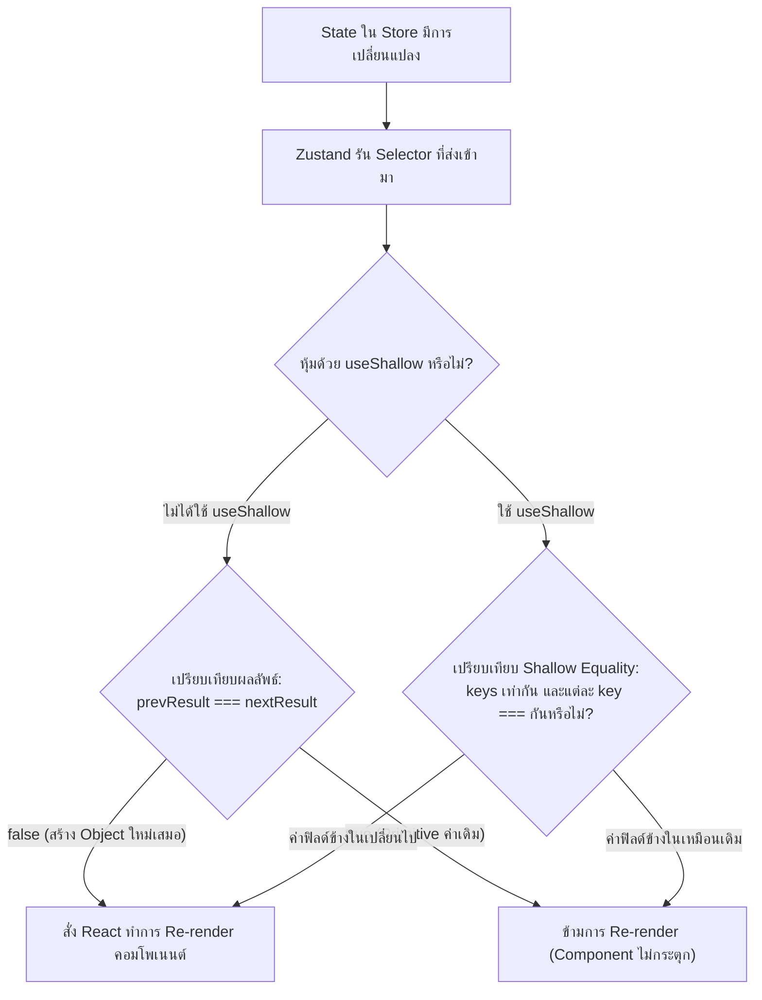

## 1. แนวคิด (Concept)

หนึ่งในจุดแข็งที่สุดของ Zustand คือ **Fine-grained Subscriptions** ผ่านฟังก์ชัน **Selector**:
1. **Atomic Selector (ทางเลือกที่เร็วและปลอดภัยที่สุด)**: ดึงค่า Primitive เดี่ยวๆ ออกมา เช่น `const count = useStore(state => state.count)` เมื่อ State อื่นใน Store เปลี่ยน ตราบใดที่ `count` ยังคงมีค่าเดิม คอมโพเนนต์จะไม่ Re-render เลยแม้แต่ครั้งเดียว
2. **ปัญหาการคืนค่า Object / Array ใหม่ใน Zustand v5**:
   - ใน Zustand v4 เคยมีตัวเลือก `shallow` equality checker แนบท้าย เช่น `useStore(selector, shallow)`
   - แต่ใน **Zustand v5** ระบบได้เปลี่ยนมาอิงกับ React 19 `useSyncExternalStore` ซึ่งเปรียบเทียบผลลัพธ์ของ Selector ด้วย **Strict Reference Equality (`===`)**
   - หากเราเขียน Selector ที่คืนค่า Object ใหม่ เช่น `useStore(state => ({ name: state.name, role: state.role }))` จะส่งผลให้ได้ Object Reference ตัวใหม่ในทุกๆ รอบการประเมิน ทำให้เกิด **Infinite Re-render Loop (Maximum update depth exceeded)** ทันที!
3. **ทางแก้ด้วย Hook `useShallow`**:
   - Zustand v5 แนะนำให้ครอบ Selector ด้วย Hook **`useShallow`** จาก `'zustand/react/shallow'` เพื่อทำการเปรียบเทียบค่าภายใน Object/Array แบบ Shallow Compare ช่วยให้คืนค่า Object/Array ได้อย่างปลอดภัยโดยไม่เกิด Loop

---

## 2. หลักการเบื้องหลัง (Under the Hood)

กลไกการตรวจจับความเปลี่ยนแปลงของ `useSyncExternalStore` และ `useShallow` ใน React 19 / Zustand v5:



- เมื่อใช้ `useShallow`, Hook จะจำค่าผลลัพธ์รอบก่อนหน้าไว้ หาก Property แต่ละตัวใน Object หรือ Element ใน Array ยังคงมีค่าเหมือนเดิม (`Object.is`) `useShallow` จะส่งคืน **Reference ตัวเดิม** ให้แก่ React ทำให้ React ทราบว่าไม่มีอะไรเปลี่ยนแปลงและข้ามการ Render ได้สำเร็จ

---

## 3. ตัวอย่างโค้ด (TypeScript / TSX)

ตัวอย่างจริง: ระบบ **E-Commerce Checkout & Order Summary Component**

### Store ตะกร้าสินค้า

```tsx filename="store/checkout-store.ts"
import { create } from 'zustand';

export interface OrderItem {
  id: string;
  title: string;
  price: number;
  quantity: number;
}

interface CheckoutStore {
  items: OrderItem[];
  customerEmail: string;
  couponCode: string | null;
  discountPercent: number;
  isProcessing: boolean;

  addItem: (item: OrderItem) => void;
  applyCoupon: (code: string, discount: number) => void;
  setProcessing: (isProcessing: boolean) => void;
}

export const useCheckoutStore = create<CheckoutStore>()((set) => ({
  items: [
    { id: '1', title: 'คีย์บอร์ดกลไก Mechanical Keyboard', price: 3500, quantity: 1 },
    { id: '2', title: 'เมาส์ไร้สาย Wireless Mouse', price: 1800, quantity: 2 },
  ],
  customerEmail: 'dev@example.com',
  couponCode: 'WELCOME10',
  discountPercent: 10,
  isProcessing: false,

  addItem: (item) => set((s) => ({ items: [...s.items, item] })),
  applyCoupon: (couponCode, discountPercent) => set({ couponCode, discountPercent }),
  setProcessing: (isProcessing) => set({ isProcessing }),
}));
```

### คอมโพเนนต์ที่ 1: ใช้ Atomic Selector (แนะนำสูงสุด)

```tsx filename="components/OrderBadge.tsx"
'use client';

import { useCheckoutStore } from '@/store/checkout-store';

export function OrderBadge() {
  // คืนค่า Primitive (number) เปรียบเทียบด้วย === ได้ทันที ปลอดภัย 100%
  const totalItems = useCheckoutStore((state) =>
    state.items.reduce((acc, item) => acc + item.quantity, 0)
  );

  return (
    <div className="inline-flex items-center gap-1.5 px-3 py-1 rounded-full bg-blue-50 text-blue-600 text-sm font-semibold">
      <span>📦 สินค้าทั้งหมด:</span>
      <span>{totalItems} ชิ้น</span>
    </div>
  );
}
```

### คอมโพเนนต์ที่ 2: ใช้ `useShallow` เมื่อต้องการดึงหลายฟิลด์เป็น Object หรือ Array

```tsx filename="components/OrderFinancialSummary.tsx"
'use client';

import { useShallow } from 'zustand/react/shallow';
import { useCheckoutStore } from '@/store/checkout-store';

export function OrderFinancialSummary() {
  // ✅ ใช้ useShallow ป้องกัน Infinite Loop ใน Zustand v5 เมื่อสร้าง Object ใหม่
  const { subtotal, discountAmount, grandTotal, couponCode } = useCheckoutStore(
    useShallow((state) => {
      const sub = state.items.reduce((sum, item) => sum + item.price * item.quantity, 0);
      const discount = (sub * state.discountPercent) / 100;
      return {
        subtotal: sub,
        discountAmount: discount,
        grandTotal: sub - discount,
        couponCode: state.couponCode,
      };
    })
  );

  return (
    <div className="p-4 border rounded-xl bg-slate-50 dark:bg-slate-900/50 space-y-2 text-sm">
      <div className="flex justify-between text-slate-500">
        <span>ยอดรวมสินค้า</span>
        <span>฿{subtotal.toLocaleString()}</span>
      </div>
      {couponCode && (
        <div className="flex justify-between text-emerald-600 font-medium">
          <span>ส่วนลดโค้ด ({couponCode})</span>
          <span>-฿{discountAmount.toLocaleString()}</span>
        </div>
      )}
      <div className="flex justify-between text-base font-bold text-slate-900 dark:text-white pt-2 border-t">
        <span>ยอดชำระสุทธิ</span>
        <span>฿{grandTotal.toLocaleString()}</span>
      </div>
    </div>
  );
}
```

---

## 4. เทียบกับวิธีอื่น (Context / Redux vs Zustand)

| เครื่องมือ | รูปแบบ Selector | พฤติกรรมเมื่อคืนค่า Object ใหม่ |
| :--- | :--- | :--- |
| **React Context** | ไม่มี Selector ในตัว | Re-render ทุกครั้งที่ Provider จ่ายค่าใหม่ ไม่สามารถข้ามได้ |
| **Redux Toolkit** | `useSelector(selectCart, shallowEqual)` | ต้องส่ง Equality Function ตัวที่สอง |
| **Zustand v4 (เดิม)** | `useStore(selector, shallow)` | ส่ง `shallow` เป็นพารามิเตอร์ตัวที่ 2 |
| **Zustand v5 (ปัจจุบัน)** | `useStore(useShallow(selector))` | **ใช้ Hook `useShallow` หุ้ม Selector โดยตรง สอดคล้องกับมาตรฐาน React 19** |

---

## 5. ผิด vs ถูก

### กรณีที่ 1: คืนค่า Object ลอยๆ โดยไม่มี `useShallow` ใน Zustand v5 (บั๊กยอดฮิต!)

```tsx
// ❌ ผิดมหันต์: ก่อให้เกิด Maximum update depth exceeded ใน Zustand v5!
function BadComponent() {
  const { customerEmail, isProcessing } = useCheckoutStore((state) => ({
    customerEmail: state.customerEmail,
    isProcessing: state.isProcessing,
  })); // สร้าง {} ก้อนใหม่ทุกครั้ง -> Reference ไม่ตรง -> Loop Re-render!

  return <div>{customerEmail}</div>;
}

// ✅ ถูก (วิธีที่ 1): ใช้ Atomic Selectors แยกบรรทัด (แนะนำที่สุดสำหรับ 1-2 ค่า)
function GoodComponentAtomic() {
  const customerEmail = useCheckoutStore((state) => state.customerEmail);
  const isProcessing = useCheckoutStore((state) => state.isProcessing);
  return <div>{customerEmail}</div>;
}

// ✅ ถูก (วิธีที่ 2): ใช้ useShallow หากต้องการ Destructure หลายค่า
import { useShallow } from 'zustand/react/shallow';

function GoodComponentShallow() {
  const { customerEmail, isProcessing } = useCheckoutStore(
    useShallow((state) => ({
      customerEmail: state.customerEmail,
      isProcessing: state.isProcessing,
    }))
  );
  return <div>{customerEmail}</div>;
}
```

### กรณีที่ 2: ใช้ Array `filter()` หรือ `map()` ใน Selector โดยไม่ใช้ `useShallow`

```tsx
// ❌ ผิด: Array.filter คืน Array อ้างอิงตัวใหม่เสมอ ทำให้เกิด Infinite Re-render
const activeItems = useCheckoutStore((state) =>
  state.items.filter((item) => item.quantity > 0)
);

// ✅ ถูก: ครอบด้วย useShallow เพื่อเปรียบเทียบสมาชิกใน Array
const activeItems = useCheckoutStore(
  useShallow((state) => state.items.filter((item) => item.quantity > 0))
);
```

---

## 6. ควรใช้เมื่อไหร่ / ไม่ควรใช้เมื่อไหร่

### ควรใช้ Atomic Selector:
- เมื่อต้องการหยิบ State เพียง 1 ถึง 2 ค่า
- เมื่อค่าที่หยิบเป็น **Primitive types** เช่น `string`, `number`, `boolean`

### ควรใช้ `useShallow`:
- เมื่อต้องการหยิบ Properties หลายตัวพร้อมกันในคราวเดียว เพื่อนำมา Destructure
- เมื่อ Selector ทำการ Transform และคืนค่าเป็น **Array ใหม่** (เช่น `filter`, `slice`) หรือ **Object ใหม่**

### ไม่ควรใช้:
- ไม่จำเป็นต้องครอบ `useShallow` กับ Primitive selector เดี่ยวๆ เช่น `useStore(useShallow(s => s.count))` เพราะเป็นการสิ้นเปลืองการคำนวณ Shallow check โดยเปล่าประโยชน์

---

## 7. คำถามสัมภาษณ์งาน (Interview Questions)

### Q1: ทำไมการคืนค่า Object Literal ใน Selector เช่น `useStore(s => ({ a: s.a, b: s.b }))` ถึงทำให้เกิด Infinite Loop ใน Zustand v5?
**แนวทางคำตอบ**:
เพราะใน Zustand v5 กลไกการตรวจจับความเปลี่ยนแปลงถูกขับเคลื่อนด้วย React 19 `useSyncExternalStore` ซึ่งใช้การเปรียบเทียบความเท่ากันแบบ Strict Equality (`===`) 

เมื่อคอมโพเนนต์ Render ฟังก์ชัน Selector จะถูกรันและสร้าง Object ตัวใหม่ขึ้นมาบนหน่วยความจำเสมอ (`{}` ตัวแรก !== `{}` ตัวที่สอง) React จึงเข้าใจว่า State ภายนอกเปลี่ยนไปแล้ว จึงสั่ง Re-render คอมโพเนนต์ และในรอบ Render ใหม่ Selector ก็ถูกรันและสร้าง Object ใหม่อีก วนลูปเช่นนี้อย่างไม่สิ้นสุดจนกระทั่งเกิด Error "Maximum update depth exceeded" 

ทางแก้คือการใช้ **`useShallow`** จาก `'zustand/react/shallow'` เพื่อสลับมาเปรียบเทียบระดับ Property ตื้นๆ แทน Strict Reference

### Q2: ระหว่างการเขียน Atomic Selectors หลายบรรทัด กับการใช้ `useShallow` แบบไหนมีประสิทธิภาพสูงกว่ากัน?
**แนวทางคำตอบ**:
**Atomic Selectors หลายบรรทัดมีประสิทธิภาพสูงกว่าเล็กน้อย** เพราะ:
1. การเปรียบเทียบ Primitive type ทำได้รวดเร็วมากในระดับ Native V8 Engine (`===`)
2. ไม่มีต้นทุนของการวนลูป `for...in` หรือ `Object.keys()` ที่แฝงอยู่ใน `useShallow`
3. อย่างไรก็ตาม ในแง่ของ Developer Experience (DX) หากต้องดึงข้อมูลพร้อมกัน 5-10 ตัว การใช้ `useShallow` เพียงบรรทัดเดียวจะช่วยให้อ่านโค้ดง่ายกว่าและประหยัดบรรทัดมากกว่าอย่างเห็นได้ชัด
