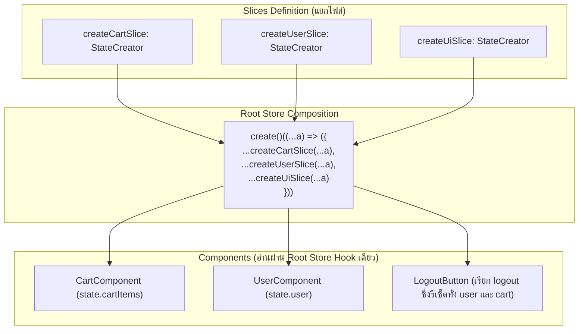

## 1. แนวคิด (Concept)

เมื่อแอปพลิเคชันมีขนาดใหญ่ขึ้น การเก็บ State ทั้งหมดไว้ในไฟล์เดียวจะทำให้โค้ดยาวนับพันบรรทัดและยากต่อการบำรุงรักษา Zustand มีทางเลือกทางสถาปัตยกรรม 2 แบบหลัก:

1. **Multiple Independent Stores (หลาย Store แยกอิสระ)**: สร้าง `useCartStore`, `useAuthStore`, `useUiStore` แยกไฟล์กันอย่างสิ้นเชิง เหมาะเมื่อ State แต่ละตัวไม่มีความสัมพันธ์กัน
2. **Slices Pattern (แยก Slice รวมเป็น Store เดียว)**: เมื่อ State ต่างโมดูลจำเป็นต้อง **แบ่งปันข้อมูลหรือมี Action ที่ข้ามเกี่ยวข้องกัน** (เช่น เมื่อผู้ใช้ล็อกเอาท์ใน `authSlice` ให้ทำการล้างตะกร้าสินค้าใน `cartSlice` ด้วย) รูปแบบ Slices Pattern จะช่วยแบ่งโค้ดออกเป็นไฟล์เล็กๆ แต่รวมกันเป็น Store กลางก้อนเดียวผ่าน `StateCreator`

---

## 2. หลักการเบื้องหลัง (Under the Hood)

การทำงานของ Slices Pattern ใน Zustand ขับเคลื่อนด้วยฟังก์ชันชนิด `StateCreator`:



- แต่ละ Slice จะได้รับฟังก์ชัน `(set, get, api)` เดียวกันกับ Root Store
- การพิมพ์ Type ด้วย `StateCreator<RootStore, [], [], MySlice>` ช่วยให้ TypeScript ทราบว่าใน Slice ย่อย สามารถเรียกดู State หรือ Action ของ Slice อื่นผ่าน `get()` ได้อย่างปลอดภัย

---

## 3. ตัวอย่างโค้ด (TypeScript / TSX)

ตัวอย่างจริง: ระบบ **E-Commerce Root Store** ที่ประกอบด้วย `cartSlice` และ `userSlice` พร้อม Action พิเศษ `checkoutAndClear` ที่ทำงานร่วมกัน

### 1. ไฟล์นิยาม Cart Slice

```tsx filename="store/slices/cart-slice.ts"
import { StateCreator } from 'zustand';
import { RootStore } from '../root-store';

export interface CartItem {
  id: string;
  name: string;
  price: number;
}

export interface CartSlice {
  cartItems: CartItem[];
  addToCart: (item: CartItem) => void;
  clearCart: () => void;
}

export const createCartSlice: StateCreator<
  RootStore,
  [],
  [],
  CartSlice
> = (set) => ({
  cartItems: [],
  addToCart: (item) =>
    set((state) => ({ cartItems: [...state.cartItems, item] })),
  clearCart: () => set({ cartItems: [] }),
});
```

### 2. ไฟล์นิยาม User Slice

```tsx filename="store/slices/user-slice.ts"
import { StateCreator } from 'zustand';
import { RootStore } from '../root-store';

export interface UserProfile {
  id: string;
  name: string;
  isMember: boolean;
}

export interface UserSlice {
  user: UserProfile | null;
  setUser: (user: UserProfile | null) => void;
  // Cross-slice action: สั่งล้างตะกร้าสินค้าและออกจากระบบพร้อมกัน
  logoutAndResetApp: () => void;
}

export const createUserSlice: StateCreator<
  RootStore,
  [],
  [],
  UserSlice
> = (set, get) => ({
  user: null,
  setUser: (user) => set({ user }),
  logoutAndResetApp: () => {
    // สามารถเข้าถึง action clearCart จากอีก slice ได้อย่างปลอดภัยผ่าน get()
    get().clearCart();
    set({ user: null });
  },
});
```

### 3. รวมทุก Slice เป็น Root Store

```tsx filename="store/root-store.ts"
import { create } from 'zustand';
import { CartSlice, createCartSlice } from './slices/cart-slice';
import { UserSlice, createUserSlice } from './slices/user-slice';

// รวม Types ทั้งหมดเป็น Root Type ก้อนเดียว
export type RootStore = CartSlice & UserSlice;

// รวม Initializers เข้าด้วยกันผ่าน spread operator
export const useRootStore = create<RootStore>()((...a) => ({
  ...createCartSlice(...a),
  ...createUserSlice(...a),
}));
```

### การเรียกใช้ใน Component

```tsx filename="components/NavbarProfile.tsx"
'use client';

import { useRootStore } from '@/store/root-store';

export function NavbarProfile() {
  const user = useRootStore((state) => state.user);
  const cartCount = useRootStore((state) => state.cartItems.length);
  const logout = useRootStore((state) => state.logoutAndResetApp);

  if (!user) {
    return <span className="text-sm text-slate-500">กรุณาเข้าสู่ระบบ</span>;
  }

  return (
    <div className="flex items-center gap-4 bg-slate-100 p-2 rounded-xl">
      <span className="font-semibold text-sm">{user.name}</span>
      <span className="text-xs bg-blue-100 text-blue-700 px-2 py-0.5 rounded-full">
        ตะกร้า: {cartCount} รายการ
      </span>
      <button
        onClick={logout}
        className="text-xs text-red-500 hover:underline"
      >
        ออกจากระบบและล้างตะกร้า
      </button>
    </div>
  );
}
```

---

## 4. เทียบกับวิธีอื่น (Context / Redux vs Zustand)

| เกณฑ์ | Redux Toolkit `createSlice` | Zustand Slices Pattern | Multiple Isolated Zustand Stores |
| :--- | :--- | :--- | :--- |
| **การแบ่งโมดูล** | บังคับแยกตาม Slice ตาม Convention | ใช้ `StateCreator` รวมกันได้อิสระ | แยกเป็น Store ต่างหากคนละไฟล์ |
| **Cross-slice Communication** | ต้องใช้ ExtraReducers ดักฟัง Action Type อื่น | **เรียก `get().otherAction()` ได้โดยตรง** | ต้อง Import Hook ของ Store อื่นมาเรียกตรงๆ |
| **ความซับซ้อนของ Type** | มี RTK Tooling ช่วยจัดการ | ต้องประกาศ `StateCreator<RootStore, ...>` | ง่ายที่สุดเพราะ Type ใคร Type มัน |
| **ความยืดหยุ่น** | ปานกลาง ผูกกับ Redux Engine | **สูงมาก เลือกได้ว่าจะรวมหรือแยก** | สูงมาก แยกอิสระ 100% |

---

## 5. ผิด vs ถูก

### กรณีที่ 1: การพิมพ์ Type ของ `StateCreator` ไม่ถูกต้อง

```tsx
// ❌ ผิด: ไม่ได้ส่ง RootStore เข้าไปใน Parameter ตัวแรกของ StateCreator
export const createCartSlice: StateCreator<CartSlice> = (set, get) => ({
  cartItems: [],
  // หากต้องการ get().user จาก userSlice จะฟ้อง Type Error ทันที เพราะมองเห็นแค่ CartSlice!
});

// ✅ ถูก: ส่ง RootStore เข้าไปใน Generic เพื่อให้มองเห็น State และ Actions ทั้งหมดของระบบ
export const createCartSlice: StateCreator<RootStore, [], [], CartSlice> = (set, get) => ({
  cartItems: [],
  // สามารถเรียก get().user ได้อย่างปลอดภัย
});
```

### กรณีที่ 2: ใช้ Slices Pattern กับเรื่องที่ไม่เกี่ยวข้องกันเลย

```tsx
// ❌ ไม่แนะนำ: นำ Theme Settings ที่ไม่เคยยุ่งกับใคร มารวมเป็น Slice ใน RootStore เดียวกับ Payment & Cart
// ทำให้ RootStore มีขนาดใหญ่และซับซ้อนเกินความจำเป็น

// ✅ ถูก: ใช้ Multiple Isolated Stores
// theme-store.ts แยกเดี่ยว
export const useThemeStore = create<ThemeState>(...);
// root-store.ts รวมเฉพาะ Business State ที่มี Cross-actions
export const useAppStore = create<RootStore>(...);
```

---

## 6. ควรใช้เมื่อไหร่ / ไม่ควรใช้เมื่อไหร่

### ควรใช้ Slices Pattern เมื่อ:
- มี State หลายก้อนที่ต้อง **ทำงานสอดคล้องกัน (Cross-cutting Concerns)** เช่น เมื่อ Auth หมดอายุ ต้องรีเซ็ตทั้ง Profile, Notifications, และ Active Session พร้อมกัน
- ต้องการให้คอมโพเนนต์สามารถอ่านข้อมูลจากหลายโดเมนผ่าน Hook ตัวเดียว

### ควรใช้ Multiple Independent Stores เมื่อ:
- โดเมนของข้อมูลไม่มีความเกี่ยวข้องกันเลย เช่น `useAudioPlayerStore` (ควบคุมเสียงเพลง) กับ `useSidebarStore` (เปิดปิดแถบเมนู) การแยก Store จะทำให้โค้ดเรียบง่ายกว่าและโหลดแบบ Code Splitting ได้ดีกว่า

---

## 7. คำถามสัมภาษณ์งาน (Interview Questions)

### Q1: เมื่อไหร่ที่เราควรเลือกใช้ "Slices Pattern" รวมเป็น Store เดียว เทียบกับการสร้าง "หลาย Store แยกอิสระ (Multiple Stores)" ใน Zustand?
**แนวทางคำตอบ**:
- **เลือก Slices Pattern** เมื่อข้อมูลในแต่ละส่วนจำเป็นต้องเกิดการทำงานประสานกัน (Cross-slice Interaction) เช่น Action ใน Slice หนึ่งต้องการอ่านค่าหรือสั่งการ Action ในอีก Slice หนึ่งอย่างเป็นเนื้อเดียวกัน (Atomic Update) รวมถึงเมื่อต้องการบันทึกข้อมูลหลาย Slice ลงใน Storage ตัวเดียวกันผ่าน Middleware `persist`
- **เลือก Multiple Stores** เมื่อข้อมูลทั้งสองส่วนเป็นอิสระต่อกันโดยสมบูรณ์ (Decoupled Domains) เช่น Theme Store กับ Video Player Store การแยกเป็นอิสระจะช่วยลดความซับซ้อนของ TypeScript Type และช่วยให้โครงสร้างไฟล์เข้าใจง่ายกว่า

### Q2: Parameter สี่ตัวใน `StateCreator<RootStore, [], [], MySlice>` มีความหมายและหน้าที่อย่างไรใน TypeScript?
**แนวทางคำตอบ**:
- **Parameter 1 (`RootStore`)**: กำหนดขอบเขตของ State ทั้งหมด เพื่อให้ฟังก์ชัน `get()` และ `set()` สามารถมองเห็นและเข้าถึง Properties/Actions ของทุก Slice ในระบบได้
- **Parameter 2 & 3 (`[]`, `[]`)**: ใช้สำหรับระบุ Middleware Mutators (เช่น Immer หรือ Devtools) ที่ถูกเปิดใช้งานในระดับ Root หากไม่มีการใช้ Mutator พิเศษให้เว้นเป็น Array ว่าง `[]`
- **Parameter 4 (`MySlice`)**: กำหนดโครงสร้าง (Shape) ของ Slice ปัจจุบันที่ฟังก์ชันนี้มีหน้าที่สร้างและส่งคืนกลับไป
