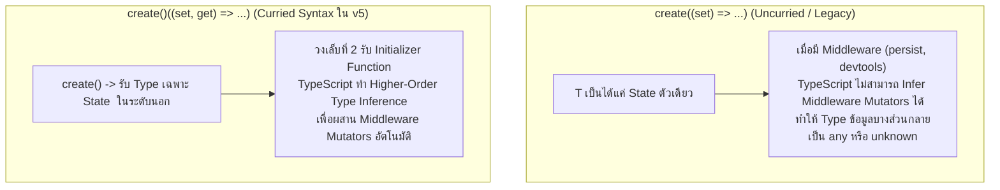

## 1. แนวคิด (Concept)

ใน **Zustand v5** ระบบ Type Inference ของ TypeScript ได้รับการปรับปรุงครั้งใหญ่เพื่อความแม่นยำสูงสุด:
1. **Currying Syntax `create<T>()(...)`**: เป็นไวยากรณ์มาตรฐานของ Zustand v5 โดยการใส่วงเล็บคู่แรก `()` ว่างเปล่าเพื่อป้องกันไม่ให้ TypeScript พยายาม Invalidate หรือ Infer Generic Argument ตัวที่สองล่วงหน้า ทำให้ Type Definition ของ State และ Middleware สามารถทำงานร่วมกันได้โดยไม่หลุด (Type Safe 100%)
2. **การแยก State และ Actions Types**: รูปแบบแนะนำระดับองค์กรคือการแยก Interface ออกเป็น 2 ก้อน:
   - `AuthState`: เก็บเฉพาะ Properties ข้อมูลล้วนๆ
   - `AuthActions`: เก็บเฉพาะฟังก์ชันคำสั่งปรับปรุงข้อมูล
   - จากนั้นรวมกันเป็น `AuthStore = AuthState & AuthActions` เพื่อให้ง่ายต่อการอ่าน, Unit Test, และการทำ Initial State Reset
3. **Middleware Typing (Mutators)**: เมื่อใช้ร่วมกับ Middleware เช่น `devtools` หรือ `persist` ไวยากรณ์ Curried จะช่วยรักษา Types ของ Store ไว้ครบถ้วนโดยไม่ต้องเขียน `[...Mutators]` เองด้วยมือ

---

## 2. หลักการเบื้องหลัง (Under the Hood)

ทำไมต้องมีวงเล็บสองชุด `create<T>()((set, get) => ...)` ใน TypeScript?



ใน TypeScript เมื่อฟังก์ชันรับ Generic Parameter หลายตัว (เช่น State Type และ Middleware Mutators Array) หากเราใส่ Generic เพียงตัวเดียวที่ฟังก์ชันแรก เช่น `create<MyState>(...)` คอมไพเลอร์ของ TypeScript จะหยุดกระบวนการ Infer ตัวแปร Generic ตัวอื่นๆ ส่งผลให้ Middleware Type หลุดหายไป

ผู้พัฒนา Zustand จึงออกแบบให้เรียกเป็น Currying Function:
`create<T>()` จะทำการ Fix Type ของ State ก่อน จากนั้นคืนฟังก์ชันลูกที่พร้อมจะดึง Type Mutators ของ Middleware มาต่อท้ายให้อัตโนมัติ

---

## 3. ตัวอย่างโค้ด (TypeScript / TSX)

ตัวอย่างจริง: ระบบ **Authentication & User Session Store** พร้อมการแยก State/Actions และการพิมพ์ Middleware อย่างสมบูรณ์

```tsx filename="store/auth-session-store.ts"
import { create } from 'zustand';
import { devtools, persist } from 'zustand/middleware';

// 1. แยก Interface ของ State (ข้อมูลล้วนๆ)
export interface UserProfile {
  id: string;
  email: string;
  name: string;
  role: 'admin' | 'editor' | 'viewer';
}

export interface AuthState {
  user: UserProfile | null;
  accessToken: string | null;
  isAuthenticated: boolean;
  isLoading: boolean;
}

// 2. แยก Interface ของ Actions (ฟังก์ชันคำสั่ง)
export interface AuthActions {
  loginSuccess: (payload: { user: UserProfile; token: string }) => void;
  logout: () => void;
  updateUserProfile: (updates: Partial<UserProfile>) => void;
  setLoading: (loading: boolean) => void;
  resetAuthState: () => void;
}

// 3. รวม Type ทั้งสองเข้าด้วยกัน
export type AuthStore = AuthState & AuthActions;

// ค่าเริ่มต้นสำหรับ Reset
const initialAuthState: AuthState = {
  user: null,
  accessToken: null,
  isAuthenticated: false,
  isLoading: false,
};

// 4. สร้าง Store ด้วย Currying Syntax พร้อม Middleware persist + devtools
export const useAuthSessionStore = create<AuthStore>()(
  devtools(
    persist(
      (set, get) => ({
        ...initialAuthState,

        loginSuccess: ({ user, token }) =>
          set(
            {
              user,
              accessToken: token,
              isAuthenticated: true,
              isLoading: false,
            },
            false,
            'auth/loginSuccess' // Action name สำหรับ DevTools
          ),

        logout: () =>
          set(
            { ...initialAuthState },
            false,
            'auth/logout'
          ),

        updateUserProfile: (updates) => {
          const currentUser = get().user;
          if (!currentUser) return;

          set(
            {
              user: { ...currentUser, ...updates },
            },
            false,
            'auth/updateUserProfile'
          );
        },

        setLoading: (isLoading) => set({ isLoading }, false, 'auth/setLoading'),

        resetAuthState: () => set(initialAuthState, true, 'auth/resetAuthState'),
      }),
      {
        name: 'app-auth-storage', // ชื่อ key ใน localStorage
        // เลือกบันทึกเฉพาะฟิลด์ที่ไม่ใช่ชั่วคราว (ไม่เซฟ isLoading)
        partialize: (state) => ({
          user: state.user,
          accessToken: state.accessToken,
          isAuthenticated: state.isAuthenticated,
        }),
      }
    ),
    { name: 'AuthSessionStore' }
  )
);
```

### การเรียกใช้ใน Component พร้อม Type Safety เต็มร้อย

```tsx filename="components/UserProfileBadge.tsx"
'use client';

import { useAuthSessionStore } from '@/store/auth-session-store';

export function UserProfileBadge() {
  // TypeScript สามารถ Auto-complete ฟิลด์ของ State และ Actions ได้อย่างแม่นยำ
  const user = useAuthSessionStore((state) => state.user);
  const isAuthenticated = useAuthSessionStore((state) => state.isAuthenticated);
  const logout = useAuthSessionStore((state) => state.logout);

  if (!isAuthenticated || !user) {
    return <span className="text-sm text-slate-400">ยังไม่ได้เข้าสู่ระบบ</span>;
  }

  return (
    <div className="flex items-center gap-3 bg-slate-100 dark:bg-slate-800 p-2 rounded-xl">
      <div className="w-8 h-8 rounded-full bg-blue-600 text-white flex items-center justify-center font-bold text-sm">
        {user.name.charAt(0)}
      </div>
      <div>
        <p className="text-sm font-semibold">{user.name}</p>
        <span className="text-xs uppercase bg-blue-100 dark:bg-blue-900/50 text-blue-600 dark:text-blue-300 px-1.5 py-0.5 rounded">
          {user.role}
        </span>
      </div>
      <button
        onClick={logout}
        className="ml-auto text-xs text-rose-500 hover:text-rose-700 px-2 py-1"
      >
        ออกจากระบบ
      </button>
    </div>
  );
}
```

---

## 4. เทียบกับวิธีอื่น (Context / Redux vs Zustand)

| เครื่องมือ | วิธีการพิมพ์ Type | ความสะดวกในการใช้งาน |
| :--- | :--- | :--- |
| **Redux Toolkit** | ใช้ `createSlice` พร้อม PayloadAction: `(state, action: PayloadAction<T>)` | ปลอดภัยสูง แต่ต้องพิมพ์ Type ใน Action Creator ซ้ำๆ และต้องนิยาม RootState แยก |
| **React Context** | กำหนด `interface ContextType` และใช้ `createContext<ContextType \| null>(null)` | ต้องเขียน Type Guard หรือตรวจสอบ `if (!context) throw Error` ทุกครั้งที่เรียกใช้ |
| **Zustand v5** | ใช้ Currying `create<T>()((set, get) => ...)` | **เรียบง่ายที่สุด พิมพ์ Type เพียงครั้งเดียวที่ Store ได้ Type ครบทั้ง State, Actions และ Selector** |

---

## 5. ผิด vs ถูก

### กรณีที่ 1: การใช้ Uncurried Syntax ร่วมกับ Middleware ใน Zustand v5

```tsx
// ❌ ผิด: ใส่ Generic เดี่ยวๆ โดยไม่มีวงเล็บคู่แรกเมื่อใช้ Middleware
export const useStore = create<AuthStore>(
  persist((set) => ({ ... }), { name: 'storage' })
);
// ผลลัพธ์: TypeScript แจ้งเตือนข้อผิดพลาด Type mismatch หรือมองไม่เห็น Action names ใน devtools

// ✅ ถูก: ใช้ Curried Syntax เสมอ
export const useStore = create<AuthStore>()(
  persist((set) => ({ ... }), { name: 'storage' })
);
```

### กรณีที่ 2: ผูกมัด Type แบบหลวมด้วย `any` หรือลืม Type ในฟังก์ชัน `get()`

```tsx
// ❌ ผิด: พึ่งพา Type Inference ล้วนๆ โดยไม่กำหนด Store Interface
export const useBadStore = create((set, get) => ({
  count: 0,
  // get() อาจถูกมองเป็น unknown หรือทำให้ circular type dependency ได้ในโค้ดขนาดใหญ่
  doubleCount: () => (get() as any).count * 2,
}));

// ✅ ถูก: กำหนด Interface ให้ครอบคลุมทั้ง State และ Actions
interface CounterStore {
  count: number;
  doubleCount: () => number;
}

export const useGoodStore = create<CounterStore>()((set, get) => ({
  count: 0,
  doubleCount: () => get().count * 2,
}));
```

---

## 6. ควรใช้เมื่อไหร่ / ไม่ควรใช้เมื่อไหร่

### ควรใช้:
- เมื่อโปรเจกต์เขียนด้วย **TypeScript** ทุกครั้ง ควรใช้รูปแบบ `create<Store>()(...)` เป็นมาตรฐาน
- เมื่อโปรเจกต์มีขนาดใหญ่ แนะนำให้ **แยก `State` และ `Actions` interfaces** ออกจากกัน เพื่อให้สามารถทำ Mocking หรือ Reset State ในการทดสอบได้ง่าย
- เมื่อใช้ Middleware อย่าง `persist`, `devtools`, หรือ `immer` ต้องใช้ Currying syntax เสมอ

### ไม่ควรใช้:
- ไม่จำเป็นต้องเขียน Type ซ้ำใน Selector: เช่น `useStore((state: AuthStore) => state.user)` เพราะ Zustand อนุมาน Type ของ `state` ให้จากคำประกาศของ `create<AuthStore>()` เรียบร้อยแล้ว

---

## 7. คำถามสัมภาษณ์งาน (Interview Questions)

### Q1: ทำไม Zustand v5 ถึงแนะนำให้ใช้ Curried Syntax `create<T>()(...)` แทนรูปแบบเดิมในเวอร์ชันเก่า?
**แนวทางคำตอบ**:
เพราะใน TypeScript ไม่มีฟีเจอร์ "Partial Type Argument Inference" (การระบุ Generic บางตัวแล้วให้ตัวที่เหลือ Infer เอง) หากเราเขียน `create<T>(...)` ตัว TypeScript จะบังคับให้อาร์กิวเมนต์ที่เหลือทุกตัวต้องถูกระบุด้วยมือ ซึ่งสร้างปัญหาใหญ่เมื่อใช้ร่วมกับ Middleware เช่น `devtools` หรือ `persist` ที่ต้องการฉีด Type เข้าสู่ Store

การใช้ Curried Syntax `create<T>()(...)` ช่วยแบ่งขั้นตอน: วงเล็บแรกรับเฉพาะ State Type `<T>` ส่วนวงเล็บที่สองจะรับ Initializer และเปิดโอกาสให้ TypeScript สามารถ Infer Middleware Mutators ได้อย่างสมบูรณ์แบบโดยไม่ต้องเขียนโค้ดซ้ำ

### Q2: ประโยชน์ของการแยกประเภท Interface ระหว่าง `State` และ `Actions` ใน Zustand คืออะไร?
**แนวทางคำตอบ**:
1. **การ Reset State**: ช่วยให้เราสามารถสร้างอ็อบเจกต์ `initialState: MyState` ที่บรรจุเฉพาะข้อมูลได้ง่าย โดยไม่ต้องจำลองฟังก์ชัน Actions ปลอมใส่เข้ามา
2. **การทำ Persistence / Serialization**: ช่วยให้ระบุฟังก์ชัน `partialize` หรือบันทึกเฉพาะ State ลงใน LocalStorage ได้อย่างถูกต้อง ไม่เผลอบันทึกฟังก์ชัน Actions ที่เป็น non-serializable ลงไป
3. **ความชัดเจนของโครงสร้าง (Maintainability)**: ช่วยให้นักพัฒนาคนอื่นในทีมอ่านและแยกแยะได้ทันทีว่าส่วนไหนคือข้อมูลที่เก็บ และส่วนไหนคือพฤติกรรมการแก้ไขข้อมูล
